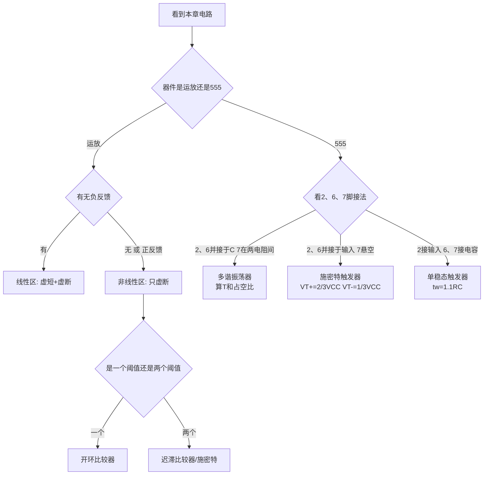

# 第7章 集成运算放大器和脉冲波形的产生与变换 · 例题与考法解析

> 对应课件《07.集成运算放大器和脉冲波形的产生与变换》（课件内部编号 7.1–7.6），本资料按章节顺序编号为第 6 章。

## 一、考情概览

本章是**模数交界**章节，考法集中、套路固定，属于"背公式 + 会识图"就能拿分的部分。重点集中在：

1. **运放工作状态与两条金律**：判断线性区（负反馈）还是非线性区（开环/正反馈），据此决定能否用虚短。
2. **反馈类型四判**：正/负、电压/电流、串联/并联、直流/交流。
3. **比较器与迟滞比较器**：传输特性画法、门限计算、输入波形画输出波形。
4. **555 定时器**：功能表、两个阈值、三种典型接法的区别。
5. **555 三种应用电路**：多谐振荡器（T、f、占空比）、施密特触发器（VT+、VT−、回差）、单稳态触发器（tw = 1.1RC）。

题型以**选择、填空、计算、画波形**为主，极少出大规模设计题。给分点集中在三个公式：

```
多谐振荡器  T ≈ 0.7(R_A + 2R_B)C
施密特      VT+ = 2/3 VCC，VT− = 1/3 VCC
单稳态      tw ≈ 1.1 RC
```

## 二、典型例题

### 例题 1：判断运放能否使用虚短

**题干**：下列三种电路中，哪些可以使用"虚短"？①运放接成电压跟随器；②运放开环作比较器；③运放经 R2 接成正反馈的迟滞比较器。

**思路**：虚短成立的唯一条件是运放工作在线性区，即存在**负反馈**且输出未饱和。

**解答**：

- ① 电压跟随器是深度负反馈，工作在线性区 → **虚短成立**（u+ = u−）。
- ② 开环无反馈，输出必饱和在 ±Uo(sat) → **虚短不成立**。
- ③ 正反馈，输出在两饱和值之间跳变 → **虚短不成立**。

三者的**虚断都成立**（rid → ∞，输入电流为零）。

**易错点**：把"虚断"也一起否掉。虚断源于 rid → ∞，与反馈无关，任何工作区都成立。

---

### 例题 2：判断反馈类型（识图题）

**题干**：某两级放大电路中，Rf 一端接第二级集电极（输出端），另一端接第一级发射极（输入端非基极），判断反馈类型。

**思路**：分三步独立判断。

1. **电压/电流**：用输出短路法——令 uo = 0，Rf 仍能把信号送回，反馈量不随 uo 消失 → **电流反馈**。
2. **串联/并联**：用输入短接法——输入端短路时，反馈信号送到发射极（非输入端点），不会被短路 → **串联反馈**。
3. **正/负**：瞬时极性法——设 T1 基极瞬时为正，经两级反相放大后回到与输入同相，反馈到发射极使 ube 减小 → **负反馈**。

**解答**：**电流串联负反馈**。

**易错点**：把"接到发射极"误判为并联。记快速法——反馈接**基极**是并联，接**发射极**是串联。

---

### 例题 3：由传输特性判断电路类型

**题干**：某电路的电压传输特性在 uI = 3 V 处由高电平垂直跳为低电平，回程也在 3 V 处跳回。判断这是什么电路。

**解答**：只有一个阈值、且跳变沿垂直 → 这是**开环比较器**（阈值 UR = 3 V）。若是施密特触发器，回程的跳变点必须与去程不同（存在回差）。

**变式**：若去程在 4 V 跳变、回程在 2 V 跳变，则是**施密特触发器**，VT+ = 4 V、VT− = 2 V、回差 2 V。

**易错点**：把单阈值比较器当成施密特触发器。**施密特触发器必须有两个不同阈值**。

---

### 例题 4：迟滞比较器门限与回差计算

**题干**：运放构成迟滞比较器，正反馈分压电阻 R1 = 5 kΩ（接同相端与地）、R2 = 15 kΩ（接输出与同相端），Uom = ±12 V。求上门限、下门限与回差。

**解答**：

```
UH = R1/(R1+R2)·Uom = 5/20 × 12 = +3 V
UL = −R1/(R1+R2)·Uom = −3 V
ΔU = UH − UL = 6 V
```

输入信号幅度必须**超过 6 V** 才能让输出完整翻转。

**易错点**：把 R2 当成接地端电阻。R2 接的是输出端，起正反馈作用；接地的才是 R1。

---

### 例题 5：555 功能表判断题

**题干**：555 定时器 VCC = 12 V，Rd = 高电平，TH = 9 V，TL = 5 V，判断输出端与放电管状态。

**解答**：

```
阈值：1/3 VCC = 4 V，2/3 VCC = 8 V
TH = 9 V > 8 V  → 上比较器动作 → 复位
TL = 5 V > 4 V  → 下比较器不动作

结论：OUT = 低电平，放电管 TD 导通，7 脚对地导通。
```

**易错点**：只看一个引脚。555 输出由两个比较器共同决定，两个阈值都要算、都要比。

---

### 例题 6：555 多谐振荡器参数计算

**题干**：555 多谐振荡器 R_A = 20 kΩ，R_B = 30 kΩ，C = 0.1 μF。求 tw1、tw2、周期 T、频率 f 与占空比 q。

**解答**：

```
tw1 = 0.7(R_A + R_B)C = 0.7 × 50×10³ × 0.1×10⁻⁶ = 3.5 ms
tw2 = 0.7 R_B C        = 0.7 × 30×10³ × 0.1×10⁻⁶ = 2.1 ms
T   = 5.6 ms
f   = 1/T ≈ 179 Hz
q   = tw1/T = 3.5/5.6 ≈ 62.5%
```

**易错点**：把 tw2 也算成 0.7(R_A + R_B)C。放电时 7 脚把 R_A 短路，只有 R_B 参与。

---

### 例题 7：占空比可调电路

**题干**：要求 555 多谐振荡器输出占空比可调、且周期基本不变，应如何改接？

**解答**：在 R_A、R_B 两端各反并联一只二极管，使充电电流只经 R_A、放电电流只经 R_B，把两条路径彻底分开。此时

```
tw1 ≈ 0.7 R_A C,  tw2 ≈ 0.7 R_B C
T ≈ 0.7(R_A + R_B)C     （与两者之和有关，调节时保持和不变即可保持周期）
q = R_A/(R_A + R_B)
```

取 R_A = R_B 即得 50% 方波。

**易错点**：只在一条支路串二极管。必须**反并联**两只，才能把充放电完全分开。

---

### 例题 8：555 施密特触发器阈值与整形

**题干**：555 接成施密特触发器，VCC = 10 V，输入为幅度 8 V、带 1.5 V 噪声的缓变信号。求两个阈值，并说明能否消除噪声误翻转。

**解答**：

```
VT+ = 2/3 × 10 = 6.67 V
VT− = 1/3 × 10 = 3.33 V
ΔVT = 3.33 V
```

噪声幅度 1.5 V < 回差 3.33 V，因此阈值附近的噪声不会引起反复翻转，输出为干净矩形波。

**若要求减小回差**：在 5 脚（CV）外加电压 Ucv，可使两个阈值同向平移；或在输入端加分压网络改变分配比。

**易错点**：认为噪声只要小于输入幅度就没影响。关键是噪声要小于**回差**，否则仍会误翻转。

---

### 例题 9：555 单稳态触发器脉宽计算

**题干**：555 单稳态触发器 R = 220 kΩ，C = 4.7 μF，触发端输入宽度 10 μs 的负脉冲。求输出脉宽 tw，并判断触发脉冲是否合适。

**解答**：

```
tw = 1.1 RC = 1.1 × 220×10³ × 4.7×10⁻⁶ ≈ 1.14 s
```

触发脉冲宽 10 μs 远小于 tw（1.14 s），满足"触发脉冲应窄于 tw"的要求，电路工作正常。

**易错点**：用 RC 代替 1.1RC；以及忽略"触发脉冲必须窄于 tw"这一条件。

---

### 例题 10：综合识图——判断是哪种 555 电路

**题干**：给出三个 555 电路：①2、6 脚并接于电容，7 脚接在两电阻之间；②2、6 脚并接于输入信号，7 脚悬空；③2 脚接触发输入，6、7 脚接电容。分别判断类型。

**解答**：

| 电路 | 接法特征 | 类型 | 输出特征 |
|------|----------|------|----------|
| ① | 2、6 并接于 C，7 脚在两电阻之间 | **多谐振荡器** | 自激，连续矩形波 |
| ② | 2、6 并接于输入，7 脚悬空 | **施密特触发器** | 整形，输出随输入跳变 |
| ③ | 2 脚接输入，6、7 接 C | **单稳态触发器** | 每触发一次输出一个 tw 脉冲 |

**易错点**：只看 2 脚接哪里就下结论。要综合 2、6、7 三个引脚的整体接法判断。

---

## 三、真题考法归纳

### 考法 1：运放工作状态与虚短虚断

**出现形式**：选择、填空、判断题。
**应对套路**：先找反馈——有负反馈 → 线性区 → 虚短 + 虚断；开环或正反馈 → 非线性区 → 只剩虚断，输出为 ±Uo(sat)。

### 考法 2：反馈类型四判

**出现形式**：识图简答、选择。
**应对套路**：极性法（定正负）→ 输出短路法（定电压/电流）→ 输入短接法（定串联/并联）。三个维度独立作答，缺一扣分。

### 考法 3：比较器/迟滞比较器画波形

**出现形式**：画图题，给输入波形求输出波形。
**应对套路**：先标出阈值线（UR 或 UH/UL），再逐段判断输入在阈值哪一侧，最后画出只有两态的矩形波。迟滞型要**分清去程与回程**用不同阈值。

### 考法 4：555 功能表判断

**出现形式**：填空、选择。
**应对套路**：算两个阈值（1/3 VCC、2/3 VCC）→ 分别比较 TH、TL → 查功能表定输出与放电管状态。注意 Rd 优先级最高。

### 考法 5：555 三大电路的参数计算

**出现形式**：计算题，最常见。
**应对套路**：

```
多谐振荡器：T ≈ 0.7(R_A + 2R_B)C，q = (R_A+R_B)/(R_A+2R_B)
施密特触发器：VT+ = 2/3VCC，VT− = 1/3VCC，ΔVT = 1/3VCC
单稳态触发器：tw ≈ 1.1RC
```

### 考法 6：由接法反推电路类型

**出现形式**：识图选择、简答。
**应对套路**：看 2、6、7 三脚的去向——2、6 接电容且 7 在两电阻之间 → 振荡器；2、6 并接输入且 7 悬空 → 施密特；2 接触发、6、7 接电容 → 单稳态。

### 考法 7：占空比调节方案设计

**出现形式**：简答、设计。
**应对套路**：反并联二极管分离充放电路径 → q = R_A/(R_A+R_B) → 保持 R_A+R_B 不变即可"调占空比不改周期"。

## 四、本章必背清单

### 公式类

| 项目 | 公式 |
|------|------|
| 理想运放条件 | Auo→∞、rid→∞、ro→0、KCMR→∞、无失调 |
| 虚短虚断 | u+ = u−；i+ = i− = 0（虚短仅线性区成立） |
| 共模抑制比 | KCMR = \|Ad/Ac\|，dB 形式 20lg\|Ad/Ac\| |
| 迟滞比较器门限 | UH = R1/(R1+R2)·Uom，UL = −UH，ΔU = 2UH |
| RC 过渡过程 | uC(t) = uC(∞) + [uC(0) − uC(∞)]e^(−t/RC) |
| 运放多谐振荡器 | T = 2RC·ln[(1+F)/(1−F)]，F = R1/(R1+R2) |
| 555 两个阈值 | 1/3 VCC、2/3 VCC |
| 555 多谐振荡器 | tw1 = 0.7(R_A+R_B)C，tw2 = 0.7R_B C，T ≈ 0.7(R_A+2R_B)C |
| 555 占空比 | 基本型 q = (R_A+R_B)/(R_A+2R_B)；可调型 q = R_A/(R_A+R_B) |
| 555 施密特 | VT+ = 2/3VCC，VT− = 1/3VCC，ΔVT = 1/3VCC |
| 555 单稳态 | tw ≈ 1.1RC（= RC·ln3） |

### 结论类

1. **虚短只在负反馈（线性区）成立，虚断在任何工作区都成立。**
2. **差分放大电路的差模放大倍数等于半边电路的放大倍数；共模抑制比越大越好。**
3. **串联负反馈使 Ri 增大，并联负反馈使 Ri 减小；电压负反馈使 Ro 减小，电流负反馈使 Ro 增大。**
4. **比较器只有一个阈值，施密特触发器有两个阈值（有回差），这是二者的本质区别。**
5. **555 基本型多谐振荡器的占空比恒大于 50%**，因为充电经过 R_A+R_B 而放电只经过 R_B。
6. **555 单稳态的脉宽与触发信号无关**，只由 R、C 决定。
7. **555 施密特触发器的回差固定为 1/3 VCC**，可由 5 脚外接电压改变。
8. **放电管的电流不能过大**，所以单稳态电路中的定时电阻 R 不能取得太小。

## 五、解题决策树



## 六、课件原图速查

本章共收录 32 张课件原图，按考点索引：

| 考点 | 图片 |
|------|------|
| 集成运放内部组成 | `images/6_1_opamp_structure.jpg`（P7） |
| 图形符号与三种输入方式 | `images/6_1_opamp_symbol_ports.jpg`（P8） |
| 基本差分放大电路 | `images/6_1_diff_amp_circuit.jpg`（P12） |
| 共模输入 | `images/6_1_common_mode.jpg`（P13） |
| 差模输入 | `images/6_1_diff_mode.jpg`（P14） |
| 恒流源差分放大器 | `images/6_1_current_source_diff.jpg`（P19） |
| 电压传输特性 | `images/6_1_transfer_characteristic.jpg`（P25） |
| 虚短与虚断 | `images/6_1_virtual_short_open.jpg`（P26） |
| 电压/电流反馈 | `images/6_1_voltage_current_feedback.jpg`（P29） |
| 串联/并联反馈 | `images/6_1_series_parallel_feedback.jpg`（P30） |
| 反馈类型判断例题 | `images/6_1_feedback_example.jpg`（P32） |
| 同相输入比较器 | `images/6_1_comparator_noninv.jpg`（P36） |
| 正弦波变方波 | `images/6_1_sine_to_square.jpg`（P39） |
| 迟滞比较器波形 | `images/6_1_hysteresis_waveform.jpg`（P42） |
| 上行/下行迟滞比较器 | `images/6_1_hysteresis_updown.jpg`（P45） |
| 运放多谐振荡器电路 | `images/6_2_amp_multivibrator_circuit.jpg`（P49） |
| 振荡周期计算 | `images/6_2_oscillation_period.jpg`（P52） |
| 占空比定义 | `images/6_2_duty_ratio.jpg`（P53） |
| 555 内部结构 | `images/6_3_555_structure.jpg`（P55） |
| 555 功能表 | `images/6_3_555_function_table.jpg`（P57） |
| 555 多谐振荡器 | `images/6_4_555_multivibrator.jpg`（P59） |
| 555 多谐振荡器波形 | `images/6_4_555_waveform.jpg`（P60） |
| 占空比可调电路 | `images/6_4_duty_adjustable.jpg`（P61） |
| 门电路施密特触发器 | `images/6_5_gate_schmitt_circuit.jpg`（P63） |
| 施密特传输特性与波形 | `images/6_5_schmitt_transfer.jpg`（P66） |
| 555 施密特触发器 | `images/6_5_555_schmitt.jpg`（P67） |
| 脉冲幅度鉴别 | `images/6_5_amplitude_discriminate.jpg`（P68） |
| 波形整形 | `images/6_5_waveform_shaping.jpg`（P70） |
| 74121 原理框图 | `images/6_6_74121_block.jpg`（P74） |
| 单稳态波形图 | `images/6_6_monostable_waveform.jpg`（P76） |
| 脉冲定时 | `images/6_6_pulse_timing.jpg`（P79） |
| 简易曝光定时器 | `images/6_6_exposure_timer.jpg`（P81） |
