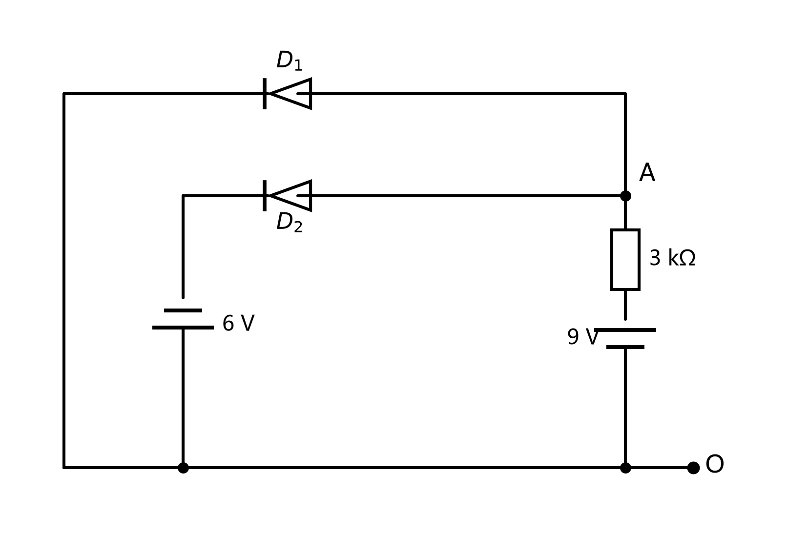
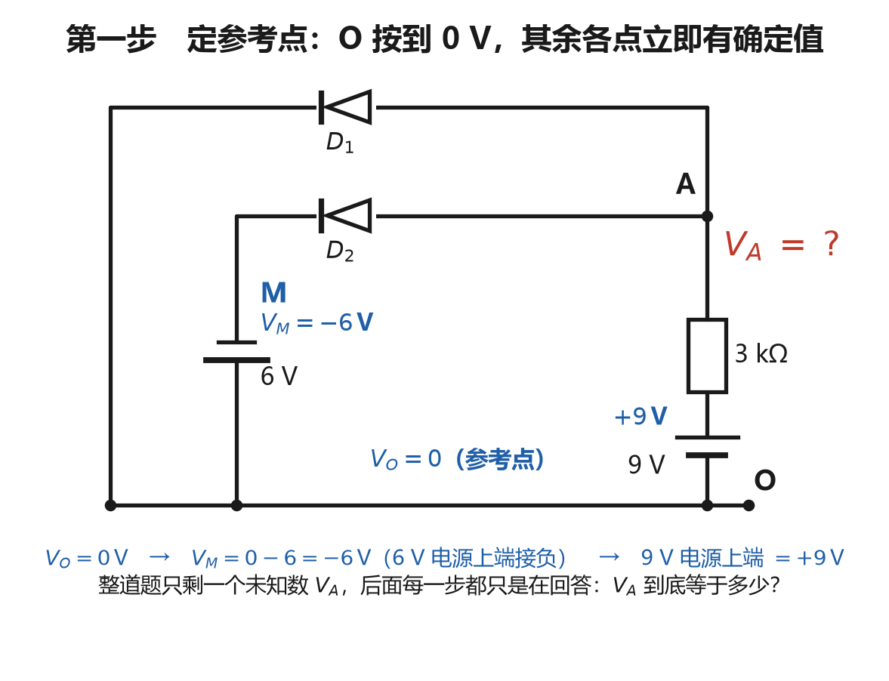
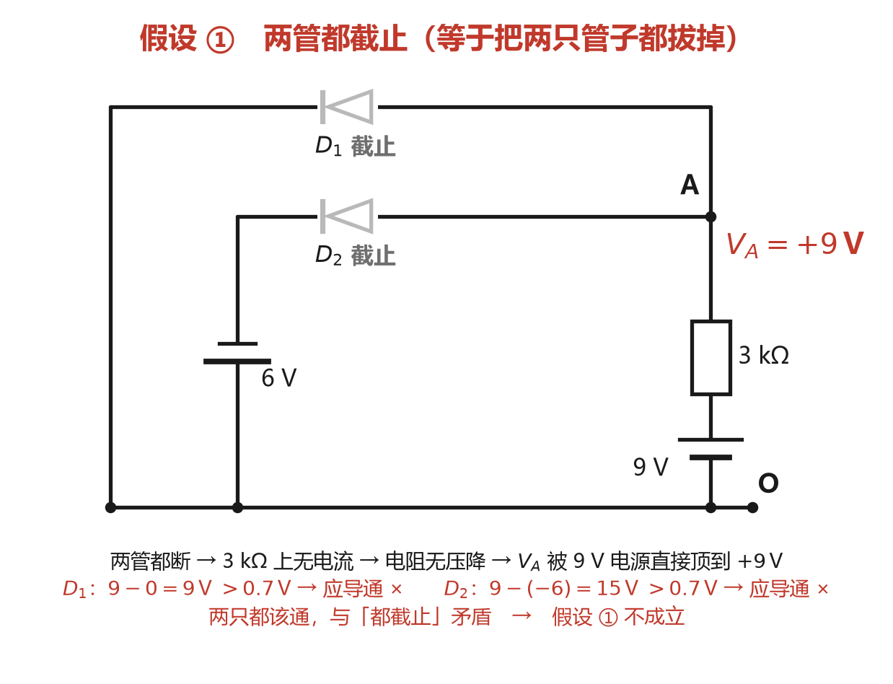
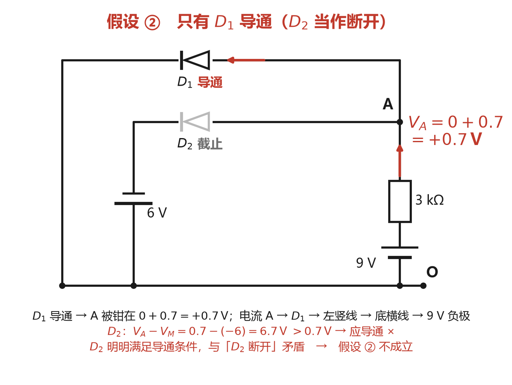
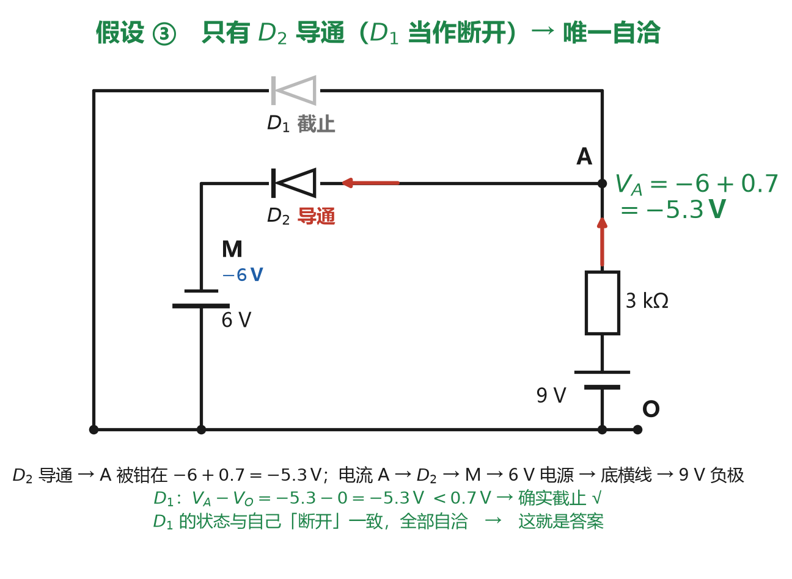
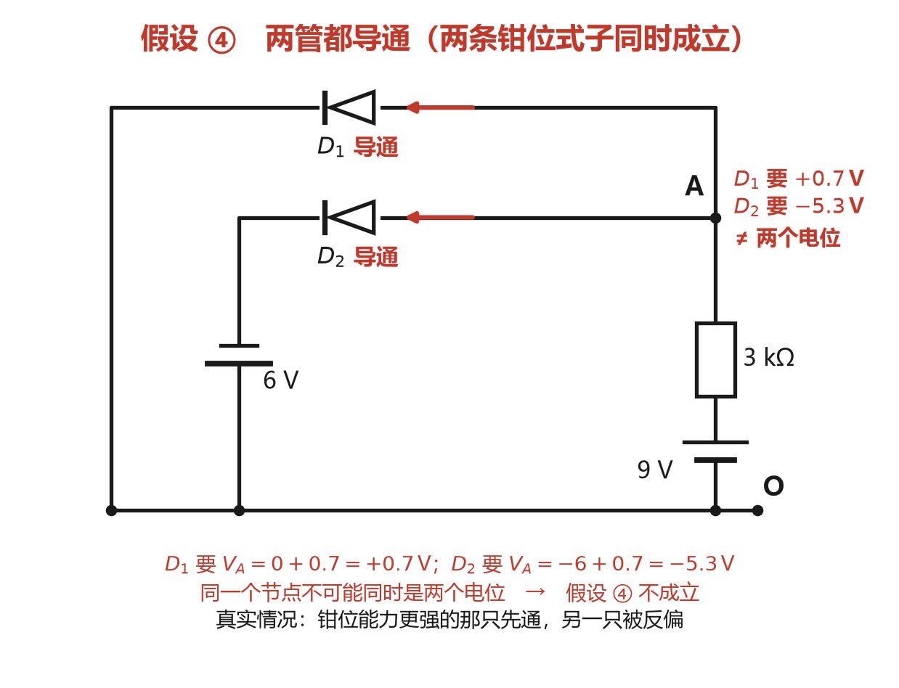
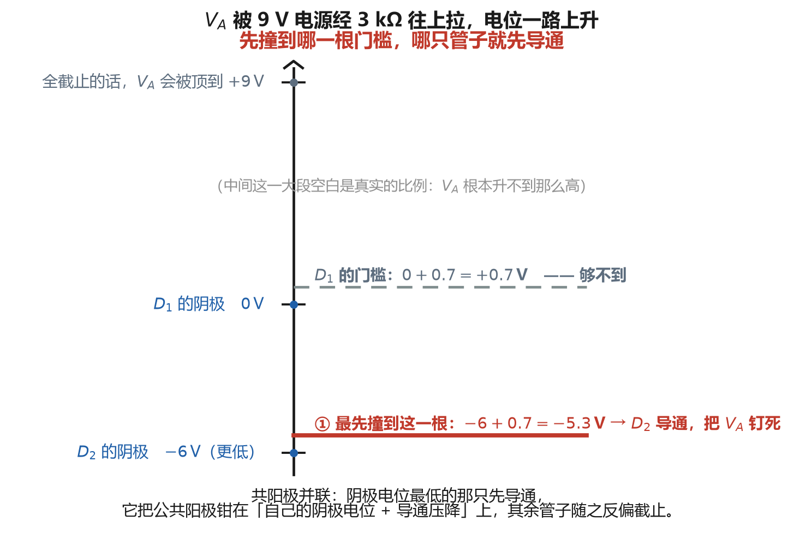
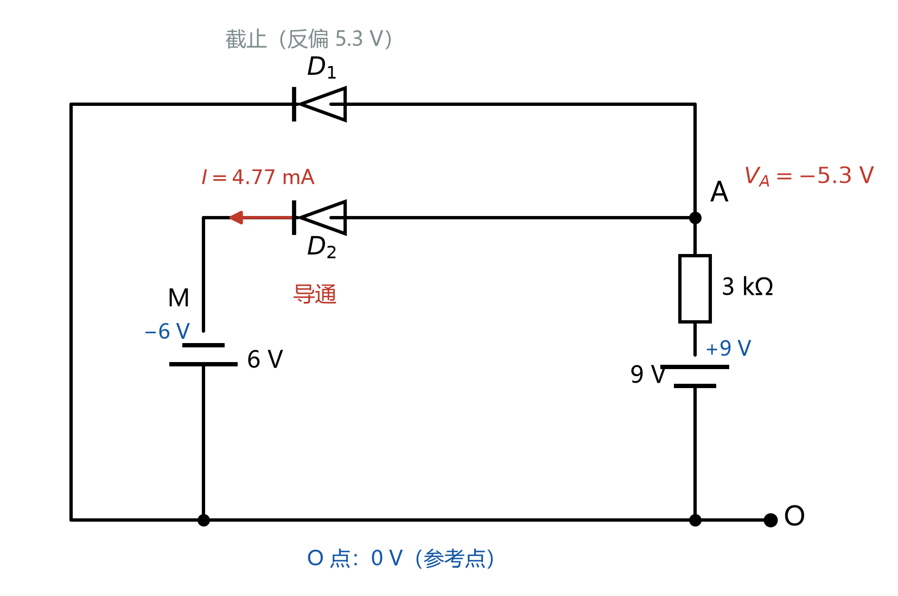

# 二极管导通判断与 A 点电位分析 · 图 1 电路专题

> **对应题目**：《练习题集》第一套 简答题 1（6 分）——"判断图 1 所示电路二极管 D₁ 和 D₂ 导通还是截止？并计算出 A、O 两端电压 $U_{AO}$。"
> **参考答案**：D₁ 截止，D₂ 导通，$U_{AO}=-6\ \text{V}$。
> **考什么**：这不是"算电阻分压"的题，而是"**先判状态、再算数值**"的典型题。判状态的依据只有一条——二极管两端到底是正偏还是反偏。

**全文配图（8 张，均为按卷面题图重绘）**

| 图号 | 位置 | 内容 |
| --- | --- | --- |
| 图 1 | §1.2 | 原题电路（干净题图，不带解答） |
| 图 2 | §2.2 | 第一步　定参考点 |
| 图 3 | §2.2 | 假设 ① 两管全截止 → 矛盾 |
| 图 4 | §2.2 | 假设 ② 仅 D₁ 导通 → 矛盾 |
| 图 5 | §2.2 | 假设 ③ 仅 D₂ 导通 → **自洽** |
| 图 6 | §2.2 | 假设 ④ 两管全导通 → 矛盾 |
| 图 7 | §三 | 两根门槛的比较（为什么偏偏是 D₂） |
| 图 8 | §三 | 解答标注图（电流方向与各点电位） |

图 2～图 6 是**同一条推理链的五帧**，每帧底部三行字就是该步的完整推导；只想快速复习的话，按顺序翻这五张图就能把整道题走完。

---

## 一、先把电路读对（这一步错了，后面全错）

### 1.1 三个必须看清的地方

这类题失分几乎都栽在"看错图"上，而图上有三处极容易看错：

| 要看的地方 | 图上的画法 | 正确结论 | 看错会怎样 |
| --- | --- | --- | --- |
| **二极管方向** | 三角形尖端朝左、竖杠在左 | 竖杠是阴极 → **阴极在左、阳极在右（朝 A）** | 若误判阳极在左，会得出"D₁ 导通"的相反答案 |
| **6 V 电源极性** | 上横线**短**、下横线**长** | 长线是正极 → **上端为负极**，即 $V_M=-6\ \text{V}$ | 若当成 $+6\ \text{V}$，A 点会算成 $+0.7\ \text{V}$ |
| **9 V 电源极性** | 上横线**长**、下横线**短** | 长线是正极 → **上端为正极**，即 $+9\ \text{V}$ | 若当成 $-9\ \text{V}$，会算成两管全截止、$U_{AO}=-9\ \text{V}$ |
| **左侧竖线归属** | 从 D₁ 左端竖直向下，一直搭到最底下的横线 | 这根竖线与底部横线是**同一个节点**（即 O 点） | 若误认为它只连到 6 V 上端，就会把 D₁、D₂ 当成**并联**，题目无解 |

> **电池符号的铁律**：一长一短两条横线，**长线是正极、短线是负极**，与它画在上面还是下面无关。本题两只电池方向**相反**，是出题人故意设的第一个陷阱。

### 1.2 节点命名



*图 1　原题电路（按卷面题图重绘）。请对照确认三处：D₁、D₂ 的竖杠都在**左侧**（阴极在左、阳极朝 A）；6 V 电源**上短下长**（上负）；9 V 电源**上长下短**（上正）；最左侧竖线一直搭到**底部横线**。*

设三条支路的公共汇点为 A，底部整条横线（含左侧竖线）为参考节点 O，6 V 电源上端为 M。

**拓扑关系（纯文本版，便于复制到不支持图片的环境）**

```
        O（参考点，全图底部横线 + 左侧竖线）
        │
        ├──── 6 V 电源（上端为负）──── M 点（V_M = −6 V）
        │                                │
        │                                D₂：阳极在 A、阴极在 M
        │                                │
        ├──── D₁：阳极在 A、阴极在 O ──── A 点
        │                                │
        │                              3 kΩ
        │                                │
        └──── 9 V 电源（上端为正，+9 V）─┘
```

四条支路**全部并在 A 与 O（或 M）之间**：

- **D₁ 支路**：A → D₁ → O，导通条件是 $V_A>V_O+0.7$
- **D₂ 支路**：A → D₂ → M → 6 V 电源 → O，导通条件是 $V_A>V_M+0.7$
- **电阻支路**：A → 3 kΩ → 9 V 电源 → O
- **6 V 支路**：M → O，把 M 点电位钉死在 $-6\ \text{V}$

---

## 二、解法：假设—检验法（"断开法"）

### 2.1 三步走

1. **定参考点**：令 $V_O=0$，于是 $V_M=-6\ \text{V}$、9 V 电源上端 $=+9\ \text{V}$。
2. **假设一种通断组合**，据此算出 $V_A$。
3. **回代检验**：用算出的 $V_A$ 反过来检查每只二极管是否真的满足"导通/截止"的条件。**全部自洽才算解**。

> **顺序不能反**：先算电流、再判状态，一定算错。因为二极管是非线性元件，"导通了才有电流"，不能用线性电路的方法先求电流。

### 2.2 四种组合逐一检验

判据统一写成"阳极电位 − 阴极电位"：

- D₁：$V_A-V_O=V_A-0=V_A$，大于 0.7 V 才导通，小于 0.7 V 才截止
- D₂：$V_A-V_M=V_A-(-6)=V_A+6$，大于 0.7 V 才导通

下面按"假设 → 算出 $V_A$ → 回代检验"走一遍，**一步一张图**。每张图底部三行文字就是这一步的完整推理，看图即可，不必回翻正文。

#### 第一步：把参考点钉住



*图 2　先把 $V_O$ 按到 0 V，$V_M$ 与 9 V 电源上端随之确定。整道题从此只剩一个未知数 $V_A$。*

#### 假设 ①：两管都截止



*图 3　灰色符号表示"假设它断开"。两管都断，3 kΩ 上就没有电流，电阻两端也就没有压降，$V_A$ 被 9 V 电源直接顶到 $+9\ \text{V}$。可这个电位一旦代回去，两只管子都该导通——假设自我否定。*

#### 假设 ②：只有 D₁ 导通



*图 4　D₁ 一导通，$V_A$ 被钳在 $0+0.7=+0.7\ \text{V}$。但回头查 D₂：它的阳极在 $+0.7\ \text{V}$、阴极在 $-6\ \text{V}$，正向电压 $6.7\ \text{V}$，早该导通了。假设又被否定。*

#### 假设 ③：只有 D₂ 导通（成立）



*图 5　D₂ 一导通，$V_A$ 被钳在 $-6+0.7=-5.3\ \text{V}$。回头查 D₁：阳极 $-5.3\ \text{V}$ 比阴极 0 V 还低，反偏，确实该截止——**假设与结果互相印证，这就是唯一解**。*

#### 假设 ④：两管都导通



*图 6　两只管子同时导通，就得让同一节点 A 同时等于 $+0.7\ \text{V}$ 和 $-5.3\ \text{V}$。这是不可能的，直接排除。*

#### 四种组合速查表

| 假设 | 由假设推出的 $V_A$ | 检验 D₁ | 检验 D₂ | 是否自洽 |
| --- | --- | --- | --- | --- |
| ① 两管全截止 | 无电流，$V_A=+9\ \text{V}$ | $9-0=9>0.7$ → 该导通 ✗ | $9+6=15>0.7$ → 该导通 ✗ | **矛盾** |
| ② 仅 D₁ 导通 | $V_A=0+0.7=+0.7\ \text{V}$ | — | $0.7+6=6.7>0.7$ → 该导通 ✗ | **矛盾** |
| ③ 仅 D₂ 导通 | $V_A=-6+0.7=-5.3\ \text{V}$ | $-5.3-0=-5.3<0.7$ → 该截止 ✓ | — | **自洽** |
| ④ 两管全导通 | 需同时 $V_A=0.7$ 与 $V_A=-5.3$ | 不可能 | 不可能 | **矛盾** |

唯一自洽的是 **③：D₂ 导通、D₁ 截止**。

> **注意假设 ③ 的检验方向**：算出 $V_A$ 之后，要检验的是"**被假设为截止的那只**"是否真的截止（D₁）。被假设为导通的那只不用再验——它是"因"，$V_A$ 就是由它推出来的，必然自洽。很多人反过来验 D₂，等于用结论证明结论，白忙一场。

### 2.3 结论

$$V_A=-6+0.7=-5.3\ \text{V}\qquad\Rightarrow\qquad U_{AO}=V_A-V_O=-5.3\ \text{V}$$

若采用**理想二极管模型**（导通压降取 0）：

$$V_A=V_M=-6\ \text{V}\qquad\Rightarrow\qquad \boxed{U_{AO}=-6\ \text{V}}$$

**答案**：**D₁ 截止，D₂ 导通，$U_{AO}=-6\ \text{V}$**（理想模型）。

---

## 三、为什么"偏偏是 D₂ 导通"

这是本题真正要考的理解，比算出 −6 V 更重要。

两只二极管的**阳极是同一个点（A）**，所以谁先导通，完全取决于**谁的阴极电位更低**：

$$V_{\text{阴极,D}_1}=0\ \text{V},\qquad V_{\text{阴极,D}_2}=-6\ \text{V}$$

阴极电位更低的那只（D₂）**只要 A 比 −6 V 高 0.7 V 就导通**，而 D₁ 要等 A 高到 +0.7 V 才导通。A 被 9 V 电源经 3 kΩ 往上"拉"，一路上升，先碰到的是 D₂ 的门槛（−6 V），于是 D₂ 先导通。

把这两根"门槛"画在同一根电位轴上，一眼就能看出谁先被撞到：



*图 7　"D₂ 的门槛 = −5.3 V"和"D₁ 的门槛 = +0.7 V"相差整整 6 V。$V_A$ 一路上升，先撞的必然是低的那根；撞上就被 D₂ 钳住，永远到不了高的一根。这正是"阴极电位低者先通"的几何解释。*

D₂ 一导通，就把 A **钳位**在 $V_M+0.7$。此时 D₁ 的阳极只有 −5.3 V，比它的阴极 0 V 还低 5.3 V，**反偏**，自然截止。

于是最终的电路状态就长这样——只有一条支路有电流：



*图 8　解答标注图（恒压降模型）。红色为电流方向与数值：$I=4.77\ \text{mA}$ 自 9 V 电源经 3 kΩ 流入 A 点，再从 A 经 **D₂** 流向 M、穿过 6 V 电源回到 O。D₁ 支路无电流通过，A、O 之间承受 5.3 V 反压。*

> **口诀（共阳极并联时）**
> **阴极电位最低者先导通，并把公共阳极钳在"最低阴极电位 + 导通压降"上；其余管子随之反偏截止。**

对称地，**共阴极并联**时反过来：**阳极电位最高者先导通，把公共阴极钳在"最高阳极电位 − 导通压降"上，其余管子截止。**

---

## 四、定量核算（验证前面的判断没算错）

取恒压降模型（0.7 V），$V_A=-5.3\ \text{V}$：

**流过 3 kΩ 的电流**

$$I=\frac{9-(-5.3)}{3\times10^{3}}=\frac{14.3}{3\times10^{3}}=4.77\ \text{mA}$$

（理想模型：$I=\dfrac{9-(-6)}{3\times10^{3}}=5\ \text{mA}$）

**电流路径**：9 V 电源正极 → 3 kΩ → A 点 → D₂ → M → 6 V 电源 → 底部横线 → O → 回到 9 V 电源负极。回路闭合，说明假设成立。

**D₁ 承受的反向电压**

$$U_{AK1}=V_A-V_O=-5.3-0=-5.3\ \text{V}$$

即反向偏置 5.3 V，远未达到反向击穿，二极管安全截止。

**KVL 校验**（沿 O → 9 V → 3 kΩ → A → D₂ → M → 6 V → O 走一圈）：

$$+9-14.3-0.7+6=0\ \checkmark$$

三个电压降加起来正好抵消两个电源，说明数值自洽。

---

## 五、六种典型错法（对号入座）

| 错误 | 现象 | 根源 |
| --- | --- | --- |
| ① 把 6 V 当成 $+6\ \text{V}$ | 得 $V_A=+0.7\ \text{V}$、$U_{AO}=+0.7\ \text{V}$，D₁ 导通 | 只看数字不看电池长短线 |
| ② 把左侧竖线当成只连 6 V 上端 | 认为 D₁、D₂ 并联，两管状态永远相同，题目"无解" | 没追线，看漏了竖线一直搭到底部 |
| ③ 先算电流再判状态 | 直接写 $I=9/3\text{k}=3\ \text{mA}$ | 把二极管当线性电阻 |
| ④ 用了 0.7 V 却不迭代 | D₁ 算出 $V_A=-5.3\ \text{V}$，却仍按"阳极 0 V"判它导通 | 判状态与算数值用了两套电位 |
| ⑤ 只验一管就收工 | 验完 D₂ 导通就写答案，没回检 D₁ | 假设—检验法必须"全部自洽" |
| ⑥ 把 $U_{AO}$ 写成 $U_{OA}$ | 符号反了，答案变成 $+6\ \text{V}$ | $U_{AO}=V_A-V_O$，下标顺序即"前减后" |

---

## 六、反事实对照：如果极性看反了会怎样

把 6 V 电源误当成"上正"（$V_M=+6\ \text{V}$），其余不变，重新推一遍：

- 两管全截止 → $V_A=+9\ \text{V}$，两管都该导通 ✗
- D₂ 单独导通 → $V_A=6.7\ \text{V}$，此时 D₁ 正偏 $6.7\ \text{V}$ 也该导通 ✗
- D₁ 单独导通 → $V_A=0.7\ \text{V}$，此时 D₂ 正偏 $6.7\ \text{V}$ 也该导通 ✗
- 两管都导通 → 只能取**较低**的钳位值 $V_A=0.7\ \text{V}$，D₂ 随之反偏

结论变成 **D₁ 导通、D₂ 截止、$U_{AO}=+0.7\ \text{V}$**——与参考答案**完全相反**。

> 这说明：**这道题对电池极性极度敏感**，一个长短线看错，答案就从 −6 V 变成 +0.7 V。考场上务必先把两只电池的极性在图上圈出来再动笔。

---

## 七、通用模板（换个数、换个管数都能套）

**题型特征**：多个二极管共阳极（或共阴极）接在同一节点，各管另一端接不同电位，节点再经电阻接电源。

**解题四步**

1. **标节点、定参考**：选公共底线（或指定点 O）为 0 V，把每个电源的极性换算成"该点相对参考点的电位"。
2. **写判据**：对每只管子写出"阳极电位 − 阴极电位"的表达式（代入已知电位，一般只剩 $V_A$ 一个未知量）。
3. **枚举假设 + 回检**：管子数 $n$ 时最多试 $2^n$ 种组合，实际按"阴极电位由低到高"顺序试，通常第 1～2 次就中。**必须所有管子同时自洽**。
4. **算数值 + 校验**：用导通管把节点电位钉住 → 求电流 → 用 KVL 走一圈验算。

**两种模型怎么选**

| 模型 | 导通压降 | 适用场合 | 本题结果 |
| --- | --- | --- | --- |
| 理想二极管 | 0 V | 只判逻辑高低、做门电路分析 | $U_{AO}=-6\ \text{V}$ ✓ 与答案一致 |
| 恒压降模型 | 硅管 0.7 V / 锗管 0.3 V | 求实际电位、估算电流 | $U_{AO}=-5.3\ \text{V}$ |

> 题目只说"判断导通还是截止，并计算 $U_{AO}$"、没给 0.7 V 时，**优先用理想模型**，因为标准答案通常按理想模型给；若给了具体管型和压降，才用恒压降模型。

---

## 八、这道题在课程里的位置

| 关联章节 | 关联点 |
| --- | --- |
| 第 1 章 1.1 半导体二极管 | 单向导电性、正偏导通/反偏截止、死区与导通压降 |
| 第 1 章 1.6 分立元件组成的基本门电路 | 本题的"钳位"思想正是二极管与门/或门的工作基础：**阴极共接 + 电阻接 $+U$ = 与门**（有 0 出 0），本题则是共阳极、阴极接不同电位 |
| 第 3 章 逻辑代数 | 判断结果（导通 = 1、截止 = 0）可抽象成逻辑变量，二极管电路由此过渡到逻辑门 |

**一句话总结**：这道题表面算的是电压，实际考的是"**非线性元件的状态判断必须用假设—检验，而钳位点由电位最不利的那条支路决定**"。把这个思路迁移到三极管工作区判断、运放非线性区判断，方法完全一样。

---

*本文与 `试卷/练习题集_逐题详解与核心知识点.md`（第一套 简答 1）、`第1章_模拟电子元件与分立电子元件/1.6_分立元件组成的基本门电路.md` 配套阅读。*
