# 2024—2025 学年第一学期《电子技术（数字）》期末考试 A 卷 · 全解

> **试卷来源**：`试卷/数电_20261017_202733.pdf` 第 1—4 页（原卷共 6 页，此扫描件缺第 5、6 页）。
> **原卷信息**：哈尔滨理工大学 · 考试时间 100 分钟 · 试卷总分 100 分 · 考试班级 23 级电气、电科、新能源、自动化、机器人、智能、光电、应物。
> **命题**：电子技术命题组｜考试日期 2024 年 12 月 15 日。

## 试卷结构速览

| 题号 | 题型 | 分值 | 覆盖内容 |
|---|---|---|---|
| 一 | 选择题（10 小题×2 分） | 20 | 门电路、编码器、数制、反演定理、数据选择器、触发器功能 |
| 二 | 填空题（7 小题、10 空×2 分） | 20 | 格雷码、三态门、最小项、触发器数目、反函数、JK→D、74160 |
| 三 | 非客观题 | 8 | 卡诺图化简 + 与非门实现 |
| 四 | 非客观题 | 10 | 74LS138 实现 1 位全加器 |
| 五 | 非客观题 | 10 | D/JK 触发器波形 |
| 六 | 非客观题 | 12 | 同步时序电路分析（3 个 JK） |
| 七 | 非客观题 | 10 | 74LS161 构成六进制（两种方法） |
| 八 | 非客观题 | 10 | 555 多谐振荡器 + D 触发器分频 |

---

# 一、选择题（本大题共 10 小题，每小题 2 分，总计 20 分）

## 1. 如图所示 TTL 门电路，能实现 $F=\bar A$ 的是（　）

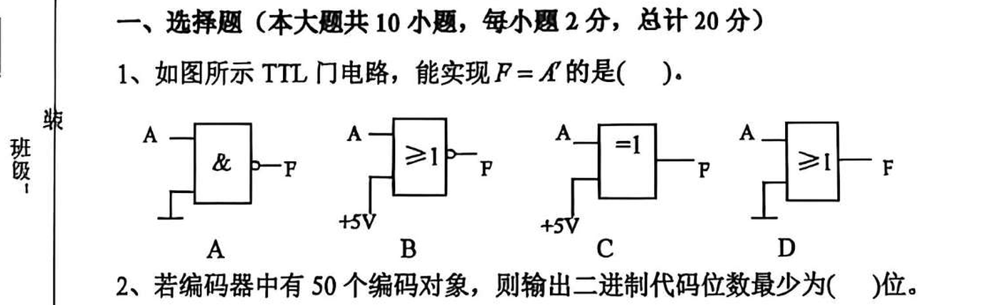

**答案：C**

**解析**：四幅图都是"把多余输入端接固定电平"的考法，逐个代入：

| 选项 | 门类型 | 多余端接法 | 输出 |
|---|---|---|---|
| A | 与非门 | 接地（0） | $F=\overline{A\cdot 0}=1$，恒为 1 |
| B | 或非门 | 接 +5 V（1） | $F=\overline{A+1}=0$，恒为 0 |
| C | **异或门** | 接 +5 V（1） | $F=A\oplus 1=\bar A$ ✔ |
| D | 或门 | 接地（0） | $F=A+0=A$，同相 |

**易错**：B 与 D 的图形都是"≥1"，唯一差别是 B 的输出端多一个小圆圈（或非）；A 的方框内是"&"且带小圆圈（与非）。**看门先看方框内符号，再看输出有无小圈**，两个都要看。

**拓展**：TTL 门多余输入端的四种处理——与非门/与门多余端**接高电平或悬空**（悬空等效 1）；或门/或非门多余端**接低电平**；CMOS 门多余端**一律不允许悬空**（栅极悬空会感应电荷击穿）。

---

## 2. 若编码器中有 50 个编码对象，则输出二进制代码位数最少为（　）位

A. 5　　B. 6　　C. 10　　D. 50

**答案：B**

**解析**：$n$ 位二进制代码可表示 $2^n$ 个对象，要求 $2^n\ge 50$。
$2^5=32<50$，$2^6=64\ge 50$，故 $n=6$。

**易错**：不要用 $\log_2 50\approx 5.64$ 后"四舍五入"得 6——**必须向上取整**。同理 8 个对象要 3 位（$2^3=8$，刚好够），16 个对象要 4 位。

**拓展**：这是"编码"的方向（对象→代码）；反方向"译码"是 $n$ 条输入线译成 $2^n$ 条输出线，如 74LS138 是 3 线-8 线译码器。判断题常把两者混起来问"输出端个数"。

---

## 3. 十进制数 136.5 相等的十六进制数是（　）

A. 88.8　　B. 86.1　　C. B2.5　　D. 88.5

**答案：A**

**解析**：整数与小数分开转换。

- 整数部分：$136=8\times16+8$，故为 `88`H；
- 小数部分：$0.5\times16=8.0$，取整数位 8，故为 `.8`H。

合起来 $\boxed{(136.5)_{10}=(88.8)_{16}}$。

**验算**：$8\times16+8+8/16=128+8+0.5=136.5$ ✔

**易错**：小数部分转十六进制是"**乘 16 取整**"，不是"乘 2 取整再拼四位"。$0.5$ 的二进制是 $0.1$，正好等于十六进制的 $0.8$，两条路结果一致；但 $0.3$ 这类数两条路容易算岔。

**拓展**：二/八/十六进制互转的捷径是"**一位十六进制 = 四位二进制，一位八进制 = 三位二进制**"。$136.5=10001000.1000$B，按四位一组正是 `88.8`H。

---

## 4. 利用反演定理求 $L=A\bar B+C$ 的反函数为（　）

A. $A+\bar B C$　　B. $(A+\bar B)C$　　C. $(\bar A+B)\bar C$　　D. $A\bar B C$

**答案：C**

**解析**：反演定理——把原式中的"·"换"+"、"+"换"·"、原变量换反变量、反变量换原变量、0 换 1、1 换 0，**保持运算顺序不变**。

$$L=A\bar B+C\ \Longrightarrow\ \bar L=(\bar A+B)\cdot\bar C$$

**验算**（直接求反）：$\bar L=\overline{A\bar B+C}=\overline{A\bar B}\cdot\bar C=(\bar A+B)\bar C$ ✔ 两法一致。

**易错**：
1. 括号不能丢。$\bar A+B$ 若不括起来写成 $\bar A+B\bar C$，含义完全不同（那是选项 A）。
2. **反演定理与对偶规则要分清**：对偶规则**变量不变**（只换运算符和 0/1），反演定理**变量取反**。

**拓展**：求反函数的另一条路是"先展开成最小项之和，再把没出现的下标补上"。例如 $F(A,B,C)=\Sigma m(1,3,5)$，则 $\bar F=\Sigma m(0,2,4,6,7)$——这正是本卷第 5 个填空题。

---

## 5. 由八选一数据选择器 74HC151 实现的逻辑函数，其逻辑表达式为（　）

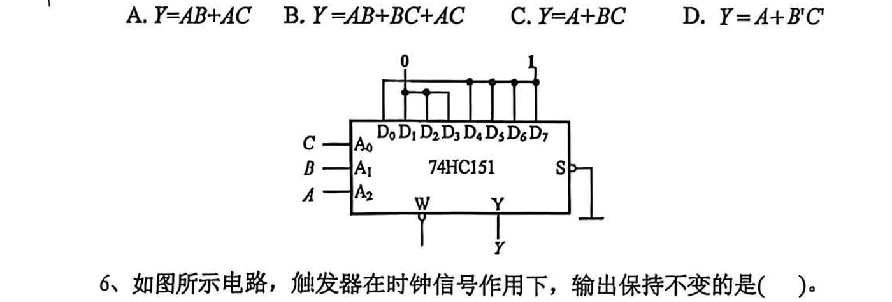

A. $Y=AB+AC$　　B. $Y=AB+BC+AC$　　C. $Y=A+BC$　　D. $Y=A+\bar B\bar C$

**答案：D**

**解析**：先读地址端，再读数据端，最后套公式。

- **地址端**：$C\to A_0$，$B\to A_1$，$A\to A_2$，故地址码为 $A_2A_1A_0=ABC$，第 $i$ 个数据端 $D_i$ 对应最小项 $m_i$（$i=4A+2B+C$）。
- **数据端**：$D_0=1$，$D_1=D_2=D_3=0$，$D_4=D_5=D_6=D_7=1$。
- **使能端**：$\bar S$ 接地，芯片正常工作。

$$Y=\sum_{i=0}^{7}D_i\,m_i=m_0+m_4+m_5+m_6+m_7$$

$$m_0=\bar A\bar B\bar C,\qquad m_4\sim m_7=A\ (\text{因 }A=1)$$

$$Y=A+\bar A\bar B\bar C=A+\bar B\bar C$$

**易错**：先看**地址端谁接高位**。本题 $A\to A_2$ 是高位，若误把 $C$ 当高位，$m_0$ 会算成 $ABC$ 的那个下标，结果全错。顺序是 $A_2A_1A_0$，不是 $A_0A_1A_2$。

**拓展**：数据选择器的通用结论——**用 $2^n$ 选 1 的 MUX 实现 $n+1$ 个变量的函数时，把 $n$ 个变量接地址端，剩下的第 $n+1$ 个变量（或其反）接数据端**。本题正是用 3 个地址变量 $A,B,C$ 实现"含 $A$ 的三变量函数"，所以 $D$ 端只需接 0/1。

---

## 6. 如图所示电路，触发器在时钟信号作用下，输出保持不变的是（　）

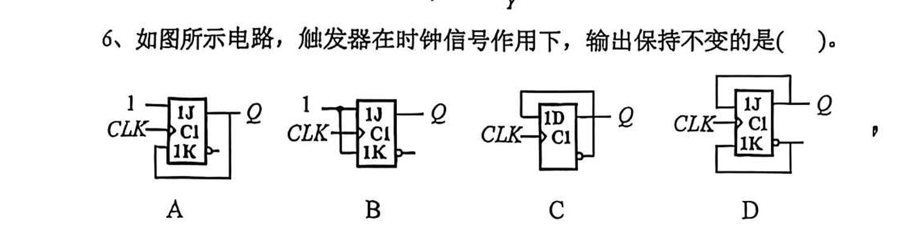

**答案：D**

**解析**：把每个图的 $J,K$（或 $D$）读出来，代入特征方程。

| 选项 | 接法 | 特征方程代入 | 结论 |
|---|---|---|---|
| A | $J=1$，$K=\bar Q$ | $Q^*=1\cdot\bar Q+\overline{\bar Q}\cdot Q=\bar Q+Q=1$ | 恒置 1 |
| B | $J=K=1$ | $Q^*=\bar Q$ | 翻转（计数） |
| C | $D=\bar Q$ | $Q^*=\bar Q$ | 翻转（二分频） |
| D | $J=Q$，$K=\bar Q$ | $Q^*=Q\bar Q+\overline{\bar Q}\,Q=0+Q=Q$ | **保持** ✔ |

**易错**：判断"保持"有两个入口——$J=K=0$（什么都不做），或 $J=Q,\,K=\bar Q$（把当前状态"喂"回去）。本题走的是第二条路，图形上表现为**两条回绕线分别从 $Q$、$\bar Q$ 引回 $J$、$K$**，很容易看反。

**拓展**：JK 触发器四种功能的口诀——**$J=K=0$ 保持，$J=K=1$ 翻转，$J\ne K$ 时 $Q^*=J$**（即 $J=1,K=0$ 置 1；$J=0,K=1$ 置 0）。

---

## 7. 如图所示电路，当 $A=1$，$B=0$ 时，触发器具有（　）功能

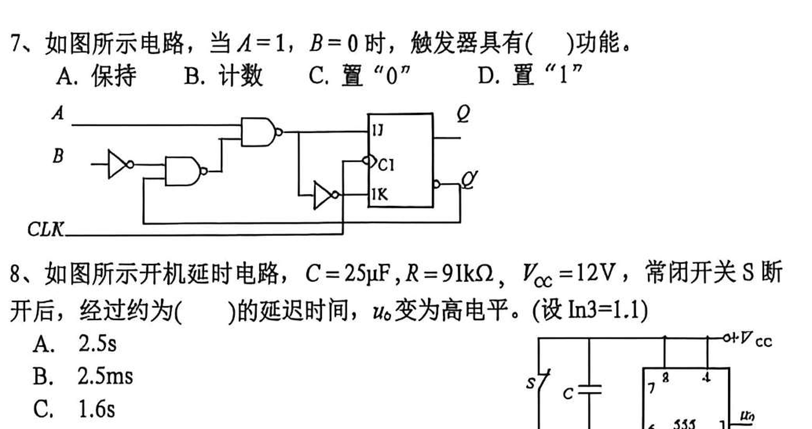

A. 保持　　B. 计数　　C. 置"0"　　D. 置"1"

**答案：B**

**解析**：由外向内一层层推 $J,K$。

1. $B$ 经非门得 $\bar B$；
2. 下方与非门：输入 $\bar B$ 与 $\bar Q$，输出 $N_1=\overline{\bar B\bar Q}$；
3. 上方与非门：输入 $A$ 与 $N_1$，输出即 $J=\overline{A N_1}$；
4. $K$ 端：$\bar Q$ 经非门接 $K$，故 $K=Q$。

代入 $A=1,\,B=0$：$\bar B=1$，$N_1=\overline{1\cdot\bar Q}=Q$，$J=\overline{1\cdot Q}=\bar Q$。

$$Q^*=J\bar Q+\bar KQ=\bar Q\bar Q+\bar QQ=\bar Q$$

每个时钟翻转一次，即**计数**功能。

**易错**：$K$ 端前面有个小圆圈（非门），所以 $K=Q$ 而不是 $K=\bar Q$。若漏看这个非门，会算成 $J=K=\bar Q$，结论就变成"保持"。

**拓展**：这类题的通用套路是"**先算 $J,K$ 的表达式，再代入特征方程**"，不要试图凭图形猜功能。$J=K=1$ 的接法（B 选项那类）才是"标准"的 $T'$ 触发器，本题是"用组合逻辑造出来的计数"。

---

## 8. 如图所示开机延时电路，$C=25\,\mu\text{F}$，$R=91\,\text{k}\Omega$，$V_{CC}=12\,\text{V}$，常闭开关 $S$ 断开后，经过约为（　）的延迟时间，$u_o$ 变为高电平（设 $\ln 3=1.1$）

A. 2.5 s　　B. 2.5 ms　　C. 1.6 s　　D. 1.6 ms

**答案：A**

**解析**：这是 555 接成的**单稳态触发器**（开机延时 / 上电复位电路）。开关 $S$ 闭合时 $C$ 被短路，$u_c=0$；$S$ 断开后电源经 $R$ 给 $C$ 充电，$u_c$ 从 0 升到 $\frac{2}{3}V_{CC}$ 时输出翻转。

$$t_w=RC\ln 3\approx 1.1RC$$

代入：$t_w=1.1\times 91\times10^{3}\times 25\times10^{-6}=1.1\times 2.275=2.5025\ \text{s}\approx 2.5\ \text{s}$。

**易错**：单位。$91\,\text{k}\Omega\times 25\,\mu\text{F}=91\times25\times10^{-3}=2.275$ **秒**（不是毫秒）。若把 $\mu$ 当成 m 处理，就会选到 2.5 ms。

**拓展**：555 单稳态的定时公式只有 $1.1RC$ 一个，但要记住三个变形——求 $R$、求 $C$、求 $t_w$。另外注意：**触发脉冲宽度必须小于 $t_w$**，否则电路会重复触发。

---

## 9. 为了将三角波变换为同频率的矩形脉冲信号，应选用（　）

A. 施密特触发器　　B. 单稳态触发器　　C. 多谐振荡器　　D. 计数器

**答案：A**

**解析**：施密特触发器有两个阈值 $V_{T+}$、$V_{T-}$。输入三角波缓慢上升/下降时，输出只在越过阈值时跳变，从而把**任意缓慢变化的波形整形为陡峭的矩形脉冲**，且频率与输入相同。

- B 单稳态：输出脉宽由 $RC$ 决定，与输入频率无关，用于**定时/延时**；
- C 多谐振荡器：**无输入**，自己产生矩形波，用于**振荡源**；
- D 计数器：**分频**，输出频率是输入的 $1/N$。

**易错**：题目关键词是"**同频率**"和"**变换/整形**"，这两点锁定施密特；若说"延时""定时"选单稳态，若说"产生"选多谐。

**拓展**：施密特触发器的三大用途——**波形整形**（本题）、**脉冲鉴幅**（把幅度超过阈值的脉冲挑出来）、**构成多谐振荡器**（外接 $RC$ 后自激）。

---

## 10. 对于组合逻辑电路和时序逻辑电路，以下说法正确的是（　）

A. 时序逻辑电路只能计数，而组合逻辑电路只能寄存
B. 时序逻辑电路没有记忆功能
C. 组合逻辑电路有记忆功能
D. 时序逻辑电路有存储电路

**答案：D**

**解析**：按定义区分：

- **组合逻辑电路**：任一时刻的输出只取决于**该时刻的输入**，结构上只有门电路、**无反馈、无记忆**；
- **时序逻辑电路**：输出不仅取决于当前输入，还取决于**电路原来所处的状态**，结构上**必须含存储电路（触发器）**，靠它记忆状态。

所以 A、B、C 全错，D 正确。

**易错**：A 项把"时序=计数"绝对化了——时序电路还包括寄存器、移位寄存器、序列检测器等，计数只是其中一类。

**拓展**：判断一个电路是组合还是时序，最直接的方法是**看有没有输出反馈到输入端**（有反馈 + 触发器 = 时序），或写出输出方程后看是否含 $Q$ 变量。

---

# 二、填空题（本大题共 7 小题，10 个空，每空 2 分，总计 20 分）

## 1. 格雷码的特点是任意两个相邻的代码中有 **\_\_\_\_** 位二进制数码不同。

**答案：1（一位）**

**解析**：格雷码（循环码）是**单位距离码**，相邻两个代码只有一位不同。例如 4 位格雷码 $0000\to0001\to0011\to0010\to0110\cdots$，每次只翻一位。

**拓展**：正因为"每次只变一位"，格雷码在**轴角编码器、异步 FIFO 指针、卡诺图行/列标号**中大量使用，可避免多位同时跳变产生的"过渡噪声"（毛刺）。

---

## 2. 三态门的输出有高电平、低电平和 **\_\_\_\_** 三种状态。

**答案：高阻态（高阻态/禁止态）**

**解析**：三态门除 0、1 之外还有第三种输出状态——**高阻态**，此时输出端相当于与电路断开，既不输出高也不输出低。

**拓展**：高阻态的价值在于**总线分时复用**：多个三态门输出并接在一条总线上，任何时刻只让一个门使能，其余置高阻，就不会出现"一个输出高、一个输出低"的短路。

---

## 3. 逻辑函数的全体最小项之和为 **\_\_\_\_**，任意两个最小项的乘积为 **\_\_\_\_**。

**答案：1；0**

**解析**：$n$ 个变量的全体最小项共有 $2^n$ 个，**任一输入组合必使且仅使一个最小项为 1**，故全体之和恒为 1。
任意两个不同的最小项，至少有一个变量取值相反，故其乘积恒为 0。

**拓展**：这两条是"最小项之和 = 标准与或式"能成立的基础，也是**卡诺图化简时把 1 圈起来**的依据。填空、判断里常与"最大项之积为 0""任意两个最大项之和为 1"配对考。

---

## 4. 构成 12 进制计数器最少需要 **\_\_\_\_** 个触发器。

**答案：4**

**解析**：$n$ 个触发器最多有 $2^n$ 个状态，要求 $2^n\ge 12$。$2^3=8<12$，$2^4=16\ge12$，故需 4 个。

**易错**：这是"**最少**"而不是"恰好"。4 个触发器有 16 个状态，做 12 进制时多出的 4 个状态要作为**无效状态**处理，还要检查能否自启动。

**拓展**：$N$ 进制计数器所需触发器数 $n=\lceil \log_2 N\rceil$。八进制刚好 3 个、十六进制刚好 4 个（无无效状态）；十进制、十二进制都属于"有无效状态"的情形。

---

## 5. 逻辑函数 $F(A,B,C)=\Sigma m(1,3,5)$，则其反函数 $\bar F=\Sigma m($ **\_\_\_\_** $)$。

**答案：$\Sigma m(0,2,4,6,7)$**

**解析**：三变量共有 $2^3=8$ 个最小项（下标 0–7）。原函数取了下标 1、3、5，反函数就取**剩下的全部**：0、2、4、6、7。

**验算**：$F+\bar F=\Sigma m(0\sim7)$，全集之和不重不漏 ✔

**易错**：漏写 7，或误以为"反函数就是每个下标加 1"。反函数对应卡诺图上**把 0 和 1 对调**，不是挪位。

**拓展**：由 $\bar F$ 再求 $F$ 时，可用德摩根还原；若题目问的是"反变量"（每个变量取反）而不是"反函数"，结果完全不同——这是最常设的陷阱。

---

## 6. 用 JK 触发器实现 D 触发器功能，则 $J=$ **\_\_\_\_**，$K=$ **\_\_\_\_**。

**答案：$J=D$；$K=\bar D$**

**解析**：令 JK 的特征方程等于 D 的特征方程：

$$Q^*=J\bar Q+\bar KQ\ \overset{!}{=}\ D$$

把 $D$ 写成 $D(Q+\bar Q)=D\bar Q+DQ$，与上式逐项对照：$\bar Q$ 的系数 $J=D$，$Q$ 的系数 $\bar K=D$ 即 $K=\bar D$。

**易错**：写成 $J=D,\,K=D$ 是错的（那会变成 $Q^*=D\bar Q+\bar DQ=D\oplus Q$，是异或）。关键是 $\bar K=D$ 要再取一次反。

**拓展**：这是"**触发器互相转换**"的标准题型。其他常用结论：D→T（$D=T\oplus Q$）、D→JK、JK→T（$J=K=T$）、T→D（$T=D\oplus Q$）。做法统一为"令两个特征方程相等，凑系数"。

---

## 7. 如图所示电路，$M=0$ 时实现了 **\_\_\_\_** 进制计数器，$M=1$ 时实现了 **\_\_\_\_** 进制计数器。

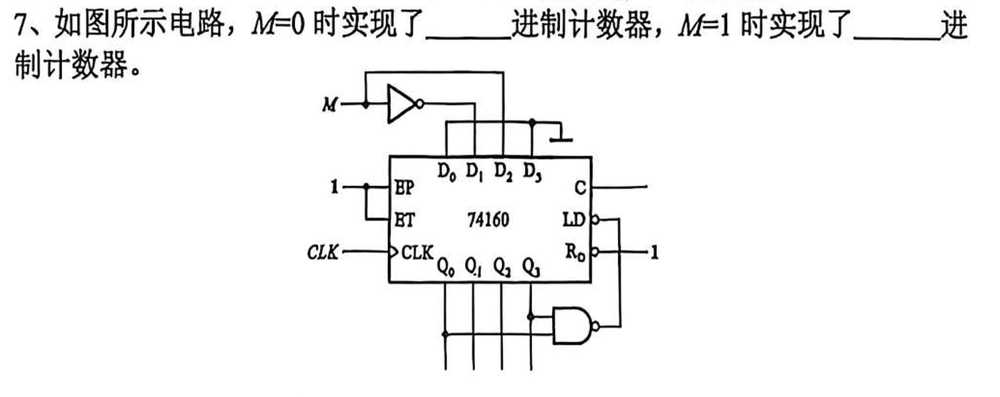

**答案：八进制；六进制**

**解析**：分三步读图。

**① 置数端**：$\bar{R_D}=1$（不清零）；$\bar{LD}=\overline{Q_0Q_3}$，即 $Q_0=Q_3=1$ 时 $\bar{LD}=0$，准备置数。

**② 置数数据端**：$D_3$、$D_0$ 同接一条接地线 → 恒 0；$D_2$ 接 $M$；$D_1$ 经非门接 $M$，即 $D_1=\bar M$。

$$\text{预置数}=D_3D_2D_1D_0=00\,M\,\bar M\,0$$

**③ 分情况**：

- $M=0$：预置数 $=0010=2$。计数到 $Q_3Q_2Q_1Q_0=1001=9$ 时 $\bar{LD}=0$，下一个时钟装入 2。有效循环 $2\to3\to\cdots\to9\to2$，共 $9-2+1=\boxed{8}$ 个状态，**八进制**。
- $M=1$：预置数 $=0100=4$。同样在 9 处置数，循环 $4\to5\to\cdots\to9\to4$，共 $\boxed{6}$ 个状态，**六进制**。

**易错**：
1. 74160 是**同步置数**，$\bar{LD}=0$ 不会立刻装入，要等**下一个时钟上升沿**，所以 9 这个状态是"走完的"，计数范围含 9。
2. 状态数 $=$ 终值 $-$ 初值 $+1$，不是终值 $-$ 初值。
3. $D_1$ 前面有非门，别把 $D_2$、$D_1$ 接成一样的。

**拓展**：74160（同步十进制加法计数器）与 74161（同步十六进制）引脚完全兼容，区别只在模值。用"**置数法**"做 $N$ 进制的两种写法：置最小数（$N$ 个状态从该数数到最大），或置最大数（从 0 数到 $2^n-N$ 再回填）——本题用的是前者。

---

# 三、非客观题（本大题 8 分）

> 用卡诺图法化简函数 $F=\bar A BC+\bar A B\bar C+ABC+AB\bar C$ 为最简与或式，并画出用 2 输入与非门实现的逻辑电路图。

## 标准答案

**① 代数预化**（比直接画卡诺图更快）：

$$F=\bar AB(C+\bar C)+AB(C+\bar C)=\bar AB+AB=B(\bar A+A)=B$$

**② 卡诺图验证**：$F$ 在 $B=1$ 的 4 个格（$m_2,m_3,m_6,m_7$）全为 1，可圈成一个 $1\times4$ 的圈，读出 $\boxed{F=B}$。

**③ 最简与或式**：$F=B$

**④ 用 2 输入与非门实现**：

$$F=B=\overline{\bar B}=\overline{B\cdot B}$$

把与非门的**两个输入端并接**到 $B$ 即可，只需 1 个与非门。

```
        ┌─────┐
B ──┬───┤     │
    │   │  &  ├──○── F = B
    └───┤     │
        └─────┘
```

## 解析

**思路**：看到四项、且每项都含 $A$ 与 $\bar A$ 的配对，先做代数提取，通常能消掉一个变量。本题 $\bar AB$ 与 $AB$ 提取公因子 $B$ 后 $A$ 被完全消去。

**步骤要点**：
1. 前两项 $\bar ABC+\bar AB\bar C=\bar AB$；
2. 后两项 $ABC+AB\bar C=AB$；
3. 相加 $\bar AB+AB=B$。

**评分点**：写出卡诺图（3 分）→ 圈出正确圈组（2 分）→ 得 $F=B$（1 分）→ 画出与非门并正确并接（2 分）。

## 易错点

1. **把 $B$ 写成 $\bar B$**：卡诺图中 $B=1$ 的四格全为 1，圈的是"$B$ 行"，不是"$\bar B$ 行"。
2. **用与非门实现时忘了两次取反**：$F=B$ 不能直接接一根线了事（题目要求"用与非门实现"），必须写成 $\overline{B\cdot B}$ 再画门。
3. 若坚持用卡诺图而圈错（如圈成两个 2 格圈），会得到 $F=\bar AB+AB$，虽然逻辑等价但**不是最简**，扣分。

## 考点拓展

**同类"结果极简"的题要敢下手**。很多同学看到四项以为答案一定复杂，反复圈图反而出错。判断依据：**若化简后只剩一个变量，说明该函数与其余变量完全无关**，此时用代数法一眼可破。

**与非-与非式的转换**是必考技能：任何与或式 $F=P_1+P_2$ 都可写成 $F=\overline{\overline{P_1}\cdot\overline{P_2}}$，即"**两次取反 + 德摩根**"。本题 $F=B$ 属于特例（单项），写成 $\overline{B\cdot B}$。

**关联考点**：用 74LS138 实现同一函数（见下一题）时，$F=B$ 只需把 $B=1$ 对应的 4 个输出端与非起来——这也是"最小项之和"与"译码器输出"一一对应的体现。

---

# 四、非客观题（本大题 10 分）

> 采用 74LS138 译码器和与非门实现 1 位二进制全加器。$A$ 是被加数，$B$ 是加数，$C$ 是来自低位的进位信号，$D$ 是本位求得的和信号，$E$ 是向高位的进位信号。要求：1）画出真值表；2）写出输出函数的最小项和表达式；3）画出电路图，标明各端子名称、状态。74LS138 逻辑符号已知，与非门输入端根据需要自定。

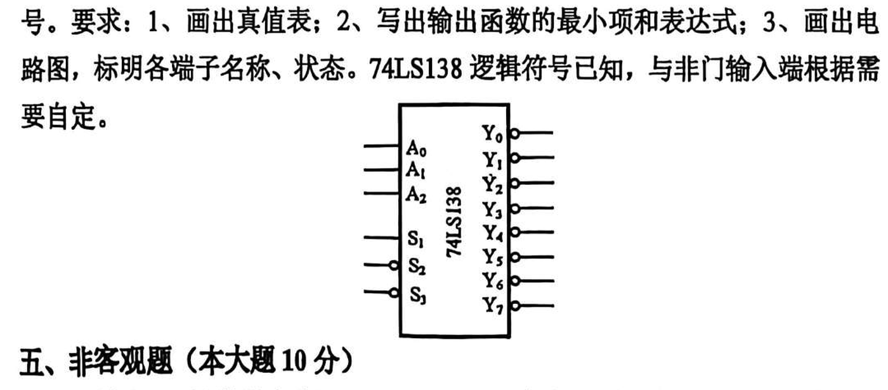

## 标准答案

**1）真值表**

| $A$ | $B$ | $C$ | $D$（本位和） | $E$（进位） |
|---|---|---|---|---|
| 0 | 0 | 0 | 0 | 0 |
| 0 | 0 | 1 | 1 | 0 |
| 0 | 1 | 0 | 1 | 0 |
| 0 | 1 | 1 | 0 | 1 |
| 1 | 0 | 0 | 1 | 0 |
| 1 | 0 | 1 | 0 | 1 |
| 1 | 1 | 0 | 0 | 1 |
| 1 | 1 | 1 | 1 | 1 |

**2）最小项表达式**

$$D(A,B,C)=\Sigma m(1,2,4,7)$$
$$E(A,B,C)=\Sigma m(3,5,6,7)$$

**3）电路图**

74LS138 的 $A_2A_1A_0$ 接 $A,B,C$（$A$ 接 $A_2$ 高位），$S_1=1$、$\bar S_2=\bar S_3=0$（使能）。输出低有效，故：

$$D=\overline{\bar Y_1\cdot\bar Y_2\cdot\bar Y_4\cdot\bar Y_7}=Y_1+Y_2+Y_4+Y_7$$
$$E=\overline{\bar Y_3\cdot\bar Y_5\cdot\bar Y_6\cdot\bar Y_7}=Y_3+Y_5+Y_6+Y_7$$

```
        ┌──────────┐
A ──────┤ A2       │
B ──────┤ A1    Y0 ├──○ (不用)
C ──────┤ A0    Y1 ├──○──┐
        │       Y2 ├──○──┤
1 ──────┤ S1    Y3 ├──○──┼──┐
        │       Y4 ├──○──┤  │
0 ──────┤/S2    Y5 ├──○──┼──┼──┐
        │       Y6 ├──○──┼──┼──┤
0 ──────┤/S3    Y7 ├──○──┼──┼──┼──┐
        └──────────┘     │  │  │  │
                     ┌───┴──┘  │  │
                     │ 4输入与非├──┴──○ D
                     └──────────┘
                     ┌───┴──┬──┴──┬──┐
                     │ 4输入与非    ├──○ E
                     └─────────────┘
```

## 解析

**思路**：全加器的两个输出都是三变量函数，而 74LS138 恰好能给出全部 8 个最小项的"反"（输出低有效）。因此**把输出为 1 的那些最小项对应的 $\bar Y_i$ 与非起来**即可。

**步骤**：
1. 列真值表（按二进制加法 $A+B+C$，和取个位、进位取十位）；
2. 从真值表读出 $D$、$E$ 为 1 的行号 → 得最小项；
3. 因 138 输出低有效，$\bar Y_i=\overline{m_i}$，故 $D=\overline{\prod \bar Y_i}$，用与非门；
4. $D$ 用 4 输入与非门，$E$ 用 4 输入与非门（题目允许自定输入端数）。

**评分点**：真值表 3 分 / 最小项表达式 2 分 / 138 接线（地址、使能）2 分 / 与非门连接 3 分。

## 易错点

1. **地址端顺序**：$A$ 接 $A_2$（高位）还是 $A_0$（低位）必须与最小项下标定义一致。若 $A$ 接 $A_0$，则下标要重排，表达式全部改变。
2. **忘记 138 输出低有效**，直接画"或门"取和——那样得到的是 $\bar D$，极性反了。
3. **使能端接错**：$S_1$ 高有效接 1，$\bar S_2$、$\bar S_3$ 低有效接 0，三者缺一不可。
4. **与非门输入数不足**：4 项必须用 4 输入与非门，或两级 2 输入，不能漏项。

## 考点拓展

**"译码器 + 与非门实现组合函数"是每一年的必考题**，模板固定：

$$F=\Sigma m(i_1,i_2,\cdots)=\overline{\bar Y_{i_1}\cdot\bar Y_{i_2}\cdots}$$

三条变式要掌握：
- 若 138 输出**高有效**（如 74LS138 加反相器），则直接用**或门**；
- 若函数变量数 **大于 3**，需用两片 138 级联扩展成 4 线-16 线；
- 若实现的是**全减器**，则 $D=A\oplus B\oplus C$、$E=\bar AB+AC+BC$（借位），最小项变为 $E=\Sigma m(1,2,3,7)$——本卷第 6 套（2015–2016）就考了全减器，可对照。

**全加器三兄弟**：$S=A\oplus B\oplus C$、$C_o=AB+AC+BC$、$C_o=AB+(A\oplus B)C$。前两个是"与或式"，第三个是"进位链式"，后者是超前进位加法器的雏形。

---

# 五、非客观题（本大题 10 分）

> D 触发器和 JK 触发器电路及 $CLK$、$A$、$J$、$K$ 波形如图所示，触发器的初态均为 0，画出 $Q_1$、$Q_2$ 的波形。

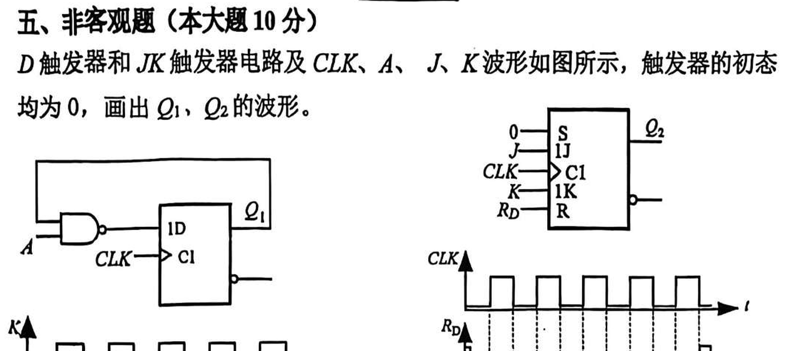

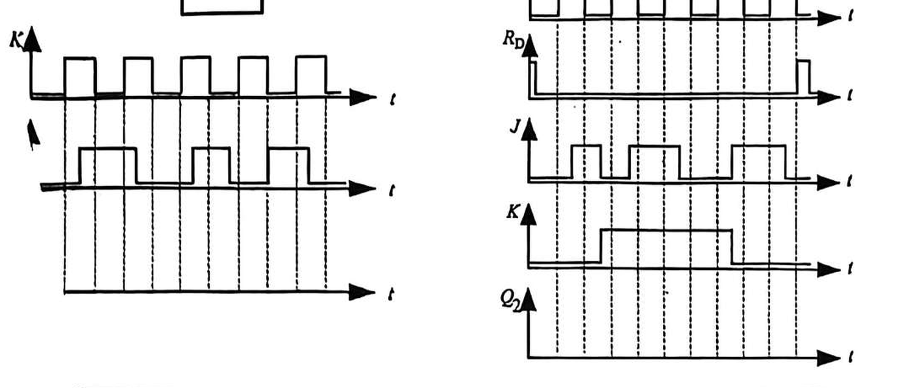

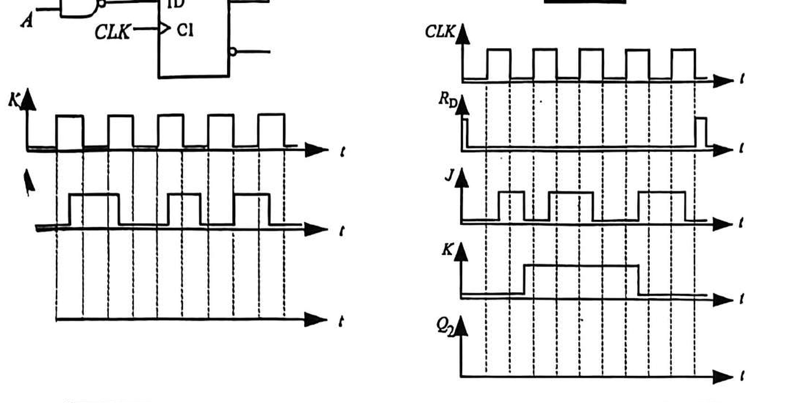

## 标准答案

**① 驱动方程**

- FF1（D 触发器）：$D_1=\overline{A\cdot Q_1}$
- FF2（JK 触发器）：$J_2=J$，$K_2=K$，异步端 $S=0$（无效）、$R_D$ 低有效

**② 状态方程**

$$Q_1^*=\overline{AQ_1}=\bar A+\bar Q_1$$

$$Q_2^*=J\bar Q_2+\bar KQ_2\quad(\text{当 }R_D=1)$$

**③ 波形（逐时钟沿判断）**

$Q_1$ 按 $D_1=\overline{AQ_1}$ 逐沿更新（初态 0）：

| 时钟沿 | $A$ | 现态 $Q_1$ | $D_1=\overline{AQ_1}$ | 次态 $Q_1$ |
|---|---|---|---|---|
| 1 | 0 | 0 | 1 | 1 |
| 2 | 1 | 1 | 0 | 0 |
| 3 | 1 | 0 | 1 | 1 |
| 4 | 0 | 1 | 1 | 1 |
| 5 | 1 | 1 | 0 | 0 |

故 $Q_1$ 序列为 $0\to1\to0\to1\to1\to0$。

$Q_2$ 按 JK 特征方程逐沿更新，并在 $R_D=0$ 期间**被强制清 0**（异步，不受时钟控制）：

| 时钟沿 | $J$ | $K$ | 现态 $Q_2$ | 次态 $Q_2$ |
|---|---|---|---|---|
| 1 | 0 | 0 | 0 | 0（保持） |
| 2 | 1 | 0 | 0 | 1（置 1） |
| 3 | 1 | 1 | 1 | 0（翻转） |
| 4 | 0 | 1 | 0 | 0（置 0） |
| 5 | 1 | 1 | 0 | 1（翻转） |

波形示意（一个时钟周期记作一格，`‾` 为高、`_` 为低）：

```
CLK  _‾_‾_‾_‾_‾_
A    ___‾‾‾___‾_      (第2、3沿为1，第5沿为1)
Q1   _‾__‾‾__‾__      (0→1→0→1→1→0)
J    __‾‾__‾‾___      (第2、3沿为1，第5沿为1)
K    ____‾‾‾‾___      (第3、4沿为1)
RD   ‾‾‾‾‾‾‾‾‾‾_‾     (仅在开头/结尾出现窄低脉冲，期间Q2被清0)
Q2   _____‾__‾__      (0→0→1→0→0→1)
```

## 解析

**思路**：画波形题的四步固定流程——①写出驱动/状态方程；②列出"每个时钟沿的输入值"；③逐沿推次态；④把次态画成阶梯波。

**关键点**：
1. **上升沿触发**：只在 CLK 的上升沿采样，其余时刻 $Q$ 保持不变（图上用竖直虚线对齐正是提示）。
2. **异步端优先**：$R_D$ 一旦为低，$Q_2$ 立刻清 0，**不必等时钟沿**，且清 0 后要等下一个有效沿才可能恢复。
3. $Q_1$ 的方程含反馈，必须**用现态算次态**，不能沿用上一次的 $A$。

**评分点**：驱动方程 3 分 / 状态方程 2 分 / 两条波形各 2.5 分（形状正确但相位错扣一半）。

## 易错点

1. **D 触发器采样时刻搞错**：D 端的值要在**时钟沿到来前**稳定，画波形时取"沿左侧"的值。
2. **忽略 $R_D$ 的异步性**：把清 0 画在时钟沿上，形状就会错位半格。
3. **$Q_1$ 与 $\bar Q_1$ 混淆**：$D_1=\overline{AQ_1}$ 中用的是 $Q_1$（同相输出），若误用 $\bar Q_1$ 则整个序列反向。
4. **JK 的 $J=K=0$ 写成"置 0"**：$J=K=0$ 是**保持**，$J=0,K=1$ 才是置 0。

## 考点拓展

**触发器波形题的三类陷阱**：
- **异步端**（$R_D$、$S_D$）：优先级最高，画波形时先处理；
- **不同触发沿**：同一题里若一个上升沿、一个下降沿，$Q$ 的跳变时刻要错开半个周期；
- **门延迟**：本类题默认理想器件，不考虑延迟；若题目明确给延迟时间，则跳变要后移。

**D 触发器构成 T' 触发器**：$D=\bar Q$ 时 $Q^*=\bar Q$，每沿翻转，是**二分频**的最简实现（本卷第 8 题就用它）。

---

# 六、非客观题（本大题 12 分）

> 分析如图所示时序逻辑电路，要求：1）写出电路的驱动方程、状态方程；2）画出完整的状态转换图（要求化成 $Q_2Q_1Q_0$）；3）分析逻辑功能并说明电路能否自启动。

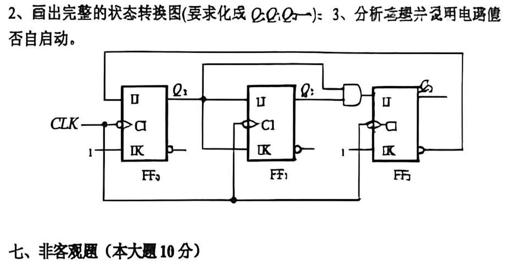

## 标准答案

**① 驱动方程**（三个触发器共用一个 CLK，同步工作；各 $K$ 端均接 1）

$$J_0=Q_2,\quad K_0=1$$
$$J_1=Q_0,\quad K_1=1$$
$$J_2=Q_1Q_0,\quad K_2=1$$

**② 状态方程**（代入 $Q^*=J\bar Q+\bar KQ$，因 $K=1$ 故 $\bar K=0$）

$$Q_0^*=Q_2\bar Q_0$$
$$Q_1^*=Q_0\bar Q_1$$
$$Q_2^*=Q_1Q_0\bar Q_2$$

**③ 状态转换表**（按 $Q_2Q_1Q_0$ 排列）

| 现态 $Q_2Q_1Q_0$ | $Q_2^*$ | $Q_1^*$ | $Q_0^*$ | 次态 |
|---|---|---|---|---|
| 000 | 0 | 0 | 0 | 000 |
| 001 | 0 | 1 | 0 | 010 |
| 010 | 0 | 0 | 0 | 000 |
| 011 | 0 | 0 | 1 | 001 |
| 100 | 0 | 1 | 0 | 010 |
| 101 | 1 | 1 | 0 | 110 |
| 110 | 0 | 0 | 0 | 000 |
| 111 | 0 | 0 | 0 | 000 |

**④ 状态转换图**

```
         ┌──────────────────────────┐
         │                          ▼
       000 ◄── 010 ◄── 001 ◄── 011
        ▲       ▲       ▲
        │       │       │
      100 ─────┘     101 ──→ 110 ──→ 000
        ▲
        │
       (由 011 → 001 → 010 → 000 汇入)

      111 ──→ 000
```

把各状态按次态串起来，得到唯一的有效循环：

$$\boxed{000\to001\to011\to101\to110\to000}$$

即 **5 个状态构成一个循环**，是**五进制计数器**。

**⑤ 自启动判断**

无效状态为 010、100、111，它们都在**有限个时钟内**进入主循环：

- $010\to000$（1 拍进环）✔
- $100\to010\to000$（2 拍进环）✔
- $111\to000$（1 拍进环）✔

因此电路**能够自启动**。

## 解析

**思路**：同步时序电路分析的五步法——①写驱动方程（各 $J,K$ 的表达式）；②代入特征方程得状态方程；③列状态表（从 000 起逐个推）；④画状态图；⑤找主循环、判断无效状态能否回环。

**本题的巧处**：三个 $K$ 全接 1，即每个触发器都是"**只能置 1 或保持，不能置 0**"的半 T 触发器。因此状态方程都是 $Q^*=J\bar Q$ 的形式，只要 $J=1$ 且当前为 0 就置 1，否则保持 0——这也是无效状态容易被"冲刷"回 0 的原因。

**评分点**：驱动方程 4 分 / 状态方程 3 分 / 状态图 3 分（状态齐全、箭头正确）/ 功能与自启动结论 2 分。

## 易错点

1. **状态表漏项**：3 个触发器必须列满 8 个状态，只列主循环 5 个会漏掉自启动判断。
2. **$J_2=Q_1Q_0$ 读成 $Q_1+Q_0$**：图上是**与门**（方框内 "&"），不是或门。
3. **进位方向搞反**：$Q_0^*=Q_2\bar Q_0$ 中的 $Q_2$ 是最**高位**的自反馈，这是扭环形计数器的特征，不要误以为是"末位进首位"的普通二进制计数。
4. **自启动结论下得太快**：必须逐个检查 3 个无效状态，只要有一个形成**死循环**（如 $010\rightleftharpoons100$），就不能自启动。

## 考点拓展

**扭环形计数器（Johnson 计数器）**的标准形态是 $Q_0^*=\bar Q_{n-1}$、$Q_i^*=Q_{i-1}$，$n$ 个触发器有 $2n$ 个状态。本题在最后一级加了"与门"限制，使 $Q_2$ 只有在 $Q_1Q_0=11$ 时才置 1，从而把 $2n=6$ 压到 5，得到**奇数分频**——这是"用扭环形做奇数分频"的经典手法。

**自启动的判定要点**：无效状态集合中，**每个状态的次态最终都要落到有效循环上**。若存在长度为 2 以上的无效子循环，则不能自启动，需修改反馈逻辑（常用做法是把某个无效状态译出后强行置数）。

**工程意义**：自启动能力决定了电路上电瞬间会不会"卡死"。实际产品里即使设计成可自启动，也常加**上电复位**作为双保险。

---

# 七、非客观题（本大题 10 分）

> 用 4 位同步二进制计数器 74LS161 设计六进制计数器，要求用两种方法实现：1）采用异步清零法；2）采用同步置数法，从 3（0011）到 8（1000）循环计数。分别画出两种方法情况下的有效状态转换图和电路图，标明各端子及状态。74LS161 逻辑符号已知，允许添加门电路。

## 标准答案

### 方法一：异步清零法（反馈清零）

**原理**：74161 的 $\bar{R_D}$ 是**异步**清零（低有效，不需时钟）。让计数到第 $N$ 个状态 $0110$（即 6）时产生清零信号，由于"6"只是**瞬间出现**、不构成稳定状态，有效状态为 $0\sim5$ 共 6 个。

**清零信号**：$\bar{R_D}=\overline{Q_2Q_1}$（$Q_2Q_1=11$ 出现在 $0110$ 和 $0111$，但 0111 不会出现，因为一到 0110 就清零）

**有效状态转换图**：

```
     ┌──────────────────────────────┐
     │                              ▼
    0000 → 0001 → 0010 → 0011 → 0100 → 0101
                                    （0110 为瞬态，不画入循环）
```

**电路图**：

```
              ┌──────────────┐
      1 ──────┤ EP        Q0 ├──────
      1 ──────┤ ET        Q1 ├───┬──
   CLK ──────►┤ CLK       Q2 ├───┼──┐
              │           Q3 ├───┼──┼──
      1 ──────┤ /LD           │   │  │
              │               │   │  │
      0 ──────┤ D0..D3        │   │  │
              └──────────────┘   │  │
                     ┌───────────┴──┘
                     │ 2输入与非门
              /RD ◄──┴──────────────
```

### 方法二：同步置数法（3→8 循环）

**原理**：$\bar{LD}$ 是**同步**置数（低有效，需等时钟沿）。要求 $3\to4\to\cdots\to8\to3$，即在计到 8（1000）时，**下一个时钟沿**把 3（0011）装入。

**置数条件**：$Q_3=1$ 且 $Q_2=Q_1=Q_0=0$，即 $\bar{LD}=\overline{Q_3\bar Q_2\bar Q_1\bar Q_0}$

**置数数据**：$D_3D_2D_1D_0=0011$

**有效状态转换图**：

```
     ┌─────────────────────────────────────┐
     │                                     ▼
    0011 → 0100 → 0101 → 0110 → 0111 → 1000
```

共 6 个状态（$8-3+1=6$）。

**电路图**：

```
              ┌──────────────┐
      1 ──────┤ EP        Q0 ├──┬───
      1 ──────┤ ET        Q1 ├──┼───
   CLK ──────►┤ CLK       Q2 ├──┼──┬
              │           Q3 ├──┼──┼──┐
              │               │  │  │  │
      0 ──────┤ D3            │  │  │  │
      0 ──────┤ D2            │  │  │  │
      1 ──────┤ D1            │  │  │  │
      1 ──────┤ D0            │  │  │  │
              └──────────────┘  │  │  │
                   ┌────────────┴──┴──┘
                   │ 4输入与非门（Q3·/Q2·/Q1·/Q0）
            /LD ◄──┘
```

## 解析

**思路**：74161 做 $N$ 进制有**两条路**，区别就在"清零"和"置数"的**有效时刻**：

| | 异步清零法 | 同步置数法 |
|---|---|---|
| 控制端 | $\bar{R_D}$（异步） | $\bar{LD}$（同步） |
| 触发时刻 | 状态一出现**立即**清零 | 等**下一个时钟沿**才装入 |
| 反馈状态 | 第 $N$ 个状态（$N$） | 第 $N$ 个或最后一个状态 |
| 有效状态数 | $0\sim N-1$，共 $N$ 个 | 由置数值决定 |

**方法一的关键**：反馈用"$N$"（6 = 0110），因为 0110 一出现就被清掉，它**不算稳定状态**，所以循环是 0000–0101 六个数。

**方法二的关键**：反馈用"最后一个状态"（8 = 1000），因为它要**稳定停留一个时钟周期**才算数完，下一个沿才装入 3。

**评分点**：每种方法各 5 分——状态图 2 分、反馈逻辑 2 分、端子接法 1 分。

## 易错点

1. **两种方法的反馈数搞混**：异步清零反馈"$N$"，同步置数反馈"$N-1$"或"指定的终值"。本题方法二指定终值 8，故反馈 1000。
2. **异步清零误当同步**：$\bar{R_D}=0$ 时状态**立即**变 0，不占时钟周期，所以 0110 不能算进循环。
3. **$\bar{LD}$、$\bar{R_D}$ 忘记低有效**：接 1 是"不动作"，接 0 才动作，很多图错在把使能端接反。
4. **方法二漏接数据端**：$D_3D_2D_1D_0=0011$ 必须接准，接错则循环起点错。
5. **状态数算错**：$3\to8$ 是 $8-3+1=6$ 个，不是 $8-3=5$ 个。

## 考点拓展

**74161 三种"造 $N$ 进制"方法的对比**（考试高频）：

| 方法 | 反馈取自 | 说明 |
|---|---|---|
| **异步清零** | $Q$ 组合出 $N$ | 最简单，但清零瞬间有毛刺 |
| **同步置数（置最小数）** | 组合出"最大数" | 状态从置数起，无毛刺 |
| **同步置数（置最大数）** | 组合出 $2^n-N$ | 从 0 数到 $2^n-N$，回填最大数 |
| **级联（$N>16$）** | 整体置数/整体清零 | 两片级联成 $16\times16=256$ 进制再截断 |

**为什么工程上偏爱同步置数**：异步清零会在输出上产生**窄脉冲毛刺**（因为清零信号是组合逻辑的瞬时输出），驱动后续电路时可能误触发；同步置数把动作对齐到时钟沿，输出干净。

**本题的"从 3 到 8"是个陷阱**：多数同学习惯"从 0 开始"，一看到 3 就慌。其实只是把置数数据从 0000 改成 0011，其余步骤不变。

---

# 八、非客观题（本大题 10 分）

> 电路如图所示，要求：1）说明 555 定时器构成了哪种应用电路？2）画出 $u_c$、$u_{o1}$、$u_{o2}$ 的波形；3）计算 $u_{o1}$ 和 $u_{o2}$ 的频率。（设 $\ln 2=0.7$）

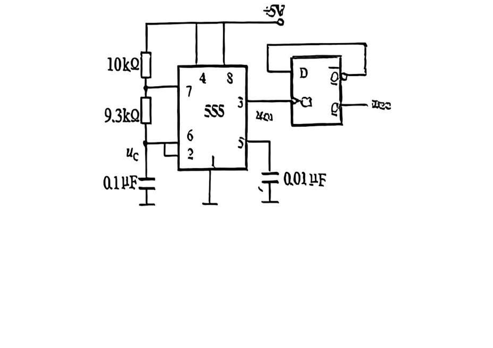

## 标准答案

**1）电路类型**

- 555 部分：$R_1=10\,\text{k}\Omega$、$R_2=9.3\,\text{k}\Omega$、$C=0.1\,\mu\text{F}$，$R_1$、$R_2$ 与 $C$ 构成充放电回路，**没有外触发输入**，故为 **多谐振荡器**（自激方波发生器）。
- D 触发器部分：$D$ 与 $\bar Q$ 相连（$D=\bar Q$），CP 接 $u_{o1}$，构成 **T' 触发器**，对 $u_{o1}$ 作 **二分频**。

**2）波形**

```
u_c    ╱╲___╱╲___╱╲___      在 1/3Vcc 与 2/3Vcc 之间充放电
        ╲    ╲    ╲
u_o1   ‾‾╲__‾‾╲__‾‾╲__      高电平 = tw1，低电平 = tw2
u_o2   ‾‾‾‾╲____‾‾‾‾╲__      每个 u_o1 周期翻转一次 → 周期加倍
```

**3）频率计算**

555 多谐振荡器的两个时间常数：

$$t_{w1}=0.7(R_1+R_2)C\quad(\text{充电，输出高})$$
$$t_{w2}=0.7R_2C\quad(\text{放电，输出低})$$

$$T_1=t_{w1}+t_{w2}=0.7(R_1+2R_2)C$$

代入 $R_1=10\,\text{k}\Omega$、$R_2=9.3\,\text{k}\Omega$、$C=0.1\,\mu\text{F}$：

$$R_1+2R_2=10+18.6=28.6\ \text{k}\Omega$$
$$T_1=0.7\times 28.6\times10^{3}\times 0.1\times10^{-6}=0.7\times 2.86\times10^{-3}=2.002\times10^{-3}\ \text{s}$$

$$f_1=\frac{1}{T_1}\approx\frac{1}{2.002\times10^{-3}}\approx 500\ \text{Hz}$$

D 触发器二分频：

$$f_2=\frac{f_1}{2}\approx 250\ \text{Hz},\qquad T_2\approx 4\ \text{ms}$$

## 解析

**思路**：先认电路（有 $R_1$、$R_2$、$C$ 且 7 脚接在两电阻之间 → 多谐振荡器），再套公式，最后看后级有没有分频。

**555 多谐振荡器三要素**：
- **充电**经 $R_1+R_2$，时间 $0.7(R_1+R_2)C$，输出**高**；
- **放电**只经 $R_2$（经 7 脚内部放电管），时间 $0.7R_2C$，输出**低**；
- 周期 $=0.7(R_1+2R_2)C$。

**占空比**：$q=\dfrac{R_1+R_2}{R_1+2R_2}=\dfrac{19.3}{28.6}\approx 67.5\%$（此问原卷未要求，但常作为附加问）。

**评分点**：电路名称 3 分 / 三条波形 4 分 / 两个频率各 1.5 分。

## 易错点

1. **把 $R_1+2R_2$ 写成 $R_1+R_2$**：放电不经过 $R_1$，所以是 $2R_2$。
2. **$0.7$ 与 $1.1$ 混用**：$1.1RC$ 是**单稳态**的脉宽公式，多谐振荡器的系数是 $0.7$（严格应为 $\ln2\approx0.693$）。
3. **单位**：$0.1\,\mu\text{F}=10^{-7}$ F，直接乘容易错一位；建议先算 $R$ 的 kΩ 部分再统一换算。
4. **忘记后级分频**：$u_{o2}$ 是 $u_{o1}$ 的二分频，频率要再除以 2，且**占空比变为 50%**（因为 T' 触发器每沿翻转）。

## 考点拓展

**555 三种接法的判别口诀**：

| 接法 | 特征 | 输出 |
|---|---|---|
| **多谐振荡器** | 无外触发，$R_1$、$R_2$、$C$ 齐全，7 脚接在两电阻之间 | 自激方波 |
| **单稳态** | 有触发输入（2 脚），一路 $RC$ 定时 | 每触发一次出一个定宽脉冲 |
| **施密特触发器** | 2、6 脚**短接**作输入，无 $RC$ | 整形、鉴幅，双阈值 |

**占空比可调的多谐振荡器**：在 $R_1$、$R_2$ 之间串两个方向相反的二极管（本卷第 4 套 2018–2019 第六题就是这种），使充电只走 $R_1$、放电只走 $R_2$，占空比可在 $0\sim100\%$ 间调节。

**频率精度**：$0.7(R_1+2R_2)C$ 是工程近似，实际还要考虑 555 内部比较器的失调、$C$ 的容差（电解电容 ±20%），所以实际电路常用**电位器微调**。

---

# 附：本卷考点分布与复习建议

| 章节 | 题号 | 分值 | 重要度 |
|---|---|---|---|
| 数制与码制 | 一3、二1、二5 | 6 | ★★★ |
| 逻辑代数与化简 | 一4、二3、三 | 14 | ★★★★★ |
| 门电路（TTL/CMOS/三态） | 一1、二2、二6 | 8 | ★★★★ |
| 组合逻辑（编码/译码/MUX） | 一2、一5、四 | 16 | ★★★★★ |
| 触发器 | 一6、一7、二4、二6 | 10 | ★★★★★ |
| 时序逻辑分析 | 五、六 | 22 | ★★★★★ |
| 计数器设计 | 二7、七 | 14 | ★★★★★ |
| 555 定时器 | 一8、一9、八 | 10 | ★★★★ |

**本卷特点**：**没有考 Verilog**（2021–2022、2019–2020 卷都考了），但**时序分析与计数器设计合计 36 分**，是全卷重心。若按本卷风格复习，应把"74161/74160 造 $N$ 进制"和"JK 同步时序分析"练到闭眼能写。

**与相邻年份的重复考点**：
- "触发器输出保持不变"的四图题：2024–2025、2020–2021、2018–2019、2016–2017 四年都考（图形几乎相同）；
- "50 个编码对象需要几位"：2024–2025、2015–2016 两年都考；
- "编码器/译码器 + 与非门实现全加器"：2024–2025（全加器）、2015–2016（全减器）成对出现。
