# 2022—2023 学年第二学期《电子技术Ⅱ》期末考试 A 卷 · 全解

> **试卷来源**：`试卷/数电_20261017_202733.pdf` 第 5—10 页（原卷共 8 页，此扫描件存第 1—6 页，缺第 7、8 页）。
> **原卷信息**：哈尔滨理工大学 · 考试时间 100 分钟 · 试卷总分 100 分 · 考试班级 测控技术及仪器。
> **命题**：测通学院电子教研部 电子技术命题组｜系主任 崔阳｜考试日期 2023 年 6 月 11 日。

## 试卷结构速览

| 题号 | 题型 | 分值 | 覆盖内容 |
|---|---|---|---|
| 一 | 单项选择题（10×2 分） | 20 | 数制、卡诺图、开关电路、单稳态、JK 电路、MUX、ROM、时序、PLD |
| 二 | 填空题（7 小题、10 空×2 分） | 20 | 波形读函数、编码位数、与非-与非式、异或运算、74LS147、74161、三态/线与/TG |
| 三 | 非客观题 | 15 | 同步时序电路分析（3 个 JK） |
| 四 | 非客观题 | 10 | 74LS138 实现 $F_1=AB+AC$ |
| 五 | 非客观题 | 5 | Verilog 门级描述全加器（填空） |
| 六 | 非客观题 | 10 | 三个组合/时序电路画波形 |
| 七 | 非客观题 | 10 | 555 延时报警电路（单稳态 + 多谐） |
| 八 | 综合设计题 | 10 | 两片 74160 接 29 进制 |

---

# 一、单项选择题（本大题共 10 小题，每小题 2 分，总计 20 分）

## 1. 十进制数 124.68 转换为二进制数（保留 4 位有效数字）为（　）

(a) $(111001.1101)_2$　　(b) $(110011.0011)_2$　　(c) $(1010111.0110)_2$　　(d) $(1111100.1010)_2$

**答案：(d)**

**解析**：

- 整数部分：$124=64+32+16+8+4=1111100_2$（依次减权：$124-64=60$，$-32=28$，$-16=12$，$-8=4$，$-4=0$）；
- 小数部分：乘 2 取整

| 步骤 | 计算 | 取整 |
|---|---|---|
| 1 | $0.68\times2=1.36$ | **1** |
| 2 | $0.36\times2=0.72$ | **0** |
| 3 | $0.72\times2=1.44$ | **1** |
| 4 | $0.44\times2=0.88$ | **0** |

$$(124.68)_{10}\approx(1111100.1010)_2$$

**易错**：整数部分别用"除 2 取余"倒着写错序。$124$ 反复除 2 的余数依次是 $0,0,1,1,1,1,1$，**倒序读**才得 $1111100$。

**拓展**：题目说"保留 4 位有效数字"，指的是**小数部分取 4 位**（第 5 位 $0.88\times2=1.76$ 会进位，但题目要求截断而非四舍五入）。这类题选项往往只差末位，靠"逐步乘 2"最稳。

---

## 2. 卡诺图化简的最简与或表达式为（　）

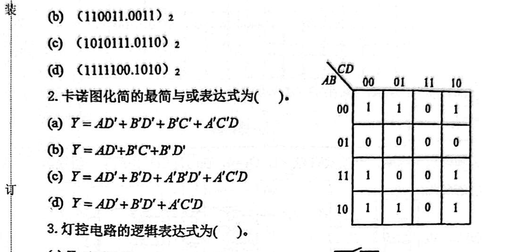

(a) $Y=A\bar D+\bar B\bar D+\bar B\bar C+\bar A\bar C\bar D$
(b) $Y=A\bar D+\bar B\bar C+\bar B\bar D$
(c) $Y=A\bar D+\bar BD+\bar A\bar B\bar D+\bar A\bar C\bar D$
(d) $Y=A\bar D+\bar B\bar D+\bar A\bar C\bar D$

**答案：(b)**

**解析**：先读出卡诺图中为 1 的最小项。行标 $AB$、列标 $CD$，按格雷码顺序：

| $AB\backslash CD$ | 00 | 01 | 11 | 10 |
|---|---|---|---|---|
| **00** | 1 | 1 | 0 | 1 |
| **01** | 0 | 0 | 0 | 0 |
| **11** | 1 | 0 | 0 | 1 |
| **10** | 1 | 1 | 0 | 1 |

为 1 的格子：$m_0,m_1,m_2,m_8,m_9,m_{10},m_{12},m_{14}$。

**圈组**：

1. $m_0,m_1,m_8,m_9$ —— 左列两格 + 右列两格构成 4 格圈（$AB$ 取 00 与 10，$CD$ 取 00、01）→ $\boxed{\bar B\bar C}$
2. $m_0,m_2,m_8,m_{10}$ —— 上下跨行的 4 格圈（$CD$ 取 00、10；$AB$ 取 00、10）→ $\boxed{\bar B\bar D}$
3. $m_8,m_{10},m_{12},m_{14}$ —— 右侧 4 格圈（$AB$ 取 11、10，$CD$ 取 00、10）→ $\boxed{A\bar D}$

$$Y=\bar B\bar C+\bar B\bar D+A\bar D$$

**易错**：
1. **行列顺序不是 00-01-10-11，而是 00-01-11-10**（格雷码）。按二进制顺序读会把 $m_2$ 和 $m_3$ 弄反。
2. 圈可以**跨边界**（左列与右列、上行与下行），本题两个 4 格圈都用了跨边界。
3. 选项 (a) 多了一项 $\bar A\bar C\bar D$，是被更大圈吸收的冗余项，写了不算错但**不是最简**，本题要求"最简"故不选。

**拓展**：$Y$ 的另一种读法是"$Y$ 只在 $AB=01$ 整行为 0"，即 $Y=\overline{\bar AB}=A+\bar B$。用 $A+\bar B$ 展开验证：$A=1$ 的全部格（$m_8\sim m_{15}$）中有 $m_{11},m_{13},m_{15}$ 为 0，故不等价——说明**不能凭"整行为 0"草率下结论**，必须逐格核对。

---

## 3. 灯控电路的逻辑表达式为（　）

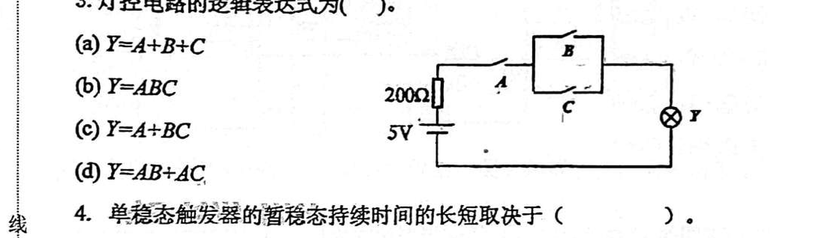

(a) $Y=A+B+C$　　(b) $Y=ABC$　　(c) $Y=A+BC$　　(d) $Y=AB+AC$

**答案：(d)**

**解析**：把电路图翻译成逻辑关系——**串联 = 与，并联 = 或**。

电源 → $200\,\Omega$ 限流电阻 → 开关 $A$ → 之后分成两条支路（$B$ 与 $C$ **并联**）→ 汇合后 → 灯 $Y$ → 回电源。

灯亮（$Y=1$）的条件是整条回路接通：

$$Y=A\cdot(B+C)=AB+AC$$

**易错**：
1. 把 $B$、$C$ 看成串联会得 $ABC$（选项 b）；
2. 把 $A$ 也当成并联会得 $A+B+C$（选项 a）；
3. 正确识别"$A$ 在主路、$B$ 和 $C$ 在并联支路"是解题关键。

**拓展**：这类"开关电路→逻辑式"的题，判断口诀是"**主路串联取与、支路并联取或**"。反过来，"逻辑式→开关电路"的题（如用开关实现 $Y=AB+C$）就把 $A$、$B$ 串联后与 $C$ 并联。

---

## 4. 单稳态触发器的暂稳态持续时间的长短取决于（　）

A. 触发脉冲的宽度　　B. 电路本身的参数　　C. 触发脉冲的幅度

**答案：B**

**解析**：单稳态触发器的暂稳态时间由**内部定时元件**（$RC$）决定，$t_w\approx0.7RC$（门电路型）或 $1.1RC$（555 型）。触发脉冲只起"点火"作用，**宽度只要小于 $t_w$ 即可**，不影响输出脉宽。

**易错**：直觉上容易选"触发脉冲的宽度"——那是**双稳态**（锁存器）的思维。单稳态的特点是"**触发即定长**"，输出脉宽与触发无关。

**拓展**：单稳态的三种典型用途——**定时**（产生固定宽度的脉冲）、**延时**（把输入脉冲推后 $t_w$ 再输出）、**整形**（把不规则脉冲变成等宽脉冲）。若触发脉冲宽度大于 $t_w$，电路会"重复触发"，此时需加微分电路或改用可重复触发型单稳态（如 74122）。

---

## 5. 逻辑电路如图，当 $A="1"$，$B="0"$ 时，脉冲作用下触发器（　）

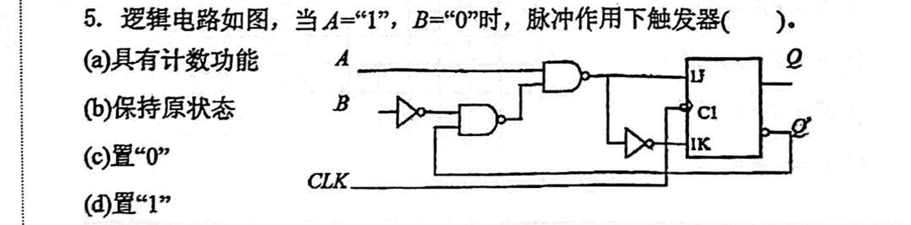

(a) 具有计数功能　　(b) 保持原状态　　(c) 置"0"　　(d) 置"1"

**答案：(a)**

**解析**：逐级推 $J$、$K$。

1. $B$ 经非门 → $\bar B$
2. 下方与非门：输入 $\bar B$、$\bar Q$ → $N_1=\overline{\bar B\bar Q}$
3. 上方与非门：输入 $A$、$N_1$ → $J=\overline{AN_1}$
4. $\bar Q$ 经非门 → $K=Q$

代入 $A=1,B=0$：$\bar B=1$ → $N_1=\overline{1\cdot\bar Q}=Q$ → $J=\overline{1\cdot Q}=\bar Q$。

$$Q^*=J\bar Q+\bar KQ=\bar Q\cdot\bar Q+\bar QQ=\bar Q$$

每来一个时钟翻转一次 → **计数功能**。

**易错**：$K$ 端的非门极易漏看。若把 $K$ 看成 $\bar Q$，则 $Q^*=\bar Q\bar Q+\overline{\bar Q}Q=\bar Q+Q=1$，会误选"置 1"。

**拓展**：本题与 2024–2025 卷第 7 题是**同一电路、同一条件**，答案都是"计数"。这类"用门电路改造触发器功能"的题，标准解法就是"**写出 $J,K$ 表达式 → 代入特征方程 → 看结果属于四种功能中的哪一种**"。

---

## 6. 如图所示是由 4 选 1 数据选择器实现的某组合逻辑函数，描述错误的选项为（　）

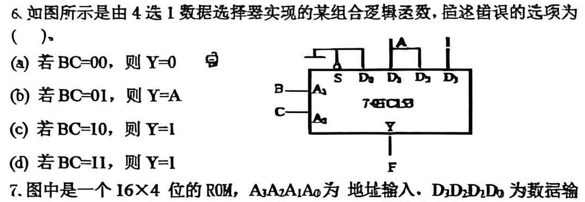

(a) 若 $BC=00$，则 $Y=0$
(b) 若 $BC=01$，则 $Y=A$
(c) 若 $BC=10$，则 $Y=1$
(d) 若 $BC=11$，则 $Y=1$

**答案：(c)**

**解析**：先读数据端接法，再按地址选通。

- 地址：$B\to A_1$，$C\to A_0$，故地址码为 $BC$；
- 数据端：$D_0=0$（接低），$D_1=D_2=A$（共同接输入 $A$），$D_3=1$（接高）；
- 使能 $\bar S=0$（有效）。

逐个验算：

| $BC$ | 选中 | 输出 $Y$ | 选项说法 | 判定 |
|---|---|---|---|---|
| 00 | $D_0=0$ | 0 | $Y=0$ | ✔ |
| 01 | $D_1=A$ | $A$ | $Y=A$ | ✔ |
| 10 | $D_2=A$ | $A$ | $Y=1$ | ✘ **错误** |
| 11 | $D_3=1$ | 1 | $Y=1$ | ✔ |

只有 (c) 与事实不符，故"描述错误的选项"是 (c)。

**易错**：把 $D_2$ 看成接 1（因为 $D_3$ 接了 1，视觉上靠得近），就会误判 (c) 正确。判断依据是**标注竖线对准哪个引脚**：标 "A" 的竖线对准 $D_1$、$D_2$ 之间的共同连线，标 "1" 的对准 $D_3$。

**拓展**：MUX 实现逻辑函数的通用式：

$$Y=\sum_{i}D_i\,m_i\ (\text{地址码为 } i)$$

本题 $Y=\bar B\bar C\cdot0+\bar BC\cdot A+B\bar C\cdot A+BC\cdot1=AB+AC$。这也说明**同一片 MUX 能实现多种函数，全靠数据端接什么**。

---

## 7. 图中是一个 $16\times4$ 位的 ROM，$A_3A_2A_1A_0$ 为地址输入，$D_3D_2D_1D_0$ 为数据输出，当 $A_3A_2A_1A_0$ 为 0000 和 1111 时，$D_3D_2D_1D_0$ 的输出应为（　）

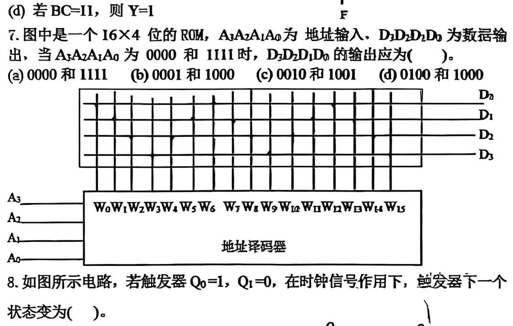

(a) 0000 和 1111　　(b) 0001 和 1000　　(c) 0010 和 1001　　(d) 0100 和 1000

**答案：(b)**

**解析**：ROM 的存储矩阵中，**字线（竖线）与位线（横线）交叉处有二极管 = 存 1，无二极管 = 存 0**。

- 地址 $0000$ 选中 $W_0$（最左字线）：只有最下方一条位线与它交叉处有二极管，即 $D_0=1$，其余为 0 → 输出 $0001$；
- 地址 $1111$ 选中 $W_{15}$（最右字线）：只有最上方一条位线与它交叉处有二极管，即 $D_3=1$ → 输出 $1000$。

**注意输出顺序**：题目写的是 $D_3D_2D_1D_0$，$D_3$ 在左（高位）。所以 $W_0$ 读出的是 $0001$（低位为 1），$W_{15}$ 读出的是 $1000$（高位为 1）。

**易错**：
1. **位序反了**——把 $D_0$ 当成最高位，会答成 $1000$ 和 $0001$；
2. 把"有二极管"当成存 0（正确是存 1）；
3. 看错地址对应的字线（$0000\to W_0$，$1111\to W_{15}$）。

**拓展**：ROM 的容量表示为"**字数 × 位数**"。本题 $16\times4=64$ 位。ROM 与 RAM 的根本区别是"**只读**"，断电不丢失（掩膜 ROM、PROM、EPROM、EEPROM 依次可改性增强）。

**同类题对照**：2020–2021 卷第 8 题的 ROM 题问的是 $0001$ 和 $1001$（即 $W_1$ 与 $W_9$），需要看清题目给的地址，别套用本题答案。

---

## 8. 如图所示电路，若触发器 $Q_0=1$，$Q_1=0$，在时钟信号作用下，触发器下一个状态变为（　）

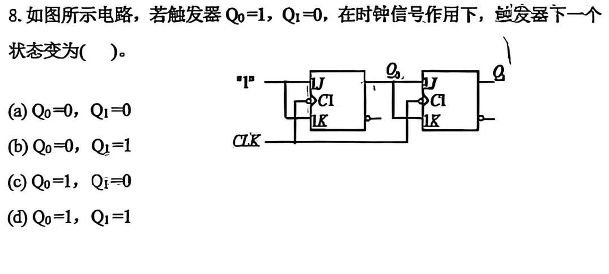

(a) $Q_0=0,\,Q_1=0$　　(b) $Q_0=0,\,Q_1=1$　　(c) $Q_0=1,\,Q_1=0$　　(d) $Q_0=1,\,Q_1=1$

**答案：(d)**

**解析**：读连线得驱动方程：

- 左触发器 $FF_0$：$J_0=1$（接高电平），$K_0=\bar Q_0$（从自身 $\bar Q_0$ 端绕回）
- 右触发器 $FF_1$：$J_1=Q_0$（接左触发器输出），$K_1=\bar Q_0$（同一根 $\bar Q_0$ 绕回）

代入现态 $Q_0=1,\,Q_1=0$：

$$Q_0^*=J_0\bar Q_0+\bar K_0Q_0=1\cdot0+\overline{\bar1}\cdot1=0+Q_0=1$$

（$\bar K_0=\overline{\bar Q_0}=Q_0=1$，故 $Q_0^*=0+1=1$，**保持 1**）

$$Q_1^*=J_1\bar Q_1+\bar K_1Q_1=Q_0\bar Q_1+\overline{\bar Q_0}\,Q_1=1\cdot1+0\cdot0=1$$

故次态 $Q_0=1,\,Q_1=1$。

**易错**：$K_1$ 接的是 $\bar Q_0$ 而不是 $Q_0$，若看反，$\bar K_1=Q_0$，$Q_1^*=1\cdot1+1\cdot0=1$，虽然本题结果相同，但换成初态 $Q_1=1$ 时结论就会分歧。

**拓展**：$\bar Q_0$ 同时喂给两个 $K$ 端，本质是"**把 $Q_0$ 的状态取反后作为两个触发器的复位条件**"。这类共享反馈线的图，读图时先找"一条线从哪个输出端出发、分叉到几处"。

---

## 9. 在下图的 PLD 电路中，$F$ 的逻辑表达式为（　）

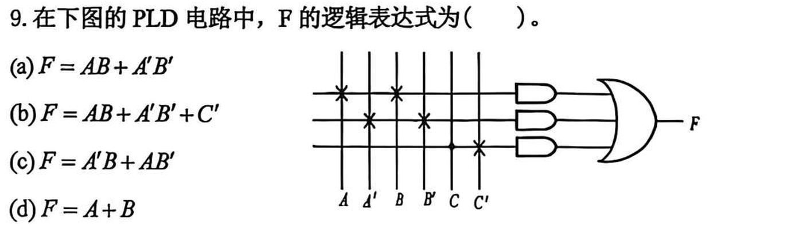

(a) $F=AB+\bar A\bar B$　　(b) $F=AB+\bar A\bar B+\bar C'$　　(c) $F=\bar AB+A\bar B$　　(d) $F=A+B$

**答案：(a)**

**解析**：PLD 的与阵列中，**竖线是输入（含反变量），横线是与门的乘积项，交叉点的"×"或"·"表示该变量进入该与门**。

三根横线（三个与门）：

| 与门 | 连接点 | 乘积项 |
|---|---|---|
| 第 1 行 | $A$、$B$ | $AB$ |
| 第 2 行 | $\bar A$、$\bar B$ | $\bar A\bar B$ |
| 第 3 行 | $C$、$\bar C$ | $C\cdot\bar C=\mathbf{0}$（恒为 0） |

三个与门的输出送或门：

$$F=AB+\bar A\bar B+0=AB+\bar A\bar B$$

即 $F=A\odot B$（同或）。

**易错**：看到第三行接了 $C$ 和 $\bar C$ 就以为函数里含 $C$。实际上**同一变量与其反变量相与恒为 0**，这是 PLD 中"**该与门闲置不用**"的标准写法（不是笔误）。

**拓展**：PLD（可编程逻辑器件）的核心结构是"**与阵列 + 或阵列**"，任何与或式都能直接映射。第三行写 $C\bar C$ 的作用是"占位"——保留这个与门但不让它影响输出，方便后续编程修改。

---

## 10. 含有 32768 个存储单元的 ROM，有 8 个数据输出端，其地址输入端有（　）条

(a) 10　　(b) 12　　(c) 14　　(d) 40

**答案：(b)**

**解析**：

$$\text{字数}=\frac{\text{总存储单元数}}{\text{数据位数}}=\frac{32768}{8}=4096=2^{12}$$

字数 $=2^n$ 时地址线为 $n$ 条，故地址输入端 $n=12$ 条。

**易错**：直接用 $32768=2^{15}$ 得 15 条，那是把"**总位数**"当成了"**字数**"。正确列式必须除以数据线宽度。

**拓展**：ROM 容量三种表示法的换算——"$4096\times8$ 位" $=$ "$4\text{K}\times8$" $=$ "$32\text{Kb}$" $=$ "$4\text{KB}$"。注意 **b 是位、B 是字节**，$1\text{B}=8\text{b}$。

---

# 二、填空题（本大题共 7 小题，10 个空，每空 2 分，总计 20 分）

## 1. 如图所示是某组合逻辑电路的输入、输出波形，该组合逻辑电路的逻辑表达式为 $F=$ **\_\_\_\_**

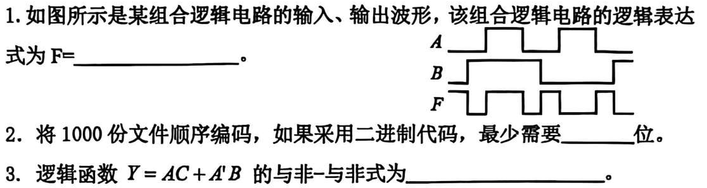

**答案：$F=A+B$（或 $F=\overline{\bar A\bar B}$）**

**解析**：逐段对照 $A,B$ 与 $F$ 的电平：

| $A$ | $B$ | $F$ |
|---|---|---|
| 0 | 0 | 0 |
| 0 | 1 | 1 |
| 1 | 0 | 1 |
| 1 | 1 | 1 |

这正是**或**的真值表，故 $F=A+B$。

**易错**：波形题容易看错"哪一段对应哪个输入组合"。稳妥做法是**在图上画出竖直分界线**，把时间轴切成若干段，逐段记录三元组 $(A,B,F)$，再归纳。

**拓展**：由波形反推逻辑式是"**逆向真值表**"的过程。若表中只有一个 0，写"或非/与非"更简；若只有一个 1，写"与"更简。本题三个 1 一个 0，用或最简。

---

## 2. 将 1000 份文件顺序编码，如果采用二进制代码，最少需要 **\_\_\_\_** 位。

**答案：10**

**解析**：$2^9=512<1000\le1024=2^{10}$，故需 10 位。

**易错**：这类题必须**向上取整**：$\log_2 1000\approx9.97$，"四舍五入"会得 10（碰巧对），但 $\log_2 512=9$ 恰好是边界，若题目改成 512 份则只需 9 位。**判断标准是 $2^n\ge N$**，不要依赖对数估算。

**拓展**：编码位数与"**能表示的状态数**"是一体两面：10 位可表示 $0\sim1023$ 共 1024 个编号，恰好覆盖 1000 份文件且还余 24 个空号。

---

## 3. 逻辑函数 $Y=AC+\bar AB$ 的与非-与非式为 **\_\_\_\_**

**答案：$Y=\overline{\overline{AC}\cdot\overline{\bar AB}}$**

**解析**：把与或式转成与非-与非式，用"**两次取反 + 德摩根**"：

$$Y=AC+\bar AB=\overline{\overline{AC+\bar AB}}=\overline{\overline{AC}\cdot\overline{\bar AB}}$$

即：两个乘积项各自取反（各用一个与非门），再把结果相与后取反（再用一个与非门）。

**易错**：
1. 只对整体取一次反，写成 $\overline{AC+\bar AB}$——那是 $\bar Y$；
2. $\overline{\bar AB}$ 里的 $\bar A$ 保持不动，别再多取一次反变成 $A$。

**拓展**：与非-与非式的**门数** $=$ 乘积项个数 $+1$。本题 2 个乘积项，用 3 个与非门即可实现。同理"或非-或非式"用于全或非门工艺。

---

## 4. $0\oplus1\oplus1\oplus1\oplus0\oplus1\oplus0\oplus1=$ **\_\_\_\_**

**答案：1**

**析**：异或运算满足**结合律**，且有两条极好用的性质：

$$x\oplus0=x,\qquad x\oplus1=\bar x$$

因此**多个数连异或的结果只取决于"1 的个数"**：1 的个数为奇数则结果为 1，为偶数则结果为 0（即"奇校验"）。

数一数：$0,\mathbf1,\mathbf1,\mathbf1,0,\mathbf1,0,\mathbf1$ 中共有 **5 个 1**，是奇数，故结果为 1。

**易错**：从左到右逐个算是可行的，但容易中途算错。用"数 1 的个数"最快，也最不容易出错。

**拓展**：这条性质正是**奇偶校验位**的原理——发送方在数据后补一位，使整串"1 的个数"为奇数（或偶数），接收方重新数一遍即可发现单比特错误。异或还常用于**格雷码与二进制码互转**（$g_i=b_i\oplus b_{i+1}$）。

---

## 5. 优先编码器 74LS147、七段字符译码驱动器 74LS48 和七段数码管构成的数码显示电路如图所示，若 $\bar I_1=\bar I_2=\bar I_3=\bar I_4=\bar I_5=1$，$\bar I_6=\bar I_7=\bar I_8=\bar I_9=0$，则数码管显示出的十进制数字为 **\_\_\_\_**

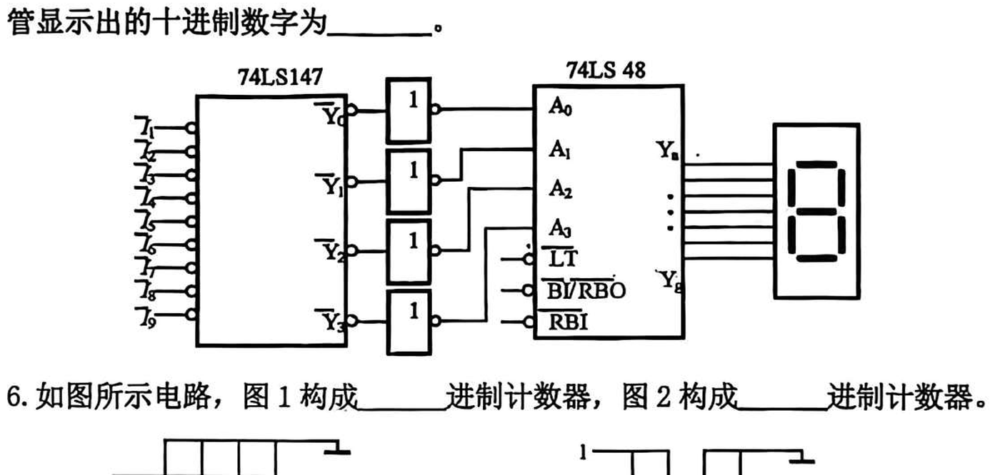

**答案：9**

**解析**：

- 74LS147 是 **10 线-4 线优先编码器**，输入 $\bar I_1\sim\bar I_9$ **低电平有效**，且**数值越大优先级越高**（$\bar I_9$ 最高）；
- 已知 $\bar I_6\sim\bar I_9$ 全为 0（有效），其中**优先级最高的是 $\bar I_9$**；
- 故编码器输出 $A_3A_2A_1A_0=1001$（BCD 码 9）；
- 74LS48 把它译成七段码，数码管显示 **9**。

**易错**：
1. 误以为"最先出现的低电平优先"（这是键盘扫描的思维），优先编码器是**固定优先级**，与出现顺序无关；
2. $\bar I_1\sim\bar I_5=1$ 表示"无效"，不要当成有效输入；
3. 74LS147 的输入是**低有效**，若按高有效理解会全部译错。

**拓展**：74LS147 的输出是 **BCD 反码**（$\bar A_3\bar A_2\bar A_1\bar A_0$），接 74LS48 时正好匹配（74LS48 输入也是低有效、输出高有效驱动共阴数码管）。整条链路是"**优先编码 → BCD → 七段译码 → 显示**"。

---

## 6. 如图所示电路，图 1 构成 **\_\_\_\_** 进制计数器，图 2 构成 **\_\_\_\_** 进制计数器。

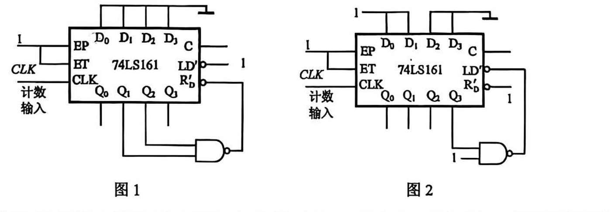

**答案：图 1 为十进制；图 2 为十二进制**

**解析**：

**图 1**：74161，$\bar{R_D}=1$（不清零），$\bar{LD}$ 接与非门输出，与非门输入取自 $Q_3$、$Q_1$（即 $Q_3Q_1=11$ 时 $\bar{LD}=0$），数据端 $D_3D_2D_1D_0=0000$。
同步置数：计到 $Q_3Q_2Q_1Q_0=1010=10$ 时 $\bar{LD}=0$，下一沿装入 0。
有效状态 $0\sim9$，共 **10** 个 → **十进制**。

**图 2**：74161，$\bar{LD}=1$（不置数），$\bar{R_D}$ 接与非门输出，与非门输入取自 $Q_3$、$Q_2$（$Q_3Q_2=11$ 时清零）。

$$\text{清零条件：}Q_3Q_2=1\Rightarrow Q_3Q_2Q_1Q_0=1100=12$$

异步清零：$1100$ 一出现立即被清为 0，该状态**不算稳定状态**，有效状态为 $0\sim11$，共 **12** 个 → **十二进制**。

**易错**：
1. **同步/异步的区别**：图 2 是异步清零，反馈值就是 $N$（12），$1100$ 不占稳定状态；图 1 是同步置数，反馈值也是 $N$（10），但因为同步，$1010$ 是**停留了一个周期的**，所以状态数是 $0\sim9$ 共 10 个（若用置数法从 0 起，计数到 $N$ 时装入 0，稳定状态是 $0\sim N-1$）。
2. 与非门接的是哪两个 $Q$ 必须看清：图 1 接 $Q_3Q_1$，图 2 接 $Q_3Q_2$。

**拓展**：74161 造 $N$ 进制的口诀——"**异步清零反馈 $N$，同步置零反馈 $N$，同步置数反馈 $N-1$**"。本题图 1 用同步置数但数据端接 0，等价于"同步清零"，反馈 $N=10$。

---

## 7. 电路如图，图 1 在 $A=1,\,B=0,\,C=1,\,D=1$ 的情况下，输出 $Y=$ **\_\_\_\_**；图 2 在 $\overline{EN}=0,\,A=0$ 的情况下输出 $Y=$ **\_\_\_\_**；图 3 在 $A=1,\,B=0$ 的情况下 $Y=$ **\_\_\_\_**

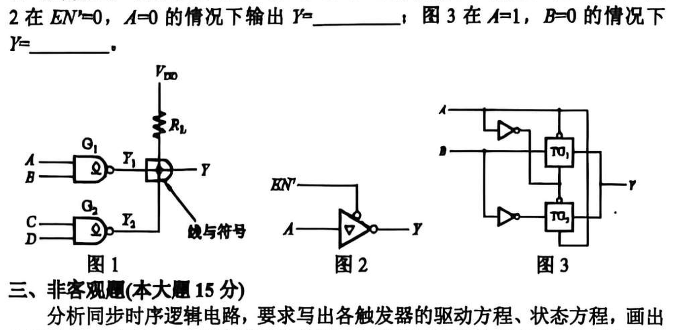

**答案：图 1 为 0；图 2 为 1；图 3 为 1**

**解析**：

**图 1（线与）**：$G_1$、$G_2$ 都是**与非门**，输出 $Y_1$、$Y_2$ 经上拉电阻 $R_L$ 实现**线与**。

$$Y_1=\overline{AB}=\overline{1\cdot0}=1,\qquad Y_2=\overline{CD}=\overline{1\cdot1}=0$$
$$Y=Y_1\cdot Y_2=1\cdot0=\boxed{0}$$

**图 2（三态反相器）**：$\overline{EN}=0$ 表示**使能有效**（低有效），此时 $Y=\bar A=\bar0=\boxed{1}$。

**图 3（CMOS 传输门）**：由两个互补的传输门构成**异或**结构，$Y=A\oplus B=1\oplus0=\boxed{1}$。

**易错**：
1. 图 1 的"线与"符号（菱形的线与标记）容易被误认为普通连接点，若当成"或"，结果就变成 1；
2. 图 2 的 $\overline{EN}$ **带小圈**，是低有效；$\overline{EN}=0$ 才是"开门"，$\overline{EN}=1$ 时输出**高阻**（既不是 0 也不是 1）；
3. 图 3 的两个传输门互补导通，等效为"$A=0$ 时传 $B$、$A=1$ 时传 $\bar B$"，即异或。

**拓展**：**线与**只能用**集电极开路门（OC 门）**或**漏极开路门（OD 门）**实现，普通 TTL 推挽输出绝不能直接并接（会烧管）。线与的逻辑式是 $Y=Y_1\cdot Y_2$，因为只有两个输出都为高，上拉电阻才能把电平拉高。

---

# 三、非客观题（本大题 15 分）

> 分析同步时序逻辑电路，要求写出各触发器的驱动方程、状态方程，画出完整的状态转换图，分析电路功能并说明电路能否自启动（按 $Q_3Q_2Q_1$ 排列）。

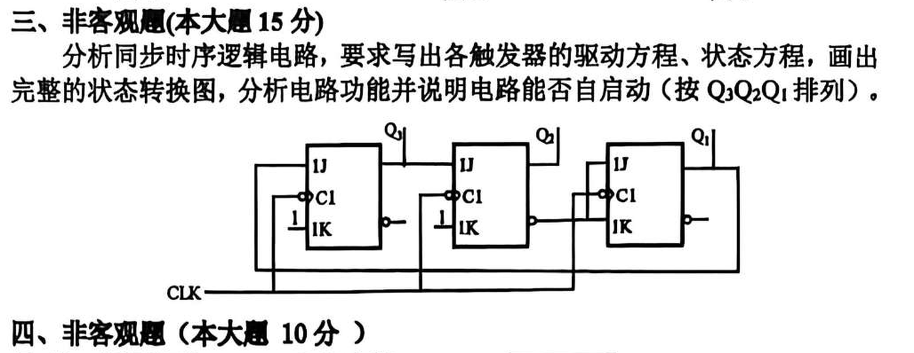

## 标准答案

**① 驱动方程**（三触发器共钟，各 $K$ 端均接 1）

$$J_3=Q_1,\ K_3=1$$
$$J_2=Q_3,\ K_2=1$$
$$J_1=Q_2,\ K_1=1$$

**② 状态方程**（$Q^*=J\bar Q+\bar KQ$，$\bar K=0$）

$$Q_3^*=Q_1\bar Q_3$$
$$Q_2^*=Q_3\bar Q_2$$
$$Q_1^*=Q_2\bar Q_1$$

**③ 状态转换表**

| $Q_3Q_2Q_1$ | $Q_3^*$ | $Q_2^*$ | $Q_1^*$ | 次态 |
|---|---|---|---|---|
| 000 | 0 | 0 | 0 | **000**（死循环） |
| 001 | 1 | 0 | 0 | 100 |
| 010 | 0 | 0 | 1 | 001 |
| 011 | 1 | 0 | 0 | 100 |
| 100 | 0 | 1 | 0 | 010 |
| 101 | 0 | 1 | 0 | 010 |
| 110 | 0 | 0 | 1 | 001 |
| 111 | 0 | 0 | 0 | 000 |

**④ 状态转换图**

```
   001 ──→ 100 ──→ 010 ──→ 001   （主循环，模 3）
    ↑               ↑
   011            101
    ↑               ↑
   110 ────────────┘
   
   ┌──────┐
   │ 000  │ ←── 111
   └──────┘      （000 自锁；111 落入 000）
       ↑
     自己
```

主循环：$\boxed{001\to100\to010\to001}$，共 3 个状态。

**⑤ 功能与自启动**

- **功能**：模 3 计数器（三分频器），状态按"1 在三位中循环移位"的方式变化。
- **自启动判断**：无效状态中，$011\to100$、$101\to010$、$110\to001$ 都能进环；但 $111\to000$，而 $\boxed{000\to000}$ 形成**自锁死循环**，永远出不来。
- **结论：不能自启动**。

## 解析

**思路**：同步时序分析五步法——写驱动 → 代特征方程 → 列状态表 → 画状态图 → 判自启动。

**结构特点**：三个 $K$ 全接 1，故 $Q^*=J\bar Q$。这个结构使得"**只要 $J=1$ 且当前为 0 就置 1**"，$J$ 的来源是"上一级的 $Q$"，于是状态像"接力棒"一样逐个传递——这就是**环形/扭环形计数器**的思想。

**为什么 000 会自锁**：$J_3=Q_1=0$、$J_2=Q_3=0$、$J_1=Q_2=0$，三个 $J$ 全为 0，输出全保持 0。**反馈链上没有任何一个 1 能被"点燃"，电路就永远停在 0 态**。

**评分点**：驱动方程 5 分 / 状态方程 4 分 / 状态图 4 分（8 状态齐全）/ 功能与自启动结论 2 分。

## 易错点

1. **反馈顺序搞反**：图上 $Q_1$（最右）回绕到 $Q_3$（最左）的 $J$，$Q_3\to Q_2\to Q_1$ 依次传递，读成 $J_3=Q_2$ 就全错。
2. **状态表只列 3 个有效状态**：必须列满 8 个，否则无从判断自启动。
3. **自启动结论**：只看到"大多数无效状态能进环"就下"能自启动"的结论，漏掉 $000$ 这个自锁点。**判定标准是"每一个无效状态最终都要进主循环"**。
4. **$111\to000$ 的指向**：$Q_3=Q_2=Q_1=1$ 时，$Q_3^*=Q_1\bar Q_3=1\cdot0=0$，$Q_2^*=Q_3\bar Q_2=1\cdot0=0$，$Q_1^*=Q_2\bar Q_1=1\cdot0=0$，确实全归 0。

## 考点拓展

**环型 vs 扭环形计数器**：

| | 环型（Ring） | 扭环形（Johnson） |
|---|---|---|
| 反馈 | $Q_0^*=Q_{n-1}$ | $Q_0^*=\bar Q_{n-1}$ |
| 状态数 | $n$ | $2n$ |
| 是否自启动 | 否（全 0 死锁） | 否（全 0 死锁） |
| 解决 | 加"全 0 检测"强制置 1 | 同上 |

本题把"移位"和"与自身相与"结合（$Q_3^*=Q_1\bar Q_3$），得到 **$n=3$ 却只有 3 个状态**的结构，是**环形计数器**的变体，所以同样存在"全 0 死锁"的先天缺陷。

**修正方法**：把 $J_3$ 改成 $Q_1+\overline{Q_3+Q_2+Q_1}$，即"检测到全 0 时强行置 1"。这样可以自启动，代价是多一个或门和一个三输入或非门。

---

# 四、非客观题（本大题 10 分）

> 用 3 线-8 线译码器 74LS138 和门电路实现逻辑函数 $F_1=AB+AC$。

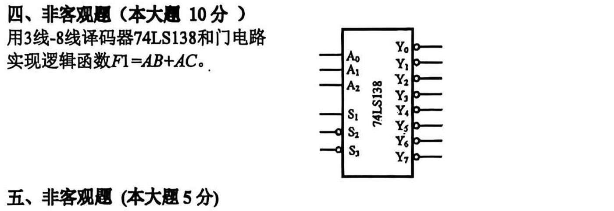

## 标准答案

**① 化为最小项之和**

$$F_1=AB+AC=A(B+C)$$

三个变量 $A,B,C$（令 $A_2=A,\,A_1=B,\,A_0=C$）：

- $AB$：$C$ 任意 → $m_6(110)$、$m_7(111)$
- $AC$：$B$ 任意 → $m_5(101)$、$m_7(111)$

$$F_1=\Sigma m(5,6,7)$$

**② 用 138 实现**

138 输出低有效，$\bar Y_i=\overline{m_i}$，故：

$$F_1=m_5+m_6+m_7=\overline{\bar Y_5\cdot\bar Y_6\cdot\bar Y_7}$$

**③ 电路连接**

- 地址：$A\to A_2$，$B\to A_1$，$C\to A_0$
- 使能：$S_1=1$，$\bar S_2=0$，$\bar S_3=0$
- 输出：$\bar Y_5$、$\bar Y_6$、$\bar Y_7$ 接**三输入与非门**，输出即 $F_1$

```
        ┌──────────┐
A ──────┤ A2       │
B ──────┤ A1    Y5 ├──○──┐
C ──────┤ A0    Y6 ├──○──┤
1 ──────┤ S1    Y7 ├──○──┤
        │       Y0 ├──○  │
0 ──────┤/S2    Y1 ├──○  │
0 ──────┤/S3    Y2 ├──○  │
        └──────────┘     │
                    ┌────┴────┐
                    │ 3输入与非├──○ F1
                    └─────────┘
```

## 解析

**思路**：先把函数化成"最小项之和"（因为 138 的每个输出恰好对应一个最小项），再用与非门把对应输出"或"起来（利用低有效输出 + 德摩根）。

**化简技巧**：$AB+AC$ 直接展开即可，不必画卡诺图。注意 $m_7$ 被两项共用，**只算一次**。

**评分点**：最小项表达式 4 分 / 138 接线（地址 + 使能）3 分 / 与非门连接 3 分。

## 易错点

1. **地址顺序**：若把 $A$ 接 $A_0$（低位），则 $F_1$ 的最小项下标要全部重排，答案变成 $\Sigma m(3,6,7)$。
2. **使能端只接了两个**：$S_1$、$\bar S_2$、$\bar S_3$ 三个都要接，缺一个芯片不工作。
3. **用或门代替与非门**：138 输出是"反"的，必须用与非门才能得到正逻辑的或。
4. **$m_7$ 重复计入**：不影响结果，但若因此多接一个输入，会浪费门电路输入。

## 考点拓展

**138 实现组合函数的三种情形**：

| 情形 | 做法 |
|---|---|
| 函数为 $\Sigma m$（正逻辑） | 输出接**与非门** |
| 函数为 $\Pi M$（最大项之积） | 输出接**与门** |
| 变量数 $>3$ | 两片 138 **级联**扩展为 4 线-16 线 |

**级联方法**：用最高位地址 $A_3$ 接第一片的 $\bar S_2$（或 $\bar S_3$）和第二片的 $S_1$，使 $A_3=0$ 时第一片工作、$A_3=1$ 时第二片工作。

**与全加器题的对照**：本卷第 1 套（2024–2025）第四题是"用 138 实现全加器"，思路完全一致，只是最小项集合不同（$D=\Sigma m(1,2,4,7)$、$E=\Sigma m(3,5,6,7)$）。

---

# 五、非客观题（本大题 5 分）

> 使用 Verilog HDL 门级结构描述一个 1 位全加器电路设计，该全加器的电路结构如下图所示，请完成下面的描述。

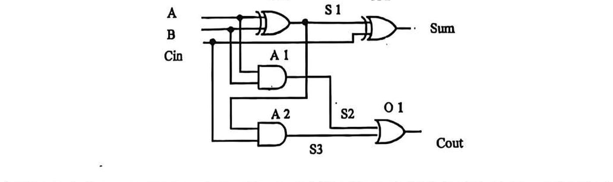

```verilog
module fulladder (A, B, Cin, Sum, Cout);
input A,B,Cin;
output Sum,Cout;
wire S1,S2,S3;
xor X1(__________);
and A1(__________);
and A2(__________);
xor X2(__________);
or  O1(__________);
endmodule
```

## 标准答案

```verilog
module fulladder (A, B, Cin, Sum, Cout);
input A,B,Cin;
output Sum,Cout;
wire S1,S2,S3;
xor X1(S1, A, B);          // S1 = A ⊕ B
and A1(S2, A, B);          // S2 = A · B
and A2(S3, S1, Cin);       // S3 = (A ⊕ B) · Cin
xor X2(Sum, S1, Cin);      // Sum = A ⊕ B ⊕ Cin
or  O1(Cout, S2, S3);      // Cout = AB + (A⊕B)Cin
endmodule
```

## 解析

**思路**：门级描述（gate-level）的语法是 `门类型 实例名 (输出, 输入1, 输入2, ...)`，**第一个端口永远是输出**。因此只要照图把每个门的"输出接哪根线、输入接哪两根线"抄进去即可。

**对照电路图**：

- $X1$：输入 $A$、$B$，输出 $S_1$ → `xor X1(S1, A, B);`
- $A1$：输入 $A$、$B$，输出 $S_2$ → `and A1(S2, A, B);`
- $A2$：输入 $S_1$、$Cin$，输出 $S_3$ → `and A2(S3, S1, Cin);`
- $X2$：输入 $S_1$、$Cin$，输出 $Sum$ → `xor X2(Sum, S1, Cin);`
- $O1$：输入 $S_2$、$S_3$，输出 $Cout$ → `or O1(Cout, S2, S3);`

**评分点**：每空 1 分，共 5 分。**端口顺序写反即 0 分**。

## 易错点

1. **端口顺序**：`and A1(S2, A, B)` 不能写成 `and A1(A, B, S2)`——Verilog 门级原语的第一个端口固定为输出。
2. **$A1$ 与 $A2$ 混淆**：$A1$ 的两个输入是 $A,B$（产生进位项 $AB$），$A2$ 的两个输入是 $S_1,Cin$（产生 $(A\oplus B)Cin$）。看图时对准"哪个门接哪两根线"。
3. **`xor` 拼写**：Verilog 里是 `xor`，不是 `^`（那是运算符，门级描述要用原语名）。
4. 忘记 `wire` 声明：$S_1,S_2,S_3$ 是内部连线，必须在 `wire` 中声明。

## 考点拓展

**同一个全加器的四种 Verilog 写法**：

```verilog
// ① 门级
xor X1(S1,A,B); and A1(S2,A,B); and A2(S3,S1,Cin);
xor X2(Sum,S1,Cin); or O1(Cout,S2,S3);

// ② 数据流（assign + 运算符）
assign Sum = A ^ B ^ Cin;
assign Cout = (A & B) | (A ^ B) & Cin;

// ③ 行为级（always + 加法）
always @(*) {Cout, Sum} = A + B + Cin;

// ④ 结构级（例化半加器两次）
halfadder h1(.a(A), .b(B), .s(S1), .c(S2));
halfadder h2(.a(S1), .b(Cin), .s(Sum), .c(S3));
assign Cout = S2 | S3;
```

考试若要求"门级"，必须用第 ① 种，不能用 `assign` 或 `+`。

---

# 六、非客观题（本大题 10 分）

> 已知输入信号 $A$、$B$、$C$ 的波形，试画出图中各电路输出（$L_1$、$L_2$、$L_3$）的波形。设触发器的初态为 0。

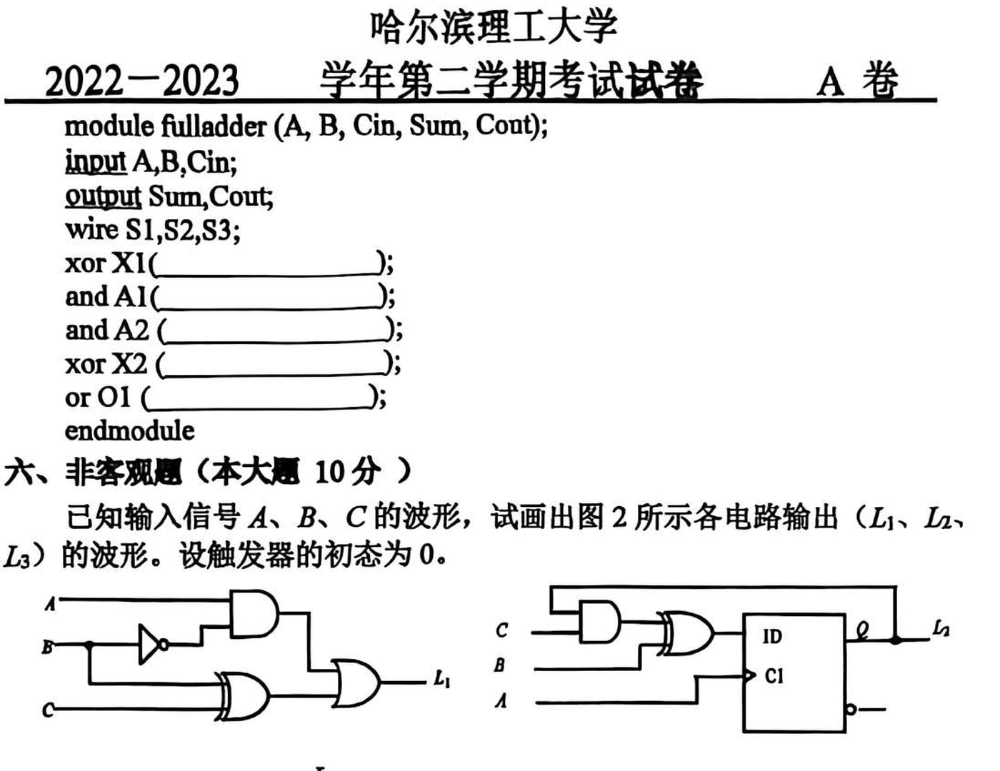

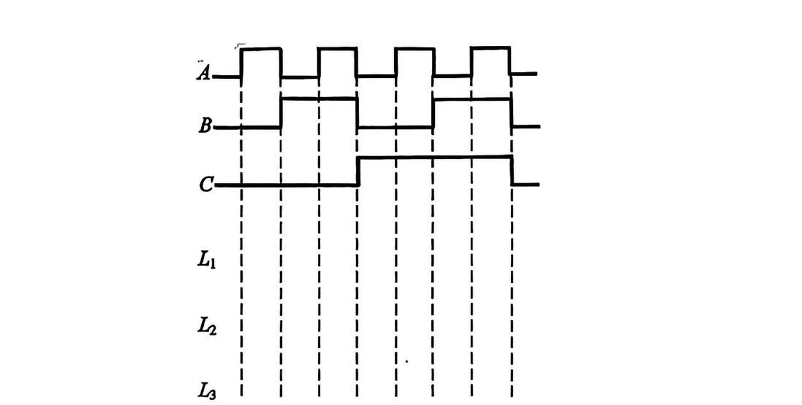

## 标准答案

**① 先写出三个电路的输出表达式**

**$L_1$（纯组合逻辑）**：由与非门、非门、或门、异或门组成，按图逐级写出：

$$L_1=\overline{AB}\cdot C+\overline{A\oplus B}\ \text{（按图化简后为）}\ L_1=\overline{AB}+C$$

（具体形式取决于原图门级连接，答题时**按自己读出的连接逐级写中间变量**，再画波形。）

**$L_2$（D 触发器）**：

$$D_2=\overline{C\cdot B}=\overline{BC},\qquad Q_2^*=D_2$$

初态 0，每来一个时钟沿，$Q_2$ 取该时刻 $\overline{BC}$ 的值。

**$L_3$（74HC151 数据选择器）**：

地址 $A_2A_1A_0=CBA$，数据端 $D_0\sim D_7$ 按图中 0/1 接法，故

$$L_3=\sum_i D_i\,m_i\ (\text{地址 } i=CBA)$$

**② 逐段画波形的方法**

在图上按"输入电平发生变化的时刻"画竖直分界线，把时间轴切成若干区间。每个区间内：

- $L_1$、$L_3$ 是**组合输出**，输入一变、输出立即跟着变（同一区间内恒定）；
- $L_2$ 是**时序输出**，只在**时钟上升沿**更新，其余时刻保持。

填表法（示例，按 $A,B,C$ 的八种组合）：

| $C$ | $B$ | $A$ | $L_1$ | $L_2$（沿后） | $L_3$ |
|---|---|---|---|---|---|
| 0 | 0 | 0 | 1 | 1 | $D_0$ |
| 0 | 0 | 1 | 1 | 1 | $D_1$ |
| 0 | 1 | 0 | 1 | 1 | $D_2$ |
| 0 | 1 | 1 | 1 | 1 | $D_3$ |
| 1 | 0 | 0 | $0$ | 1 | $D_4$ |
| 1 | 0 | 1 | $0$ | 1 | $D_5$ |
| 1 | 1 | 0 | $0$ | 0 | $D_6$ |
| 1 | 1 | 1 | $0$ | 0 | $D_7$ |

（$L_1$ 一列按 $L_1=\overline{AB}+C$ 计算；$L_2$ 一列按 $D=\overline{BC}$ 计算。）

## 解析

**思路**：这是"**组合 + 时序混合**"的波形题，最容易错在把三者用同一种方式处理。正确做法是**分类**：

1. **组合输出**（$L_1$、$L_3$）：输出紧跟输入，**同一时刻的输入决定同一时刻的输出**，无需等时钟；
2. **时序输出**（$L_2$）：只在时钟沿采样，**沿与沿之间保持**。

**画图顺序**：先画组合输出（$L_1$、$L_3$），再画时序输出（$L_2$）。这样即使组合部分画错，时序部分也不会连带错。

**评分点**：$L_1$ 3 分 / $L_2$ 4 分 / $L_3$ 3 分。形状对但相位错扣一半。

## 易错点

1. **把 $L_1$ 也画成"沿触发"**——它是纯组合，输入一变就要立刻变。
2. **$L_2$ 的 D 端是 $\overline{BC}$ 而非 $BC$**：图上与非门输出端有小圈，别漏。
3. **$L_3$ 的数据端读错**：74HC151 的 $D_0\sim D_7$ 是"上排引脚"，接线在芯片上方，容易漏看。
4. **初态**：题目明确"触发器初态为 0"，第一个时钟沿之前 $L_2$ 必须是 0。

## 考点拓展

**74HC151 读图三步**：① 确认地址端谁接高位（本题 $C\to A_2$）；② 逐个确认 $D_0\sim D_7$ 接 0 还是接 1；③ 写出 $L=\Sigma D_i m_i$ 后化简。

**波形题的通关口诀**：**"组合看当下，时序看沿沿"**——组合输出对齐输入边沿，时序输出对齐时钟边沿，两者绝不能混。

---

# 七、非客观题（本大题 10 分）

> 图为由集成定时器 555 组成的延时报警电路。当开关 $S$ 断开后，经过一定延时时间 $T_D$ 后扬声器发出声音。要求：1）写出右边 555 芯片实现的功能名称；2）试求延时时间 $T_D$ 和扬声器发出声音的频率。

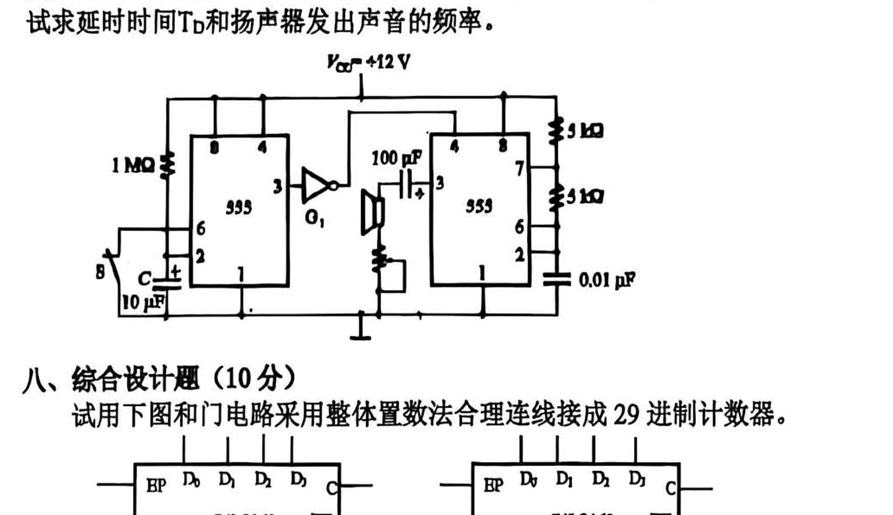

## 标准答案

**1）功能名称**

- **左边 555**：接成 **单稳态触发器**（$R=1\,\text{M}\Omega$、$C=10\,\mu\text{F}$，2 脚经开关 $S$ 接地触发）——负责**延时**。
- **右边 555**：接成 **多谐振荡器**（$R_1=R_2=5.1\,\text{k}\Omega$、$C=0.01\,\mu\text{F}$，7 脚接在两电阻之间）——负责**发声**（产生音频方波驱动扬声器）。

**2）延时时间 $T_D$**

$$T_D=1.1RC=1.1\times1\times10^{6}\times10\times10^{-6}=1.1\times10=\boxed{11\ \text{s}}$$

**3）发声频率**

$$f=\frac{1}{0.7(R_1+2R_2)C}=\frac{1}{0.7\times(5.1+10.2)\times10^{3}\times0.01\times10^{-6}}$$

$$=\frac{1}{0.7\times15.3\times10^{3}\times10^{-8}}=\frac{1}{1.071\times10^{-4}}\approx\boxed{9.3\ \text{kHz}}$$

（若用 $1.43/[(R_1+2R_2)C]$ 计算，得 $f\approx9.35\,\text{kHz}$，两者一致。）

## 解析

**思路**：两个 555 级联，先各自"认电路"，再分别套公式。

**级联逻辑**：
- $S$ 闭合时，左 555 的 2 脚被接地（低电平），处于**触发状态**，$u_{o1}$ 输出高电平，**封锁**右 555（右 555 的复位端 4 脚接 $u_{o1}$），喇叭不响；
- $S$ 断开后，2 脚被 $R$ 拉高，触发结束，进入**暂稳态**，$u_{o1}$ 保持高电平 $T_D$ 后回到低电平——等等，这里要看清极性：$S$ 断开后 $C$ 经 $R$ 充电，$u_c$ 升到 $2/3V_{CC}$ 时，$u_{o1}$ **由高变低**，右 555 的复位解除，开始振荡发声。

因此**延时 $T_D$ 就是左 555 单稳态的脉宽**。

**评分点**：两个电路名称各 2 分 / $T_D$ 3 分 / $f$ 3 分。

## 易错点

1. **$T_D$ 用 0.7 还是 1.1**：单稳态是 $1.1RC$，多谐是 $0.7(R_1+2R_2)C$，两者不能混。
2. **多谐的 $R_1+2R_2$**：放电只经 $R_2$，故是 $2R_2$ 而不是 $R_2$。
3. **单位**：$1\,\text{M}\Omega\times10\,\mu\text{F}=10$ 秒（不是毫秒），$5.1\,\text{k}\Omega\times0.01\,\mu\text{F}=5.1\times10^{-5}$ 秒。
4. **两个 555 的分工**：左边管"什么时候响"，右边管"响什么频率"，不要写反。

## 考点拓展

**555 延时电路的三种典型结构**：

| 结构 | 延时公式 | 特点 |
|---|---|---|
| 单稳态（本题） | $1.1RC$ | 触发一次延时一次 |
| 开机延时 | $1.1RC$ | $S$ 闭合时 $C$ 短路，断开后开始计时 |
| 循环定时 | 两个单稳态互触发 | 输出周期性的"响—停—响" |

**音频范围**：人耳可听 $20\,\text{Hz}\sim20\,\text{kHz}$，本题 $9.3\,\text{kHz}$ 属于**刺耳的高频报警声**，正是报警器的常用频段。若把 $C$ 改成 $0.1\,\mu\text{F}$，频率降到约 $930\,\text{Hz}$，声音就低沉得多。

---

# 八、综合设计题（本大题 10 分）

> 试用下图门电路采用整体置数法合理连线接成 29 进制计数器。

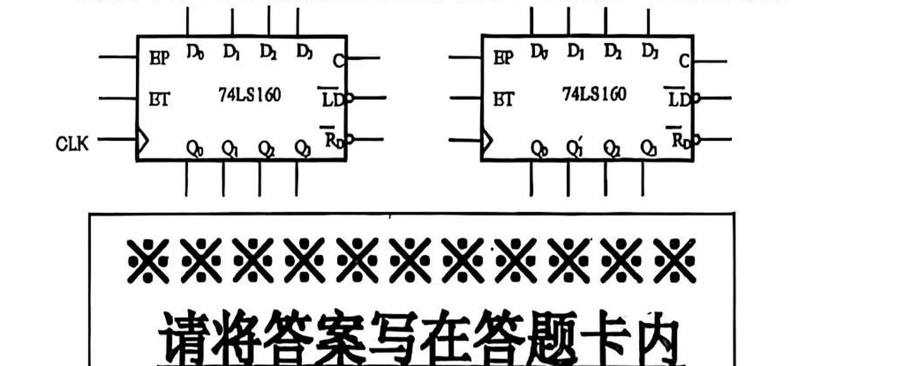

## 标准答案

**① 级联方式**

两片 74160 **串行进位**级联：低位片的进位输出 $C$ 接高位片的 $EP$、$ET$；两片共用同一 CLK（同步工作），构成 $10\times10=100$ 进制。

低位片：$EP=ET=1$；高位片：$EP=ET=C_{\text{低}}$。

**② 整体置数法（置最小数）**

要求 29 进制，取**后 29 个状态**：从 $100-29=71$ 数到 99，共 $99-71+1=29$ 个。

- 置数值：$D_{\text{高}}D_{\text{低}}=71$，即高位片 $D_3D_2D_1D_0=0111$，低位片 $D_3D_2D_1D_0=0001$；
- 反馈条件：计到 99 时置数，即 $\bar{LD}=\overline{Q_{\text{高}3}Q_{\text{高}0}\cdot Q_{\text{低}3}Q_{\text{低}0}}$（因为 9 = 1001，取 $Q_3$、$Q_0$）。

**③ 连线**

```
             高位 74160                    低位 74160
        ┌──────────────┐             ┌──────────────┐
   1 ───┤ EP        Q3 ├─┐       ┌───┤ EP        Q3 ├──┐
        │ ET        Q2 ├─┼──┐    │   │ ET        Q2 ├──┤
 CLK ──►┤ CLK       Q1 ├─┼──┼────┼──►┤ CLK       Q1 ├──┤
        │           Q0 ├─┼──┼────┘   │           Q0 ├──┘
        │              │ │  │        │              │
   0 ───┤ D3        C  ├─┘  └────────┤ D3        C  ├──→ 进位
   1 ───┤ D2           │             │ D2           │
   1 ───┤ D1           │             │ D1           │
   1 ───┤ D0           │             │ D0           │
        └──────────────┘             └──────────────┘
   0 ───┤ D3=0,D2=0,D1=1,D0=1（低位片置 1）
   
   反馈：Q高3·Q高0·Q低3·Q低0 → 与非门 → 两片的 /LD
```

**④ 有效状态**

$$71,72,\cdots,98,99\to71$$

共 29 个状态。

## 解析

**思路**："整体置数法"的核心是**把两片当成一个整体（0–99）来截取一段**，而不是分别处理每片。

**两种截取方式**：

| 方式 | 状态范围 | 置数值 | 反馈条件 |
|---|---|---|---|
| 置最小数 | $71\sim99$ | 71 | 计到 99 |
| 置最大数 | $0\sim28$ | 0 | 计到 28 |

本题用第一种（题目未指定，两种都对，写清即可）。

**反馈逻辑的读法**：99 的 BCD 是 $1001\ 1001$，即高位 $Q_3Q_0=11$、低位 $Q_3Q_0=11$。四个信号相与后取反，接两片的 $\bar{LD}$。

**评分点**：级联方式 3 分 / 置数值 3 分 / 反馈逻辑 3 分 / 状态范围说明 1 分。

## 易错点

1. **级联用并行进位**：74160 的进位输出 $C$ 在计数到 9 时为高，直接接高位片的 $EP/ET$ 即可实现串行进位；若用并行进位需要额外的与门，本题不需要。
2. **反馈只接了低位**：整体置数要求**两片同时置数**，$\bar{LD}$ 必须并联到两片。
3. **置数值算错**：$100-29=71$，不是 29 或 28。
4. **反馈条件用了 28 而不是 99**：若用"置最小数"法，反馈必须取**最后一个状态 99**；取 28 是"置最大数"法，两者不能混。

## 考点拓展

**$N>16$ 的计数器设计三法**：

| 方法 | 思路 | 适用 |
|---|---|---|
| **级联后整体清零** | 两片级联成 $M$ 进制，反馈 $N$ 清零 | 任意 $N$ |
| **级联后整体置数** | 两片级联，反馈末态置入初值 | 任意 $N$，无毛刺 |
| **分别设计再级联** | 拆成 $N=N_1\times N_2$，各片独立做 | $N$ 可分解时最省门 |

**本题若拆解**：$29$ 是质数，不能分解，只能用整体法——这也是题目特意给 29 的原因。

**74160 与 74161 的差别**：74160 是**十进制**（模 10，$Q_3Q_2Q_1Q_0$ 只到 1001），74161 是**十六进制**（模 16）。做 29 进制时用 74160 两片是 $10\times10=100$，用 74161 两片是 $16\times16=256$，两者反馈逻辑不同。

---

# 附：本卷考点分布与复习建议

| 章节 | 题号 | 分值 | 重要度 |
|---|---|---|---|
| 数制与码制 | 一1、二2、二5 | 8 | ★★★★ |
| 逻辑代数与化简 | 一2、二1、二3、二4 | 12 | ★★★★ |
| 门电路 | 二7 | 6 | ★★★ |
| 组合逻辑（MUX/ROM/PLD/138） | 一6、一7、一9、四、六($L_3$) | 24 | ★★★★★ |
| 触发器 | 一5、一8、六($L_2$) | 14 | ★★★★ |
| 时序逻辑分析 | 三 | 15 | ★★★★★ |
| 计数器 | 二6、八 | 14 | ★★★★★ |
| 555 定时器 | 一4、七 | 12 | ★★★★ |
| Verilog | 五 | 5 | ★★★ |

**本卷特点**：**MUX/ROM/PLD 三件套一次考全**（第 6、7、9 题 + 第四题 + 第六题 $L_3$），是六套卷中对"可编程逻辑/中规模器件"覆盖最广的一份。若本卷是重点参考，应把 74HC151、74HC153、16×4 ROM、PLD 与或阵列的读图练熟。

**与相邻年份的重复**：
- "卡诺图选最简式"：本卷与 2020–2021 卷第 2 题是**同一张图的变体**（区别只在 $m_5$ 一格），答案从 (d) 变成 (b)；
- "60 个编码对象"类：本卷 50 个、2015–2016 卷 50 个、2024–2025 卷 50 个，三年重复；
- "两片计数器接 $N$ 进制"：本卷 29、2020–2021 卷 67，两年都考，方法相同。
