# 2020—2021 学年第一学期《电子技术Ⅱ》期末考试 A 卷 · 全解

> **试卷来源**：`试卷/数电_20261017_202733.pdf` 第 11—18 页（原卷 8 页，**完整**）。
> **原卷信息**：哈尔滨理工大学 · 考试时间 100 分钟 · 试卷总分 100 分 · 考试班级 电气、电信、通信、电科、电技。
> **命题**：测通学院电子教研部 电子技术命题组｜系主任 何召兰｜考试日期 2020 年 12 月 23 日。

## 试卷结构速览

| 题号 | 题型 | 分值 | 覆盖内容 |
|---|---|---|---|
| 一 | 单项选择题（10×2 分） | 20 | 波形读函数、卡诺图、半加器、触发器功能、DAC、时序定义、JK 反馈、ROM、MUX |
| 二 | 填空题（7 小题、10 空×2 分） | 20 | 数制转换、编码位数、74LS147、存储器容量、74161、PLD、三态/线与/TG |
| 三 | 非客观题 | 12 | 同步时序电路分析（3 个 JK） |
| 四 | 非客观题 | 8 | Verilog 描述 → 画逻辑电路图 |
| 五 | 非客观题 | 10 | 555 占空比可调多谐振荡器 |
| 六 | 非客观题 | 10 | D/JK 触发器画波形 |
| 七 | 非客观题 | 10 | 74LS138 实现 $F_1=AB+AC$ |
| 八 | 综合设计题 | 10 | 两片 74161 接 67 进制 |

---

# 一、单项选择题（本大题共 10 小题，每小题 2 分，总计 20 分）

## 1. 如图所示是某组合逻辑电路的输入、输出波形，该组合逻辑电路的逻辑表达式为（　）

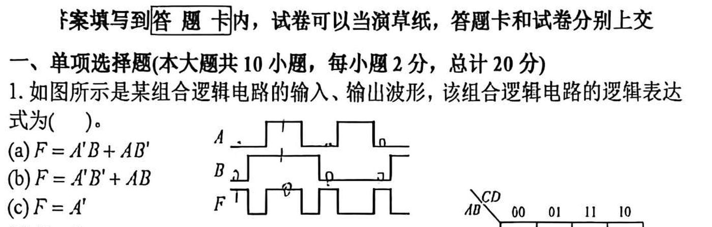

(a) $F=\bar AB+A\bar B$　　(b) $F=\bar A\bar B+AB$　　(c) $F=\bar A$　　(d) $F=B$

**答案：(a)**

**解析**：把时间轴按波形跳变处切开，逐段读 $(A,B)\to F$：

| $A$ | $B$ | $F$ |
|---|---|---|
| 0 | 0 | 0 |
| 0 | 1 | 1 |
| 1 | 0 | 1 |
| 1 | 1 | 0 |

"相异出 1、相同出 0"正是**异或**，故 $F=\bar AB+A\bar B=A\oplus B$。

**读图要点**：在图上画竖直分界线，把每一段的 $(A,B,F)$ 三元组抄下来，再与四个选项的真值表逐一比对。**不要凭"看起来像"直接猜**。

**易错**：(b) 是同或（相同出 1），波形上与异或**正好互补**。分辨方法：看 $A=B=0$ 那一段，$F$ 是高还是低——本题该段 $F$ 为低，故是异或。

**拓展**：异或的工程意义是"**不等比较器**"：$A\oplus B=1$ 表示两输入不同。它还是**半加器的和**（$S=A\oplus B$）与**奇校验**的核心运算。

---

## 2. 卡诺图化简的最简与或表达式为（　）

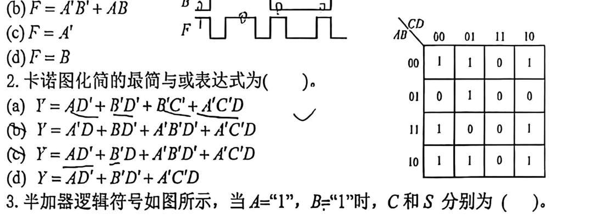

(a) $Y=A\bar D+\bar B\bar D+\bar B\bar C+\bar A\bar C\bar D$
(b) $Y=\bar AD+B\bar D+\bar A\bar B\bar D+\bar A\bar C\bar D$
(c) $Y=A\bar D+\bar BD+\bar A\bar B\bar D+\bar A\bar C\bar D$
(d) $Y=A\bar D+\bar B\bar D+\bar A\bar C\bar D$

**答案：(d)**

**解析**：读卡诺图（行 $AB$、列 $CD$，格雷码顺序）：

| $AB\backslash CD$ | 00 | 01 | 11 | 10 |
|---|---|---|---|---|
| **00** | 1 | 1 | 0 | 1 |
| **01** | 0 | **1** | 0 | 0 |
| **11** | 1 | 0 | 0 | 1 |
| **10** | 1 | 1 | 0 | 1 |

为 1 的格子：$m_0,m_1,m_2,m_5,m_8,m_9,m_{10},m_{12},m_{14}$。

**圈组**：

1. $m_8,m_{10},m_{12},m_{14}$（右侧 4 格）→ $A\bar D$
2. $m_0,m_2,m_8,m_{10}$（上下跨行的 4 格）→ $\bar B\bar D$
3. $m_1,m_5$（第 2 列的 2 格）→ $\bar A\bar C\bar D$

$$Y=A\bar D+\bar B\bar D+\bar A\bar C\bar D$$

**易错**：
1. 本题与 2022–2023 卷第 2 题**只差一格**——本题 $m_5=1$（2022–2023 卷该格为 0），所以要多一项 $\bar A\bar C\bar D$。**做题时绝不能凭记忆套答案**。
2. $m_5$ 单独一个 1，只能与 $m_1$ 合成 2 格圈，不能与 $m_4$（为 0）圈在一起。
3. 选项 (a) 多了 $\bar B\bar C$，那是把 $m_0,m_1,m_8,m_9$ 圈成 4 格——但 $m_9$ 是 1、$m_8$ 是 1，$m_0,m_1$ 是 1，这四格确实全为 1，看似能圈……**但圈了之后 $m_1$ 已被覆盖，第三组就变成冗余**，反而多一项。最简要求项数最少，故选 (d)。

**拓展**：卡诺图化简的"**必要质蕴含项**"概念——若某个 1 只能被一个圈覆盖，那个圈必须保留。本题 $m_5$ 只被 $\bar A\bar C\bar D$ 覆盖，故该项是必要的。

---

## 3. 半加器逻辑符号如图所示，当 $A="1"$，$B="1"$ 时，$C$ 和 $S$ 分别为（　）

(a) $S=0,\ C=0$　　(b) $S=1,\ C=0$　　(c) $S=0,\ C=1$　　(d) $S=1,\ C=1$

**答案：(c)**

**解析**：半加器实现 $A+B$，输出本位和 $S$ 与进位 $C$：

$$S=A\oplus B,\qquad C=AB$$

代入 $A=B=1$：$S=1\oplus1=0$，$C=1\cdot1=1$，即"$1+1=10$"，和为 0、进位为 1。

**易错**：把 $S$、$C$ 的位置记反（$S$ 是和、$C$ 是进位）。另注意半加器**没有来自低位的进位输入**，这是它与全加器的唯一区别。

**拓展**：半加器的两种实现——① 一个异或门 + 一个与门；② 用 4 个与非门（$S=\overline{\overline{A\cdot\overline{AB}}\cdot\overline{B\cdot\overline{AB}}}$）。全加器则由**两个半加器 + 一个或门**构成。

---

## 4. 如图所示电路，触发器在时钟信号作用下，输出保持不变的是（　）

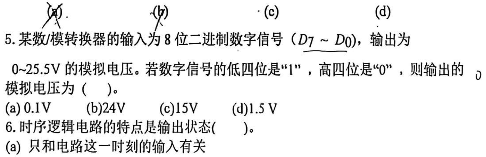

**答案：(d)**

**解析**：与 2024–2025 卷第 6 题**同一组图**，逐个代入特征方程：

| 选项 | 接法 | 结果 |
|---|---|---|
| (a) | $J=1$，$K=\bar Q$ | $Q^*=1$（恒置 1） |
| (b) | $J=K=1$ | $Q^*=\bar Q$（翻转） |
| (c) | $D=\bar Q$ | $Q^*=\bar Q$（翻转） |
| (d) | $J=Q$，$K=\bar Q$ | $Q^*=Q$（**保持**）✔ |

**易错**：判断"保持"要盯住 $J$、$K$ 是"接固定电平"还是"接 $Q$ 的反馈"。本题 (d) 的 $J$、$K$ 分别从 $Q$、$\bar Q$ 引回，构成自保持回路。

**拓展**：这个电路的意义是"**把 JK 触发器接成 D 锁存器之外的另一种锁存形式**"——它不需要额外的非门，只用两条反馈线就能锁存状态。

---

## 5. 某数/模转换器的输入为 8 位二进制数字信号（$D_7\sim D_0$），输出为 0~25.5 V 的模拟电压。若数字信号的低四位是"1"，高四位是"0"，则输出的模拟电压为（　）

(a) 0.1 V　　(b) 24 V　　(c) 15 V　　(d) 1.5 V

**答案：(d)**

**解析**：

$$\text{最小输出（1 LSB）}=\frac{V_{\max}}{2^8-1}=\frac{25.5}{255}=0.1\ \text{V}$$

输入 $D_7D_6D_5D_4D_3D_2D_1D_0=00001111$，其十进制值为 15，故

$$u_o=15\times0.1=1.5\ \text{V}$$

**易错**：
1. 分母用 $2^8=256$（得 $0.0996$ V，误差虽小但不标准）。**满量程对应 $2^n-1$**，故除 $255$。
2. 把"低四位是 1"当成 $11110000$（低四位在左）。**$D_0$ 是最低位**，低四位是 $D_3D_2D_1D_0$。

**拓展**：DAC 的三个关键参数——**分辨率**（1 LSB 对应的电压）、**满量程**（$V_{FS}$）、**转换精度**（实际输出与理想值的偏差）。8 位 DAC 的分辨率是满量程的 $1/255\approx0.39\%$。

---

## 6. 时序逻辑电路的特点是输出状态（　）

(a) 只和电路这一时刻的输入有关
(b) 只和电路原来的状态有关
(c) 不仅和电路这一时刻的输入有关，而且和电路原来的状态有关
(d) 和输入和原来状态都无关

**答案：(c)**

**解析**：时序电路的输出方程一般形式为

$$Z=F(X,Q^n)$$

即输出由**当前输入 $X$** 与**现态 $Q^n$** 共同决定。这也是"记忆功能"的来源——状态 $Q^n$ 里存着过去输入的历史信息。

**易错**：(b) 只说了"状态"，漏了"输入"。对于 **Moore 型**电路，输出确实只与状态有关（$Z=F(Q^n)$）；但**题目问的是时序电路的一般特点**，应以 Mealy 型（含输入）为准。

**拓展**：Moore 与 Mealy 的判别——看输出方程里有没有输入变量：**有输入是 Mealy，没有是 Moore**。Moore 输出与时钟同步、无毛刺；Mealy 响应更快但可能有竞争冒险。

---

## 7. JK 触发器连接图如下，输出状态方程为（　）

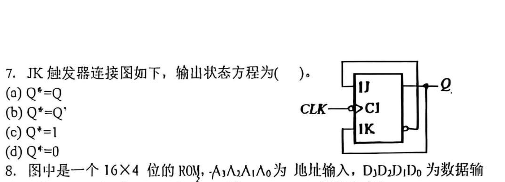

(a) $Q^*=Q$　　(b) $Q^*=\bar Q$　　(c) $Q^*=1$　　(d) $Q^*=0$

**答案：(a)**

**解析**：读图得 $J=Q$（从 $Q$ 端绕回）、$K=\bar Q$（从 $\bar Q$ 端绕回），代入特征方程：

$$Q^*=J\bar Q+\bar KQ=Q\bar Q+\overline{\bar Q}\,Q=0+Q=Q$$

即"**保持**"功能。

**易错**：$K$ 端前面有小圆圈（$\bar Q$ 输出），故 $K=\bar Q$ 而非 $Q$。若误读成 $K=Q$，则 $Q^*=Q\bar Q+\bar QQ=0$，会选成"置 0"。

**拓展**：这是"**用 JK 触发器实现 T 锁存/保持**"的标准接法。与第 4 题 (d) 图**完全一致**，属于同一考点的两种问法（一问功能、一问方程）。

---

## 8. 图中是一个 $16\times4$ 位的 ROM，$A_3A_2A_1A_0$ 为地址输入，$D_3D_2D_1D_0$ 为数据输出，当 $A_3A_2A_1A_0$ 为 0001 和 1001 时，$D_3D_2D_1D_0$ 的输出应为（　）

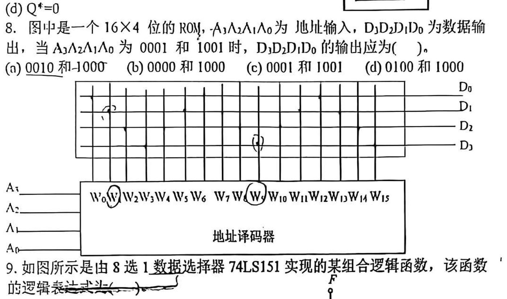

(a) 0010 和 1000　　(b) 0000 和 1000　　(c) 0001 和 1001　　(d) 0100 和 1000

**答案：(a)**

**解析**：

- $0001$ 选中 $W_1$（第 2 条字线）：只有 $D_1$ 那条位线与它有二极管 → 输出 $0010$（注意顺序 $D_3D_2D_1D_0$，$D_1=1$ 在**倒数第二位**）；
- $1001$ 选中 $W_9$（第 10 条字线）：只有 $D_3$ 那条位线有二极管 → 输出 $1000$。

**易错**：
1. 把 $D_1=1$ 写成 $0001$——混淆了 $D_0$ 和 $D_1$ 的位置；
2. 地址 $1001$ 对应 $W_9$ 而不是 $W_{10}$（字线编号从 $W_0$ 开始）；
3. 把"有二极管"当存 0。

**拓展**：ROM 的"存储矩阵"读图法——**横线是位线（输出），竖线是字线（被地址选中），交叉点的二极管表示该位存 1**。这与 PLD 的与阵列画法相似，但含义不同：ROM 是"查表"，PLD 是"做运算"。

---

## 9. 如图所示是由 8 选 1 数据选择器 74LS151 实现的某组合逻辑函数，该函数的逻辑表达式为（　）

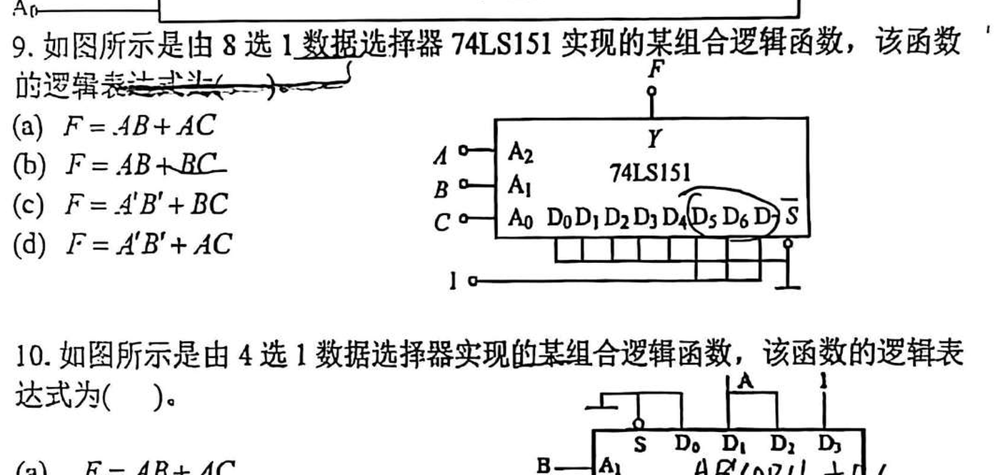

(a) $F=AB+AC$　　(b) $F=AB+BC$　　(c) $F=\bar A\bar B+BC$　　(d) $F=\bar A\bar B+AC$

**答案：(a)**

**解析**：

- 地址：$A\to A_2$，$B\to A_1$，$C\to A_0$，地址码 $ABC$；
- 使能 $\bar S=0$（接地，有效）；
- 数据端：$D_0\sim D_4=0$（接另一条线/地），$D_5,D_6,D_7=1$（接高电平）。

$$F=\sum_iD_i m_i=m_5+m_6+m_7$$

$$m_5=A\bar BC,\quad m_6=AB\bar C,\quad m_7=ABC$$

$$F=A\bar BC+AB\bar C+ABC=AB(\bar C+C)+A\bar BC=AB+A\bar BC=AB+AC$$

**易错**：$D_5,D_6,D_7$ 接的是"1"，其余接"0"——读图时看**每个数据引脚向下引出的线接哪一排**，接"1"排的为 1。若看反（以为 $D_0\sim D_2$ 接 1），结果会变成 $\bar A\bar B$ 系列。

**拓展**：MUX 的输出表达式也可写成"**卡诺图按地址分组**"的形式：

$$F=D_0\bar A\bar B\bar C+D_1\bar A\bar BC+\cdots$$

本题只有 $D_5,D_6,D_7$ 为 1，对应卡诺图右下角三格，圈图后正好是 $AB+AC$。

---

## 10. 如图所示是由 4 选 1 数据选择器实现的某组合逻辑函数，该函数的逻辑表达式为（　）

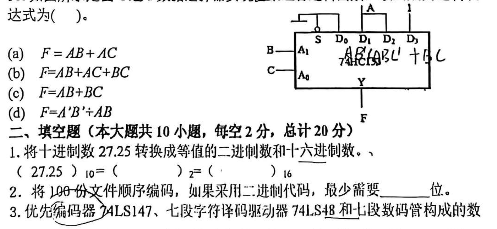

(a) $F=AB+AC$　　(b) $F=AB+AC+BC$　　(c) $F=AB+BC$　　(d) $F=\bar A\bar B+AB$

**答案：(b)**

**解析**：

- 地址：$B\to A_1$，$C\to A_0$，地址码 $BC$；
- 数据端：$D_0=0$，$D_1=A$，$D_2=A$，$D_3=1$。

$$F=D_0\bar B\bar C+D_1\bar BC+D_2B\bar C+D_3BC=0+A\bar BC+AB\bar C+BC$$

$$F=A(\bar BC+B\bar C)+BC=A(B\oplus C)+BC$$

展开验证：$A(B\oplus C)+BC=AB\bar C+A\bar BC+BC$

- $A=1,B=1,C=0$ → $1\cdot1\cdot1+0+0=1$ ✔
- $A=0,B=1,C=1$ → $0+0+1=1$ ✔
- $A=1,B=0,C=1$ → $0+1+0=1$ ✔

而 $AB+AC+BC$ 在这三种情况下也都是 1，两者等价（这就是"**三人表决器**"）。

**易错**：$D_1$、$D_2$ 都接 $A$，容易只看一个。若漏掉 $D_2=A$，会得 $F=AB+AC$（选项 a）——少了一项 $BC$。

**拓展**：**三人表决器** $F=AB+AC+BC$ 是历年高频函数，它的三种等价形式：
- 与或式：$AB+AC+BC$
- 用 MUX 实现：4 选 1 + $D_1=D_2=A$、$D_3=1$（本题）
- 用 138 实现：$\Sigma m(3,5,6,7)$

---

# 二、填空题（本大题共 7 小题，10 个空，每空 2 分，总计 20 分）

## 1. 将十进制数 27.25 转换成等值的二进制数和十六进制数。$(27.25)_{10}=(\ \ \ )_2=(\ \ \ )_{16}$

**答案：$11011.01$；$1\text{B}.4$**

**解析**：

- 整数：$27=16+8+2+1=11011_2$；
- 小数：$0.25\times2=0.5$（取 0），$0.5\times2=1.0$（取 1）→ $0.01_2$。

$$27.25=11011.01_2$$

转十六进制：从十进制小数点向两侧**四位一组**——$0001\ 1011\ .\ 0100$ → $1\text{B}.4$。

**验算**：$1\times16+11+4/16=16+11+0.25=27.25$ ✔

**易错**：小数部分"乘 2 取整"要**从上往下顺着写**，不是倒序。$0.25\to0.5$ 取 0、$0.5\to1.0$ 取 1，结果 $0.01$；若倒着写就成 $0.10=0.5$，错。

**拓展**：二进制与十六进制互转是**唯一"无损快速"的进制转换**（因为 $16=2^4$），十进制与二进制互转则需逐位计算。考试中常利用这一点：**先把十进制转成二进制，再四位一组转十六进制**。

---

## 2. 将 100 份文件顺序编码，如果采用二进制代码，最少需要 **\_\_\_\_** 位。

**答案：7**

**解析**：$2^6=64<100\le128=2^7$，故需 7 位。

**易错**：$\log_2 100\approx6.64$，向上取整得 7；但若用"四舍五入"会得 7（碰巧正确）。**必须用 $2^n\ge N$ 判断**，不能靠对数估算。

**拓展**：编码位数与"可表示的状态数"是一体两面。7 位可表示 $0\sim127$ 共 128 个编号，编 100 份文件后还剩 28 个空号（可用于校验或扩展）。

---

## 3. 优先编码器 74LS147、七段字符译码驱动器 74LS48 和七段数码管构成的数码显示电路如图所示，若 $\bar I_1=\bar I_2=\bar I_3=\bar I_4=1$，$\bar I_6=\bar I_7=\bar I_8=\bar I_9=0$，则数码管显示出的十进制数字为 **\_\_\_\_**

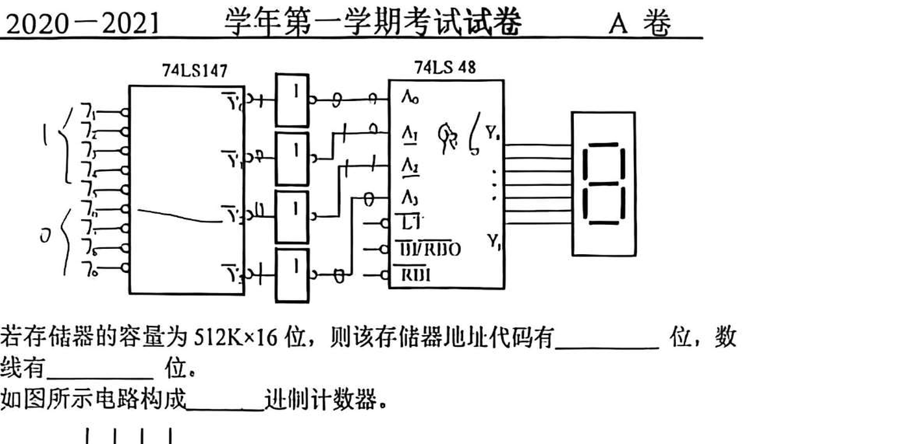

**答案：9**

**解析**：74LS147 的输入**低电平有效**，且**数值越大优先级越高**。$\bar I_6\sim\bar I_9$ 全为 0，其中优先级最高的是 $\bar I_9$，故输出 BCD 码 9，数码管显示 **9**。

**易错**：
1. 题目**未给** $\bar I_5$ 的值（只给了 1~4 和 6~9），这不影响结论——因为 $\bar I_9$ 优先级最高，压过一切；
2. 若误认为"优先级最低的有效"，会答成 6。

**拓展**：74LS147 是 **10 线-4 线**优先编码器（$I_1\sim I_9$ 共 9 个输入 + 一个"无输入"隐含状态），输出为 **BCD 反码**。它与 74LS148（8 线-3 线）常被对比考。

---

## 4. 若存储器的容量为 $512\text{K}\times16$ 位，则该存储器地址代码有 **\_\_\_\_** 位，数据线有 **\_\_\_\_** 位。

**答案：19；16**

**解析**：

- 字数 $512\text{K}=512\times1024=524288=2^{19}$ → 地址线 **19** 位；
- 每个字 16 位 → 数据线 **16** 位。

**易错**：$512\text{K}$ 中的 K 是 $1024=2^{10}$，故 $512\text{K}=2^9\times2^{10}=2^{19}$。若按 $1000$ 算会得错误结果。

**拓展**：存储器容量三种写法互换——$512\text{K}\times16=2^{19}\times16$ 位 $=8\text{Mb}=1\text{MB}$。注意 **b（bit）与 B（Byte）差 8 倍**，这是硬件题最常见的丢分点。

---

## 5. 如图所示电路构成 **\_\_\_\_** 进制计数器。

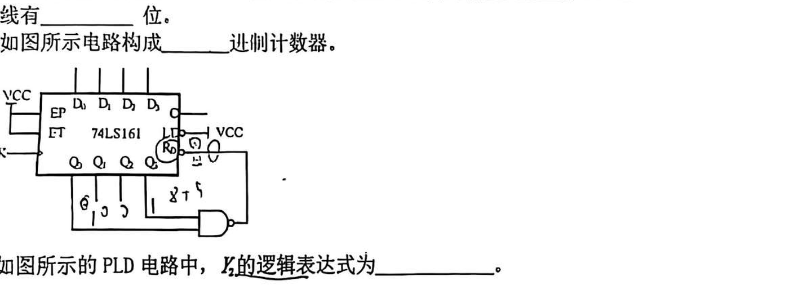

**答案：九进制**

**解析**：

- $EP=ET=1$（允许计数），$\bar{LD}=1$（不置数）；
- $\bar{R_D}$ 接与非门输出，与非门的两个输入取自 $Q_0$ 与 $Q_3$；
- 故 $\bar{R_D}=\overline{Q_0Q_3}$，当 $Q_3Q_2Q_1Q_0=1001=9$ 时 $\bar{R_D}=0$。

74161 的 $\bar{R_D}$ 是**异步清零**：9 一出现立即被清为 0，**9 不是稳定状态**。有效状态为 $0\sim8$，共 **9** 个。

**易错**：
1. 把异步清零当成同步，误算成 10 个状态；
2. 反馈取自 $Q_0Q_3$ 而不是 $Q_1Q_3$（后者对应 1010 = 10，才是十进制）。

**拓展**：74161 异步清零做 $N$ 进制时，**反馈值就是 $N$**（因为第 $N$ 个状态瞬现即消）。这与"同步置数"的反馈值 $N-1$ 形成鲜明对比，是每年必考的判断点。

---

## 6. 如图所示的 PLD 电路中，$Y_1$ 的逻辑表达式为 **\_\_\_\_**

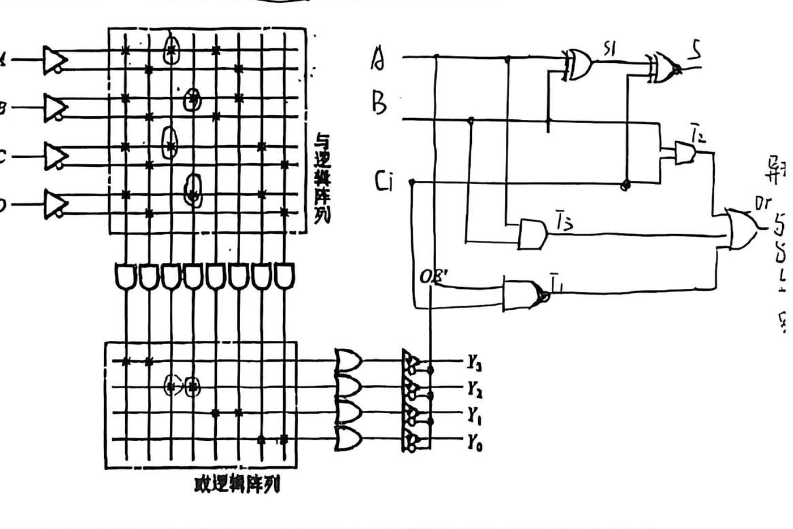

**答案：按卷面点阵读数，$Y_1$ 为两个乘积项之和（见解析）**

**解析（读图方法）**：

这是一张 4 输入（$A,B,C,D$）、8 个与门、4 个或门的 PLD 阵列图，读图分两步：

**第一步：读与阵列（上方的"与逻辑阵列"）**
每一条水平线是一个与门，竖线是输入及其反变量。某个交叉点画"×"或"•"，表示该输入进入这个与门。
逐行读出 8 个乘积项 $P_0\sim P_7$。

**第二步：读或阵列（下方的"或逻辑阵列"）**
每个或门把若干乘积项相加，得到 $Y_1\sim Y_4$。$Y_1$ 对应最上面那个或门，把它所连的乘积项相加即可。

**关键提示**：原卷此处点阵密集、且有同学的手写批注叠加，**逐点辨识存在歧义**。考试时若遇到同类图，建议：
1. 先数清输入线（本题 4 个变量 → 8 条竖线）；
2. 每条横线从左往右逐点扫，记录"第几条竖线有点"；
3. 竖线编号规则是 $A,\bar A,B,\bar B,C,\bar C,D,\bar D$ 交替排列，**先确认这个顺序再数**。

**拓展**：PLD 的三种类型——**PROM**（与阵列固定、或阵列可编程）、**PLA**（与、或阵列**都可编程**）、**PAL**（与阵列可编程、或阵列固定）。本题图示为 **PLA**（两个阵列都有可编程点）。

---

## 7. 电路如图，图 1 在 $A=1,\,B=0,\,C=0,\,D=1$ 的情况下，输出 $Y=$ **\_\_\_\_**；图 2 在 $\overline{EN}=0,\,A=1$ 的情况下输出 $Y=$ **\_\_\_\_**；图 3 在 $A=1,\,B=0$ 的情况下 $Y=$ **\_\_\_\_**

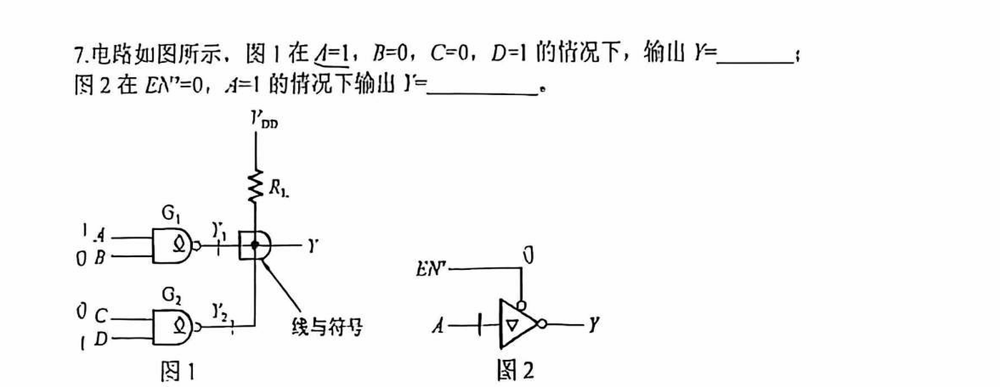

**答案：图 1 为 1；图 2 为 0；图 3 为 1**

**解析**：

**图 1（线与）**：$Y_1=\overline{AB}=\overline{1\cdot0}=1$，$Y_2=\overline{CD}=\overline{0\cdot1}=1$，线与后

$$Y=Y_1\cdot Y_2=1\cdot1=\boxed{1}$$

**图 2（三态反相器）**：$\overline{EN}=0$ → 使能有效，$Y=\bar A=\bar1=\boxed{0}$。

**图 3（CMOS 传输门）**：互补传输门构成异或功能，$Y=A\oplus B=1\oplus0=\boxed{1}$。

**易错**：
1. 图 1 的"线与"是**与**不是或——只有两个输出都为高，上拉电阻才能把电平拉到高；
2. 图 2 的 $\overline{EN}$ 低有效，$\overline{EN}=0$ 才工作，$\overline{EN}=1$ 时输出高阻；
3. 图 3 的传输门是**互补**结构（一个 NMOS 一个 PMOS），等效为异或而不是同或。

**拓展**：三道小题分别对应"**线与 / 三态 / 传输门**"三个 CMOS-TTL 接口考点，是本课程最常成套出现的组合题。记忆要点：
- 线与 → 必须 OC/OD 门 + 上拉电阻；
- 三态 → 用于总线分时复用；
- 传输门 → 用于模拟开关、异或/同或、D 锁存器。

---

# 三、非客观题（本大题 12 分）

> 试分析同步时序逻辑电路，要求写出各触发器的驱动方程、状态方程，输出方程，画出完整的状态转换图（按 $Q_3Q_2Q_1$ 排列）。

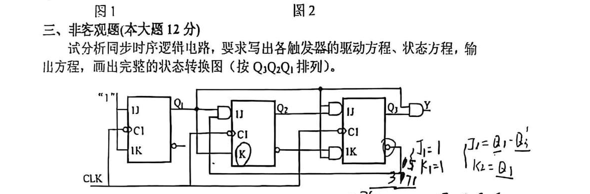

## 标准答案

**① 驱动方程**（三触发器共钟，各 $K$ 端均接 1）

由图示反馈：$J_3=Q_1$，$J_2=Q_3$，$J_1=Q_2$，$K_3=K_2=K_1=1$。

**② 状态方程**

$$Q_3^*=Q_1\bar Q_3,\qquad Q_2^*=Q_3\bar Q_2,\qquad Q_1^*=Q_2\bar Q_1$$

**③ 输出方程**

本题输出即各触发器的 $Q$ 端，无额外组合输出（若图上 $Y$ 取自某个 $Q$，则 $Y=Q_i$）。

**④ 状态转换表**

| $Q_3Q_2Q_1$ | 次态 | 说明 |
|---|---|---|
| 000 | 000 | 自锁（死循环） |
| 001 | 100 | 进主循环 |
| 010 | 001 | 进主循环 |
| 011 | 100 | 进主循环 |
| 100 | 010 | 进主循环 |
| 101 | 010 | 进主循环 |
| 110 | 001 | 进主循环 |
| 111 | 000 | 落入死循环 |

**⑤ 状态转换图**

```
   001 ──→ 100 ──→ 010 ──→ 001      （主循环，模 3）
    ↑        ↑
   110      011 / 101
   
   000 ⇄ 000（自锁）      111 ──→ 000
```

主循环 3 个状态，**模 3 计数器（三分频）**；因 $000$ 自锁，**不能自启动**。

## 解析

**思路**：同步时序分析五步——驱动 → 状态方程 → 状态表 → 状态图 → 判自启动。三个 $K$ 全接 1 时，$Q^*=J\bar Q$，状态像"接力棒"在三级间传递。

**与 2022–2023 卷第 3 题的异同**：两题图几乎相同（都是三个 JK、$K$ 全接 1、环形反馈），本题按 $Q_3Q_2Q_1$ 排列，结论一致（模 3、不能自启动）。**这说明该题是校本题库的固定题**，务必记熟。

**评分点**：驱动 4 分 / 状态方程 3 分 / 状态图 3 分 / 功能与自启动 2 分。

## 易错点

1. 状态表必须列满 8 个，只列 3 个有效状态无法判断自启动；
2. 反馈链顺序：$Q_1\to J_3$、$Q_3\to J_2$、$Q_2\to J_1$，是"右→左"的绕回，读反则全错；
3. 自启动结论必须逐个检查无效状态，特别是 $000$ 的自锁。

## 考点拓展

**环形计数器的通病**：$n$ 个触发器串联成环，状态数只有 $n$（而不是 $2^n$），且"全 0 态"无法自行脱离。工程上必须加**自启动修正**：

$$J_3=Q_1+\overline{Q_3+Q_2+Q_1}$$

即"检测到全 0 时强行置 1"。

**分频应用**：模 3 计数器就是**三分频器**，输入 $f$，输出 $f/3$，占空比 $1/3$。若需要 50% 占空比，可再用一个 T' 触发器二分频得到 $f/6$。

---

# 四、非客观题（本大题 8 分）

> 根据下面所给的语言描述，画出对应的逻辑电路图。

```verilog
module fulladd (A, B, Ci, S, Co);
  input A,B,Ci;
  output S,Co;
  wire S1,T1,T2,T3;
  xor X1 (S1,A,B);
  xor X2 (S,S1,Ci);
  and A1 (T3,A,B);
  and A2 (T2,B,Ci);
  and A3 (T1,A,Ci);
  or  O1 (Co,T1,T2,T3);
endmodule
```

## 标准答案

**电路结构**：

- $X1$：异或门，输入 $A$、$B$，输出 $S_1=A\oplus B$
- $X2$：异或门，输入 $S_1$、$C_i$，输出 $S=A\oplus B\oplus C_i$
- $A1$：与门，输入 $A$、$B$，输出 $T_3=AB$
- $A2$：与门，输入 $B$、$C_i$，输出 $T_2=BC_i$
- $A3$：与门，输入 $A$、$C_i$，输出 $T_1=AC_i$
- $O1$：或门，输入 $T_1$、$T_2$、$T_3$，输出 $C_o=AC_i+BC_i+AB$

```
A ──┬──────┬──────────────┐
    │      │              │
    │   ┌──┴──┐           │
    ├───┤ X1  ├─ S1 ──┐    │
B ──┼───┤     │       │    │
    │   └─────┘    ┌──┴──┐ │
    │              │ X2  ├── S
Ci ─┼──────────────┤     │ │
    │              └─────┘ │
    │   ┌─────┐            │
    ├───┤ A1  ├── T3 ──┐    │
    │   └─────┘        │    │
    │   ┌─────┐        ├──┐ │
    ├───┤ A2  ├── T2 ──┤  │ │
    │   └─────┘        │  │ │
    │   ┌─────┐        │  │ │
    └───┤ A3  ├── T1 ──┘  │ │
        └─────┘      ┌────┴─┴┐
                     │  或门  ├── Co
                     └───────┘
```

## 解析

**思路**：Verilog 门级描述的端口顺序是 `门类型 实例名 (输出, 输入1, 输入2, ...)`，**照抄即得电路**——每条语句画一个门，输出接哪根线、输入接哪两根线，一目了然。

**逐个翻译**：

| 语句 | 门 | 输入 | 输出 |
|---|---|---|---|
| `xor X1 (S1,A,B)` | 异或 | $A,B$ | $S_1$ |
| `xor X2 (S,S1,Ci)` | 异或 | $S_1,C_i$ | $S$ |
| `and A1 (T3,A,B)` | 与 | $A,B$ | $T_3$ |
| `and A2 (T2,B,Ci)` | 与 | $B,C_i$ | $T_2$ |
| `and A3 (T1,A,Ci)` | 与 | $A,C_i$ | $T_1$ |
| `or O1 (Co,T1,T2,T3)` | 或（3 输入） | $T_1,T_2,T_3$ | $C_o$ |

**电路功能**：这是一个 **1 位全加器**，$S$ 是本位和，$C_o$ 是进位。

**评分点**：每个门 1 分（共 6 分），连线正确 2 分。

## 易错点

1. **端口顺序**：`and A1 (T3,A,B)` 的输出 $T_3$ 在**第一个**位置，写成 `(A,B,T3)` 就画反了；
2. **$A1$、$A2$、$A3$ 与 $T_3$、$T_2$、$T_1$ 的下标不对应**（$A1\to T_3$、$A2\to T_2$、$A3\to T_1$），照抄语句即可，不要"按序号对齐"；
3. 或门是**三输入**（$T_1,T_2,T_3$），画成二输入就漏了 $AC_i$。

## 考点拓展

**全加器的两种进位表达式**：
- $C_o=AB+AC_i+BC_i$（本题，三个二输入与门 + 三输入或门）
- $C_o=AB+(A\oplus B)C_i$（两个与门 + 一个或门，更省器件）

**Verilog 三种描述风格对照**（同一电路）：

```verilog
// 门级（本题）
xor X1(S1,A,B); xor X2(S,S1,Ci);
and A1(T3,A,B), A2(T2,B,Ci), A3(T1,A,Ci);
or  O1(Co,T1,T2,T3);

// 数据流
assign {Co,S} = A + B + Ci;

// 行为级
always @(*) {Co,S} = A + B + Ci;
```

**反向题**（给电路写 Verilog）与本题（给 Verilog 画电路）是同一能力的两面，考试轮换出现。

---

# 五、非客观题（本大题 10 分）

> 电路如图，设二极管为理想二极管，已知 $C=0.1\,\mu\text{F}$，$R_1=R_3=1\,\text{k}\Omega$，可调电阻 $R_2=2\,\text{k}\Omega$。试求：1）写出该电路功能；2）求该振荡器的振荡频率及占空比调节范围。

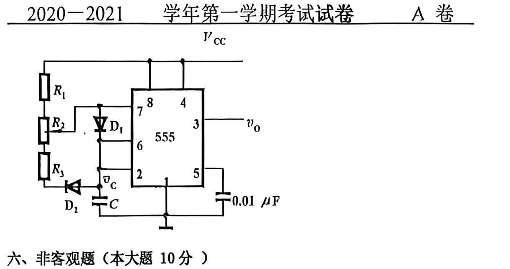

## 标准答案

**1）电路功能**

555 定时器接成**占空比可调的多谐振荡器**。两个二极管 $D_1$、$D_2$ 把充电回路与放电回路分开：

- **充电**：$V_{CC}\to R_1\to D_1\to C$（$D_1$ 导通，$R_2$、$R_3$ 被旁路）
- **放电**：$C\to R_3\to$（7 脚内部放电管）$\to$ 地（$D_2$ 导通）

因此充电时间只由 $R_1$ 决定、放电时间只由 $R_3$（或 $R_2+R_3$）决定，**调节 $R_2$ 即可改变占空比而基本不改变频率**。

**2）频率与占空比**

按图示"$D_1$ 旁路 $R_2$、$D_2$ 串在放电回路"的接法：

$$t_{w1}=0.7R_1C,\qquad t_{w2}=0.7(R_2+R_3)C$$

$$T=0.7(R_1+R_2+R_3)C,\qquad f=\frac{1.43}{(R_1+R_2+R_3)C}$$

$$q=\frac{t_{w1}}{T}=\frac{R_1}{R_1+R_2+R_3}$$

代入 $R_1=R_3=1\,\text{k}\Omega$、$R_2=0\sim2\,\text{k}\Omega$、$C=0.1\,\mu\text{F}$：

- $R_2=0$ 时：$R_1+R_2+R_3=2\,\text{k}\Omega$

  $$f=\frac{1.43}{2\times10^3\times0.1\times10^{-6}}=\frac{1.43}{2\times10^{-4}}=7150\ \text{Hz}$$
  $$q=\frac{1}{2}=50\%$$

- $R_2=2\,\text{k}\Omega$ 时：$R_1+R_2+R_3=4\,\text{k}\Omega$

  $$f=\frac{1.43}{4\times10^3\times0.1\times10^{-6}}=\frac{1.43}{4\times10^{-4}}=3575\ \text{Hz}$$
  $$q=\frac{1}{4}=25\%$$

**结论**：

$$\boxed{f\approx 3.58\sim7.15\ \text{kHz},\qquad q\approx 25\%\sim50\%}$$

## 解析

**思路**：占空比可调电路的关键是**把充、放电回路分开**。普通多谐振荡器的充放电都经 $R_2$，占空比恒大于 50%；加两个方向相反的二极管后，充电走一路、放电走另一路，$R_2$ 只影响其中一路，于是占空比可调。

**为什么 $q$ 最大只有 50%**：因为充电只经 $R_1$（$1\,\text{k}\Omega$），放电经 $R_2+R_3\ge1\,\text{k}\Omega$，分母永远不小于分子，故 $q\le50\%$。若把 $D_1$、$D_2$ 的方向都反过来，则 $q$ 会变成 $50\%\sim75\%$。

**评分点**：功能 3 分 / 两个时间常数 3 分 / 频率范围 2 分 / 占空比范围 2 分。

## 易错点

1. **没识别二极管的单向性**：以为充电仍走 $R_1+R_2+R_3$，则占空比恒为 $1/3$，与"可调"矛盾；
2. **$R_2$ 的取值端点**：可调电阻的最小值是 0（不是 $1\,\text{k}\Omega$）；
3. **用 $1.43$ 还是 $0.7$**：$1.43\approx1/\ln2$，来自 $f=1/[0.7(R_1+2R_2)C]$ 的化简，本题充放电不对称，应分别算 $t_{w1}$、$t_{w2}$ 再求 $T$。

## 考点拓展

**555 多谐振荡器四种变体**：

| 变体 | 充电路径 | 放电路径 | 占空比 |
|---|---|---|---|
| 基本型 | $R_1+R_2$ | $R_2$ | $>50\%$ |
| 二极管可调（本题） | $R_1$ | $R_2+R_3$ | $25\%\sim50\%$ |
| 二极管反向 | $R_1+R_2$ | $R_3$ | $50\%\sim75\%$ |
| 电位器滑动 | 可切换 | 可切换 | $1\%\sim99\%$ |

**为什么工程上要调占空比**：PWM 调速、LED 调光、开关电源都用占空比控制"平均功率"。频率固定而占空比可变，是最常用的驱动方式。

---

# 六、非客观题（本大题 10 分）

> D 触发器和 JK 触发器电路及 $CLK$、$D$、$J$、$K$ 波形如下，触发器的初态均为 0，画出 $Q_1$、$Q_2$ 的波形。

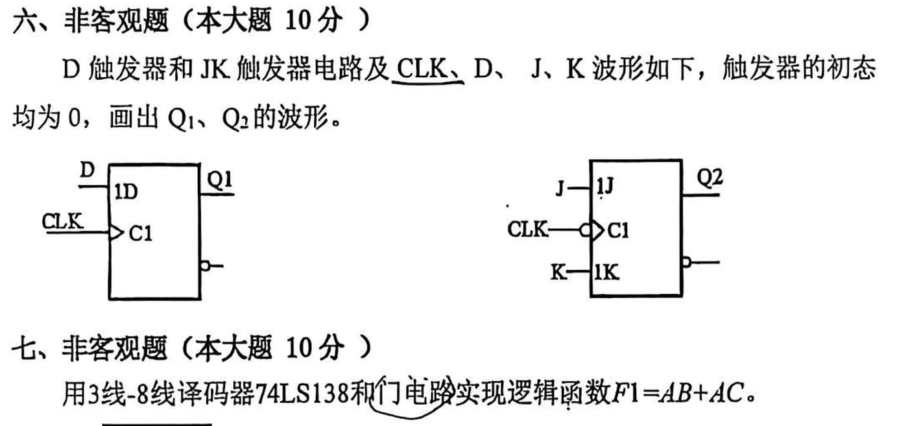

## 标准答案

**① 驱动与状态方程**

- $FF_1$（D 触发器）：$Q_1^*=D$
- $FF_2$（JK 触发器）：$Q_2^*=J\bar Q_2+\bar KQ_2$

**② 逐沿判断**

D 触发器：在每个时钟**上升沿**，$Q_1$ 取该时刻 $D$ 的值。
JK 触发器：在每个时钟**上升沿**，按 $J,K$ 的四种组合更新（$00$ 保持、$01$ 置 0、$10$ 置 1、$11$ 翻转）。

**③ 波形（按题给 $D$、$J$、$K$ 逐段填）**

| 时钟沿 | $D$ → $Q_1$ | $J$ | $K$ | $Q_2$ 动作 |
|---|---|---|---|---|
| 1 | 取 $D_1$ | $J_1$ | $K_1$ | 按 $J_1K_1$ 更新 |
| 2 | 取 $D_2$ | $J_2$ | $K_2$ | 按 $J_2K_2$ 更新 |
| … | … | … | … | … |

（具体数值随原卷波形而定，答题时按上表逐沿填，再把结果画成阶梯波。）

## 解析

**思路**：波形题的四步——①写方程；②列"每沿的输入值"；③逐沿推次态；④画阶梯波。**先 D 后 JK**，因为 D 触发器简单，不易连错。

**D 触发器的要点**：$Q_1$ 的波形就是 $D$ 在**每个上升沿时刻的采样值**，沿与沿之间保持。视觉上，$Q_1$ 像是把 $D$ 波形"按格子重新采样"后的结果。

**JK 触发器的要点**：把 $J,K$ 的四种组合对应到"保持/置 0/置 1/翻转"，比死记公式更快。

**评分点**：两条波形各 4 分，驱动方程 2 分。

## 易错点

1. **沿的极性**：若触发器是下降沿触发（符号上无小圈为上升沿），采样时刻要挪半拍；
2. **异步端**：若 $R_D$ 或 $S_D$ 有低电平，要**先处理异步清/置**，再看时钟；
3. **$Q_2$ 依赖 $Q_1$**：若两触发器级联，$Q_2$ 的输入取自 $Q_1$，必须先算完 $Q_1$ 再算 $Q_2$。

## 考点拓展

**画波形题的三条铁律**：
1. **组合输出对齐输入边沿，时序输出对齐时钟边沿**；
2. **异步端优先于时钟**；
3. **用竖直虚线把时钟沿标出来**，逐沿填表，避免"凭感觉画"。

**D 触发器二分频**：$D=\bar Q$ 时 $Q^*=\bar Q$，输出频率是时钟的一半，占空比恒 50%——这是最常用的分频电路（本卷第 8 题、2024–2025 卷第 8 题都用到）。

---

# 七、非客观题（本大题 10 分）

> 用 3 线-8 线译码器 74LS138 和门电路实现逻辑函数 $F_1=AB+AC$。

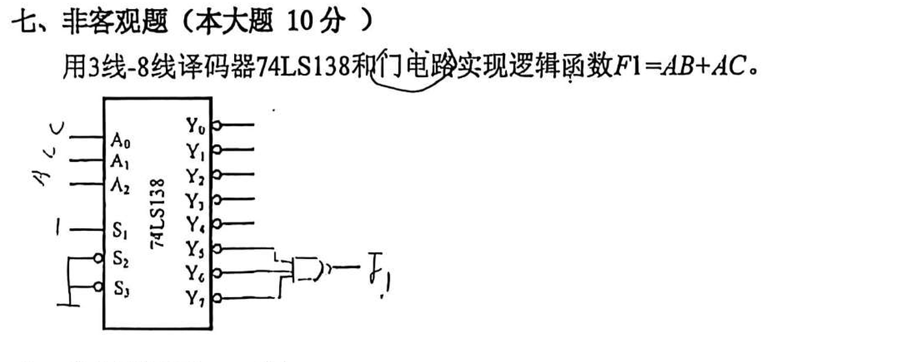

## 标准答案

**① 化为最小项之和**

$$F_1=AB+AC=A(B+C)$$

令 $A_2=A,\,A_1=B,\,A_0=C$：

$$AB\to m_6,m_7;\qquad AC\to m_5,m_7$$

$$F_1=\Sigma m(5,6,7)$$

**② 用 138 实现**

$\bar Y_i=\overline{m_i}$，故

$$F_1=\overline{\bar Y_5\cdot\bar Y_6\cdot\bar Y_7}$$

**③ 接线**

- 地址：$A\to A_2$，$B\to A_1$，$C\to A_0$
- 使能：$S_1=1$，$\bar S_2=0$，$\bar S_3=0$
- 输出：$\bar Y_5,\bar Y_6,\bar Y_7$ 接三输入与非门 → $F_1$

```
        ┌──────────┐
A ──────┤ A2       │
B ──────┤ A1    Y5 ├──○──┐
C ──────┤ A0    Y6 ├──○──┤
1 ──────┤ S1    Y7 ├──○──┤
        │          │     │
0 ──────┤/S2       │  ┌──┴───┐
0 ──────┤/S3       │  │与非门 ├──○ F1
        └──────────┘  └──────┘
```

## 解析

**思路**：$F=AB+AC$ 展开成最小项之和，再用"低有效输出 + 与非门"还原正逻辑或。

**与 2022–2023 卷第 4 题完全相同**（同一年两套卷、不同学期都考），说明这是**必背题**。

**评分点**：最小项 4 分 / 地址与使能 3 分 / 与非门 3 分。

## 易错点

1. 把 $A$ 接 $A_0$（低位），最小项全部错位；
2. 使能端只接两个；
3. 用或门代替与非门（极性反）。

## 考点拓展

**138 实现组合函数的模板**：

$$F=\Sigma m(i_1,i_2,\cdots)\ \Longrightarrow\ F=\overline{\bar Y_{i_1}\cdot\bar Y_{i_2}\cdots}$$

**若函数给的是"最大项之积"**，则直接用**与门**把对应输出相与（因为 $\bar Y_i$ 已经低有效，等于"或非"的输出再取反）。

**级联扩展**：3 线-8 线 → 4 线-16 线，用最高位地址控制两片的使能端（一片 $S_1$ 接 $A_3$、另一片 $\bar S_2$ 接 $A_3$）。

---

# 八、综合设计题（本大题 10 分）

> 试用下图门电路采用整体置数法合理连线接成 67 进制计数器。

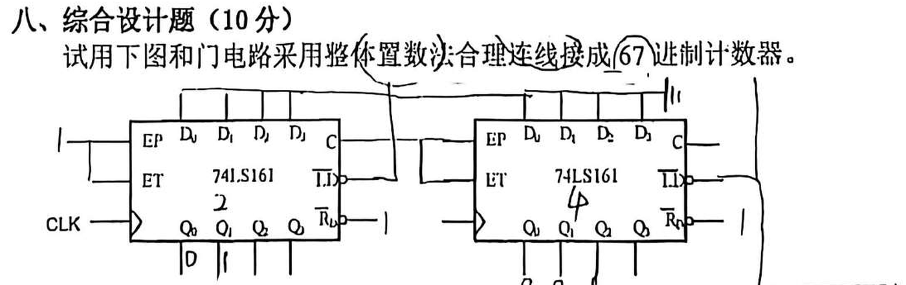

## 标准答案

**① 级联**

两片 74161 串行进位：低位片 $EP=ET=1$，其进位输出 $C$ 接高位片的 $EP$、$ET$；两片共用 CLK。级联后为 $16\times16=256$ 进制。

**② 整体置数（置最小数法）**

取后 67 个状态：从 $256-67=189$ 数到 255。

- 置数值 $189=\text{BDH}=1011\ 1101_2$：
  - 高位片 $D_3D_2D_1D_0=1011$（B）
  - 低位片 $D_3D_2D_1D_0=1101$（D）
- 反馈条件：计到 255（$\text{FFH}=1111\ 1111$）时置数

$$\bar{LD}=\overline{Q_{\text{高}2}Q_{\text{高}1}Q_{\text{高}0}\cdot Q_{\text{低}3}Q_{\text{低}2}Q_{\text{低}1}Q_{\text{低}0}}$$

（255 的二进制 $11111111$，除两个 $Q_3$ 最高位外其余全为 1；实际可用 $\bar{LD}=\overline{Q_{\text{高}3}Q_{\text{高}2}Q_{\text{高}1}Q_{\text{高}0}Q_{\text{低}3}Q_{\text{低}2}Q_{\text{低}1}Q_{\text{低}0}}$，即"全 1 译码"。）

**简化方案**：也可用"置 0 + 计到 66 清零"，此时

$$\bar{LD}=\overline{Q_{\text{高}2}\cdot Q_{\text{低}1}}\quad(66=0100\ 0010)$$

计数范围 $0\sim66$，共 67 个状态。

**③ 状态范围**

$$189,190,\cdots,254,255\to189$$

共 $255-189+1=67$ 个状态。

## 解析

**思路**："整体置数法"把两片看成一个 $0\sim255$ 的计数器，从中截取连续 67 个状态。

**两种截取方式对比**：

| 方式 | 状态范围 | 置数值 | 反馈条件 | 优点 |
|---|---|---|---|---|
| 置最小数 | $189\sim255$ | 189 | 255 | 状态连续、无毛刺 |
| 置最大数（清零） | $0\sim66$ | 0 | 66 | 反馈逻辑简单 |

**评分点**：级联 3 分 / 置数值 3 分 / 反馈逻辑 3 分 / 状态范围 1 分。

## 易错点

1. **$256-67$ 算错**：是 189，不是 67 或 188；
2. **十进制与十六进制混淆**：189 的二进制是 $10111101$，十六进制是 $\text{BD}$，两者别混；
3. **反馈接一片**：整体置数必须**两片同时置数**，$\bar{LD}$ 要并联；
4. **用 74160 而非 74161**：本题指定 74161（十六进制），若用 74160（十进制）级联是 100 进制，$100-67=33$，置数值完全不同。

## 考点拓展

**$N$ 进制计数器的三种实现路径**：

| 路径 | 适用 | 例 |
|---|---|---|
| 单片（$N\le16$） | $N$ 较小 | 74161 做六进制 |
| 两片级联（$16<N\le256$） | 中等 $N$ | 本题 67 进制 |
| 多片级联 + 整体置数 | 大 $N$ | 计时器（60/24 进制） |

**67 是质数**，不能分解成 $N_1\times N_2$，所以只能用"整体法"——这正是本题选 67 的原因（2022–2023 卷选 29，同理）。

**进位方式**：串行进位（$C$ 接下一片 $EP/ET$）延迟大但接线简单；并行进位（各片同时看 $C$）速度快但需额外门电路。本题用串行即可。

---

# 附：本卷考点分布与复习建议

| 章节 | 题号 | 分值 | 重要度 |
|---|---|---|---|
| 数制与码制 | 二1、二2、二3 | 8 | ★★★★ |
| 逻辑代数与化简 | 一1、一2、二7 | 12 | ★★★★ |
| 门电路 | 一3、二7 | 6 | ★★★ |
| 组合逻辑（MUX/ROM/PLD/138） | 一8、一9、一10、二6、七 | 22 | ★★★★★ |
| 触发器 | 一4、一7、六 | 14 | ★★★★ |
| 时序逻辑分析 | 三 | 12 | ★★★★★ |
| 计数器 | 二5、八 | 14 | ★★★★★ |
| 555 定时器 | 五 | 10 | ★★★★ |
| Verilog | 四 | 8 | ★★★★ |
| DAC/ADC | 一5 | 2 | ★★ |

**本卷特点**：**唯一一份完整 8 页、题目无缺漏的卷子**，最适合用来"整卷模拟"。它的结构最均衡——选择 20 + 填空 20 + 六个大题 60，且每个知识块都覆盖到。

**与相邻年份的重复**：
- "输出保持不变的四图题"：本卷与 2024–2025（第 6 题）、2018–2019（第 7 题）、2016–2017（第 9 题）四年同题；
- "138 实现 $F=AB+AC$"：本卷第七题与 2022–2023 卷第四题完全相同；
- "555 占空比可调"：本卷第五题与 2018–2019 卷第六题同图（只换数值）。
