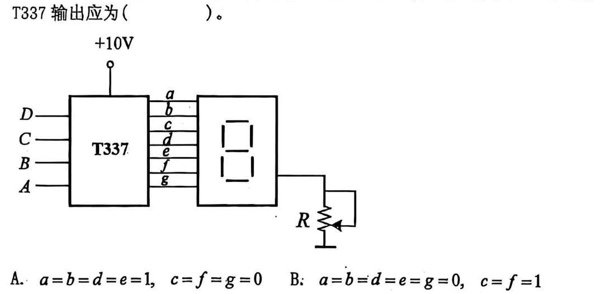
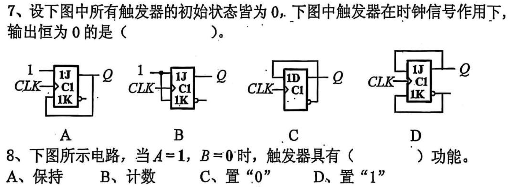
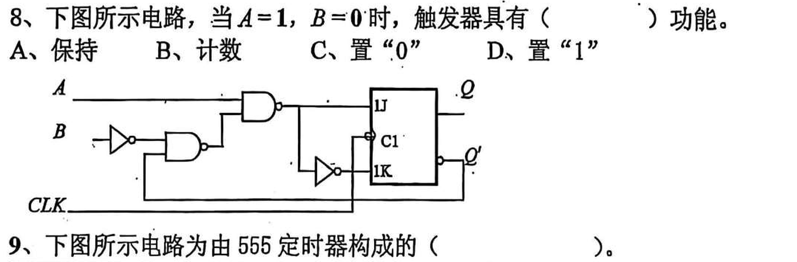
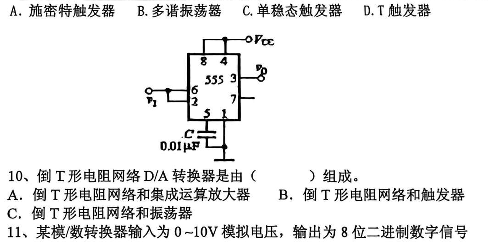
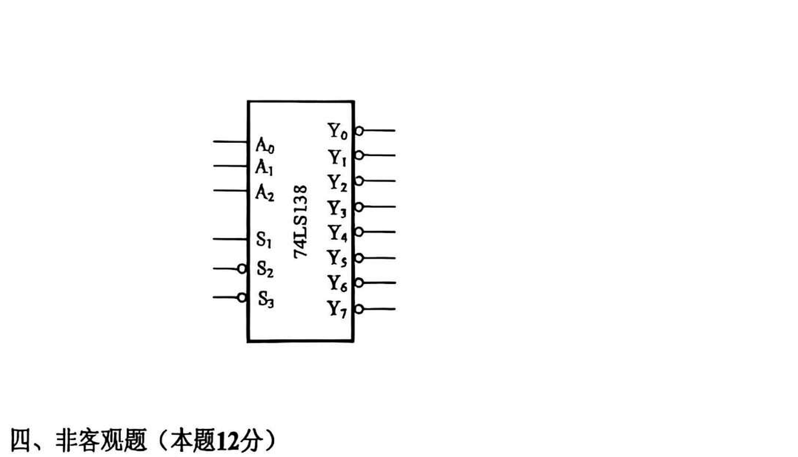
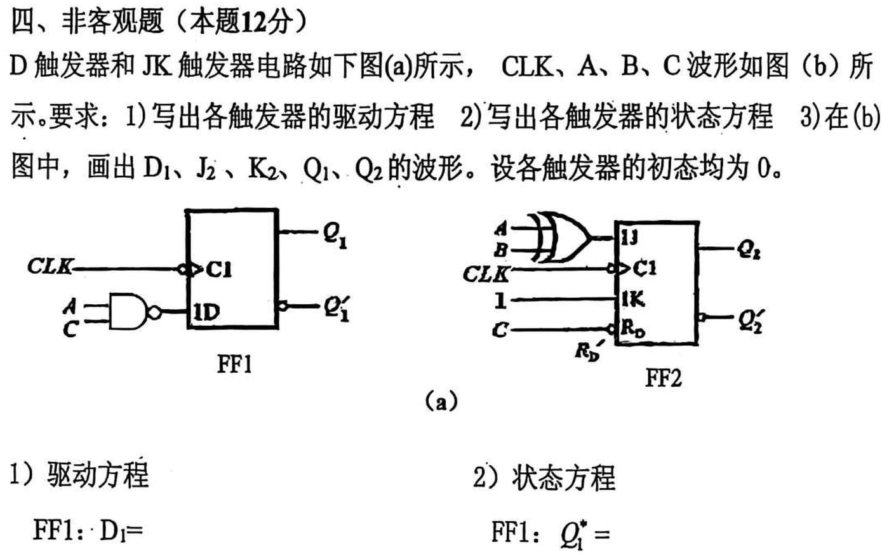
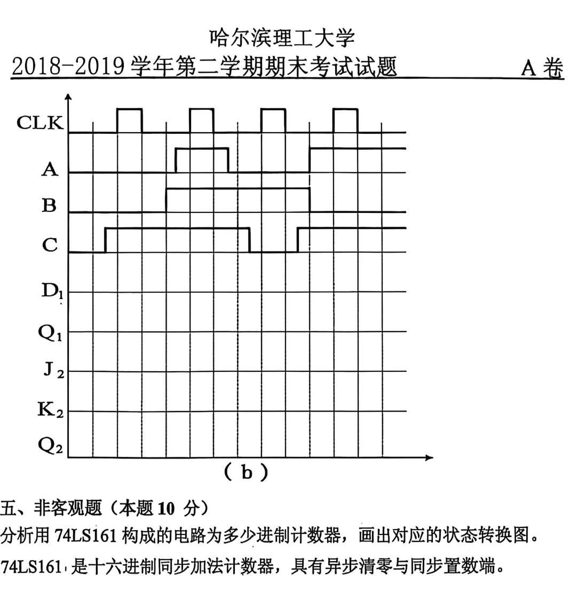
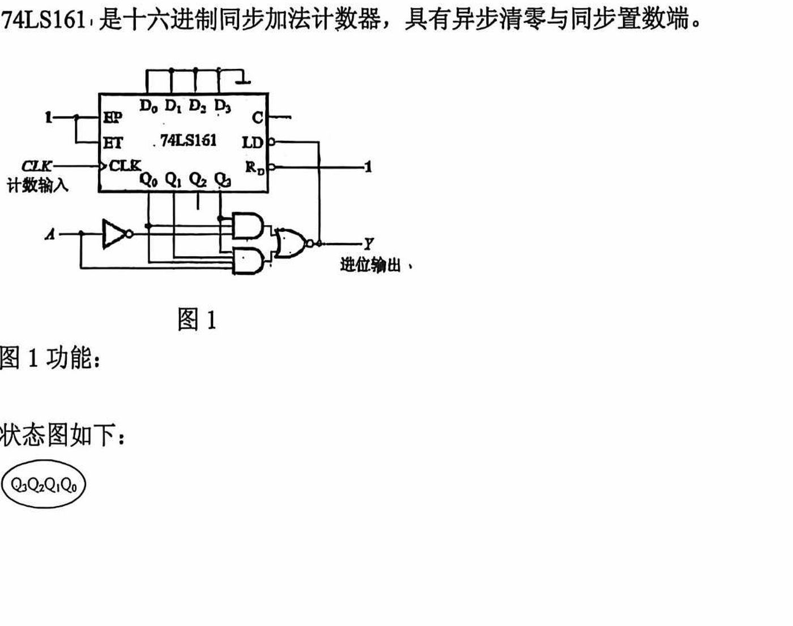
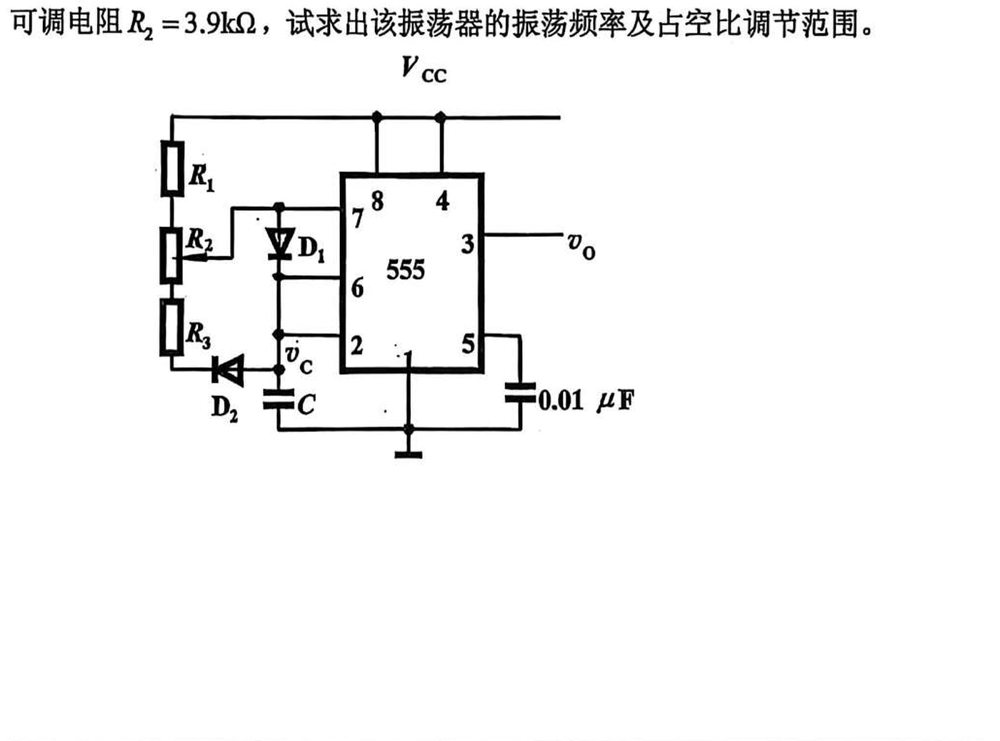

# 2018—2019 学年第二学期《电子技术Ⅱ》期末考试 A 卷 · 全解

> **试卷来源**：`试卷/数电_20261017_202733.pdf` 第 19—24 页（原卷 6 页，**完整无缺页**）。
> **原卷信息**：哈尔滨理工大学 · 2018—2019 学年第二学期期末考试试题 · A 卷 · 科目《电子技术Ⅱ》。
> **卷面构成**：客观题 48 分（填空 15 + 选择 33）＋ 非客观题 52 分（10 + 10 + 12 + 10 + 10），满分 100 分。

> **编号说明**：原卷把 Verilog 分析题标成了"二、非客观题"，与前面的"二、单项选择题"撞号，导致后续题号整体错位。本文按**出现顺序**重排为三～七，并在每节标题后注明原卷标注。

## 试卷结构速览

| 本文题号 | 原卷标注 | 题型 | 分值 | 覆盖内容 |
|---|---|---|---|---|
| 一 | 一 | 填空题（5×3 分） | 15 | 数制转换、8421BCD、三种基本运算、三态门、D/A 转换 |
| 二 | 二 | 单项选择题（11×3 分） | 33 | 时序电路判别、JK 特征方程、计数器容量、译码显示、反函数、RS 约束、触发器状态、DAC/ADC |
| 三 | 二 | Verilog HDL 程序分析 | 10 | 门级描述 → 电路图 + 真值表 + 功能 |
| 四 | 三 | 组合逻辑设计 | 10 | 74LS138 + 与非门实现双输出函数 |
| 五 | 四 | 触发器分析 | 12 | D/JK 驱动方程、状态方程、画波形 |
| 六 | 五 | 计数器分析 | 10 | 74LS161 + 与非门 → 可控进制 + 状态图 |
| 七 | 六 | 555 定时器 | 10 | 双二极管占空比可调多谐振荡器 |

---

# 一、填空题（本大题共 5 小题，每小题 3 分，共计 15 分）

## 1. 十进制数 123 对应的二进制数是（　），十六进制数是（　）

**答案：$(1111011)_2$ ；$(7B)_{16}$**

**解析**：十进制→二进制用"除 2 取余、倒序排列"：

| 除 | 商 | 余 |
|---|---|---|
| 123÷2 | 61 | **1** |
| 61÷2 | 30 | **1** |
| 30÷2 | 15 | **0** |
| 15÷2 | 7 | **1** |
| 7÷2 | 3 | **1** |
| 3÷2 | 1 | **1** |
| 1÷2 | 0 | **1** |

自下而上读余数：$1111011$。验算：$64+32+16+8+2+1=123$ ✓。

二进制→十六进制**四位一组**（从右往左，不足补 0）：

$$0111\;\;1011\quad\Rightarrow\quad 7\;\;\mathrm{B}$$

**易错**：十六进制里 $10\sim15$ 写作 A~F，别写成 "711" 或 "7/11"。本题余数序列是 $1101111$，倒序才对；直接正序抄会得到 111（错）。

**拓展**：$2^7=128>123$，所以二进制恰好 **7 位**；一般 $N$ 位二进制能表示 $0\sim 2^N-1$，判位数用 $\lceil\log_2(D+1)\rceil$。

---

## 2. 100001100001 是 8421BCD 码，其对应的十进制数是（　）

**答案：861**

**解析**：8421BCD 是**每 4 位二进制表示 1 位十进制数**，从右往左四位一切：

$$1000\;\big|\;0110\;\big|\;0001\quad\Rightarrow\quad 8\;\;6\;\;1$$

| 8421BCD 组 | 权值 8-4-2-1 | 十进制数字 |
|---|---|---|
| 1000 | 8 | 8 |
| 0110 | 4+2 | 6 |
| 0001 | 1 | 1 |

**易错**：这是本题的核心陷阱——若把它当**纯二进制**，$100001100001_2=2145$，完全不对。8421BCD 里 $1010\sim1111$ 是**非法码**，正因为不用它们，12 位才只能表示 3 位十进制数（$000\sim999$）。

**拓展**：12 位二进制最多表示 $2^{12}=4096$ 个数，而 3 位 8421BCD 只用 $10^3=1000$ 个，**编码效率只有约 24%**，这是 BCD 码"方便人读、浪费存储"的典型代价。

---

## 3. 逻辑代数的三种基本运算是（　）、（　）、（　）

**答案：与（AND）、或（OR）、非（NOT）**

**解析**：三种基本运算对应三种基本门，其余运算（与非、或非、异或、同或、与或非）都是它们的**复合**。

| 运算 | 表达式 | 口诀 |
|---|---|---|
| 与 | $Y=A\cdot B$ | 全 1 出 1，有 0 出 0 |
| 或 | $Y=A+B$ | 有 1 出 1，全 0 出 0 |
| 非 | $Y=\bar A$ | 有 0 出 1，有 1 出 0 |

**易错**：不要答"与非、或非、异或"——那已经是复合运算了；也不要漏掉"非"，只写"与、或"。

**拓展**：由这三种运算可推出**三条基本规则**：代入规则、反演规则、对偶规则；以及**五个常用公式**：$A+AB=A$、$A+\bar AB=A+B$、$AB+\bar AC=AB+\bar AC+BC$、$A(A+B)=A$、$A\bar B+\bar AB=A\oplus B$。本套卷选择题第 5 题考的就是反函数关系。

---

## 4. 三态门的工作状态是（　）、（　）、（　）

**答案：高电平（逻辑 1）、低电平（逻辑 0）、高阻态（Z）**

**解析**：三态门（TSL 门）比普通门多一个**使能端 EN**：

| EN | 输出 |
|---|---|
| 有效（高电平使能时 EN=1） | 正常输出 0 或 1 |
| 无效（EN=0） | **高阻态 Z**：输出端相当于开路，既不是 0 也不是 1 |

**易错**：常见的坑是把"高阻"写成"悬空"——悬空指**输入端**没接，高阻指**输出端**呈开路状态，两者不是一回事。

**拓展**：三态门是实现**总线分时复用**的关键：$n$ 个三态门输出并接到同一根总线上，**任何时刻最多只能有一个门使能**，否则会出现"两个门同时驱动一根线、一个输出 1 一个输出 0"的短路状态（总线冲突），电流过大甚至烧器件。

---

## 5. 设 4 位 D/A 转换器的满度输出为 30V，则输入数字量 1010 的模拟电压为（　）

**答案：20 V**

**解析**：4 位 DAC，满度输出对应输入全 1 即 $1111=(15)_{10}$，故**单位量化台阶**为

$$\Delta=\frac{U_{FS}}{2^4-1}=\frac{30}{15}=2\ \mathrm{V/LSB}$$

输入 $1010=(10)_{10}$：

$$u_O=10\times 2=20\ \mathrm{V}$$

**易错**：很多人用 $30/16=1.875$ V 去乘，得 18.75 V。这个错法的实质是把"满度"当成了 $2^4=16$ 个台阶。**判据**：题目说"满度输出"＝输入全 1 时的输出，分母必须是 $2^n-1$。只有当题目给的是"参考电压 $U_{REF}$"时，才用 $\dfrac{U_{REF}}{2^n}$。

**拓展**：DAC 三个核心指标——**分辨率**（$1/2^n$，本卷选择题第 10 题考倒 T 形网络）、**转换精度**（实际特性与理想特性的最大偏差）、**转换速度**（建立时间）。位数越高分辨越细，但速度通常越慢。

---

# 二、单项选择题（本大题共 11 小题，每小题 3 分，总计 33 分）

> 原卷要求：请将选择题答案填在表格中，填在其他处不给分。

## 1. 请判断以下哪个电路不是时序逻辑电路（　）

A、计数器　　B、寄存器　　C、译码器　　D、触发器

**答案：C**

**解析**：判据只有一条——**输出是否与"过去的状态"有关**。

| 电路 | 有无记忆 | 属于 |
|---|---|---|
| 计数器 | 有（靠触发器记数） | 时序 |
| 寄存器 | 有（靠触发器存数） | 时序 |
| **译码器** | **无，输出只由当前输入决定** | **组合** |
| 触发器 | 有（本身就是一个存储单元） | 时序（最基本） |

译码器 $Y_i=m_i$，输出是当前输入的即时函数，属**组合逻辑电路**。

**易错**：有人因为"译码器常和计数器配合使用"就误判为时序电路。判据只看**自身结构里有没有反馈/存储元件**，与它跟谁配合无关。

**拓展**：时序电路的结构特征 = **组合电路 + 存储电路 + 反馈**；描述工具是**状态方程、驱动方程、输出方程**三件套（本卷第 5 题正是考这三件套）。

---

## 2. 边沿触发 JK 触发器的特征方程是（　）

A、$Q^{n+1}=\bar J\bar Q^n+KQ^n$　　B、$Q^{n+1}=\bar JQ^n+\bar K\bar Q^n$
C、$Q^{n+1}=J\bar Q^n+\bar KQ^n$　　D、$Q^{n+1}=JQ^n+KQ^n$

**答案：C**

**解析**：JK 触发器的功能表：

| $J$ | $K$ | $Q^{n+1}$ | 功能 |
|---|---|---|---|
| 0 | 0 | $Q^n$ | 保持 |
| 0 | 1 | 0 | 置 0 |
| 1 | 0 | 1 | 置 1 |
| 1 | 1 | $\bar Q^n$ | 翻转 |

由表写出：$J=0$ 时 $Q^{n+1}=\bar KQ^n$；$J=1$ 时 $Q^{n+1}=1$。合并即

$$\boxed{Q^{n+1}=J\bar Q^n+\bar KQ^n}$$

**验证四个组合**：$(J,K)=(1,1)\Rightarrow \bar Q^n+0=\bar Q^n$ ✓ 翻转；$(0,0)\Rightarrow 0+Q^n=Q^n$ ✓ 保持。

**易错**：A 把 $\bar J$ 与 $J$ 位置搞反（那其实是把 J/K 互换后的形式）；D 丢了 $\bar K$、$\bar Q^n$ 上的非号，会推出 $(1,1)\to 1$，与"翻转"矛盾。**自查技巧**：代 $J=K=1$ 进去，只有能化成 $\bar Q^n$ 的选项才对。

**拓展**：同一触发器换个写法就是别的器件——
- 令 $J=K=T$，得 **T 触发器**：$Q^{n+1}=T\bar Q^n+\bar TQ^n=T\oplus Q^n$；
- 令 $J=D,\ K=\bar D$，得 **D 触发器**：$Q^{n+1}=D$；
- 令 $J=K=1$，得 **T' 触发器**：$Q^{n+1}=\bar Q^n$（每来一个时钟翻转一次，是计数器的最基本单元）。

---

## 3. 用 n 个触发器构成计数器，可得到的最大计数长度为（　）

A、n　　B、2n　　C、$n^2$　　D、$2^n$

**答案：D**

**解析**：$n$ 个触发器共有 $2^n$ 种状态组合（$00\cdots0$ 到 $11\cdots1$），计数器每来一个时钟换一个状态，最多把 $2^n$ 个状态全走一遍再回到起点，即 $2^n$ 进制。

例：4 个触发器 → 最多十六进制（模 16）；实际要做十进制就跳过 6 个状态。

**易错**：答成 $2n$ 是把"状态数"当成了"位数×2"。另外注意题目问的是**最大**计数长度；实际电路的模可以小于 $2^n$（用反馈置数/清零实现），但**绝不可能超过** $2^n$。

**拓展**：$n$ 个触发器最大模 $2^n$ 称为**全状态计数器**（如 74161 的十六进制）。若状态图能自启动地走遍全部 $2^n$ 个状态，则它同时就是**最大长度移位型计数器**（如 $n$ 位扭环形是 $2n$，$n$ 位环形只有 $n$）。

---

## 4. 下图所示为采用共阴极数码管的译码显示电路，若显示码数是 2，译码器 T337 输出应为（　）



A、$a=b=d=e=1,\ c=f=g=0$　　B、$a=b=d=e=g=0,\ c=f=1$　　C、$a=b=d=e=g=1,\ c=f=0$

**答案：C**

**解析**：先看七段排列（顺时针从顶端开始）：

```
   aaaa
  f    b
  f    b
   gggg
  e    c
  e    c
   dddd
```

数字 **2** 点亮的段是：$a$（上横）、$b$（右上竖）、$g$（中横）、$e$（左下竖）、$d$（下横）；熄灭的是 $c$（右下竖）、$f$（左上竖）。

所以 $a=b=d=e=g=1$，$c=f=0$。

**关键前提——共阴还是共阳**：T337 是**共阴极**BCD-七段译码驱动器，输出**高电平有效**（段码为 1 时该段亮）。若换成共阳极（如 T337 的对应型号或 74LS47），则段码要**整体取反**，此时应选 B。

**易错**：本题最容易错在把共阴/共阳搞混。**记忆法**：共阴 → 公共端接地 → 段要亮必须给高电平 → **1 亮**；共阳 → 公共端接 +V → 段要亮必须拉低 → **0 亮**。

**拓展**：常见集成译码驱动器——**74LS48/T337**（共阴、高有效、内部带升压电阻）、**74LS47**（共阳、低有效、集电极开路需外接限流电阻）。图中 $R$ 就是外接限流电阻，用来把段电流限制在 $5\sim10$ mA。

---

## 5. $F_1=AB'+A'B$ 与 $F_2=AB+A'B'$ 两函数式的关系是（　）

A、反演　　B、对偶　　C、反函数

**答案：C**

**解析**：先认出这两个是"老熟人"：

$$F_1=A\bar B+\bar AB=A\oplus B\ (\text{异或}),\qquad F_2=AB+\bar A\bar B=A\odot B\ (\text{同或})$$

而**异或与同或互为反函数**：$A\odot B=\overline{A\oplus B}$，即 $F_2=\bar F_1$。

逐项验证：$F_1$ 在 $(A,B)=(0,0),(0,1),(1,0),(1,1)$ 上取 $0,1,1,0$；$F_2$ 取 $1,0,0,1$——**正好互补** ✓。

**易错**：三个概念必须分清：

| 概念 | 操作 | 结果 |
|---|---|---|
| **反演**（求反函数） | 与↔或、0↔1、原变量↔反变量，**所有变量都要换** | $\bar F$ |
| **对偶** | 与↔或、0↔1，**变量保持不变** | $F^D$ |
| 本题问的"关系" | 两式本身互为反函数 | $F_2=\bar F_1$ |

"反演"是**操作规则**，"反函数"是**操作结果**，选项把两者并列，考的正是这个区分。

**拓展**：若求 $F_1=A\bar B+\bar AB$ 的**对偶式**，则得 $F^D=(A+\bar B)(\bar A+B)$，它化简后等于 $F_1$ 本身——**自对偶函数**。异或、同或都是自对偶的。

---

## 6. 与非门构成的基本 RS 触发器特性方程为 $Q^*=S'+RQ$，约束方程为（　）

A、$R+S=0$　　B、$R+S=1$　　C、$RS=1$　　D、$RS=0$

**答案：B**

**解析**：本题给的是**与非门**构成的基本 RS 触发器，两个输入**低电平有效**。把特性方程拿去"试用"，就能反推出各输入的含义：

| $S$ | $R$ | $Q^*=S'+RQ$ | 物理含义 |
|---|---|---|---|
| 1 | 1 | $0+Q=Q$ | **保持** |
| 0 | 1 | $1+Q=1$ | **置 1**（S 低有效） |
| 1 | 0 | $0+0=0$ | **置 0**（R 低有效） |
| 0 | 0 | $1+0=1$ | **非法**（同时要求置 1 和置 0，电路无法确定） |

非法组合是 $S=R=0$，即"两者不能同时为 0"，等价于

$$\boxed{S+R=1}$$

**易错**：$RS=0$（选项 D）是**或非门**构成的 RS 触发器的约束条件（高电平有效，不能同时为 1）。判断口诀：

- **与非门**（低有效）→ 不能同时为 **0** → $S+R=1$
- **或非门**（高有效）→ 不能同时为 **1** → $RS=0$

**拓展**：当 $S=R=0$ 同时出现时，两个与非门输出都变 1，破坏 $Q$ 与 $\bar Q$ 互补关系；若两输入**同时**撤销回到 1，输出谁先翻取决于门的传输延时，结果是**随机**的——这正是"约束"二字的物理来源，也是 RS 触发器不能直接用做二进制计数器的根本原因。

---

## 7. 设下图中所有触发器的初始状态皆为 0，下图中触发器在时钟信号作用下，输出恒为 0 的是（　）



**答案：D**

**解析**：逐一写出各图的 $Q^{n+1}$，代入 $Q=0$ 和 $Q=1$ 两个初值看结果：

**A**：$J=1$，$K=Q$（K 端由 $Q$ 引出）
$$Q^{n+1}=J\bar Q+\bar KQ=\bar Q+\bar QQ=\bar Q$$
→ 每来一个时钟翻转，$0\to1\to0\to1\cdots$，**不恒为 0**。

**B**：$J$、$K$ 并接在 "1" 上，$J=K=1$
$$Q^{n+1}=\bar Q$$
→ 同样是 T' 触发器，**翻转**。

**C**：D 触发器，$D=\bar Q$
$$Q^{n+1}=\bar Q$$
→ **翻转**。

**D**：JK 触发器，上环引 $Q$ 到 $J$，下环引 $\bar Q$ 到 $K$，即 $J=Q,\ K=\bar Q$
$$Q^{n+1}=J\bar Q+\bar KQ=Q\bar Q+QQ=0+Q=Q$$
→ **保持**。初态为 0，则输出恒为 0 ✓

**易错**：C 和 D 只差一个反馈取自 $Q$ 还是 $\bar Q$，结果却从"翻转"变成"保持"。**判别捷径**：把 $Q=0$、$Q=1$ 分别代入自反馈式，若两次都得到原值则为保持，若得到互补则为翻转。

**拓展**：D 图的接法等价于 $J=Q,\ K=\bar Q$——这正是把 JK 触发器**改接成 D 触发器**的经典方法（令 $J=D,\ K=\bar D$ 后 $Q^{n+1}=D$）。本题把 $D$ 换成了 $Q$ 本身，于是 $Q^{n+1}=Q$，成了"存住自己"的锁存器。

---

## 8. 下图所示电路，当 $A=1$，$B=0$ 时，触发器具有（　）功能



A、保持　　B、计数　　C、置"0"　　D、置"1"

**答案：B**

**解析**：先逐级写表达式。

设 $B$ 经反相后为 $\bar B$，它与 $\bar Q$（由 $Q'$ 端反馈）送入**下与非门**，输出记为 $G$：

$$G=\overline{\bar B\cdot \bar Q}$$

$A$ 与 $G$ 送入**上与非门**，输出即 $J$：

$$J=\overline{A\cdot G}$$

而 $K$ 由 $J$ 经**反相器**得到：

$$K=\bar J$$

代入 $A=1,\ B=0\Rightarrow \bar B=1$：

$$G=\overline{1\cdot\bar Q}=Q,\qquad J=\overline{1\cdot Q}=\bar Q,\qquad K=Q$$

$$Q^{n+1}=J\bar Q+\bar KQ=\bar Q\cdot\bar Q+\bar Q\cdot Q=\bar Q$$

→ 来一个时钟翻转一次，故为**计数（翻转）功能**，选 B。

**完整功能表**（顺手验证设计意图）：

| $A$ | $B$ | $J$ | $K$ | $Q^{n+1}$ | 功能 |
|---|---|---|---|---|---|
| 0 | × | 1 | 0 | 1 | 置 1 |
| 1 | 0 | $\bar Q$ | $Q$ | $\bar Q$ | 计数 |
| 1 | 1 | 0 | 1 | 0 | 置 0 |

可见该电路由 $A$ 决定"装数"还是"计数"，$B$ 决定装 1 还是装 0，是一个**带控制端的 T 触发器**（可控计数单元）。

**易错**：最容易漏掉最后那个反相器，误以为 $K=J$（那就成了 $J=K=\bar Q$，推不出正确结果）。看图时务必**顺着线走到底**，别跳线。

**拓展**："$K=\bar J$"是判断题里的高频套路：只要 $K=\bar J$，无论 $J$ 是什么表达式，都有
$$Q^{n+1}=J\bar Q+JQ=J$$
即电路等价于 **D 触发器**、$D=J$。本题 $J=\bar Q$，于是又退化成 $Q^{n+1}=\bar Q$ 的翻转。

---

## 9. 下图所示电路为由 555 定时器构成的（　）



A、施密特触发器　　B、多谐振荡器　　C、单稳态触发器　　D、T 触发器

**答案：A**

**解析**：数 555 的**三个关键引脚怎么接**，就能一步定位：

| 引脚 | 作用 | 本题接法 | 含义 |
|---|---|---|---|
| 2（$\overline{TR}$） | 下比较器输入（$\frac13V_{CC}$） | 与 6 短接后接 $v_I$ | 外部信号直接控制 |
| 6（$TH$） | 上比较器输入（$\frac23V_{CC}$） | 与 2 短接 | 两阈值合并，形成**回差** |
| 7（$DIS$） | 放电管 | **悬空** | 无 RC 充放电回路 |
| 4、8 | 复位、电源 | 接 $V_{CC}$ | 正常工作 |
| 5（$CO$） | 电压控制 | 经 $0.01\,\mu$F 接地 | 滤除干扰，稳定阈值 |

**判据表**（三句话记住三种电路）：

| 电路 | 2、6 接法 | 7 脚 |
|---|---|---|
| **施密特触发器** | 2、6 **短接**后接输入 | **悬空** |
| 单稳态触发器 | 2 接输入（触发脉冲） | 7 接 RC，与 6 相连 |
| 多谐振荡器 | 2、6 短接接电容 | 7 接在两个电阻之间，构成反馈 |

本题 2、6 短接、7 悬空、无电容定时元件 → **施密特触发器** ✓

**易错**：只看"2、6 短接"就选多谐振荡器是常见错误。**多谐振荡器必须有 7 脚参与的充放电回路**（否则电容充不上电、振不起来）；本题 7 脚空着，只能是施密特。

**拓展**：施密特触发器的两个阈值 $V_{T+}=\frac23V_{CC}$、$V_{T-}=\frac13V_{CC}$，**回差电压** $\Delta V_T=\frac13V_{CC}$。回差的作用是把缓慢变化、带噪声的输入整形为陡峭的矩形波——这就是"**波形整形**"。5 脚外接电压可改变阈值，从而**调节回差**。

---

## 10. 倒 T 形电阻网络 D/A 转换器是由（　）组成

A、倒 T 形电阻网络和集成运算放大器　　B、倒 T 形电阻网络和触发器　　C、倒 T 形电阻网络和振荡器

**答案：A**

**解析**：倒 T 形（R-2R）电阻网络 DAC 的结构就是两块：

1. **R-2R 倒 T 形电阻网络**——把每一位的权电流"分流"出来，实现 $I_i=\dfrac{V_{REF}}{2^n}\cdot 2^i$ 的二进制加权；
2. **集成运算放大器**——作**电流-电压转换**（$u_O=-I_\Sigma R_F$），并把输出与负载隔离。

**易错**：DAC 的核心是"数字量→模拟量"，不需要触发器（那是存储/时序元件），更不需要振荡器（那是产生周期信号）。

**拓展**：倒 T 形的两大优点——
- 网络里**只有 R 和 2R 两种阻值**，便于集成（权电阻网络需要 $R,2R,4R,\dots,2^{n-1}R$ 共 $n$ 种，精度难保证）；
- 各位**开关切换时节点电压不变**（虚地），因此**毛刺小、转换速度快**。

缺点：$n$ 位要 $2n$ 个电阻，位数高时面积大，故高位常用**分段/树形**结构。

---

## 11. 某模/数转换器输入为 0~10V 模拟电压，输出为 8 位二进制数字信号（D7~D0）。若输入电压是 2V，则输出的数字信号为（　）

A、00100011　　B、00110011　　C、00100001

**答案：B**

**解析**：8 位 ADC 满量程对应 $11111111=(255)_{10}$，量化台阶

$$\Delta=\frac{10}{255}\approx 0.0392\ \mathrm{V}$$

$$D=\frac{2}{10}\times 255=51=(00110011)_2$$

验算：$51=32+16+2+1$ → 位权 $D_5,D_4,D_1,D_0$ 为 1 → $0011\,0011$ ✓

**易错**：用 $2/10\times 256=51.2$ 再取整也是 51，结果一致；但若按 $2/10\times 255$ 四舍五入得 51 更规范。真正的坑是**把 255 写成 256 后不取整**，直接写 00110011.2 这种不存在的答案，或误选 A（$35=00100011$，对应 $1.37$ V）。

**拓展**：ADC 的两个"±"——**量化误差**最大为 $\pm\frac12\mathrm{LSB}$（无法消除，只能靠增加位数减小）；**转换误差**还包括偏移、增益、非线性等。8 位分辨率 $\frac{1}{256}\approx 0.39\%$，12 位约 $0.024\%$。

---

# 三、非客观题（本题 10 分）——Verilog HDL 程序分析

> 原卷标注为"二、非客观题（本题 10 分）"。
> **要求**：1）画出电路图，标出端口名称；2）列出真值表；3）说明电路功能。

```verilog
module mux2to1(a, b, sel, out);
    input  a, b, sel;
    output out;
    wire   selnot, a1, b1;
    not U1(selnot, sel);
    and U2(a1, a, selnot);
    and U3(b1, b, sel);
    or  U4(out, a1, b1);
endmodule
```

## 1）电路图与端口名称

程序用的是**门级原语**（`not` / `and` / `or`），每条原语实例化就是一个门。原语的端口顺序是**输出在前、输入在后**，这一点决定了各线的连接关系：

| 实例 | 原语 | 端口顺序 | 连接关系 |
|---|---|---|---|
| `U1` | not | (out, in) | `selnot` ← $\overline{sel}$ |
| `U2` | and | (out, in1, in2) | `a1` ← $a\cdot \overline{sel}$ |
| `U3` | and | (out, in1, in2) | `b1` ← $b\cdot sel$ |
| `U4` | or | (out, in1, in2) | `out` ← $a1+b1$ |

**端口清单**：输入 `a`、`b`、`sel`；输出 `out`；内部连线（wire）`selnot`、`a1`、`b1`。

结构（一个非门 + 两个与门 + 一个或门，标准"与或式"两级电路）：

```
        ┌──────┐
 sel ──►│  U1  │── selnot ──┐
        │ NOT  │            │
        └──────┘      ┌─────▼─────┐
 a ──────────────────►│    U2     │── a1 ──┐
                      │   AND     │        │
                      └───────────┘   ┌────▼────┐
                                      │   U4    │── out
        ┌───────┐           ┌────────►│   OR    │
 b ────►│  U3   │── b1 ─────┘         └─────────┘
       │  AND  │◄── sel
       └───────┘
```

对应逻辑表达式：

$$out=a\cdot\overline{sel}+b\cdot sel$$

## 2）真值表

| `sel` | `a` | `b` | `selnot` | `a1` | `b1` | `out` |
|---|---|---|---|---|---|---|
| 0 | 0 | 0 | 1 | 0 | 0 | **0** |
| 0 | 0 | 1 | 1 | 0 | 0 | **0** |
| 0 | 1 | 0 | 1 | 1 | 0 | **1** |
| 0 | 1 | 1 | 1 | 1 | 0 | **1** |
| 1 | 0 | 0 | 0 | 0 | 0 | **0** |
| 1 | 0 | 1 | 0 | 0 | 1 | **1** |
| 1 | 1 | 0 | 0 | 0 | 0 | **0** |
| 1 | 1 | 1 | 0 | 0 | 1 | **1** |

观察"输出列"：`sel = 0` 时 `out` 与 `a` 同列；`sel = 1` 时 `out` 与 `b` 同列。

## 3）电路功能

**二选一数据选择器（2-to-1 MUX）**：`sel` 作地址选择端——

- $sel=0$：$out=a$（选通通道 A）
- $sel=1$：$out=b$（选通通道 B）

写成通式即 $out=\bar{sel}\cdot a+sel\cdot b$，正是**二选一 MUX 的标准表达式**。

## 易错与拓展

**易错**：Verilog 门级原语的**第一个端口永远是输出**。若把 `and U2(a1, a, selnot)` 读成"输入 a1、输出 a"，整个电路就全反了，这是本类题第一大失分点。记忆："**先出后进**"。

**拓展**：
- 门级描述（`and/or/not`）属于**结构化描述**，与用 `assign out = sel ? b : a;` 的**数据流描述**、用 `always` 的**行为描述**功能等价，三者描述的是同一硬件，考试常要求"用不同描述风格改写同一电路"。
- 二选一 MUX 是构造大容量 MUX 的基本块：4 选 1 需要 3 个 2 选 1（两级），$2^n$ 选 1 需要 $2^n-1$ 个。
- 由 $out=\bar{sel}\cdot a+sel\cdot b$ 可反推：**MUX 就是一个"查表器"**。把输入当变量、把数据端当系数，任意 $n$ 变量函数都可用 $2^{n-1}$ 选 1 MUX 实现（$Y=\sum D_i m_i$），这是本课程的重要设计方法。

---

# 四、非客观题（本题 10 分）——用 74LS138 和与非门实现逻辑函数

> 原卷标注为"三、非客观题（本题 10 分）"。

$$\begin{cases}F_1=AB+A'C+A'BC'\\[2pt] F_2=A'B'C'+B'C+ABC'\end{cases}$$



## 1）化成最小项之和

**74LS138 的输出就是最小项的反**：当 $A_2A_1A_0=ABC$（取 $A_2=A$、$A_1=B$、$A_0=C$）时，

$$Y_i=\overline{m_i},\qquad i=0,1,\dots,7$$

所以用 138 实现函数，第一步必须把表达式化成 $\sum m_i$。

**$F_1$ 逐项展开**（$A'C$ 与 $B$ 无关，注意别漏项）：

| 项 | 条件 | 覆盖的最小项 |
|---|---|---|
| $AB$ | $A=1,B=1$ | $m_6(110)$、$m_7(111)$ |
| $A'C$ | $A=0,C=1$ | $m_1(001)$、$m_3(011)$、$m_5(101)$、$m_7(111)$ |
| $A'BC'$ | $A=0,B=1,C=0$ | $m_2(010)$ |

$$F_1=\sum m(1,2,3,5,6,7)$$

**$F_2$ 逐项展开**：

| 项 | 条件 | 覆盖的最小项 |
|---|---|---|
| $A'B'C'$ | $A=0,B=0,C=0$ | $m_0(000)$ |
| $B'C$ | $B=0,C=1$ | $m_1(001)$、$m_5(101)$ |
| $ABC'$ | $A=1,B=1,C=0$ | $m_6(110)$ |

$$F_2=\sum m(0,1,5,6)$$

## 2）卡诺图校验（顺带化到最简）

**$F_1$**（行 $AB$、列 $C$）：

| $AB\backslash C$ | 0 | 1 |
|---|---|---|
| **00** | 0 | **1** |
| **01** | **1** | **1** |
| **11** | **1** | **1** |
| **10** | 0 | **1** |

圈组：$\{m_1,m_3,m_5,m_7\}=C$，$\{m_2,m_3,m_6,m_7\}=B$ → 

$$F_1=B+A'C$$

**$F_2$**：

| $AB\backslash C$ | 0 | 1 |
|---|---|---|
| **00** | **1** | **1** |
| **01** | 0 | 0 |
| **11** | **1** | 0 |
| **10** | 0 | **1** |

圈组：$\{m_0,m_1\}=A'B'$，$\{m_1,m_5\}=B'C$，$m_6$ 孤立 → $ABC'$

$$F_2=A'B'+B'C+ABC'$$

## 3）接线与逻辑图

**138 的使能端**：$S_1$ 高有效，$S_2$、$S_3$ 低有效，必须 $S_1=1,\ S_2=S_3=0$ 芯片才工作。

| 138 引脚 | 接法 |
|---|---|
| $A_2A_1A_0$ | 接 $A,B,C$ |
| $S_1$ | 接 1（$V_{CC}$） |
| $\bar S_2,\bar S_3$ | 接 0（地） |
| $Y_0\sim Y_7$ | 按要求取用 |

**两个函数取"与非"即可还原**——这是 138 方案的核心技巧：

$$F_1=\sum m(1,2,3,5,6,7)=\overline{Y_1Y_2Y_3Y_5Y_6Y_7}\quad(\text{六输入与非门})$$

$$F_2=\sum m(0,1,5,6)=\overline{Y_0Y_1Y_5Y_6}\quad(\text{四输入与非门})$$

```
        ┌───────────┐  Y0 ───────────────┐
 A ────►│A2         │  Y1 ──┐            │
 B ────►│A1  74LS138│  Y2 ──┼──┐         │
 C ────►│A0         │  Y3 ──┼──┼──┐      │
        │           │  Y5 ──┼──┼──┼──┐   ├──[与非]── F2
 1 ────►│S1         │  Y6 ──┼──┼──┼──┼───┘
 0 ────►│S2         │  Y7 ──┴──┴──┴──┴──────[与非]── F1
 0 ────►│S3         │
        └───────────┘
```

## 补充：一个更省门的写法

注意到 $F_1$ 只在 $m_0$、$m_4$ 处为 0，而 $Y_0=\bar m_0$、$Y_4=\bar m_4$，于是

$$F_1=\overline{m_0+m_4}=Y_0\cdot Y_4$$

即 $F_1$ 用**两个 138 输出端直接相与**就能得到（若只允许与非门，就用两个与非门串成与门）。这比六输入与非门省得多——考场上先看"0 的个数"还是"1 的个数"少，**哪边少就做哪边**。

## 易错与拓展

**易错**：
1. 忘记 **138 输出是低有效**，直接把 $Y_i$ 相加——那就成了 $\overline{F}$。记住"输出即 $\bar m_i$，要还原必须再取反"。
2. $A'C$ 只写出 $m_1$、$m_5$，漏掉 $m_3$、$m_7$——**"与某变量无关"的项一定覆盖 2 个或 4 个最小项**。
3. 使能端接错（$S_1$ 接地），芯片全程不工作，输出全 1。

**拓展**：138 的三种典型用法——
- **作译码器**：输出 $\bar m_i$，直接驱动低有效的负载；
- **作数据分配器**：$S_1$ 改接数据 $D$，则 $Y_i$ 把 $D$ 分配到指定通道；
- **作函数发生器**：$n$ 变量函数用 $2^n$ 选 1 器件（138/151）＋与非门实现，即本题套路。当变量数超过 3 个时，要用**级联**（两片 138 + 高位译码）或改用 74151。

---

# 五、非客观题（本题 12 分）——触发器电路分析

> 原卷标注为"四、非客观题（本题 12 分）"。
> **要求**：1）写出各触发器的驱动方程；2）写出各触发器的状态方程；3）在 (b) 图中画出 $D_1$、$J_2$、$K_2$、$Q_1$、$Q_2$ 的波形。设各触发器初态均为 0。





## 读图：两个触发器的接法

| 触发器 | 类型 | 时钟 | 输入接法 | 异步端 |
|---|---|---|---|---|
| **FF1** | 边沿 D | CLK | $D_1$ 由**与门**给出，两输入为 $A$、$C$ | 无 |
| **FF2** | 边沿 JK | CLK（与 FF1 同一时钟） | $J_2$ 由**异或门**给出，输入 $A$、$B$；$K_2$ 接 **1** | $\bar R_D=C$（低电平异步清零） |

> **关于图中 1D 端的小圆圈**：它与 C1 端的时钟标记同款，是引脚连接符号，不是"与非"的取反圈，故该门按**与门**读取。若你的老师按与非门讲解，则 $D_1=\overline{AC}$，只需把下表 $D_1$ 列与 $Q_1$ 列整体取反，驱动/状态方程的推导方法完全不变。

## 1）驱动方程

$$\boxed{D_1=A\cdot C}\qquad\qquad \boxed{J_2=A\oplus B=A\bar B+\bar AB}\qquad\qquad \boxed{K_2=1}$$

异步清零端：$\bar R_{D2}=C$，即 $C=0$ 时 $Q_2$ **立即**被清 0（不受时钟控制）。

## 2）状态方程

**FF1（D 触发器）**：$Q_1^{n+1}=D_1$

$$\boxed{Q_1^{n+1}=AC}$$

**FF2（JK 触发器）**：$Q_2^{n+1}=J_2\bar Q_2^n+\bar K_2Q_2^n$，代入 $K_2=1$ 得 $\bar K_2=0$

$$\boxed{Q_2^{n+1}=(A\oplus B)\cdot\bar Q_2^n\quad(C=1\ \text{时})}$$
$$\boxed{Q_2^{n+1}=0\quad(C=0\ \text{时，异步清零})}$$

**化简说明**：$K_2=1$ 意味着"只要 $J_2=0$ 就一定置 0，$J_2=1$ 就一定翻转"，所以 $Q_2$ 的行为只有两种——**$J_2=0$ 置 0、$J_2=1$ 翻转**，不存在"保持"。

## 3）画波形

### 先把 (b) 图的输入读成表格

波形图中 CLK 有 4 个完整时钟脉冲，A、B、C 的跳变位置都落在时钟沿之间。按**上升沿**采样（若按下降沿，各值整体后移半个周期，结论不变）：

| 时钟沿 | $A$ | $B$ | $C$ | 说明 |
|---|---|---|---|---|
| 初态 | — | — | — | $Q_1=0,\ Q_2=0$ |
| 第 1 个 ↑ | 0 | 0 | 1 | C 在第一个沿之前已升为 1 |
| 第 2 个 ↑ | 1 | 1 | 1 | A、B 都已为 1 |
| 第 3 个 ↑ | 0 | 1 | 0 | C 在第三个沿之前已降为 0 |
| 第 4 个 ↑ | 1 | 0 | 1 | A 已升 1、B 已降 0、C 回升 1 |

### 逐沿计算

| 时钟沿 | $D_1=AC$ | $J_2=A\oplus B$ | $K_2$ | $Q_1^{n+1}$ | $Q_2^{n+1}$ |
|---|---|---|---|---|---|
| 初态 | — | — | — | 0 | 0 |
| 第 1 个 ↑ | $0\cdot1=0$ | $0\oplus0=0$ | 1 | **0**（保持 0） | **0**（$J=0$ 置 0） |
| 第 2 个 ↑ | $1\cdot1=1$ | $1\oplus1=0$ | 1 | **1**（置 1） | **0**（$J=0$ 置 0） |
| 第 3 个 ↑ | $0\cdot0=0$ | $0\oplus1=1$ | 1 | **0**（置 0） | **0**（$C=0$ 异步清零） |
| 第 4 个 ↑ | $1\cdot1=1$ | $1\oplus0=1$ | 1 | **1**（置 1） | **1**（$J=1$ 翻转） |

### 波形绘制要点

- **$D_1$**：$D_1=A\cdot C$，直接对 A、C 两条波形做"与"——只有 A 与 C 同时为高的区段 $D_1$ 才为高（对应第 2 个沿前后那一段，以及第 4 个沿之后）。
- **$J_2$**：$J_2=A\oplus B$，A、B 不同则为高。按跳变点分段：A、B 都为 0 时低 → B 先升到 1（A 仍为 0）时变高 → A 也升到 1 时变低 → A 降回 0 时又变高 → B 降为 0（A=1）后仍为高。
- **$K_2$**：恒为 **1**，画一条位于高电平的直线。
- **$Q_1$**：在每个**时钟上升沿**取值 $D_1$，其余时刻保持不变——形状是"$D_1$ 的采样保持"，即
  $$Q_1:\ \underbrace{0}_{初}\ \to\ 0\ \to\ 1\ \to\ 0\ \to\ 1$$
- **$Q_2$**：上升沿处按 $J_2$ 决定（$J_2=0$ 则清 0、$J_2=1$ 则翻转）；此外 **C 一旦变 0，$Q_2$ 立刻掉 0**（与时钟无关，波形上表现为"提前跳变"，这是异步端的显著特征）。
  $$Q_2:\ 0\ \to\ 0\ \to\ 0\ \to\ 0\ \to\ 1$$

## 易错与拓展

**易错**：
1. **把 $K_2=1$ 当成"保持"**。$J=K=1$ 才是翻转，$J=0,K=1$ 是置 0，$K=1$ 单独存在时**永远不会保持**。
2. **忽略异步清零**：$C=0$ 时 $Q_2$ 不等时钟沿就归零，波形要画在 C 下降沿处，早于第 3 个时钟沿。这是"异步"二字的全部意义。
3. **忘记初态**：题目明确"初态均为 0"，$Q_1$、$Q_2$ 的左端必须从 0 起画。
4. 混淆 $D_1=AC$ 里 $C$ 的角色——$C$ 既是 FF1 的数据输入因子，又是 FF2 的异步清零信号，同一个信号两处用，读图时不要以为是两个不同的 $C$。

**拓展**：
- 异步清零让电路"不听时钟指挥"，好处是能立即复位，坏处是**抗干扰差**（C 上一个窄毛刺就可能误清零）。工程上要求复位信号"干净"，或改用**同步复位**（把复位条件并入 $D$/$J$ 表达式）。
- 本题两个触发器**共用时钟**，属**同步时序电路**；若 FF2 的时钟取自 $Q_1$，就变成**异步计数器**（ ripple counter），分析时要一级一级往后推。

---

# 六、非客观题（本题 10 分）——74LS161 构成的计数器

> 原卷标注为"五、非客观题（本题 10 分）"。
> **题目**：分析用 74LS161 构成的电路为多少进制计数器，画出对应的状态转换图。74LS161 是十六进制同步加法计数器，具有异步清零与同步置数端。



## 1）读图：把每根线落实到引脚

| 引脚 | 接法 | 结论 |
|---|---|---|
| $D_3D_2D_1D_0$ | 四端并接后接地 | 置数数据 $=0000$ |
| $\overline{LD}$ | 接 $Y$（反馈信号） | **同步置数**，$Y=0$ 时下一沿装入 0000 |
| $\bar R_D$（清零） | 接 1 | 异步清零**不用** |
| $EP$、$ET$ | 均接 1 | 允许计数 |
| $C$（进位） | 悬空 | 未用 |
| CLK | 计数输入 | — |

**反馈逻辑**：两个**与门**（各三输入）送一个**或非门**（或门带输出小圈），输出即 $Y$：

$$G_1=\bar A\cdot Q_3\cdot Q_0,\qquad G_2=A\cdot Q_1\cdot Q_0$$
$$Y=\overline{G_1+G_2}=\overline{\bar AQ_3Q_0+AQ_1Q_0}=\overline{Q_0\left(\bar AQ_3+AQ_1\right)}$$

**关键结论**：反馈信号里含有输入 $A$，所以这**不是一个固定进制的计数器，而是"可控进制"计数器**——$A$ 取不同值，模不同。

## 2）分情况求模

因为 $D_3D_2D_1D_0=0000$，属于**同步置数法**：计到使 $Y=0$ 的那个状态 $S_M$ 时，**下一个时钟沿**把 0000 装入，于是有效状态是 $0000\to S_M$，共 $S_M+1$ 个。

### 情况一：$A=0$

$$\bar A=1\ \Rightarrow\ Y=\overline{Q_0Q_3}$$

$Y=0$ 的条件是 $Q_3Q_0=11$。从 0000 起递增，**首次**出现 $Q_3=Q_0=1$ 的状态是

$$Q_3Q_2Q_1Q_0=1001=(9)_{10}$$

故有效状态为 $0\sim9$ 共 **10 个** → **十进制计数器**（模 10）。

### 情况二：$A=1$

$$A=1\ \Rightarrow\ Y=\overline{Q_0Q_1}$$

$Y=0$ 的条件是 $Q_1Q_0=11$。首次出现是

$$Q_3Q_2Q_1Q_0=0011=(3)_{10}$$

故有效状态为 $0\sim3$ 共 **4 个** → **四进制计数器**（模 4）。

## 3）状态转换图

**$A=0$（十进制）**：

```
        ┌──────────────────────────────────────────────┐
        │                                              │
        ▼                                              │
   ┌────────┐   ┌────────┐   ┌────────┐        ┌────────┐
   │ 0000   │──►│ 0001   │──►│ 0010   │─ … ───►│ 1001   │
   └────────┘   └────────┘   └────────┘        └────────┘
      Q3Q2Q1Q0 = 0    1          2                 9
                                           （此时 Y=0，下一沿置 0000）
```

状态序列：$0000\to0001\to0010\to0011\to0100\to0101\to0110\to0111\to1000\to1001\to0000$

**$A=1$（四进制）**：

```
        ┌───────────────────────────────────┐
        │                                   │
        ▼                                   │
   ┌────────┐   ┌────────┐   ┌────────┐   ┌────────┐
   │ 0000   │──►│ 0001   │──►│ 0010   │──►│ 0011   │
   └────────┘   └────────┘   └────────┘   └────────┘
                                               （Y=0，下一沿置 0000）
```

状态序列：$0000\to0001\to0010\to0011\to0000$

## 4）关于自启动

$A=1$ 时只用到 4 个状态，其余 12 个状态虽不在主循环上，但因 $Y$ 只取决于 $Q_1Q_0$，任何状态都会在若干拍内被拉回主循环（例如 $1111\to$ 因 $Q_1Q_0=11$ 立即置 0000），**电路可自启动**。$A=0$ 时同理，$1010\sim1111$ 这 6 个状态中，$Q_3Q_0=11$ 的（$1011$、$1111$）直接置 0，其余先计到最近的那个再置 0，同样**可自启动**。

## 易错与拓展

**易错**：
1. **同步置数与异步清零差 1**：置数法反馈"终态 $S_M$"（本题 $A=0$ 时反馈 1001），清零法反馈"$S_M+1$"（要反馈 1010 才能得十进制）。本题是置数法，故反馈取 9 而不是 10。
2. 只看 $Q_3Q_0$ 不看 $A$，直接答"十进制"——漏掉 $A=1$ 时是四进制，白白丢一半分。**见到有外加输入端的反馈网络，第一反应就是"分情况讨论"**。
3. 忘记写"$Y$ 是低电平有效"：$Y=0$ 才置数，若把 $Y$ 当高有效，模会算错。

**拓展**：用 74161 做任意 $N$ 进制的**两条标准路线**——

| 方法 | 反馈信号取自 | 反馈状态 | 特点 |
|---|---|---|---|
| **异步清零法** | $\bar R_D$（低有效） | 计到 $N$ 时清零（反馈 $N$） | 状态 $N$ 只闪现一瞬间，**不是稳定状态** |
| **同步置数法** | $\overline{LD}$（低有效） | 计到 $N-1$ 时置数（反馈 $N-1$） | 状态 $N-1$ 是稳定状态，**波形干净无毛刺** |

本题用同步置数法（$\overline{LD}$ 接反馈、$D=0000$），等价于"0 到 $N-1$ 循环"，因此 $A=0$ 时 $N-1=9\Rightarrow N=10$，$A=1$ 时 $N-1=3\Rightarrow N=4$，与上面结论一致。

---

# 七、非客观题（本题 10 分）——555 多谐振荡器

> 原卷标注为"六、非客观题（本题 10 分）"。
> **题目**：下图为集成定时器 CB555 组成的多谐振荡器。已知 $C=0.22\,\mu$F，$R_1=R_3=1.3\,\mathrm{k}\Omega$，可调电阻 $R_2=3.9\,\mathrm{k}\Omega$，试求出该振荡器的振荡频率及占空比调节范围。



## 1）先判断两条充放电路径

这是经典的**双二极管占空比独立可调**电路。二极管的方向决定了"充电走一条路、放电走另一条路"：

| 二极管 | 方向 | 作用 |
|---|---|---|
| $D_1$ | 阳极接 7 脚节点（$R_1$、$R_2$ 之间），阴极接电容端 | **充电**时导通 |
| $D_2$ | 阳极接电容端，阴极接 $R_3$ | **放电**时导通 |

**充电过程**（输出高电平，7 脚内部放电管截止）：
$$V_{CC}\to R_1\to D_1\to C\ \text{充电}$$
此时 $D_2$ 反偏截止，$R_2$、$R_3$ 支路不通电（7 脚悬空、无回路），故
$$t_{W1}=0.7R_1C$$

**放电过程**（输出低电平，7 脚内部放电管导通到地）：
$$C\to D_2\to R_3\to R_2\to \text{7 脚}\to \text{地}$$
此时 $D_1$ 反偏截止（阳极被 7 脚拉到 0，阴极为正），故
$$t_{W2}=0.7(R_2+R_3)C$$

> **为什么是 $0.7$**：电容电压在 $\frac13V_{CC}$ 与 $\frac23V_{CC}$ 之间往复，
> $t=R C\ln\dfrac{V(\infty)-V(0^+)}{V(\infty)-V(t)}$，充电时 $V(\infty)=V_{CC}$，得 $RC\ln2\approx0.7RC$。

## 2）频率与占空比的通式

$$T=t_{W1}+t_{W2}=0.7C\left(R_1+R_2+R_3\right)$$

$$\boxed{f=\frac{1}{T}\approx\frac{1.43}{C\left(R_1+R_2+R_3\right)}}$$

$$\boxed{q=\frac{t_{W1}}{T}=\frac{R_1}{R_1+R_2+R_3}\times100\%}$$

注意 $R_2$ 只出现在**放电**支路，所以调 $R_2$ 只改变 $t_{W2}$（低电平宽度），使**频率与占空比同时变化**——这正是"占空比可调"的实现原理。

## 3）代入数值求范围

$C=0.22\,\mu\mathrm{F}=0.22\times10^{-6}\,\mathrm{F}$，$R_1=R_3=1.3\,\mathrm{k}\Omega$，$R_2\in[0,\ 3.9\,\mathrm{k}\Omega]$。

**下限（$R_2=0$）**：总电阻 $=1.3+0+1.3=2.6\,\mathrm{k}\Omega$

$$T_{\min}=0.7\times0.22\times10^{-6}\times2.6\times10^{3}=4.00\times10^{-4}\ \mathrm{s}\approx0.40\ \mathrm{ms}$$
$$f_{\max}=\frac{1}{4.00\times10^{-4}}\approx2.5\times10^{3}\ \mathrm{Hz}=2.5\ \mathrm{kHz}$$
$$q_{\max}=\frac{1.3}{2.6}\times100\%=50\%$$

**上限（$R_2=3.9\,\mathrm{k}\Omega$）**：总电阻 $=1.3+3.9+1.3=6.5\,\mathrm{k}\Omega$

$$T_{\max}=0.7\times0.22\times10^{-6}\times6.5\times10^{3}=1.00\times10^{-3}\ \mathrm{s}\approx1.0\ \mathrm{ms}$$
$$f_{\min}=\frac{1}{1.00\times10^{-3}}=1.0\times10^{3}\ \mathrm{Hz}=1.0\ \mathrm{kHz}$$
$$q_{\min}=\frac{1.3}{6.5}\times100\%=20\%$$

## 4）结论

$$\boxed{f\in[1.0\ \mathrm{kHz},\ 2.5\ \mathrm{kHz}]}\qquad\qquad \boxed{q\in[20\%,\ 50\%]}$$

- **振荡频率**：约 $1.0\sim2.5$ kHz（周期 $1.0\sim0.40$ ms）
- **占空比调节范围**：$20\%\sim50\%$（$R_2$ 从最大调到 0 时，占空比从 20% 升到 50%）

**规律**：$R_2$ 减小 → 放电时间变短 → 周期变短 → **频率升高**、**占空比升高**。$R_2=0$ 时上下两路对称（都是 $1.3\,\mathrm{k}\Omega$），占空比恰为 **50%**，输出成为方波。

## 易错与拓展

**易错**：
1. **把 $R_2$ 也算进充电回路**。必须顺着二极管方向走：$D_2$ 挡住了充电电流，所以充电只有 $R_1$。若忽略二极管、按"$R_1+2R_2$"计算，$q$ 会算成 $\frac{R_1}{R_1+2R_2+2R_3}$，全错。
2. **$R_3$ 漏掉**。$R_3$ 在放电支路上，$t_{W2}=0.7(R_2+R_3)C$，漏掉它频率会偏高。
3. 单位换算：$0.22\,\mu\mathrm{F}=0.22\times10^{-6}$ F，不是 $0.22\times10^{-9}$；$\mathrm{k}\Omega$ 要乘 $10^3$。

**拓展**：
- **普通 555 多谐振荡器**（无二极管）：$t_{W1}=0.7(R_1+R_2)C$、$t_{W2}=0.7R_2C$，占空比 $q=\frac{R_1+R_2}{R_1+2R_2}>50\%$，**永远调不到 50% 以下**——这就是本题要加两个二极管的原因。
- 若把 $R_2$ 换成电位器并在两端各串一个固定小电阻，可防止调到 0 时 7 脚放电电流过大烧管。
- 计算频率的另一种写法 $f=\dfrac{1.43}{(R_1+R_2+R_3)C}$ 是由 $\dfrac{1}{0.7}\approx1.43$ 得来，两种写法等价，考试写出一个即可。

---

# 附录 A：全卷考点分布

| 章节 | 题号 | 分值 | 说明 |
|---|---|---|---|
| 数制与码制 | 一1、一2 | 6 | 十进制↔二/十六进制、8421BCD 解码 |
| 逻辑代数基础 | 一3、二5 | 6 | 三种基本运算、反函数/反演/对偶 |
| 逻辑门电路 | 一4、二6 | 6 | 三态门、与非门 RS 约束 |
| 组合逻辑电路 | 四（138） | 10 | 最小项、译码器实现函数 |
| 触发器 | 二2、二7、二8、五 | 21 | JK 特征方程、状态判别、驱动/状态方程、波形 |
| 时序逻辑电路 | 二1、二3、六 | 16 | 时序判别、计数器容量、74161 可控进制 |
| 脉冲波形产生 | 二9、七 | 13 | 555 三种接法判别、占空比可调多谐 |
| 数模/模数转换 | 一5、二10、二11 | 9 | DAC 满度、倒 T 形网络、ADC 量化 |
| 半导体存储器/PLD | — | 0 | **本卷未考**（其余各卷均考，复习不能跳） |
| 硬件描述语言 | 三（Verilog） | 10 | 门级原语读图 + 真值表 + 功能 |

**分值重心**：触发器与波形（21 分）＞ 计数器（16 分）＞ 脉冲电路（13 分）＞ 组合设计（10 分）＝ Verilog（10 分）。

# 附录 B：复习建议

1. **"反馈式"计数器必须会分情况**。本卷第六题把输入 $A$ 塞进反馈网络，模随 $A$ 变。凡见到反馈表达式里出现**非状态量**（外部输入），一律分情况画状态图。
2. **同步置数 vs 异步清零差一个数**。牢记：置数反馈"终态 $S_M$"、清零反馈"$S_M+1$"；置数的终态是**稳定状态**、清零的那个状态只**闪现**。真题里两条路线都出现过（本卷用置数，下一卷用清零）。
3. **555 三种电路靠"7 脚"分辨**。2、6 短接＋7 悬空 → 施密特；7 接 RC 且与 6 相连 → 单稳态；7 接在两电阻之间 → 多谐。本卷选择题 9 与第七题正是一"判"一"算"。
4. **波形题先画表再画线**。把时钟沿、各输入值列成表，逐行算出 $D$/$J$/$K$ 与次态，波形只是把表格"翻译"成图。特别注意**异步端**的波形要在触发信号跳变处**提前**变化，不能对齐时钟沿。
5. **DAC/ADC 的分母**：题目给"满度输出"用 $2^n-1$；给"参考电压 $U_{REF}$"用 $2^n$。本卷一5 与二11 分别考了这两个口径，容易互相污染。
6. **本卷没考存储器与 PLD**，但相邻年份两套卷都出了 EPROM 容量（$2^n\times m$ 位）与 PLD 与或阵列，别因为这一套没考就跳过。
