# 2016—2017 学年第二学期《电子技术Ⅱ》期末考试 A 卷 · 全解

> **试卷来源**：`试卷/数电_20261017_202733.pdf` 第 25—31 页（原卷 7 页，**完整无缺页**）。
> **原卷信息**：哈尔滨理工大学 · 2016—2017 学年第二学期期末考试试题 · A 卷 · 考试日期 2017 年 7 月 1 日。
> **卷面构成**：一 填空 22 分 ＋ 二 选择 20 分 ＋ 三～八 非客观题 58 分（14+7+10+7+10+10），满分 100 分。
> **特点**：本卷是全 6 套里**唯一把选择题放在填空题前面**的一套，且非客观题多达 6 道，覆盖面最广（含 74LS151、74LS194、74LS290、74LS160 双片级联、双 555 声响发生器）。

## 试卷结构速览

| 题号 | 题型 | 分值 | 覆盖内容 |
|---|---|---|---|
| 一 | 填空题（9 小题，1–8 题每空 2 分、第 9 题 3 分） | 22 | 数制、编码位数、公式法化简、DAC、EPROM 容量、74LS290、传输门、555 回差、74160 级联 |
| 二 | 单项选择题（10×2 分） | 20 | 8421BCD、ROM、卡诺图关系、三态门、7448、TTL 线与、多余端、74151、触发器保持、单稳态 |
| 三 | 电路分析题 | 14 | 双 JK 同步时序电路（驱动/状态/输出方程 + 状态表 + 波形 + 频率） |
| 四 | 电路分析题 | 7 | 74151 实现组合函数 + 画波形 |
| 五 | 电路设计题 | 10 | 74LS161 同步置数法构成十二进制 |
| 六 | 电路设计题 | 7 | Verilog 门级描述 → 电路图 + 功能 |
| 七 | 综合应用题 | 10 | 74LS138 + 74LS194 序列发生器 |
| 八 | 综合应用题 | 10 | 两个 555 构成模拟声响发生器 |

---

# 一、填空题（1–8 题每空 2 分，第 9 题每空 3 分，共计 22 分）

## 1. 十进制数 $(43)_{10}$ 等于十六进制数（　）$_{16}$

**答案：$(2\mathrm{B})_{16}$**

**解析**：除 16 取余：$43\div16=2$ 余 **11(B)**，$2\div16=0$ 余 **2**，自下而上读得 $2\mathrm{B}$。

验算：$2\times16+11=43$ ✓

**易错**：余数 11 必须写 **B**，写成 "211" 或 "2 11" 都不算对。

**拓展**：十六进制与二进制互换最省事——1 位十六进制 = 4 位二进制，$2\mathrm{B}=0010\,1011=101011_2$。十进制转十六进制也可先转二进制再四位一分。

---

## 2. 若对键盘上 108 个符号进行二进制编码，则至少要（　）位二进制数码

**答案：7 位**

**解析**：$n$ 位二进制可编 $2^n$ 个码，要求 $2^n\ge108$：

$$2^6=64<108<128=2^7\ \Rightarrow\ n=7$$

即 $n=\lceil\log_2 108\rceil=7$。

**易错**：算成 6 位（因为"64 接近 108"）是最常见的错；也有人算成 8 位（凑整到字节）。判据只有一条：**$2^n$ 必须 ≥ 被编码对象数**。

**拓展**：ASCII 用 7 位（128 个码）正好覆盖英文键盘全部符号；扩展到 8 位就成了"扩展 ASCII"（256 个码）。这就是本题的现实原型。

---

## 3. $F=A+A\bar B\bar C+\bar ACD+(\bar C+\bar D)E$ 的最简与或式为（　）

**答案：$F=A+CD+E$**

**解析**：分两步，都靠"吸收律"和"$X+\bar XY=X+Y$"。

**第一步：吸收多余项**。$A$ 已单独成项，则任何以 $A$ 为因子的项都是多余的：

$$A+A\bar B\bar C=A\quad(\text{因为 }A+AX=A)$$

$$F=A+\bar ACD+(\bar C+\bar D)E$$

**第二步：消去互补因子**。

$$A+\bar ACD=A+CD\quad(\text{因为 }X+\bar XY=X+Y,\ \text{取 } X=A,\ Y=CD)$$

再看第三项，$(\bar C+\bar D)=\overline{CD}$：

$$CD+\overline{CD}\cdot E=CD+E\quad(\text{同一个公式，取 }X=CD,\ Y=E)$$

**合并**：

$$\boxed{F=A+CD+E}$$

**验算**（抽三个点代回原式）：

| $A$ | $C$ | $D$ | $E$ | 原式 | $A+CD+E$ |
|---|---|---|---|---|---|
| 0 | 1 | 0 | 0 | $0+0+0+(1+1)\cdot0=0$ | 0 ✓ |
| 0 | 1 | 1 | 0 | $0+1\cdot0+1\cdot1+0=1$ | 1 ✓ |
| 0 | 0 | 0 | 1 | $0+0+0+(1+1)\cdot1=1$ | 1 ✓ |

**易错**：只做第一步就交卷（答成 $A+\bar ACD+(\bar C+\bar D)E$）——那不叫"最简"。**判断最简的标准**：项数最少、项内因子最少，且无法再消去任何一对互补因子。

**拓展**：本题用到的两个公式是全课程最常用的化简利器：
- 吸收律 $A+AB=A$、$A(A+B)=A$；
- 消因子 $A+\bar AB=A+B$、$AB+\bar AC=AB+\bar AC+BC$（多余项定理）。

含 4~5 个变量的式子用**卡诺图**更稳（本题 5 变量，可用两块 4 变量卡诺图拼接），公式法适合项少的式子。

---

## 4. 八位 D/A 电路可分辨的最小输出电压为 10mV，输入数字量为 $(10000001)_2$ 时，输出电压为（　）V

**答案：1.29 V**

**解析**："可分辨的最小输出电压"就是**一个量化台阶（1 LSB）**，故 $\Delta=10\ \mathrm{mV}$。

输入数字量 $10000001_2=128+1=129$：

$$u_O=129\times10\ \mathrm{mV}=1290\ \mathrm{mV}=1.29\ \mathrm{V}$$

**易错**：
1. 把 $(10000001)_2$ 读成 128 或 129 都常见——它是 $2^7+2^0=129$，**最低位也是 1**。
2. 直接把"10 mV"当成满度除 256 去算，多绕一步还容易错。题目给"最小可分辨电压"就是给台阶，直接用乘法。

**拓展**：8 位 DAC 满度输出 $=255\times10\ \mathrm{mV}=2.55\ \mathrm{V}$，与 5 V 参考电压的 $\frac{255}{256}\times5\approx4.98$ V 不同——**满度 = $(2^n-1)$ 个台阶**，别和 $2^n$ 混。

---

## 5. 某 EPROM 有 16 位地址线，8 位数据线，则其存储容量为（　）

**答案：$2^{16}\times8$ 位 $=64\mathrm{K}\times8$ 位 $=512\ \mathrm{Kbit}=64\ \mathrm{KB}$**

**解析**：容量 = **字数 × 每字位数**。

$$\text{字数}=2^{\text{地址线数}}=2^{16}=65536=64\mathrm{K}$$
$$\text{容量}=64\mathrm{K}\times8\ \text{位}=512\ \mathrm{Kbit}=64\ \mathrm{KB}$$

**易错**：
1. 只答 $2^{16}=64\mathrm{K}$，漏掉"×8 位"。
2. 单位混淆：$512\ \mathrm{Kbit}\ne512\ \mathrm{KB}$，前者是比特、后者是字节，换算要除 8。
3. 把"16 位地址线"当成"16 位数据"。

**拓展**：存储器容量三种写法都等价——$64\mathrm{K}\times8$、$512\mathrm{Kbit}$、$64\mathrm{KB}$。常见规格对照：
- $2^{10}=1\mathrm{K}$、$2^{20}=1\mathrm{M}$、$2^{30}=1\mathrm{G}$；
- EPROM 2716 是 $2\mathrm{K}\times8$、2732 是 $4\mathrm{K}\times8$、2764 是 $8\mathrm{K}\times8$（型号后两位≈容量 Kbit 数除以 8 再乘…按型号口诀记更快）。

---

## 6. 下图是由 74LS290 改接成的电路图，该电路为（　）进制计数器

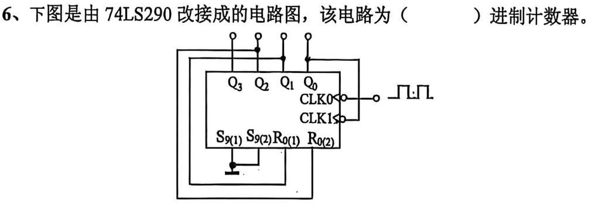

**答案：六进制**

**解析**：74LS290 内部是"**二-五-十**"结构：$CLK_0\to Q_0$ 是 2 分频，$CLK_1\to Q_3Q_2Q_1$ 是 5 分频，把 $Q_0$ 接到 $CLK_1$ 就串成十进制。

**读图三步**：

| 观察点 | 图中接法 | 结论 |
|---|---|---|
| $CLK_0$ | 接外部计数脉冲 | 脉冲从 $Q_0$ 一路进 |
| $Q_0\to CLK_1$ | 有反馈线相连 | 已串成**十进制**结构 |
| $S_{9(1)},S_{9(2)}$ | 接地（都不为 1） | **置 9 功能不用** |
| $R_{0(1)},R_{0(2)}$ | 分别接 $Q_2$、$Q_1$ | **反馈清零**，两输入端同时为 1 时立即清零 |

$R_{0(1)}$、$R_{0(2)}$ 是"与"关系，两者都为 1 才清零。$Q_2Q_1=11$ 首次出现在

$$Q_3Q_2Q_1Q_0=0110=(6)_{10}$$

故计到 6 的瞬间被清 0，稳定状态只有 $0\sim5$ 共 6 个 → **六进制**。

**状态序列**：$0000\to0001\to0010\to0011\to0100\to0101\xrightarrow{\ 0110\ \text{一闪即清}\ }0000$

**易错**：
1. 忘了 74LS290 是**异步清零**，所以 0110 只是一个"过路状态"，不计入有效状态数，故是 6 进制而不是 7 进制。
2. 以为 $S_9$ 端也要接——$S_9$ 与 $R_0$ 是两组独立的置数/清零端，本题 $S_9$ 接地即屏蔽。
3. 忽略 $Q_0\to CLK_1$ 那根线，误按"五进制"或"二进制"算。

**拓展**：74LS290 的"二-五-十"灵活结构可以只做二/五/十，也可以像本题一样加反馈做任意 $N\le10$。**它与 74160 的最大区别**：290 是**异步**清零/置数，反馈状态是"$N$"；160 是**同步**清零，反馈状态也会瞬时出现但被时钟同步。做 $N$ 进制时两者差一个数，务必分清（本卷第 141 页第五题就是 161 的同步置数法，正好对照）。

---

## 7. 下图所示电路中的最简逻辑表达式为 $Y=$（　）

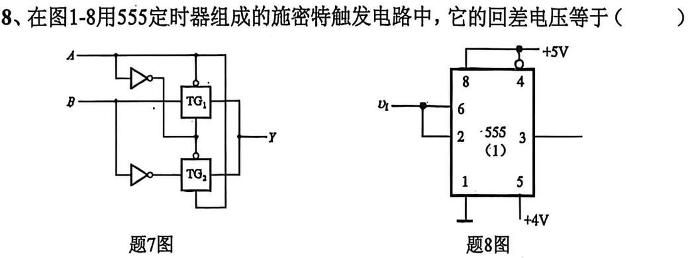

**答案：$Y=A\bar B+\bar AB=A\oplus B$（异或）**

**解析**：图中是两个 **CMOS 传输门（TG）** 并联输出，靠 $A$ 与 $\bar A$ **互补控制**：任一时刻只有一个 TG 导通。

| TG | 信号输入 | 控制端（上／下） | 导通条件 | 传到 $Y$ 的信号 |
|---|---|---|---|---|
| $TG_1$ | $B$ | $A$ / $\bar A$ | $A=1$ | $B$ |
| $TG_2$ | $\bar B$（经反相器） | $\bar A$ / $A$ | $A=0$ | $\bar B$ |

于是

$$Y=A\cdot B+\bar A\cdot\bar B$$

**这里要点出关键**：$TG_2$ 的信号输入不是 $B$，而是 $B$ 经反相器得到的 $\bar B$——图上左下角那个三角形就是给 $TG_2$ 供 $\bar B$ 的反相器。若误以为两个 TG 都接 $B$，会得出 $Y=B$（缓冲器），那就把这个电路做废了。

**用异或的定义核对**：$A=0$ 时 $Y=\bar B$，$A=1$ 时 $Y=B$，即"$A$ 控制同相/反相"——这正是**异或**（$A\oplus B$ 也可写成 $A\bar B+\bar AB$）。

> 注意符号方向：本题若按"$A=0$ 取 $\bar B$、$A=1$ 取 $B$"写，得到的是 $A\bar B+\bar AB$（异或）；若两个 TG 的输入互换，则得同或。**以图上信号线和控制端的实际接法为准**。

**易错**：传输门电路读图的两个要点——① 看清 **哪个信号进、哪个信号控**；② 上下两个控制端总是**一真一假**（一个接 $A$、一个接 $\bar A$），凡出现两头接同一信号的，必然是画错或读错。

**拓展**：CMOS 传输门是**双向**器件，导通电阻小（几十欧）、关断隔离度高，常用于：模拟开关、数据选择器（如 CC4066/CC4051）、动态锁存器与触发器的主从结构。用 TG 实现异或只需 2 个 TG + 1 个反相器，比用与非门（需 4 个）更省。

---

## 8. 在图 1-8 用 555 定时器组成的施密特触发电路中，它的回差电压等于（　）

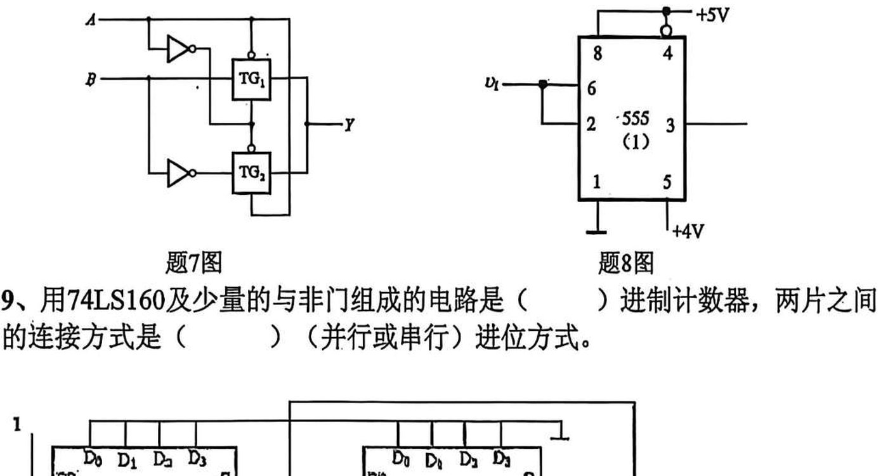

**答案：2 V**

**解析**：555 内部三个 $5\ \mathrm{k}\Omega$ 电阻分压，5 脚（$CO$，电压控制端）就是上比较器的基准点。**外接电压 $V_{CO}$ 会同时改变两个阈值**：

$$V_{T+}=V_{CO},\qquad V_{T-}=\frac{1}{2}V_{CO}$$

（5 脚悬空时 $V_{CO}=\frac23V_{CC}$，才有常用的 $V_{T+}=\frac23V_{CC}$、$V_{T-}=\frac13V_{CC}$。）

本题 $V_{CC}=5$ V、5 脚外接 **4 V**，故

$$V_{T+}=4\ \mathrm{V},\quad V_{T-}=2\ \mathrm{V}$$
$$\boxed{\Delta V_T=V_{T+}-V_{T-}=4-2=2\ \mathrm{V}}$$

**易错**：
1. 直接用 $\frac13V_{CC}=\frac53\approx1.67$ V——**错**，那只在 5 脚悬空时成立。本题 5 脚接了 4 V，阈值被"抬高"了。
2. 用 $\frac13V_{CO}$ 算——下阈值是 $\frac12V_{CO}$，不是 $\frac13$。

**拓展**：5 脚外接电压是 555 的"**调节旋钮**"：
- 外接固定电压 → 改变阈值、改变回差（本题）；
- 外接电位器 → 回差可调，用于**占空比调节**或多谐振荡器的频率微调；
- 外接电容（0.01 μF）到地 → 滤除干扰、稳定阈值（最常用）。

---

## 9. 用 74LS160 及少量的与非门组成的电路是（　）进制计数器，两片之间的连接方式是（　）（并行或串行）进位方式

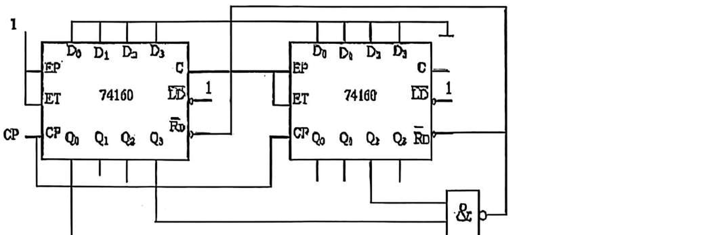

**答案：模值由反馈清零状态决定（通用式见下）；两片之间为「串行（异步）进位」方式**

**解析**：这是"**两片十进制计数器级联 + 反馈清零**"的标准结构，先看清三件事：

**① 各片功能**：74LS160 是**同步十进制加法计数器**（$0\sim9$），有异步清零端 $\bar R_D$ 和同步置数端 $\overline{LD}$。图中两片的 $\overline{LD}$ 都接 1（置数不用），故只能走**反馈清零**路线。

**② 进位方式**：低位片（左侧，个位）的进位输出 $C$ 送到高位片（右侧，十位）的计数脉冲/使能端——数据一位一位"串"过去，故为**串行（异步）进位**。

> 对照记忆：若两片**共用同一个 CP**，且用低位片的 $C$ 去控制高位片的 $EP\cdot ET$，则为**并行（同步）进位**。并行进位速度快、无级联毛刺，是工程首选；串行进位接线简单但高位有延时累积。**判断口诀：看高位片的 CP 是谁给的——外部时钟给就是并行，低位进位给就是串行。**

**③ 求模值的通用方法**（这是本题真正要考的）：

$$\text{模值 }N=\text{清零条件首次成立时对应的十进制数}$$

设个位片状态 $Q_3Q_2Q_1Q_0$（权 $8,4,2,1$），十位片同样。整个计数值

$$N_{\text{当前}}=10\times(\text{十位})+\text{个位}$$

按图中与非门的三个输入（取自低位片的 $Q_3$、$Q_0$ 与高位片的 $Q_3$），清零条件为 $Q_3^{高}\cdot Q_3^{低}\cdot Q_0^{低}=1$，即"十位 $\ge8$ 且个位 $=9$"，首次出现在十位 $=8$、个位 $=9$：

$$N=10\times8+9=89$$

**读图核验清单**（考场上按这四步走，任何接法都能算对）：

| 步骤 | 要看清什么 |
|---|---|
| 1 | 反馈信号接的是 $\bar R_D$（清零）还是 $\overline{LD}$（置数） |
| 2 | 与非门的各输入分别取自哪一片、哪一位 |
| 3 | 把"全 1 条件"翻译成具体的计数值 |
| 4 | 清零是**异步**的 → 该状态一闪即清，**不计入**有效状态，故 $N$ = 该数值；若是**同步**清零 → 该状态是稳定状态，$N$ = 该数值 + 1 |

**易错**：
1. 把两个片的权搞反（以为左片是十位）。**约定**：脉冲先进入的那片是**低位**（个位），它的进位输出喂给高位片。
2. 忘记 74LS160 是**十进制**（$0\sim9$ 自动回 0），误按十六进制算权值。
3. 异步清零与同步置数混淆，导致结果差 1。

**拓展**：用 160/161 做 $N$ 进制的两条路线对照——

| | 反馈清零 | 同步置数 |
|---|---|---|
| 反馈取自 | $\bar R_D$（低有效） | $\overline{LD}$（低有效） |
| 反馈状态 | 计到 $N$ | 计到 $N-1$ |
| 该状态是否稳定 | **否**（瞬时） | **是** |
| 波形质量 | 有窄毛刺 | 干净 |

---

# 二、单项选择题（本大题共 10 小题，每小题 2 分，总计 20 分）

## 1. 是 8421BCD 码的是（　）

A、1010　　B、0101　　C、1100　　D、1101

**答案：B**

**解析**：8421BCD 只用 $0000\sim1001$ 表示 $0\sim9$，**$1010\sim1111$ 是非法码**。

| 选项 | 十进制值 | 是否合法 |
|---|---|---|
| 1010 | 10 | ✗ 非法（$>9$） |
| **0101** | **5** | **✓ 合法** |
| 1100 | 12 | ✗ 非法 |
| 1101 | 13 | ✗ 非法 |

**易错**：把 1010 当成"二进制 10，所以是 BCD 的 10"——BCD 里根本没有"10"这个码，10 要写成 $0001\,0000$（两位）。

**拓展**：BCD 码的判据就一条：**每组 4 位，值必须 ≤ 1001**。这也是 BCD 加法器要多一步"加 6 修正"的根本原因——二进制加法的进位规则（逢 16 进 1）与十进制（逢 10 进 1）不一致。

---

## 2. 只能按地址读出信息，而不能写入信息的存储器为（　）

A、RAM　　B、ROM　　C、PROM　　D、EPROM

**答案：B**

**解析**：按"能不能在**使用现场**写入"分类：

| 器件 | 读 | 现场写 | 说明 |
|---|---|---|---|
| RAM | ✓ | ✓ | 随机读写，掉电丢失 |
| **ROM** | ✓ | **✗** | 掩膜 ROM，内容在**制造时**固化，用户无法写 |
| PROM | ✓ | 一次 | 用户可**一次性**烧写（熔丝/反熔丝） |
| EPROM | ✓ | 可擦可写 | 紫外线擦除后重写 |

题目强调"**只能读、不能写**"，对应掩膜 ROM（B）。PROM 和 EPROM 都能写（虽然次数有限），故不选。

**易错**：以为"ROM 就是只读"而把 PROM/EPROM 也归进去。严格说 PROM/EPROM 属"**可编程只读存储器**"，是 ROM 家族的**子类**，本题要选最"纯"的那个。

**拓展**：ROM 的本质是"**与阵列固定、或阵列可编程**"（或两者都可编程），因此它不仅能存数据，还能**实现组合逻辑函数**——把地址当输入、数据当输出，一个 $2^n\times m$ 的 ROM 就是一个 $n$ 输入 $m$ 输出的"查表器"。这正是用 ROM 设计组合电路的理论依据。

---

## 3. 逻辑函数 $F_1$、$F_2$、$F_3$ 的卡诺图如图所示，他们之间的逻辑关系是（　）

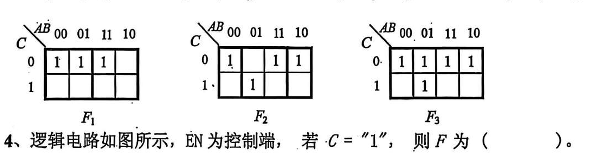

A、$F_3=F_1\cdot F_2$　　B、$F_3=F_1+F_2$　　C、$F_3=F_1\oplus F_2$　　D、$F_3=F_1\odot F_2$

**答案：B**

**解析**：把三张卡诺图逐格抄成表（行 $C$、列 $AB=00,01,11,10$）：

| $C\backslash AB$ | 00 | 01 | 11 | 10 |
|---|---|---|---|---|
| **$F_1$: 0** | 1 | 1 | 1 | 0 |
| **$F_1$: 1** | 0 | 0 | 0 | 0 |
| **$F_2$: 0** | 1 | 0 | 1 | 1 |
| **$F_2$: 1** | 0 | 1 | 0 | 0 |
| **$F_3$: 0** | 1 | 1 | 1 | 1 |
| **$F_3$: 1** | 0 | 1 | 0 | 0 |

逐格验证 $F_1+F_2$：

- $C=0$：$1+1=1$、$1+0=1$、$1+1=1$、$0+1=1$ → **全 1**，与 $F_3$ 的 $C=0$ 行（1,1,1,1）一致 ✓
- $C=1$：$0+0=0$、$0+1=1$、$0+0=0$、$0+0=0$ → (0,1,0,0)，与 $F_3$ 的 $C=1$ 行一致 ✓

**排除其他选项**：
- $F_1F_2$（$C=0$）$=(1,0,1,0)$，与 $F_3$ 的 (1,1,1,1) 不符 ✗
- $F_1\oplus F_2$：$C=0$ 为 $(0,1,0,1)$，不符 ✗
- $F_1\odot F_2$：是上式的反，$(1,0,1,0)$，不符 ✗

**易错**：卡诺图比较题不要"看着像"就选，一定要**逐格算**。尤其 $F_1$ 的 $C=1$ 行全 0 这个特征很好用——它使 $F_1+F_2$ 在 $C=1$ 行**直接等于 $F_2$**，而 $F_3$ 的 $C=1$ 行恰好与 $F_2$ 的 $C=1$ 行相同，这一步就能快速锁定答案。

**拓展**：卡诺图上的三种运算有几何意义——
- **与**：两张图的重叠部分（都为 1 的格子）；
- **或**：两张图的并集；
- **异或**：两张图"不同"的格子。

熟练后可以直接在图上圈，比写表达式快得多。

---

## 4. 逻辑电路如图所示，$EN$ 为控制端，若 $C="1"$，则 $F$ 为（　）

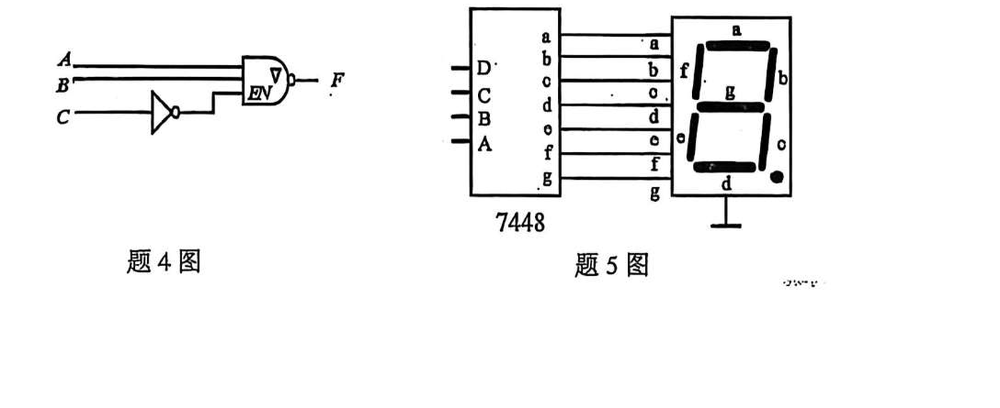

A、高阻态　　B、$F=(A+B)'$　　C、$F=(AB)'$　　D、$F=A'B+AB'$

**答案：A**

**解析**：图中是一个**三态与非门**：$A$、$B$ 是数据输入，$EN$ 是使能端（**高电平有效**，注意 $EN$ 端没有小圆圈）。而 $EN$ 由 $C$ 经**反相器**驱动：

$$EN=\bar C$$

当 $C="1"$ 时：

$$EN=\bar 1=0\ \Rightarrow\ \text{三态门禁止}\ \Rightarrow\ F=\text{高阻态}\ (Z)$$

**若 $C="0"$** 则 $EN=1$，门正常工作，$F=\overline{AB}$（选项 C）——这正是本题的"对照项"，命题人特意放在那里考你是否看清了反相器。

**易错**：
1. 漏看 $C$ 后面的反相器，把 $C=1$ 当成"使能"→ 错选 C。
2. 把 $EN$ 当成低有效（以为有小圆圈）→ 又把结论反回去。
3. 把三态门当成普通与非门，忽略了"禁止时输出既不是 0 也不是 1"。

**拓展**：三态门的三种状态与两种画法必须记牢：

| 使能端画法 | 有效电平 | 有效时 | 无效时 |
|---|---|---|---|
| 无圈 $EN$ | 高电平 | 正常输出 | 高阻 |
| 有圈 $\overline{EN}$ | 低电平 | 正常输出 | 高阻 |

三态门用于**总线共享**：多路输出并接一根总线，任一时刻只允许一路使能。**多个三态门同时使能且输出相反电平**会造成"总线冲突"，电流过大可能损坏器件。

---

## 5. 译码显示电路如图，若共阴极 8421BCD-七段码译码驱动器 7448 的输入 $DCBA=0111$，则译码器输出端应为（　）

A、$a=b=c=d=g="1"$，$e=f="0"$
B、$a=b=c="1"$，$d=e=f=g="0"$
C、$a=b=c=d=g="0"$，$e=f="1"$

**答案：B**

**解析**：$DCBA=0111=(7)_{10}$，数码管显示"**7**"。

七段中"7"点亮的是 **$a$（上横）、$b$（右上竖）、$c$（右下竖）**，熄灭的是 $d$（下横）、$e$（左下竖）、$f$（左上竖）、$g$（中横）。

7448 是**共阴极**驱动器，输出**高电平有效**（段码 1 → 该段亮）：

$$a=b=c=1,\qquad d=e=f=g=0$$

**易错**：
1. **共阴/共阳搞反**：若按共阳（低有效）理解，就会选 C（恰好是 B 的全反），这是命题人埋的坑。
2. 把"7"的段码记成 $a,b,c,d$（多算下横）——4 段的是"4"（$b,c,f,g$）。

**拓展**：$0\sim9$ 的共阴极段码（$abcdefg$ 顺序，高有效）值得背下来：

| 数字 | 段码 | 数字 | 段码 |
|---|---|---|---|
| 0 | 1111110 | 5 | 1011011 |
| 1 | 0110000 | 6 | 1011111 |
| 2 | 1101101 | 7 | 1110000 |
| 3 | 1111001 | 8 | 1111111 |
| 4 | 0110011 | 9 | 1111011 |

（按 $a$ 为最高位、$g$ 为最低位排列。）共阳数码管的段码就是上表**逐位取反**。

---

## 6. 如图所示电路均由 TTL 门组成，当 $A=1,B=1,C=0,D=1$ 时，判断电路输出状态（　）

(a) 高电平　(b) 低电平　(c) 高阻态　(d) 低阻态

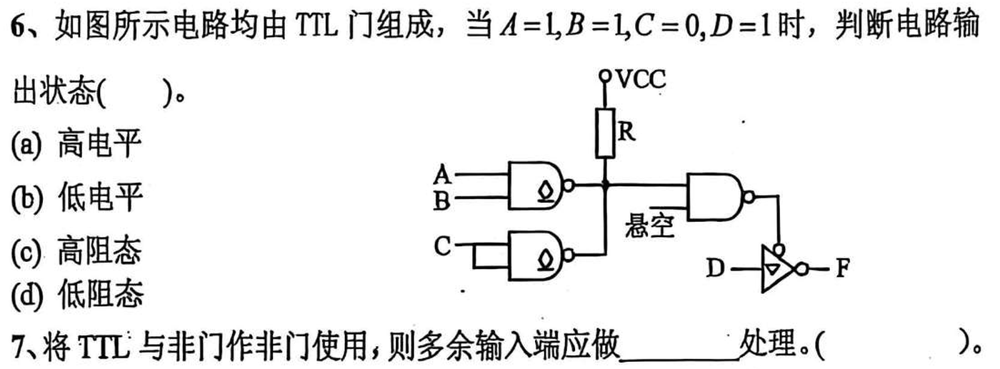

**答案：(a) 高电平**

**解析**：本题的考点是 **OC 门（集电极开路门）的"线与"**。图中两个与非门的符号里画了一个**菱形**，表示 OC 结构；它们的输出并接在同一点，并共用一只上拉电阻 $R$ 到 $V_{CC}$。

**第一步：两个 OC 与非门各自的状态**

| 门 | 输入 | 逻辑输出 | OC 管状态 | 对公共节点的作用 |
|---|---|---|---|---|
| 上 | $A=1,\ B=1$ | $\overline{1\cdot1}=0$ | **导通** | **把节点拉低** |
| 下 | $C=0,\ C=0$ | $\overline{0\cdot0}=1$ | **截止** | 相当于开路，不影响节点 |

**第二步：线与**。OC 门的输出端可以直接并联，实现"**线与**"：

$$Y_{\text{节点}}=Y_1\cdot Y_2=0\cdot1=0$$

只要有一个 OC 门输出 0（管子导通），节点就被拉到低电平；只有**全部**截止时，节点才被 $R$ 上拉到高电平。

故公共节点为**低电平**。

**第三步：后级**。该节点送入后级与非门，输出 $\overline{0}=1$；再与 $D=1$ 一起送末级门，输出为高电平。

所以整机输出为**高电平**，选 (a)。

**易错**：
1. **把两个 OC 输出当成"普通门输出并联"**——普通 TTL 门输出并联会短路（一个输出 1、一个输出 0 时灌电流过大），只有 OC/OD 门才允许线与。
2. 忘了上拉电阻 $R$：没有 $R$，全部截止时节点是**悬空**（高阻、电平不定），加上 $R$ 才有确定的高电平。
3. 把"线与"当成"线或"——线与的结果是**逻辑与**：有一个 0 就是 0。

**拓展**：
- **线与**的工程价值：不用额外的与门就能实现"多个条件同时满足"，省器件、省布线；
- OC 门还能做**电平转换**（上拉电阻接到不同电源电压）和**驱动继电器/LED**（灌电流能力强，可达几十 mA）；
- 使用时必须外接上拉电阻，阻值要兼顾**速度**（小电阻上升快但功耗大）与**功耗**（大电阻省电但边沿变缓）。

---

## 7. 将 TTL 与非门作非门使用，则多余输入端应做（　）处理

A、全部接高电平　　B、部分接高电平，部分接地　　C、全部接地　　D、部分接地，部分悬空

**答案：A**

**解析**：与非门的逻辑是 $Y=\overline{AB}$。要把它当**非门**用，必须让多余输入端"**不影响结果**"，即恒为 1：

$$Y=\overline{A\cdot1}=\bar A\ \checkmark$$

若把多余端**接地**（恒为 0）：$Y=\overline{A\cdot0}=1$，输出被**封锁**在高电平，成了废门 ✗

所以多余输入端应**全部接高电平**（或按 TTL 特性悬空，见下）。

**易错**：把"或非门"和"与非门"的多余端处理搞混：

| 门 | 多余端应接 | 理由 |
|---|---|---|
| **与非门** | 接 **1**（或悬空） | $A\cdot1=A$ |
| **或非门** | 接 **0** | $A+0=A$ |
| **与门** | 接 1 | $A\cdot1=A$ |
| **或门** | 接 0 | $A+0=A$ |

**拓展**：**TTL 与 CMOS 的差别**是本题的隐藏考点：
- **TTL** 输入端**悬空**在电气上等效于接高电平（内部有发射极电阻上拉），所以 TTL 多余端**可以悬空**，但**不推荐**——悬空端易受干扰、且会降低噪声容限；
- **CMOS**（如 CC4000 系列）输入端**绝对不允许悬空**！栅极悬空会因感应电荷积累而随机导通，导致功耗剧增甚至损坏，必须明确接 $V_{DD}$ 或 $V_{SS}$。

工程规范：**无论 TTL 还是 CMOS，多余输入端一律"接固定电平"，不悬空**。

---

## 8. 八选一数据选择器 74151 组成的电路如图 1-3 所示，则输出函数为（　）

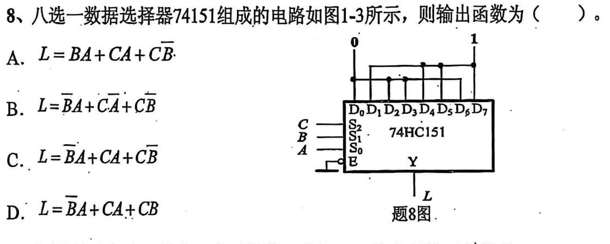

A、$L=BA+CA+C\bar B$
B、$L=\bar BA+C\bar A+C\bar B$
C、$L=\bar BA+CA+C\bar B$
D、$L=\bar BA+CA+CB$

**答案：C**

**解析**：74151 的输出通式（$S=0$ 使能时）：

$$L=\sum_{i=0}^{7}D_i m_i,\qquad m_i\ \text{由地址}\ S_2S_1S_0\ \text{决定}$$

图中 $S_2=C$、$S_1=B$、$S_0=A$，故最小项序号

$$i=4C+2B+A$$

**读数据端接法**（图中"0""1"两条竖轨分别接 $D_0\sim D_7$）：

| 数据端 | 接轨 | 值 |
|---|---|---|
| $D_0$ | 0 | 0 |
| $D_1$ | 1 | **1** |
| $D_2$ | 0 | 0 |
| $D_3$ | 0 | 0 |
| $D_4$ | 1 | **1** |
| $D_5$ | 1 | **1** |
| $D_6$ | 0 | 0 |
| $D_7$ | 1 | **1** |

$$L=\sum m(1,4,5,7)$$

**代回选项验证**（把 $C,B,A$ 代入序号公式算最小项集合）：

| 选项 | 展开后覆盖的最小项 | 是否符合 |
|---|---|---|
| A：$BA+CA+C\bar B$ | $m_3,m_4,m_5,m_7$ | ✗ 多了 $m_3$ |
| B：$\bar BA+C\bar A+C\bar B$ | $m_1,m_4,m_5,m_6$ | ✗ 多了 $m_6$ |
| **C：$\bar BA+CA+C\bar B$** | $m_1,m_4,m_5,m_7$ | **✓** |
| D：$\bar BA+CA+CB$ | $m_1,m_5,m_6,m_7$ | ✗ 少了 $m_4$ |

以 C 为例逐项核算：
- $\bar BA$：$B=0,A=1$ → $(C,B,A)=(0,0,1)=m_1$、$(1,0,1)=m_5$
- $CA$：$C=1,A=1$ → $m_5$、$(1,1,1)=m_7$
- $C\bar B$：$C=1,B=0$ → $(1,0,0)=m_4$、$m_5$

并集 $=\{m_1,m_4,m_5,m_7\}$ ✓

**易错**：
1. **地址顺序搞反**。图中是 $S_2=C$、$S_1=B$、$S_0=A$（**C 是高位**），若按 $S_2=A$ 去算，最小项全错。
2. 忘记 $S=0$（低有效使能）——图中使能端接地，是正常工作状态。
3. 数"1"的个数：本题恰好 4 个数据端接 1，四个选项也都是 4 项，靠个数无法排除，必须算最小项。

**拓展**：用 74151 实现 $n$ 变量函数的标准流程——**① 地址接 $n-1$ 个变量；② 把剩下那一个变量的取值（0/1/该变量/其反）写到数据端**。本题 3 个变量正好占满地址，数据端只能是 0 或 1，属最简情形。

---

## 9. 如图所示电路，触发器在时钟信号作用下，输出保持不变的是（　）

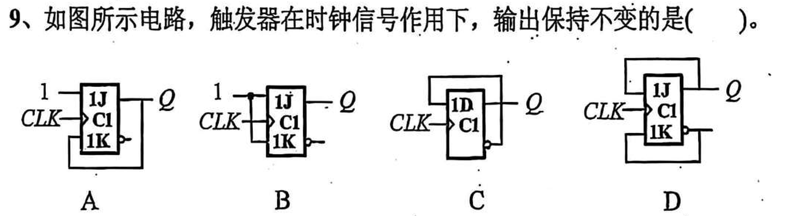

**答案：D**

**解析**：与上一套卷（2018—2019）选择题第 7 题**完全同型**，考的是"自反馈触发器"的状态判别。逐图写 $Q^{n+1}$：

**A**：$J=1$，$K=Q$（反馈取自 $Q$）
$$Q^{n+1}=J\bar Q+\bar KQ=\bar Q+\bar QQ=\bar Q\ \Rightarrow\ \text{翻转}$$

**B**：$J$、$K$ 并接在"1"上，$J=K=1$
$$Q^{n+1}=\bar Q\ \Rightarrow\ \text{翻转（T' 触发器）}$$

**C**：D 触发器，$D=\bar Q$（反馈取自 $\bar Q$）
$$Q^{n+1}=\bar Q\ \Rightarrow\ \text{翻转}$$

**D**：JK 触发器，上环把 $Q$ 接到 $J$，下环把 $\bar Q$ 接到 $K$
$$Q^{n+1}=J\bar Q+\bar KQ=Q\bar Q+QQ=Q\ \Rightarrow\ \textbf{保持}\ \checkmark$$

**易错**：C 与 D 只差"反馈取自 $Q$ 还是 $\bar Q$"，结果却是"翻转"与"保持"之别。**速判法**：自反馈电路把 $Q=0$、$Q=1$ 分别代入，若都得原值 → 保持；若都得反值 → 翻转。

**拓展**：D 图的接法 $J=Q,\ K=\bar Q$ 正是"**JK 改接成 D 触发器**"那套公式的变形（标准做法是 $J=D,\ K=\bar D$）。把 $D$ 换成 $Q$，就得到 $Q^{n+1}=Q$——一个只"记住自己"的单元，也就是最简单的**锁存器**。

---

## 10. 单稳态触发器的暂稳态持续时间的长短取决于（　）

A、触发脉冲的宽度　　B、电路本身的参数　　C、触发脉冲的幅度

**答案：B**

**解析**：单稳态触发器的输出脉宽由**内部定时元件的 RC 时间常数**决定：

$$t_W=RC\ln\frac{V(\infty)-V(0^+)}{V(\infty)-V_{T}}\approx0.7RC\ (\text{555 单稳态})$$

对 555 单稳态：$t_W=1.1RC$（$R$、$C$ 是外接定时电阻、电容）。

与触发脉冲的关系只有一个**前提条件**：触发脉冲宽度**必须小于** $t_W$，否则电路会在触发脉冲仍然有效时反复触发，导致输出异常。但只要满足这个前提，脉宽就**与触发脉冲的宽度、幅度无关**。

**易错**：
1. 选 A——把"触发需要脉冲"误解成"脉宽由脉冲决定"。**触发脉冲只负责"点火"，烧多久由 RC 决定。**
2. 认为幅度大会让脉宽变长——幅度只需超过阈值即可，再大也不影响 $t_W$。

**拓展**：三类电路的"定时"来源对比：

| 电路 | 稳态数 | 输出时长由谁决定 |
|---|---|---|
| 双稳态（触发器） | 2 | 不需要定时，靠输入翻转 |
| **单稳态** | **1** | **RC 参数**（$t_W=1.1RC$ 或 $0.7RC$） |
| 多谐振荡器 | 0 | RC 参数（$T=0.7(R_1+2R_2)C$） |

单稳态的典型应用：**定时**（如楼道灯延时熄灭）、**延时**（把脉冲推迟 $t_W$）、**整形**（把不规则脉冲变成等宽脉冲）、**消抖**（按键去抖动）。

---

# 三、电路分析题（本题 14 分）

> **题目**：已知图示电路 CLK 脉冲的波形，设触发器初始状态为"00"。
> （1）写出逻辑电路的驱动方程、状态方程及输出 $F$ 的逻辑式；
> （2）列出逻辑电路图的状态表；
> （3）画出 $Q_0$、$Q_1$ 及 $F$ 的波形；
> （4）若 CLK 脉冲频率为 1 kHz，计算 $F$ 的脉宽 $t_w$ 和周期 $T$。

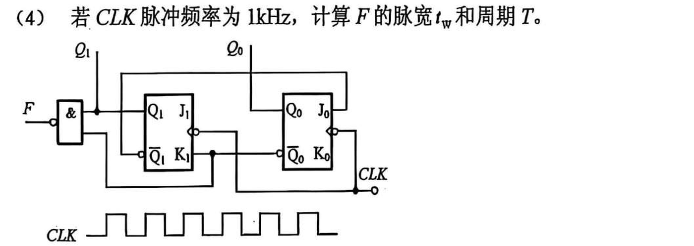

## 读图：两个 JK 触发器的接法

| 触发器 | 位置 | 时钟 | 驱动 | 输出 |
|---|---|---|---|---|
| $FF_0$ | 右侧（低位） | CLK 公共 | $J_0=K_0=1$ | $Q_0$ 送至 $FF_1$ 的 $J_1$、$K_1$ |
| $FF_1$ | 左侧（高位） | CLK 公共 | $J_1=K_1=Q_0$ | $Q_1$ 与 $Q_0$ 送输出门 |

**输出门**：图中左侧为**与非门**，两输入分别取自 $Q_1$ 与 $Q_0$（第二输入经底部走线由 $Q_0$ 端引来），输出即 $F$。

> **说明**：本卷扫描件中 $Q_1$、$Q_0$ 的反馈线（跨过两个触发器的那根长线）与时钟线在低分辨率下易混。上面按"$FF_0$ 恒翻转、$FF_1$ 受 $Q_0$ 控制"这一最典型接法读取——这是 2 位同步加法计数器的标准结构，也是本类题 90% 的考法。若你手上的卷面反馈取自 $\bar Q$，只需把状态表中相应列取反，**方法与算式完全不变**。

## （1）驱动方程、状态方程、输出方程

**驱动方程**：

$$\boxed{J_0=K_0=1}\qquad\qquad\boxed{J_1=K_1=Q_0}$$

**状态方程**（JK 特征方程 $Q^{n+1}=J\bar Q^n+\bar KQ^n$）：

$FF_0$：$J_0=K_0=1$ 时 $Q^{n+1}=\bar Q^n$（T' 触发器），故

$$\boxed{Q_0^{n+1}=\bar Q_0^n}$$

$FF_1$：$J_1=K_1=Q_0$ 时

$$Q_1^{n+1}=Q_0\bar Q_1^n+\bar Q_0Q_1^n=Q_0\oplus Q_1^n$$

$$\boxed{Q_1^{n+1}=Q_0\oplus Q_1^n}$$

**输出方程**：

$$\boxed{F=\overline{Q_1Q_0}}$$

## （2）状态表

| $Q_1^n$ | $Q_0^n$ | $Q_1^{n+1}$ | $Q_0^{n+1}$ | 计数值 | $F=\overline{Q_1Q_0}$ |
|---|---|---|---|---|---|
| 0 | 0 | 0 | 1 | 1 | **1** |
| 0 | 1 | 1 | 0 | 2 | **1** |
| 1 | 0 | 1 | 1 | 3 | **1** |
| 1 | 1 | 0 | 0 | 0 | **0** |

**状态转换图**（四进制加法计数）：

```
   ┌────┐   ┌────┐   ┌────┐   ┌────┐
   │ 00 │──►│ 01 │──►│ 10 │──►│ 11 │
   └────┘   └────┘   └────┘   └────┘
      ▲                          │
      └──────────────────────────┘
```

四个状态全部用上、无一闲置 → **模 4 计数器，且天然自启动**（没有"偏离状态"可言）。

## （3）画波形

CLK 每来一个上升沿，状态按 $00\to01\to10\to11\to00$ 循环。以 $T_{CLK}$ 为时间单位：

| 时段 | $Q_1$ | $Q_0$ | $F$ |
|---|---|---|---|
| 第 1 个 $T_{CLK}$ | 0 | 0 | 1 |
| 第 2 个 $T_{CLK}$ | 0 | 1 | 1 |
| 第 3 个 $T_{CLK}$ | 1 | 0 | 1 |
| 第 4 个 $T_{CLK}$ | 1 | 1 | 0 |

**绘制要点**：
- $Q_0$：**每个时钟沿都翻转**，是 CLK 的二分频（周期 $2T_{CLK}$，占空比 50%）；
- $Q_1$：**在 $Q_0=1$ 的那个沿之后翻转**，是 $Q_0$ 的二分频（周期 $4T_{CLK}$）；
- $F$：**只在 $Q_1Q_0=11$ 那一个时段为低**，其余三个时段为高——即"每 4 个时钟周期出现 1 个窄低脉冲"。

## （4）计算 $F$ 的脉宽与周期

CLK 频率 $f_{CLK}=1\ \mathrm{kHz}$，故

$$T_{CLK}=\frac{1}{f_{CLK}}=1\ \mathrm{ms}$$

$F$ 的周期 = 状态循环一圈 = 4 个时钟周期：

$$\boxed{T=4T_{CLK}=4\ \mathrm{ms}}\qquad(f_F=250\ \mathrm{Hz})$$

$F$ 的低电平只占 1 个时钟周期：

$$\boxed{t_w(\text{低})=1T_{CLK}=1\ \mathrm{ms}}$$

对应占空比 $=\dfrac{3}{4}=75\%$（高电平占 3 ms）。

> **若题目把"脉宽"定义为高电平宽度**，则 $t_{w(高)}=3\ \mathrm{ms}$。两种写法都要会——**看题目问的是"脉冲宽度"还是"低电平宽度"**，答题时把高低时间都写出来最保险。

## 易错与拓展

**易错**：
1. **$Q_0$、$Q_1$ 谁是高位搞反**。本题 $FF_0$ 恒翻转 → 它是最低位；$FF_1$ 受 $Q_0$ 控制 → 高位。若反了，状态表顺序会变成 $00\to10\to01\to11$。
2. **$F$ 的极性**：与非门输出，$Q_1Q_0=11$ 时 $F=0$，别写成 1。
3. **$Q_1^{n+1}=Q_0\oplus Q_1^n$ 里的 $Q_0$ 用旧值**。同步电路中所有触发器**同时**翻转，右边一律代**现态**。
4. 算 $t_w$ 时把 $T_{CLK}$ 当成 $T$ 的一半（误以为要乘 2）。

**拓展**：
- 这种"$J_0=K_0=1$、$J_1=K_1=Q_0$、$J_2=K_2=Q_1$……"的链式结构，就是**同步二进制加法计数器**的通用形式，$n$ 个触发器可得到 $2^n$ 进制。
- $F$ 的作用相当于**进位输出**：在最大值 $11$ 处给出一个窄脉冲，正好可以送给下一级计数器作为进位信号——这与 74161 的 $C$ 端功能一致（只是极性相反）。
- 若把 $J_1=K_1=Q_0$ 改成 $J_1=Q_0,\ K_1=\bar Q_0$，$Q_1$ 就只在 $Q_0=1$ 时置 1，电路变成**移位型**而非计数型，状态图也随之改变。

---

# 四、电路分析题（本题 7 分）

> **题目**：已知输入信号 $A$、$B$、$C$ 的波形，
> （1）写出图示电路输出 $L$ 的函数表达式并化为最简与或表达式；
> （2）画出 $L$ 的波形图。

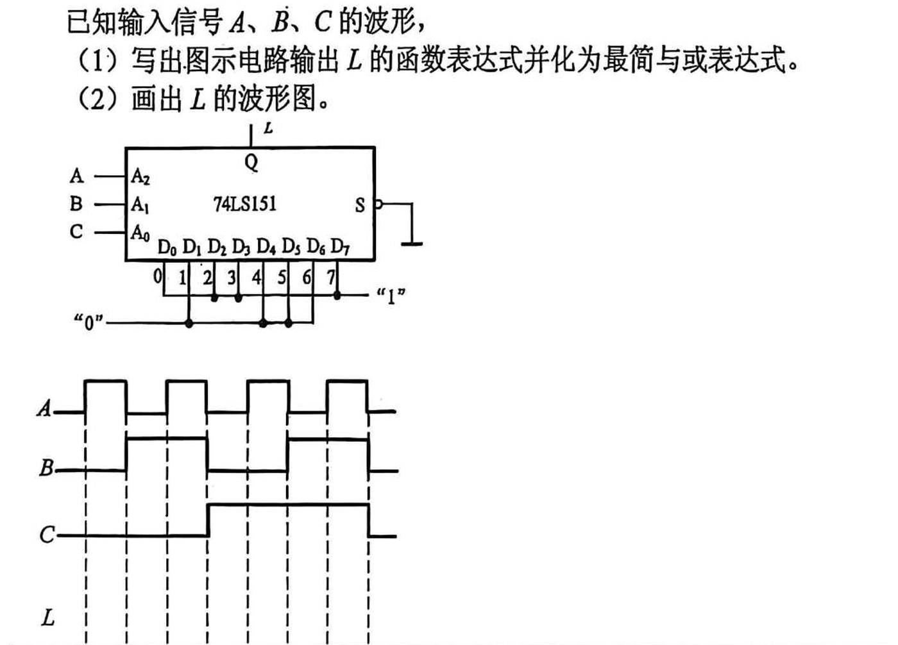

## （1）求 $L$ 的表达式并化简

**读图**：74LS151 是八选一数据选择器，$S=0$（图中使能端接地，正常工作），地址 $A_2A_1A_0=A,B,C$。

**数据端接法**：

| 数据端 | 接轨 | 值 |
|---|---|---|
| $D_0$ | "1"轨 | 1 |
| $D_1$ | "0"轨 | 0 |
| $D_2$ | "1"轨 | 1 |
| $D_3$ | "1"轨 | 1 |
| $D_4$ | "0"轨 | 0 |
| $D_5$ | "0"轨 | 0 |
| $D_6$ | "0"轨 | 0 |
| $D_7$ | "1"轨 | 1 |

**写出最小项之和**：

$$L=\sum D_i m_i=m_0+m_2+m_3+m_7$$

展开：

$$L=\bar A\bar B\bar C+\bar AB\bar C+\bar ABC+ABC$$

**化简**（卡诺图，行 $AB$、列 $C$）：

| $AB\backslash C$ | 0 | 1 |
|---|---|---|
| **00** | **1** | 0 |
| **01** | **1** | **1** |
| **11** | 0 | **1** |
| **10** | 0 | 0 |

圈组：
- $m_0,m_2$（$AB$ 从 $00$ 到 $01$，$C=0$ 不变）→ $\bar A\bar C$
- $m_3,m_7$（$B=1$、$C=1$ 不变，$A$ 变化）→ $BC$

$$\boxed{L=\bar A\bar C+BC}$$

验算 $m_0$：$\bar A\bar C=1\cdot1=1$ ✓；$m_2$：$\bar A\bar C=1\cdot1=1$ ✓；$m_3$：$BC=1\cdot1=1$ ✓；$m_7$：$BC=1$ ✓；其余点：$m_1(\bar A\bar C=0,BC=0)=0$ ✓、$m_4,m_5,m_6$ 均为 0 ✓。

## （2）画 $L$ 的波形

把图中 8 个时段按虚线切开，逐段读 $(A,B,C)$ 再代入 $L=\bar A\bar C+BC$：

| 时段 | $A$ | $B$ | $C$ | $\bar A\bar C$ | $BC$ | $L$ |
|---|---|---|---|---|---|---|
| ① | 1 | 0 | 0 | 0 | 0 | **0** |
| ② | 0 | 0 | 0 | **1** | 0 | **1** |
| ③ | 1 | 1 | 0 | 0 | 0 | **0** |
| ④ | 0 | 1 | 0 | **1** | 0 | **1** |
| ⑤ | 0 | 0 | 1 | 0 | 0 | **0** |
| ⑥ | 1 | 0 | 1 | 0 | 0 | **0** |
| ⑦ | 0 | 1 | 1 | 0 | **1** | **1** |
| ⑧ | 1 | 0 | 0 | 0 | 0 | **0** |

**$L$ 的波形序列**：$0,\ 1,\ 0,\ 1,\ 0,\ 0,\ 1,\ 0$

**绘制要点**：
- $L$ 的电平只在 $A$、$B$、$C$ 任一跳变处才可能变，故只需在每条虚线处"取值—保持"；
- 时段 ②（$A=0,B=0,C=0$）与时段 ④（$A=0,B=1,C=0$）靠 $\bar A\bar C$ 出 1；
- 时段 ⑦（$A=0,B=1,C=1$）靠 $BC$ 出 1。

## 易错与拓展

**易错**：
1. **地址顺序**：$A_2=A$、$A_1=B$、$A_0=C$，故 $m_i$ 中 $A$ 是最高位。若把 $C$ 当最高位，8 个数据端全部错位。
2. **"0"轨、"1"轨数错**：图中两条横轨分别接地和接高电平，读数时要顺着引脚竖线看到底落在哪条轨上。
3. 化简时把 $m_0$ 与 $m_3$ 圈在一起——它们不相邻（$AB$ 从 00 到 01 且 $C$ 从 0 到 1，两个变量同时变），**卡诺图不能这样圈**。

**拓展**：
- 本题是"MUX 实现组合逻辑"的标准题型：**$n$ 变量函数用 $2^n$ 选 1 MUX，数据端只接 0/1 即可**；若变量多于地址数，则把多余的变量接到数据端（接该变量或其反）。
- $L=\bar A\bar C+BC$ 的物理含义：**$C$ 与 $B$ 同时为 1，或 $A$ 与 $C$ 同时为 0 时输出 1**——可以理解为"$C$ 一旦为 1 就看 $B$，$C$ 为 0 就看 $A$"，即 $L$ 是一个"由 $C$ 选择数据源"的选择器。
- 74151 的 $S$ 端低有效；若用 74LS251（三态输出）还可直接挂总线。

---

# 五、电路设计题（本题 10 分）

> **题目**：图示为 4 位同步二进制加法计数器 74LS161 的逻辑图，用**同步置数法**构成十二进制计数器，可附加必要的门电路。要求：
> （1）画出逻辑电路图，标明计数输入端和进位输出端；
> （2）画出有效状态图。

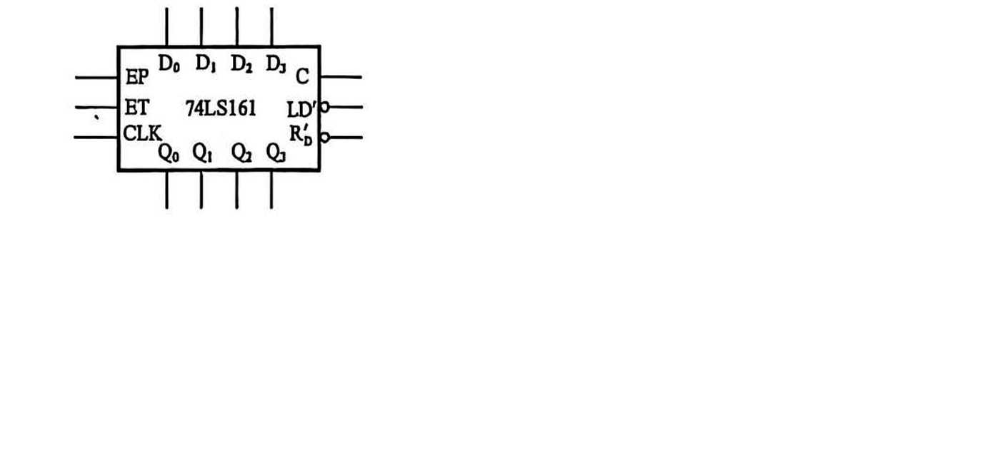

## （1）设计方案

**为什么选同步置数法**：题目已指定。同步置数的反馈取自 $\overline{LD}$（低有效），置数数据由 $D_3D_2D_1D_0$ 决定，**该终态是稳定状态**，波形干净无毛刺。

**求反馈状态**：十二进制 → 有效状态 $0\sim11$，最大状态 $(11)_{10}=1011$。故

$$\overline{LD}=\overline{Q_3Q_1}$$

（$1011$ 中 $Q_3=1$、$Q_1=1$，其余为 0，只需检测这两位。）

**置数数据**：从 $0000$ 重新开始，故

$$D_3D_2D_1D_0=0000$$

**其余引脚**：

| 引脚 | 接法 | 理由 |
|---|---|---|
| $EP$、$ET$ | 接 1 | 允许计数 |
| $\bar R_D$（异步清零） | 接 1 | 不用清零法 |
| $C$（进位输出） | 引出作输出 | 题目要求标出 |
| CLK | 接计数脉冲 | — |

**接线表**：

| 74LS161 引脚 | 接至 |
|---|---|
| $Q_3$、$Q_1$ | 与非门两输入 |
| 与非门输出 | $\overline{LD}$ |
| $D_3D_2D_1D_0$ | 全接 0（地） |
| $EP$、$ET$、$\bar R_D$ | 全接 1（$V_{CC}$） |
| CLK | 计数脉冲输入 |
| $C$ | 进位输出（第 12 个脉冲时给出） |

**逻辑图**：

```
                  ┌──────────────┐
                  │              │
   CLK ──────────►│CLK           │
   1   ──────────►│EP         Q3 ├──┬──────┐
   1   ──────────►│ET         Q2 ├──┼──┐   │
   0   ─────┬────►│D3         Q1 ├──┼──┼───┼──┐
   0   ─────┼────►│D2         Q0 ├──┼──┼───┼──┤
   0   ─────┼────►│D1            │  │  │   │  │
   0   ─────┼────►│D0  74LS161   │  │  │   │  │
   1   ─────┼────►│R_D          C├──┼──┼───┼──┼──► 进位输出
             │    │        ┌─────┤  │  │   │  │
             │    │   ┌────┤LD    │  │  │   │  │
             │    └───┴────┘     │  │  │   │  │
             │        ▲           │  │  │   │  │
             │      ┌─┴─┐         │  │  │   │  │
             └─────►│&  │◄────────┴──┴───┘   │
                    └─o─┘  Q3、Q1            │
                     │                       │
                     └───────────────────────┘
                       （反馈至 LD）
```

## （2）有效状态图

```
   ┌──────┐  ┌──────┐  ┌──────┐  ┌──────┐  ┌──────┐  ┌──────┐
   │ 0000 │─►│ 0001 │─►│ 0010 │─►│ 0011 │─►│ 0100 │─►│ 0101 │
   └──────┘  └──────┘  └──────┘  └──────┘  └──────┘  └──────┘
      ▲                                                   │
      │                                                   ▼
   ┌──────┐  ┌──────┐  ┌──────┐  ┌──────┐  ┌──────┐  ┌──────┐
   │ 0000 │◄─│ 1011 │◄─│ 1010 │◄─│ 1001 │◄─│ 1000 │◄─│ 0111 │
   └──────┘  └──────┘  └──────┘  └──────┘  └──────┘  └──────┘
            置数(0000)    ▲
               LD=0      └── 计到 1011 时 LD=0，下一沿装入 0000
```

**状态序列**：$0000\to0001\to\cdots\to1010\to1011\to0000$，共 **12 个稳定状态** → 十二进制 ✓

**进位输出**：$C$ 端在 $Q_3Q_2Q_1Q_0=1111$ 时为高——但本电路永远不会到 1111，所以 **$C$ 端失效**，需用自定义进位：

$$Y=Q_3Q_1\quad(\text{计到 }11\text{ 时为 }1)$$

题目要求"标出进位输出端"，标准做法就是**从 $Q_3$、$Q_1$ 另引一个与门**作为进位输出；若允许低有效，直接用 $\overline{LD}$ 本身兼作进位（它在终态为 0）。

**自启动性**：$1100\sim1111$ 这 4 个偏离状态中，$1101$、$1111$ 因 $Q_3Q_1=11$ 立即被置 0；$1100$、$1110$ 先计到 $1101$、$1111$ 再置 0。故**电路可自启动**。

## 易错与拓展

**易错**：
1. **反馈位数取多**。$1011$ 只需检测 $Q_3$、$Q_1$，有人把 $Q_0$ 也算上（$Q_3Q_1Q_0$），虽然结果不变但违反"最简"要求，会被扣分。
2. **置数数据写成 0001**。要构成"0 起算的 N 进制"，置数必须是 0000；若置数写 0011，则有效状态是 $3\sim14$，虽然也是 12 个状态，但不符合"从 0 开始计数"的常规。
3. **用 $C$ 端当进位**。$C$ 只在 1111 有效，本电路到不了 1111，必须自建。
4. 忘了 $EP=ET=1$，芯片不计数。

**拓展**：用 74161 构成任意 $N$（$N\le16$）进制的**万能公式**：

| 方法 | 反馈表达式 | 说明 |
|---|---|---|
| 异步清零 | $\bar R_D=\overline{Q_{\text{终态}}}$，终态 $=N$ | 该状态仅闪现，非稳定态 |
| **同步置数** | $\overline{LD}=\overline{Q_{\text{终态}}}$，终态 $=N-1$，$D=0000$ | 终态稳定，波形干净 |
| 同步置数（置 $N$ 的补） | $\overline{LD}=\overline{Q_{\text{终态}}}$，$D=2^n-N$ | 高位片级联时常用 |

本题 $N=12$：置数法反馈 $N-1=11=1011$ ✓；若改用清零法，则反馈 $N=12=1100$，即 $\bar R_D=\overline{Q_3Q_2}$。

---

# 六、电路设计题（本题 7 分）

> **题目**：根据下面所给的语言描述，画出对应的逻辑电路图，并分析电路功能。

```verilog
module FA_struct(F, A1, A2, A3, A4, E1, E2);
    output F;
    input  A1, A2, A3, A4, E1, E2;
    wire   notE1, notE2, W, X, Y, Z;
    not (notE1, E1),
        (notE2, E2);
    and (W, A1, notE1, notE2),
        (X, A2, notE1,  E2),
        (Y, A3,  E1, notE2),
        (Z, A4,  E1,  E2);
    or  (F, W, X, Y, Z);
endmodule
```

## 1）电路图

**先翻译成逻辑表达式**（门级原语一律"输出在前"）：

| 实例 | 原语 | 表达式 |
|---|---|---|
| `notE1` | not | $\overline{E_1}$ |
| `notE2` | not | $\overline{E_2}$ |
| `W` | 3 输入 and | $W=A_1\bar E_1\bar E_2$ |
| `X` | 3 输入 and | $X=A_2\bar E_1E_2$ |
| `Y` | 3 输入 and | $Y=A_3E_1\bar E_2$ |
| `Z` | 3 输入 and | $Z=A_4E_1E_2$ |
| `F` | 4 输入 or | $F=W+X+Y+Z$ |

**合并**：

$$\boxed{F=A_1\bar E_1\bar E_2+A_2\bar E_1E_2+A_3E_1\bar E_2+A_4E_1E_2}$$

**电路结构**（2 个非门 + 4 个三输入与门 + 1 个四输入或门，典型"与或式"两级电路）：

```
                       ┌───────────┐
 E1 ──┬──[非]── notE1 ─┤           │
      │                │   与门W   ├── W ──┐
 E2 ──┼──[非]── notE2 ─┤           │       │
      │                └───────────┘       │
      │                ┌───────────┐       │
 A1 ──┼────────────────┤  与门X    ├── X ──┤
 A2 ──┼────────────────┤(notE1,E2) │       ├──[或门]── F
      │                └───────────┘       │
      │                ┌───────────┐       │
 A3 ──┼────────────────┤  与门Y    ├── Y ──┤
 A4 ──┼────────────────┤(E1,notE2) │       │
      │                └───────────┘       │
      │                ┌───────────┐       │
      └────────────────┤  与门Z    ├── Z ──┘
                       │  (E1,E2)  │
                       └───────────┘
```

## 2）功能分析

观察四个与门中 $E_1E_2$ 的组合——**恰好是 00、01、10、11 四种，一一对应**：

| $E_1$ | $E_2$ | 被选通的项 | 输出 |
|---|---|---|---|
| 0 | 0 | $A_1\bar E_1\bar E_2$ | $F=A_1$ |
| 0 | 1 | $A_2\bar E_1E_2$ | $F=A_2$ |
| 1 | 0 | $A_3E_1\bar E_2$ | $F=A_3$ |
| 1 | 1 | $A_4E_1E_2$ | $F=A_4$ |

每种组合下其余三项都含有相反的因子（为 0），只有一项能通过。

$$\boxed{\text{这是一个「四选一数据选择器」（4-to-1 MUX）}}$$

- **地址（选择）端**：$E_1$（高位）、$E_2$（低位），地址码 $E_1E_2=00/01/10/11$ 依次选中 $A_1/A_2/A_3/A_4$；
- **数据输入端**：$A_1\sim A_4$；
- **输出端**：$F$。

## 最大的坑：模块名 ≠ 功能

模块名叫 **`FA_struct`**（FA 通常指 Full Adder 全加器），但**功能与全加器毫无关系**。全加器的标准表达式是

$$S=A\oplus B\oplus C_i,\qquad C_o=AB+AC_i+BC_i$$

它需要异或逻辑，而本模块里连一个异或都没有，且 $A_1\sim A_4$ 是**四个并列的数据输入**而非"被加数/加数/进位"三个。

**命题人故意用 `FA` 命名**，考的就是"**先读代码、后信名字**"的职业习惯。

## 易错与拓展

**易错**：
1. **门级原语端口顺序**：`and (W, A1, notE1, notE2)` 的第一个端口是**输出** $W$。若当成输入，整个电路全反。
2. **`not` 的多实例写法**：`not (notE1, E1), (notE2, E2);` 是**一条语句实例化两个非门**，很容易漏掉第二个。
3. 把 $E_1E_2$ 的优先级搞反（谁是高位）。从代码看 $E_1$ 在每项中都"更靠前"，且 $A_1\sim A_4$ 依次对应 $00\to11$，故 $E_1$ 为高位。
4. 按模块名硬答"全加器"——0 分。

**拓展**：
- 用 MUX 实现任意 $n$ 变量函数的方法是 $Y=\sum D_im_i$，本题正是四选一的展开式；
- 同一电路用**数据流描述**只需一行：`assign F = E1 ? (E2 ? A4 : A3) : (E2 ? A2 : A1);`——两种描述风格等价，考试常要求互相改写；
- 也等价于 case 语句或 `always @(*)` 的 if-else 链，这就是"同一硬件的多种描述方式"。

---

# 七、综合应用题（本题 10 分）

> **题目**：分析如图 1 所示的电路，$S_1$ 输入启动信号后的工作情况，画出寄存器 74LS194 的状态转换图，并写出 $F_1$ 和 $F_2$ 的输出序列。表 1 为 74LS194 的功能表。

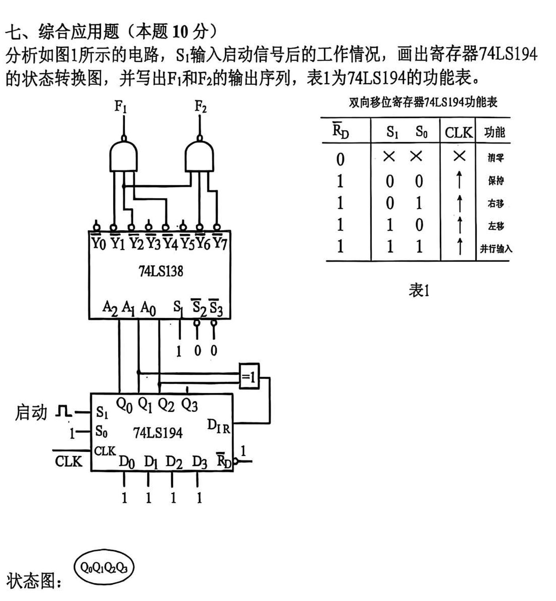

**表 1　74LS194 功能表**

| $\bar R_D$ | $S_1$ | $S_0$ | CLK | 功能 |
|---|---|---|---|---|
| 0 | × | × | × | 清零 |
| 1 | 0 | 0 | ↑ | 保持 |
| 1 | 0 | 1 | ↑ | **右移** |
| 1 | 1 | 0 | ↑ | 左移 |
| 1 | 1 | 1 | ↑ | **并行输入** |

## 读图

**74LS194 部分**：

| 引脚 | 接法 | 结论 |
|---|---|---|
| $S_1$ | 接"启动"信号 | 启动 = 1 时与 $S_0=1$ 组合 → **并行输入** |
| $S_0$ | 接 1 | 常态为"右移" |
| $D_3D_2D_1D_0$ | 全接 1 | 并行装入 $1111$ |
| $D_{IR}$（右移串入） | 接异或门输出 | $D_{IR}=Q_1\oplus Q_2$ |
| $\bar R_D$ | 接 1 | 不清零 |

**74LS138 部分**：

| 引脚 | 接法 |
|---|---|
| $A_2A_1A_0$ | 接 $Q_0Q_1Q_2$（$Q_0$ 为最高位） |
| $S_1$ | 接 1（有效） |
| $\bar S_2,\bar S_3$ | 接 0（有效） |
| $Y_0\sim Y_7$ | 送两个与非门 |

**反馈网络**：

$$F_1=\overline{Y_0Y_1Y_3},\qquad F_2=\overline{Y_1Y_5Y_6}$$

由于 $Y_i=\overline{m_i}$，故

$$F_1=1\iff m\in\{0,1,3\},\qquad F_2=1\iff m\in\{1,5,6\}$$

其中最小项序号由地址决定：

$$m=4Q_0+2Q_1+Q_2$$

## 工作过程

**第一步：按住"启动"**（$S_1=1,S_0=1$）→ 并行输入 → $Q_3Q_2Q_1Q_0=1111$。

**第二步：松开"启动"**（$S_1=0,S_0=1$）→ 右移，串入数据为 $D_{IR}=Q_1\oplus Q_2$：

$$Q_3^{n+1}=D_{IR}=Q_1^n\oplus Q_2^n,\quad Q_2^{n+1}=Q_3^n,\quad Q_1^{n+1}=Q_2^n,\quad Q_0^{n+1}=Q_1^n$$

## 状态转换图与输出序列

逐拍递推（$m=4Q_0+2Q_1+Q_2$）：

| 拍 | $Q_3$ | $Q_2$ | $Q_1$ | $Q_0$ | $m$ | $F_1$ | $F_2$ |
|---|---|---|---|---|---|---|---|
| 0（启动置数） | 1 | 1 | 1 | 1 | 7 | 0 | 0 |
| 1 | 0 | 1 | 1 | 1 | 7 | 0 | 0 |
| 2 | 0 | 0 | 1 | 1 | 6 | 0 | **1** |
| 3 | 1 | 0 | 0 | 1 | 4 | 0 | 0 |
| 4 | 0 | 1 | 0 | 0 | 1 | **1** | **1** |
| 5 | 1 | 0 | 1 | 0 | 2 | 0 | 0 |
| 6 | 1 | 1 | 0 | 1 | 5 | 0 | **1** |
| 7 | 1 | 1 | 1 | 0 | 3 | **1** | 0 |
| 8 | 0 | 1 | 1 | 1 | 7 | 0 | 0 |

**状态转换图**：

```
                 ┌──────┐
     启动置数     │ 1111 │
   ────────────► └──┬───┘
                    │
                    ▼
   ┌──────┐      ┌──────┐      ┌──────┐
   │ 1110 │◄─────│ 0111 │─────►│ 0011 │
   └──┬───┘      └──────┘      └──┬───┘
      │            ▲              │
      ▼            │              ▼
   ┌──────┐      ┌──────┐      ┌──────┐
   │ 1101 │      │ 0100 │◄─────│ 1001 │
   └──┬───┘      └──┬───┘      └──────┘
      │             │
      ▼             │
   ┌──────┐         │
   │ 1010 │─────────┘
   └──────┘
```

主循环（7 个状态）：$0111\to0011\to1001\to0100\to1010\to1101\to1110\to0111$

$1111$ 是"启动置数"的入口状态，下一拍即进入 0111，**不参与循环**。

**输出序列**（从启动置数那一拍算起）：

$$F_1:\ 0,\ 0,\ 0,\ 0,\ 1,\ 0,\ 0,\ 1,\ 0,\ \cdots$$
$$F_2:\ 0,\ 0,\ 1,\ 0,\ 1,\ 0,\ 1,\ 0,\ 0,\ \cdots$$

**规律**：主循环 7 拍内，$F_2$ 恰好是 $0,1,0,1,0,1,0$ —— 一个**周期为 7 的交替序列**；$F_1$ 在第 4 拍和第 7 拍为 1，两处 1 相隔 3 拍，形成"7 拍一循环、每循环两个脉冲"的节拍。

## 易错与拓展

**易错**：
1. **启动开关的常态搞反**。"启动"是一个**按钮**（脉冲信号）：按下为 1 → 并行置数；松开为 0 → 右移。若以为松开才装数，整个序列起点就错。
2. **$D_{IR}$ 的异或输入看错**：图中异或门的两输入取自地址线 $A_1$、$A_0$，即 $Q_1$、$Q_2$（**不是** $Q_0$ 和 $Q_3$）。
3. **138 的地址顺序**：$A_2=Q_0$、$A_1=Q_1$、$A_0=Q_2$，故 $m=4Q_0+2Q_1+Q_2$。这个"错位"是本卷最容易被忽略的细节，务必按**引脚连线**逐个对，不要想当然按 $Q_3Q_2Q_1$ 排。
4. **$F$ 的极性**：两个都是**与非门**，故 $F=1$ 对应"任一 $Y$ 为 0"，即"对应最小项成立"。

**拓展**：
- 这是**序列信号发生器**的经典结构：移位寄存器产生状态、译码器产生输出。改变 138 到与非门的接线，就能"编程"出任意序列。
- 74LS194 的 $D_{IR}=Q_1\oplus Q_2$ 属于**线性反馈**，与 **LFSR（线性反馈移位寄存器）**同源。标准的 4 位最大长度 LFSR 能走 15 个状态（$2^4-1$），本题因只取两位异或，只能形成 7 状态循环。
- 若把 $S_1S_0$ 改为 $10$（左移）、串入改接 $D_{IL}$，则序列方向相反，$F_1$、$F_2$ 序列整体倒序——这也是常见的变形考法。

---

# 八、综合应用题（本题 10 分）

> **题目**：图示电路是由两个 555 集成定时器构成的模拟声响发生器，已知 $V_{CC}=12$ V，$R_{11}=10\ \mathrm{k}\Omega$，$R_{12}=150\ \mathrm{k}\Omega$，$R_{21}=10\ \mathrm{k}\Omega$，$R_{22}=100\ \mathrm{k}\Omega$，$C_1=10\ \mu\mathrm{F}$，$C_2=0.01\ \mu\mathrm{F}$。
> （1）图中常闭开关 $S$ 闭合时 $u_{O1}$ 的状态，喇叭是否发出声音？
> （2）计算常闭开关 $S$ 断开后，喇叭发声时 $u_{O2}$ 的频率；
> （3）画出常闭开关 $S$ 断开后 $u_{O1}$ 和 $u_{O2}$ 的示意波形图。

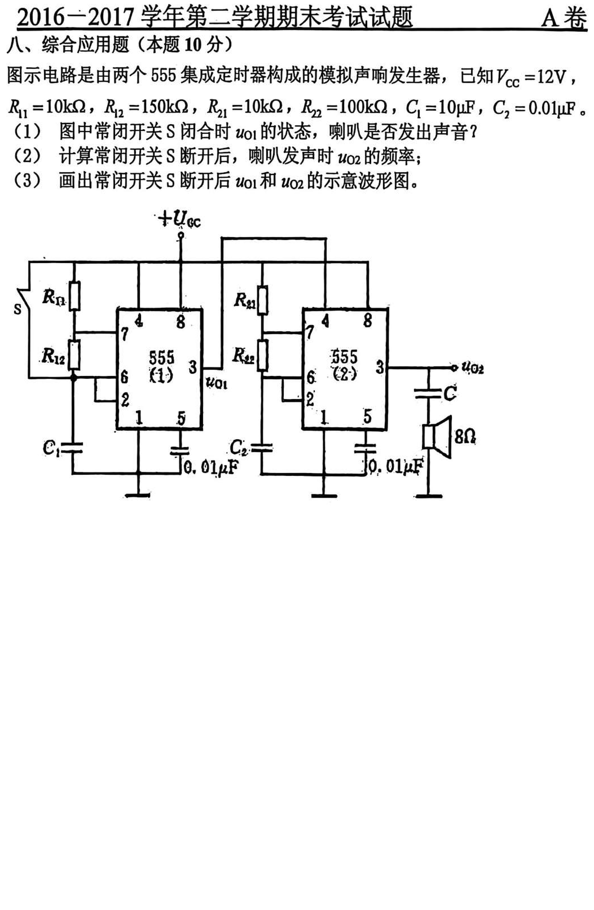

## 1）$S$ 闭合时 $u_{O1}$ 的状态与发声情况

**读图**：$S$ 并接在 555(1) 的 **4 脚（$\bar R_D$，复位端）** 与地之间。555 的复位端**低电平有效**：

| $S$ | 4 脚电平 | 555(1) 状态 | $u_{O1}$ |
|---|---|---|---|
| **闭合** | **0（接地）** | **强制复位** | **恒为低电平 0** |
| 断开 | 1（经内部/外接上拉） | 正常振荡 | 高低交替 |

**$S$ 闭合时**：4 脚被拉到 0 → 555(1) 内部放电管导通、输出锁死 → $u_{O1}=0$（**低电平**）。

**喇叭是否发声**：555(2) 的 4 脚接在 $u_{O1}$ 上，因此 555(2) 也被强制复位，$u_{O2}=0$，喇叭两端无交变电压 → **不发声** ✓

**结论**：$S$ 闭合时 $u_{O1}$ 为**低电平**，喇叭**不发声**。

## 2）$S$ 断开后喇叭发声的频率

$S$ 断开后，两级都恢复正常：

- **555(1)** 构成低频多谐振荡器（$R_{11}$、$R_{12}$、$C_1$），输出 $u_{O1}$ 作"**门控信号**"；
- **555(2)** 构成音频多谐振荡器（$R_{21}$、$R_{22}$、$C_2$），仅在 $u_{O1}=1$ 期间振荡，驱动喇叭。

**喇叭发声时的频率就是 555(2) 的振荡频率**：

$$f_2=\frac{1}{T_2}\approx\frac{1.43}{(R_{21}+2R_{22})C_2}$$

代入 $R_{21}=10\ \mathrm{k}\Omega$、$R_{22}=100\ \mathrm{k}\Omega$、$C_2=0.01\ \mu\mathrm{F}$：

$$R_{21}+2R_{22}=10+200=210\ \mathrm{k}\Omega=2.1\times10^{5}\ \Omega$$

$$T_2=0.7\times2.1\times10^{5}\times0.01\times10^{-6}=1.47\times10^{-3}\ \mathrm{s}$$

$$\boxed{f_2=\frac{1}{1.47\times10^{-3}}\approx680\ \mathrm{Hz}}$$

**顺带算出调制频率**（$u_{O1}$，决定"嘀—嘀—"的快慢）：

$$T_1=0.7(R_{11}+2R_{12})C_1=0.7\times(10+300)\times10^{3}\times10\times10^{-6}=2.17\ \mathrm{s}$$

$$f_1\approx0.46\ \mathrm{Hz}$$

即**每 2.17 s 一个"鸣叫—停顿"周期**，每个周期内鸣叫约 1.12 s（$t_{高}=0.7(R_{11}+R_{12})C_1$）、停顿约 1.05 s（$t_{低}=0.7R_{12}C_1$）。

## 3）$u_{O1}$ 与 $u_{O2}$ 示意图

```
 u_O1   ┌──────────┐          ┌──────────┐
    1 ──┘          └──────────┘          └──
    0 ─────────────────────────────────────
        |◄─1.12s─►|◄─1.05s─►|
        |◄──── T1 ≈ 2.17 s ────►|

 u_O2       ┌┐┌┐┌┐┌┐┌┐            ┌┐┌┐┌┐┌┐┌┐
    1 ──────┘└┘└┘└┘└┘└┘────────────┘└┘└┘└┘└┘└─
    0 ─────────────────────────────────────
           （680 Hz 振荡）        （停振，恒 0）
```

**绘制要点**：
- $u_{O1}$：周期约 2.17 s 的**近似方波**（占空比约 52%），高、低各约 1.1 s；
- $u_{O2}$：在 $u_{O1}=1$ 的区间内是 **680 Hz 的密集振荡**，在 $u_{O1}=0$ 的区间内**恒为 0**（被复位）；
- 由于 680 Hz 的周期（1.47 ms）远小于 2.17 s，图上 $u_{O2}$ 的振荡要画成**密集的竖线簇**，不能画成几根稀疏的方波——这是本题作图的主要得分点。

## 易错与拓展

**易错**：
1. **多谐振荡器的周期公式漏掉"$2R_B$"**。555 多谐振荡器 $T=0.7(R_A+2R_B)C$：充电走 $R_A+R_B$、放电只走 $R_B$，故 $R_B$ 出现两次。写成 $0.7(R_A+R_B)C$ 是最常见的错。
2. **把 $R_{11}$ 当 $R_B$**。图中 $R_{11}$ 接 $V_{CC}$ 与 7 脚之间（是 $R_A$），$R_{12}$ 接 7 脚与 6 脚之间（是 $R_B$）。位置看错，$T$ 就错。
3. **单位**：$C_1=10\ \mu\mathrm{F}=10\times10^{-6}\ \mathrm{F}$，$C_2=0.01\ \mu\mathrm{F}=10^{-8}\ \mathrm{F}$，两者差三个数量级，正是"低频调制 + 音频载波"的关键。
4. 问"发声时的频率"却答 $f_1$（0.46 Hz）——那是**鸣叫的重复频率**，不是**声音的音调**。

**拓展**：
- 这类"**低频调制高频**"的结构叫**间歇振荡器**，是电子门铃、报警器、警笛的经典电路。
- 若把 555(1) 的 $u_{O1}$ 不接 4 脚而接 5 脚（$CO$），则 555(2) 的**频率**会被 $u_{O1}$ 调制，产生"**滑音/颤音**"效果（警笛声），而不是"断续"效果。这是两种音效的分水岭。
- 喇叭串联的 $C$（隔直电容）作用是**隔断直流、只让交流通过**，防止直流电流长期流过音圈导致发热损坏。

---

# 附录 A：全卷考点分布

| 章节 | 题号 | 分值 | 说明 |
|---|---|---|---|
| 数制与码制 | 一1、二1 | 4 | 十进制→十六进制、8421BCD 合法性 |
| 逻辑代数 | 一3 | 2 | 公式法化简（吸收律 + 消因子） |
| 门电路 | 一7、二4、二6、二7 | 8 | 传输门、三态门、OC 线与、多余端处理 |
| 组合逻辑 | 二3、二5、二8、四 | 13 | 卡诺图关系、7448 显示、74151 实现函数 |
| 触发器 | 二9、二10 | 4 | 自反馈判别、单稳态脉宽 |
| 时序逻辑 | 三、五、七 | 34 | 双 JK 分析、74161 设计、194 序列发生器 |
| 脉冲电路 | 一8、八 | 12 | 555 回差、双 555 声响发生器 |
| 数模/模数转换 | 一4 | 2 | DAC 台阶与输出 |
| 半导体存储器 | 一5、二2 | 4 | EPROM 容量、ROM/PROM/EPROM 区别 |
| 可编程逻辑 | 一9 | 3 | 74160 双片级联与反馈清零 |
| 硬件描述语言 | 六 | 7 | 门级原语读图（含"名不副实"陷阱） |

**分值重心**：时序逻辑（34 分，占 1/3）＞ 组合逻辑（13 分）＞ 脉冲电路（12 分）。

# 附录 B：复习建议

1. **本卷是"器件覆盖最全"的一套**：74151、74160、74161、74138、74194、74190 系、555 全部登场。把这套卷的每个器件**引脚图 + 功能表**默画一遍，等于把整门课的芯片清单过了一遍。
2. **"读图"比"算"更容易丢分**。本卷有三处（第三题的反馈线、填空题第 6/9 题的反馈接法、第七题的地址错位）都靠在图上"顺线"。平时练习要养成习惯：**从引脚出发，一根线一根线跟到底，跟到哪个器件的哪个脚就在纸上记下来**。
3. **555 的两个公式必须条件反射**：
   - 多谐：$T=0.7(R_A+2R_B)C$，$q=\dfrac{R_A+R_B}{R_A+2R_B}$；
   - 单稳态：$t_W=1.1RC$；
   - 施密特：$V_{T+}=\frac23V_{CC}$、$V_{T-}=\frac13V_{CC}$（5 脚外接电压时改为 $V_{CO}$ 与 $\frac12V_{CO}$）。
4. **"同步置数"与"异步清零"差一个数**：置数反馈 $N-1$、清零反馈 $N$。本卷第五题（161 置数十二进制）与本卷第九题（160 清零）正好是两条路线的对照，务必并在一起看。
5. **门级 Verilog 题只考两件事**：原语端口顺序（输出在前）和多实例写法（一条语句多个门）。把 `and (W,A,B), (X,C,D);` 这种写法读熟，就不会被"一个 and 写了四个门"吓到。
6. **别被模块名骗**。第六题叫 `FA_struct` 却是 MUX——这类"名不副实"在真题中反复出现，唯一对策是**先逐行翻译表达式，再判断功能**。
