# 2015—2016 学年第二学期《电子技术Ⅱ》期末考试 A 卷 · 全解

> **试卷来源**：`试卷/数电_20261017_202733.pdf` 第 32—37 页（原卷 6 页，**完整无缺页**）。
> **原卷信息**：哈尔滨理工大学 · 2015—2016 学年第二学期期末考试试题 · A 卷 · 考试科目 **电子技术Ⅱ** · 考试时间 100 分钟 · 试卷总分 100 分 · 考试班级：测控、通信、安全、物联网 14 级 · 出题教师 王宏昊 · 考试日期 2016 年 6 月 20 日。
> **卷面构成**：一 填空 8 分 ＋ 二 选择 40 分（20×2）＋ 三～八 非客观题 52 分（10+8+6+8+10+10），满分 100 分。
> **特点**：这是全 6 套里**客观题分值最高**的一套（填空＋选择＝48 分，选择单选就占 40 分），非客观题只有 6 道但类型极全：译码器设计全减器、边沿 D 触发器画波形、Verilog 读代码、双 JK 时序分析、74160/74290 判进制、555＋D 触发器算频率。**没有偏题怪题，全部是各章的基本功**。

## 试卷结构速览

| 题号 | 题型 | 分值 | 覆盖内容 |
|---|---|---|---|
| 一 | 填空题（4 小题，共 8 分） | 8 | 数制转换、原/反/补码、EPROM 容量、摩根定理与对偶式 |
| 二 | 单项选择题（20×2 分） | 40 | 晶体管开关状态、OC 门线与、与非-与非、扇出系数、逻辑图读式、TTL 输入负载、共阴数码管、JK 触发器功能、边沿 D 触发器波形时刻、CMOS 门识别、触发器个数、主从 JK 分频、编码位数、74151、ADC 编码、ROM 存储矩阵、T 形网络 DAC、单稳态、PLD、ADC 速度 |
| 三 | 设计题 | 10 | 74LS138＋多输入与非门实现一位全减器 |
| 四 | 画波形题 | 8 | 边沿 D 触发器（含异步置位/复位）输出波形 |
| 五 | 读程序题 | 6 | Verilog 门级描述 → 电路图＋真值表＋功能 |
| 六 | 分析题 | 8 | 双 JK 触发器时序电路（驱动/状态/输出方程＋状态表＋状态图） |
| 七 | 分析题 | 10 | 74LS160 与 74LS290 各构成多少进制计数器 |
| 八 | 综合应用题 | 10 | 555 多谐振荡器＋D 触发器二分频，算频率、画波形 |

---

# 一、填空题（每小题 2 分，共计 8 分）

## 1. $(25.7)_{10}=(\quad)_2=(\quad)_{16}$，二进制数保留小数点后四位有效数字

**答案：$(25.7)_{10}=(11001.1011)_2=(19.\mathrm{B})_{16}$**

**解析**：整数、小数分开转换。

① 整数部分 25，除 2 取余：

$$25=2\times12+1,\quad 12=2\times6+0,\quad 6=2\times3+0,\quad 3=2\times1+1,\quad 1=2\times0+1$$

自下而上读：$25=(11001)_2$。

② 小数部分 0.7，乘 2 取整（取 4 位）：

| 乘 2 | 结果 | 取整 |
|---|---|---|
| $0.7\times2=1.4$ | 1.4 | **1** |
| $0.4\times2=0.8$ | 0.8 | **0** |
| $0.8\times2=1.6$ | 1.6 | **1** |
| $0.6\times2=1.2$ | 1.2 | **1** |

自上而下读：$0.7\approx(0.1011)_2$（截断，非四舍五入）。

③ 二进制转十六进制：整数、小数各自四位一组。

$$11001.1011\;\Rightarrow\;0001\ 1001\ .\ 1011\;=\;(19.\mathrm{B})_{16}$$

**易错**：
- 小数部分乘 2 取整，**从上往下读**，方向搞反就得到 $1101$；
- 题目说"保留小数点后四位"，就是**截断到 4 位**，不要求继续判断第 5 位是否进位；
- 十六进制小数位 $0.1011_2=\dfrac{11}{16}=0.\mathrm{B}_{16}$，别写成 $0.11$。

**拓展**：验算 $0.1011_2=0.5+0.125+0.0625=0.6875\approx0.7$ ✓。这类"十进制→二/十六进制"的题，**先转二进制再四位一分转十六进制**永远比"除 16 取余"快，因为小数部分除 16 取余极易算错。

---

## 2. 带符号位二进制数 $(111011)_2$ 的反码为（　），补码为（　）

**答案：反码 $=100100$，补码 $=100101$**

**解析**：最高位 $1$ 是符号位，表示**负数**，符号位不参与求反。

- 原码：$1\,11011$
- 反码：符号位仍为 1，**数值位按位取反** → $1\,\overline{11011}=1\,00100=100100$
- 补码：反码**末位加 1** → $100100+1=100101$

**易错**：
- 把符号位也取反，得到 $011011$——错得最普遍；
- 补码加 1 时进位搞错：$100100+1=100101$ 只动最低位，不要连符号位一起加；
- 忘记"首位的 1 是符号"而当成普通二进制 $111011=59$ 去处理。

**拓展**：负数的补码也可用"**从右往左，第一个 1 及其右边的 0 不变，左边（含符号位）全部取反**"速算：$1\,11011$ → 末尾 $11$ 不动 → 前面 $1110$ 取反得 $0001$ → 结果 $100101$ ✓。此外还有恒等式：$[\text{补}]_{\text{补}}=[\text{原}]$，即对补码再求一次补码就回到原码，可用来验算。

---

## 3. 某 EPROM 有 8 根数据线，13 位地址线，则其存储容量为（　）

**答案：$2^{13}\times8\ \mathrm{bit}=8192\times8\ \mathrm{bit}=65536\ \mathrm{bit}=64\ \mathrm{Kbit}=8\ \mathrm{KB}$（即 $8\mathrm{K}\times8$ 位）**

**解析**：存储容量 $=$ 字数 $\times$ 字长。

- 字数 $=2^{n}=2^{13}=8192=8\mathrm{K}$（$n$ 为地址线根数）
- 字长 $=$ 数据线根数 $=8$ 位

$$\text{容量}=2^{13}\times8=65536\ \mathrm{bit}=64\ \mathrm{Kbit}=8\ \mathrm{KB}$$

**易错**：
- 只答 $8\mathrm{K}\times8$ 不换算成 bit/B，题目问"存储容量"最好**两种表示都写**；
- 把 $2^{13}\times8$ 算成 $2^{16}=64\mathrm{K}$ 位——注意 $64\mathrm{Kbit}=8\mathrm{KB}=65536$ **位**，不是 65536 字节；
- 混淆 Kbit 与 KB：$1\mathrm{B}=8\mathrm{bit}$，差 8 倍。

**拓展**：EPROM 的"容量写法"统一为 $2^n\times m$，$n$ 数地址线、$m$ 数数据线。同系列题：$1\mathrm{K}\times4$ 的 RAM 有 10 根地址线、4 根数据线；$256\times8$ 的 PROM 有 8 根地址线、8 根数据线。EPROM 的"E"是 Erasable（紫外线擦除），擦除后全为 1。

---

## 4. 摩根定理表示为：$(A\cdot B)'=(\quad)$；$(A+B)'=(\quad)$。函数表达式 $Y=AB+(C+D)'$，则其对偶式 $Y^D=(\quad)$

**答案：$(A\cdot B)'=A'+B'$；$(A+B)'=A'\cdot B'$；$Y^D=(A+B)(CD)'$**

**解析**：

① 摩根定理（反演律）：**"断开长横、与或互换、原反互换"**

$$(A\cdot B)'=A'+B',\qquad (A+B)'=A'\cdot B'$$

② 对偶式 $Y^D$ 的规则：**与↔或互换、0↔1 互换，变量和反号一律不动**。

$$Y=AB+(C+D)'\;\xrightarrow{\ \text{与或互换}\ }\;Y^D=(A+B)\cdot(CD)'$$

注意 $(C+D)$ 内部的"$+$"也要换成"$\cdot$"，但**括号外面的那一横（求反号）保留**。

**易错**：
- 把 $Y^D$ 算成 $(A+B)(C'+D')$——把"求反号"也按反演律拆了，那是求**反函数** $\bar Y$ 的活；
- 只换最外层、忘了括号里 $(C+D)\to(CD)$；
- 混淆三兄弟：**反函数 $\bar Y$**（用摩根定理整体取反）、**对偶式 $Y^D$**（只换与或/0-1，不动反号）、**反演**（对偶式再对每个变量取反）。

**拓展**：三者关系可一句话记牢——**$\bar Y=(Y^D)$ 中所有变量取反**。本题 $\bar Y=(A'\!+\!B')(C'\!+\!D')'$，而 $Y^D=(A+B)(CD)'$，把 $Y^D$ 中 $A\to A',B\to B',C\to C',D\to D'$ 正好得到 $\bar Y$，可用来验算。对偶规则的最大用处是：**只要证明了一个与或式，其对偶式自动成立**，证明量减半。

---

# 二、单项选择题（本大题共 20 小题，每小题 2 分，共计 40 分）

## 1. 数字电路中晶体管大多工作于（　）

(a) 放大状态　(b) 开关状态　(c) 击穿状态

**答案：(b) 开关状态**

**解析**：数字电路处理的是 0/1 两个电平，晶体管只在**截止**（输出高电平）与**饱和**（输出低电平）两个极端之间切换，即"开关状态"。放大状态是模拟电路的典型工作区（如共射放大器要设静态工作点），击穿状态则是要避免的破坏性状态。

**易错**：看到"晶体管"就条件反射选"放大"——那是模电的思维。数电里晶体管的**放大区只是过渡瞬间**，不允许停留。

**拓展**：衡量开关性能的两个指标——**饱和深度**（饱和度 $S=\beta I_B/I_{CS}>1$ 越深，存储时间越长、速度越慢）与**开关时间**（延迟、上升、存储、下降）。TTL 门把晶体管做在集成电路里，靠**抗饱和肖特基二极管**（SBD）钳位来缩短存储时间。

---

## 2. 能实现线与逻辑功能的门电路是（　）

(a) TTL 与非门　(b) 三态逻辑门　(c) 集电极开路门

**答案：(c) 集电极开路门（OC 门）**

**解析**：**线与**是把多个门的输出端直接并联，实现"与"的功能：$Y=Y_1\cdot Y_2\cdot\cdots$。只有输出级为**集电极开路**（OC，Open Collector）结构的门才允许直接并联——因为 OC 门的输出管集电极悬空，必须外接上拉电阻 $R_L$，多个 OC 门并联时不会出现"一个输出高、一个输出低"造成的短路大电流。

TTL 推拉输出的门**严禁**并联（会烧管）；三态门（TSL）输出可以并联，但靠的是**分时使能**（同一时刻只允许一个门处于工作态），实现的是"总线复用"而非"线与"。

**易错**：把三态门也当成能"线与"的门。三态门并联必须保证使能信号互斥，否则同样短路。

**拓展**：OC 门的三大用途——**线与**、**驱动负载**（可接继电器、LED、长线）、**电平转换**（外接不同电源电压的上拉电阻）。外接上拉电阻 $R_L$ 的取值要同时满足：$R_{L(\min)}=\dfrac{V_{CC}-V_{OL}}{I_{OL(\max)}-mI_{IL}}$、$R_{L(\max)}=\dfrac{V_{CC}-V_{OH}}{nI_{OH}+mI_{IH}}$。CMOS 的对应结构叫**漏极开路门（OD 门）**。

---

## 3. $F=AB+CD$ 的"与非-与非"逻辑式为（　）

(a) $F=(A'B'C'D')'$　(b) $F=\big((AB)'(CD)'\big)'$　(c) $F=(AB)'(CD)'$

**答案：(b) $F=\big((AB)'(CD)'\big)'$**

**解析**：与或式转与非-与非式的固定套路——**两次求反**：

$$F=AB+CD=\overline{\overline{AB+CD}}=\overline{\overline{AB}\cdot\overline{CD}}=\big((AB)'(CD)'\big)'$$

即：先把每个乘积项各自取反，再把它们"与非"起来。

对照选项：
- (a) $(A'B'C'D')'=A+B+C+D$——德摩根展开后完全变味；
- (c) $(AB)'(CD)'=(A'+B')(C'+D')=A'C'+A'D'+B'C'+B'D'$——少了最外层的一横，是"与或非"的中间结果。

**易错**：漏掉最外层括号的求反号（选 (c)）。判断方法：**与非-与非式的层数一定是"内层与非 + 外层与非"两层**，数一下括号就知道。

**拓展**：与非-与非式的工程意义——**全部用二输入与非门实现**。本题需要 3 个与非门：2 个做 $\overline{AB}$、$\overline{CD}$，1 个做最后与非。同理还有"或非-或非式"，用于全部用或非门实现的场合（如 CMOS 工艺）。

---

## 4. TTL 与非门的扇出系数是（　）

(a) 输出端允许驱动各类型门电路的最大数目
(b) 输出端允许驱动同类型门电路的最小数目
(c) 输出端允许驱动同类型门电路的最大数目

**答案：(c) 输出端允许驱动同类型门电路的最大数目**

**解析**：**扇出系数 $N_O$** 定义为：一个门输出端在保证输出电平合格的前提下，所能驱动的**同类门**的最大数目。

$$N_O=\min\{N_{OL},\,N_{OH}\},\qquad N_{OL}=\frac{I_{OL(\max)}}{I_{IL}},\quad N_{OH}=\frac{I_{OH(\max)}}{I_{IH}}$$

TTL 门通常由**低电平扇出**决定（灌电流能力远大于拉电流能力）。

**易错**：
- 选 (b)"最小数目"——正好说反；
- 选 (a)"各类型门"——扇出是在**同类型门**之间定义的（不同类型门的 $I_{IL}/I_{IH}$ 不同，必须分别核算）。

**拓展**：典型值：74 系列 $N_O=8\sim10$，74LS 系列 $N_O=8$，74ALS 系列可达 20。扇出与**扇入**相对：扇入是门输入端个数。工程上还常提"**驱动能力**"，单位是"个标准门负载"。CMOS 门因输入阻抗极高，直流扇出可达 $10^3$ 量级，实际受**容性负载**限制（$t_{pd}\propto R_{on}C_L$）。

---

## 5. 图示逻辑电路的逻辑式为（　）

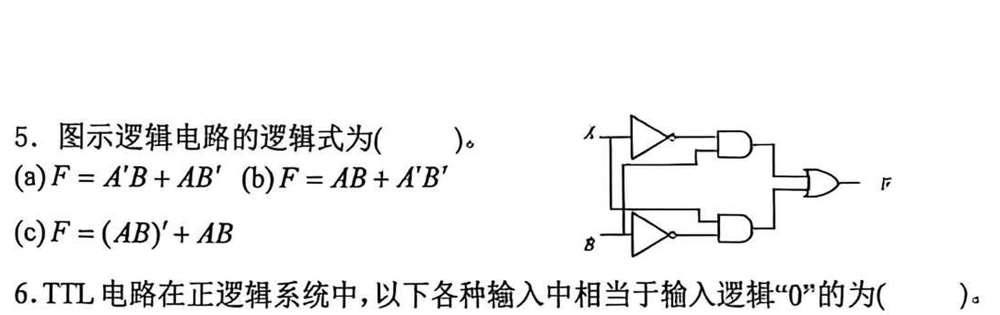

(a) $F=A'B+AB'$　(b) $F=AB+A'B'$　(c) $F=(AB)'+AB$

**答案：(a) $F=A'B+AB'$（即 $F=A\oplus B$）**

**解析**：按"从输入往输出逐级写"。

① 上支路：$A$ 经反相器得 $A'$，与 $B$ 送与门 → 输出 $A'B$；
② 下支路：$B$ 经反相器得 $B'$，与 $A$ 送与门 → 输出 $AB'$；
③ 两支路经或门相加：

$$F=A'B+AB'=A\oplus B$$

**易错**：把上下两个与门的输入接反（看成"$A$ 与 $A'$"），选 (b) $AB+A'B'$（同或）。判别口诀：**反相器串在 $A$ 上、这个与门就吃 $A'$，另一个输入必是原变量 $B$**——因为图中从 $B$ 引出的竖线要往上接进上方的与门。

**拓展**：$A\oplus B$ 的常用等价式：$A\oplus B=AB'+A'B=(A+B)(A'+B')$。它是**半加器的和**，也是奇校验电路的核心。若把或门换成或非门、或把输出再取反，就得到同或 $A\odot B=AB+A'B'$（可作为"相等比较器"）。

---

## 6. TTL 电路在正逻辑系统中，以下各种输入中相当于输入逻辑"0"的是（　）

(a) 悬空　(b) 通过电阻 2.7 kΩ 接电源　(c) 通过电阻 2.7 kΩ 接地　(d) 通过电阻 510 Ω 接地

**答案：(d) 通过电阻 510 Ω 接地**

**解析**：TTL 输入端内部是发射极，输入低电平时有**灌电流** $I_{IL}\approx1.6\ \mathrm{mA}$ 流出。外接电阻 $R$ 到地时，电阻上产生的压降 $U=RI_{IL}$ 必须 **小于 $U_{IL(\max)}=0.8\ \mathrm{V}$** 才算逻辑 0：

- $R=510\ \Omega$：$U=510\times1.6\ \mathrm{mA}\approx0.82\ \mathrm{V}$，落在阈值内 → **逻辑 0** ✓
- $R=2.7\ \mathrm{k}\Omega$：$U=2.7\mathrm{k}\times1.6\mathrm{mA}\approx4.3\ \mathrm{V}$，被拉高到 1.4 V 以上 → **逻辑 1**
- 悬空：TTL 输入悬空时内部电路使其等效为高电平 → **逻辑 1**（但工程上严禁悬空，易受干扰）
- 2.7 kΩ 接电源：直接就是高电平 → **逻辑 1**

**易错**：记成"悬空是 0"。**TTL 悬空 = 1，CMOS 悬空 = 随机（绝对禁止）**，这一条每年必考。

**拓展**：TTL 输入端的"**开门电阻** $R_{on}\approx0.8\ \mathrm{k}\Omega$、**关门电阻** $R_{off}\approx2\ \mathrm{k}\Omega$"是本题的理论依据：$R<R_{on}$ 视为 0，$R>R_{off}$ 视为 1，中间是不确定区。工程规范：**多余输入端不能悬空**——与非门多余端接 1（或并联使用），或非门多余端接 0。

---

## 7. 图示为采用共阴极数码管的译码显示电路，若显示码数是 2，译码器输出端应为（　）

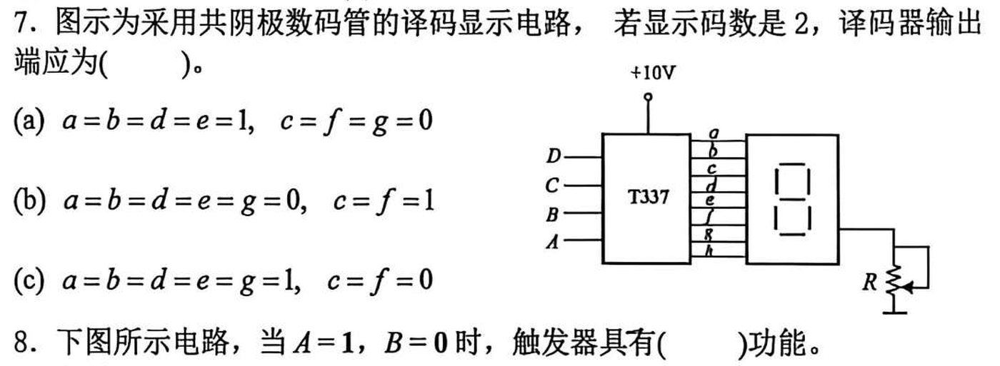

(a) $a=b=d=e=1$，$c=f=0$
(b) $a=b=d=e=g=0$，$c=f=1$
(c) $a=b=d=e=g=1$，$c=f=0$

**答案：(c) $a=b=d=e=g=1$，$c=f=0$**

**解析**：两步走。

① **判断共阴还是共阳**：图中数码管的公共端经电阻 $R$ 接地 → **共阴极**，各段阳极加**高电平**才发光。

② **数字"2"点亮哪些段**：$a$（上横）、$b$（右上竖）、$g$（中横）、$e$（左下竖）、$d$（下横）亮；$c$（右下竖）、$f$（左上竖）灭。

$$\Rightarrow\ a=b=d=e=g=1,\qquad c=f=0$$

**易错**：
- 选 (a)：漏掉了 $g$。$a=b=d=e=1$ 是"3"去掉中横或"9"缺段，反正不是"2"；
- 选 (b)：把共阴当成共阳，电平全反了；
- 记错字模：数字 2 的七段码（共阴，$agfedcb$ 顺序）是 $1101101$，数字 3 是 $1100111$，两者差在 $e$ 与 $g$。

**拓展**：七段码表（共阴，顺序 $a\,b\,c\,d\,e\,f\,g$）：

| 数字 | $a$ | $b$ | $c$ | $d$ | $e$ | $f$ | $g$ | 十六进制 |
|---|---|---|---|---|---|---|---|---|
| 0 | 1 | 1 | 1 | 1 | 1 | 1 | 0 | 3F |
| 1 | 0 | 1 | 1 | 0 | 0 | 0 | 0 | 06 |
| 2 | 1 | 1 | 0 | 1 | 1 | 0 | 1 | 5B |
| 3 | 1 | 1 | 1 | 1 | 0 | 0 | 1 | 4F |
| 4 | 0 | 1 | 1 | 0 | 0 | 1 | 1 | 66 |
| 5 | 1 | 0 | 1 | 1 | 0 | 1 | 1 | 6D |
| 6 | 1 | 0 | 1 | 1 | 1 | 1 | 1 | 7D |
| 7 | 1 | 1 | 1 | 0 | 0 | 0 | 0 | 07 |
| 8 | 1 | 1 | 1 | 1 | 1 | 1 | 1 | 7F |
| 9 | 1 | 1 | 1 | 1 | 0 | 1 | 1 | 6F |

共阳数码管则把上表**逐位取反**（0 对应 40H，2 对应 A4H）。集成译码器 74LS47/74LS48 内部已含此译码表，外部只需送 8421BCD 码。

---

## 8. 下图所示电路，当 $A=1$、$B=0$ 时，触发器具有（　）功能

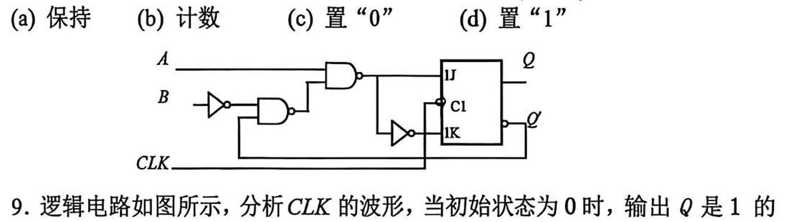

(a) 保持　(b) 计数　(c) 置"0"　(d) 置"1"

**答案：(b) 计数**

**解析**：先写驱动方程，再代 $A=1,B=0$。

从图逐点看：
① $B$ 经反相器得 $B'$；
② 下方与非门（记 $G_2$）输入为 $B'$ 与反馈回来的 $Q'$：

$$G_2=\overline{B'\cdot Q'}$$

③ 上方与非门（记 $G_1$）输入为 $A$ 与 $G_2$ 输出，其输出即 $J$：

$$J=\overline{A\cdot G_2}=\overline{A\cdot\overline{B'Q'}}$$

④ $J$ 经反相器送 $K$，故 $K=J'$。

代入 $A=1,\ B=0$（此时 $B'=1$）：

$$G_2=\overline{1\cdot Q'}=Q,\qquad J=\overline{1\cdot Q}=Q',\qquad K=Q$$

于是 $J=Q'$、$K=Q$——这正是 **$T'$ 触发器**的标准接法：

| 现态 $Q$ | $J$ | $K$ | 次态 $Q^*$ |
|---|---|---|---|
| 0 | 1 | 0 | 1（置 1） |
| 1 | 0 | 1 | 0（置 0） |

每个时钟沿都翻转 → **计数**功能。

**易错**：
- 只看到"$J=K$"就选"计数"。要小心：$J=K=1$ 才是标准计数；本题 $J=Q',K=Q$，是**互补**的两个值，但效果同样是"每来一个脉冲翻转一次"，因此仍归为计数；
- 把 $G_1$ 当成与门（漏看输出的小圆圈），得 $J=AQ$，那就变成"$A=1$ 时 $J=Q,K=Q'$，状态不变"→ 会误选"保持"；
- 反馈取错：把 $Q'$ 看成 $Q$，得 $J=Q,K=Q'$，结论变成"保持"。

**拓展**：$JK$ 触发器的四种功能一览（这是数电最基础的 2×2 表）：

$$Q^*=JQ'+K'Q$$

| $J$ | $K$ | $Q^*$ | 功能 |
|---|---|---|---|
| 0 | 0 | $Q$ | 保持 |
| 0 | 1 | 0 | 置 0 |
| 1 | 0 | 1 | 置 1 |
| 1 | 1 | $Q'$ | 翻转（计数） |

本题 $J=Q',K=Q$ 代入得 $Q^*=Q'Q'+Q'Q=Q'$，确实每次翻转。**只要 $J\ne K$ 的不同时，关键看 $J$ 是否为 $Q'$、$K$ 是否为 $Q$**——是则翻转。

---

## 9. 逻辑电路如图所示，分析 CLK 的波形，当初始状态为 0 时，输出 $Q$ 是 1 的瞬间为（　）

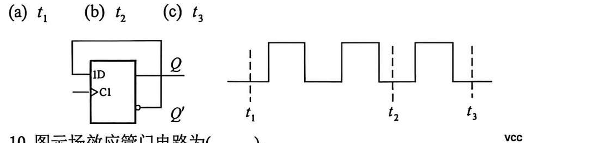

(a) $t_1$　(b) $t_2$　(c) $t_3$

**答案：(c) $t_3$**

**解析**：三步定案。

① **认出电路**：D 触发器的 $D$ 端接自己的 $\overline{Q}$ 端（图中从 $Q'$ 引出的反馈线绕回 $D$）→ $D=Q'$，这是**二分频（$T'$）**接法，**每个上升沿翻转一次**。

② **定触发沿**：$C1$ 端画的是"$\triangleright$"（小三角），表示**边沿触发**；没有小圆圈 → **上升沿**有效。

③ **对照波形数沿**：把 CLK 的每个**上升沿**编号，$Q$ 在这些时刻依次翻转：

| 时刻 | 事件 | $Q$ |
|---|---|---|
| 起始 | 初态 | 0 |
| $t_1$ 前 | 尚未出现上升沿 | **0** |
| 第 1 个上升沿 | 翻转 | 1 |
| 第 2 个上升沿 | 翻转 | 0 |
| 第 3 个上升沿（$t_3$ 前的那个） | 翻转 | 1 |
| $t_3$ | 该点落在第 3 个上升沿之后 | **1** ✓ |

$t_1$ 画在**第一个上升沿之前**（此时仍为 0），$t_2$ 落在**第二、三个上升沿之间**（此时为 0），$t_3$ 落在**第三个上升沿之后**（此时为 1）。

**易错**：
- 判成下降沿触发：$Q$ 的翻转时刻整体后移半个周期，会误选 $t_2$；
- 忘了初态为 0 时"第一个上升沿才变 1"，误以为一上电就是 1；
- $C1$ 的小三角看成小圆圈（在模糊的扫描件上很常见）——**小三角＝边沿触发，三角外再加小圆圈才是下降沿**。

**拓展**：$\overline{Q}$ 接 $D$ 是**最经典的二分频电路**，输出频率 $f_Q=f_{CLK}/2$，占空比恒为 50%（这一点比用 555 做分频更优）。级联 $n$ 级即得 $f/2^n$，构成**二进制计数器**的全部输出。区分记忆：

| 触发器 | 翻转条件 |
|---|---|
| $T$ 触发器 | $T=1$ 时每个有效沿翻转 |
| $D$ 触发器（$D=Q'$） | 每个有效沿必翻转 |
| $JK$（$J=K=1$） | 每个有效沿必翻转 |

---

## 10. 图示场效应管电路为（　）

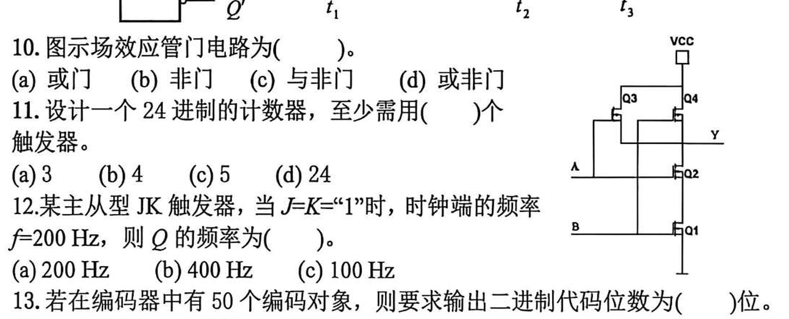

(a) 或门　(b) 非门　(c) 与非门　(d) 或非门

**答案：(c) 与非门**

**解析**：这是标准的 **CMOS 门结构**，判读方法是"**看下拉网络（NMOS）的串并联**"。

① **负载管（上拉）**：$Q_3$、$Q_4$ 是 PMOS，源极都接 $V_{CC}$，**漏极并在一起** → **并联**，栅极分别接 $A$、$B$。
② **驱动管（下拉）**：$Q_1$、$Q_2$ 是 NMOS，**漏源串联**，栅极分别接 $B$、$A$，最下端接地。
③ 输出 $Y$ 取自 $Q_4$ 漏极与 $Q_2$ 漏极的公共点。

判据：

- **NMOS 串联 ⇒ 与关系（需全为 1 才导通下拉）**：$A=1$ 且 $B=1$ 时 $Q_1,Q_2$ 同时导通 → $Y=0$
- **PMOS 并联 ⇒ 或关系（任一为 0 即导通上拉）**：$A=0$ 或 $B=0$ 时 $Q_3$ 或 $Q_4$ 导通 → $Y=1$

$$Y=\overline{A\cdot B}$$

**易错**：
- 只看下拉网络串并联就下结论，忘了 PMOS 是**低电平导通**，把并联看成"与"→ 误选"或非门"；
- 把 $Q_3,Q_4$ 的并联看成串联（图上线画得密）。

**拓展**：CMOS 门"**上拉网络与下拉网络互为对偶**"是根本规律：

| 逻辑 | NMOS 下拉网络 | PMOS 上拉网络 | 管子数 |
|---|---|---|---|
| 非门 | 1 个 | 1 个 | 2 |
| 与非门 | 串联 | 并联 | $2n$ |
| 或非门 | 并联 | 串联 | $2n$ |
| 与门/或门 | 与非/或非 + 反相器 | — | $2n+2$ |

CMOS 的特点：静态功耗极低（µW 级）、输入阻抗极高（多余端**绝不能悬空**）、抗干扰容限大（约 $0.3V_{DD}$）；缺点是速度受容性负载限制、输入电压超出 $V_{DD}$ 会触发**闩锁效应**。

---

## 11. 设计一个 24 进制的计数器，至少需用（　）个触发器

(a) 3　(b) 4　(c) 5　(d) 24

**答案：(c) 5 个**

**解析**：$n$ 个触发器可表示 $2^n$ 个状态，要求 $2^n\ge N=24$：

$$2^4=16<24<32=2^5\ \Rightarrow\ n=5$$

即 $n=\lceil\log_2 24\rceil=5$。

**易错**：选 (b) 4 个（因为"$24\approx16$，凑合"）；选 (d) 24（以为一个状态一个触发器）。

**拓展**：5 个触发器有 $32-24=8$ 个**无效状态**，必须检查**自启动**能力：若无效状态在时钟作用下能自动进入有效循环，称电路能自启动；否则需修改反馈逻辑。常见的 $2^n$ 进制（2、4、8、16、32）**没有**无效状态，不需要自启动设计。

---

## 12. 某主从型 JK 触发器，当 $J=K=1$ 时，时钟端的频率 $f=200\ \mathrm{Hz}$，则 $Q$ 的频率为（　）

(a) 200 Hz　(b) 400 Hz　(c) 100 Hz

**答案：(c) 100 Hz**

**解析**：$J=K=1$ 时 JK 触发器处于**计数（翻转）**状态：**每来一个完整时钟周期翻转一次**，一翻一转正好两个时钟周期凑成一个完整的 $Q$ 周期：

$$f_Q=\frac{f_{CLK}}{2}=\frac{200}{2}=100\ \mathrm{Hz}$$

**易错**：
- 选 400 Hz：把"翻转"理解成"上升沿、下降沿都触发"，那是**双边沿**电路，普通 JK 不是；
- 忽略"主从"二字：主从 JK 在 $CLK=1$ 期间主触发器采样、$CLK$ 下降沿从触发器翻转，**一个时钟周期只翻转一次**，所以频率仍是二分频（注意：正因如此，主从 JK 才有"一次变化"问题）。

**拓展**：主从 JK 的要点：

| 特性 | 说明 |
|---|---|
| 触发方式 | 电平触发（主从），下降沿翻转 |
| 一次变化问题 | $CLK=1$ 期间 $J,K$ 变化会多次改写主触发器，最终只认最后一次，可能导致逻辑错误 |
| 解决办法 | 用**边沿触发**结构（维持阻塞式、传输门式） |
| 抗干扰 | 要求 $CLK=1$ 期间 $J,K$ 保持稳定 |

---

## 13. 若在编码器中有 50 个编码对象，则要求输出二进制代码位数为（　）位

(a) 5　(b) 6　(c) 10　(d) 50

**答案：(b) 6 位**

**解析**：$n$ 位二进制可编 $2^n$ 个对象，要求 $2^n\ge50$：

$$2^5=32<50<64=2^6\ \Rightarrow\ n=6$$

**易错**：选 5 位（只记住"$2^5=32$ 差不多"）；选 10 位（把十进制位数当二进制位数）。

**拓展**：74LS148 是 **8 线-3 线**优先编码器（$2^3=8$），74LS147 是 **10 线-4 线** BCD 优先编码器（$2^4=16\ge10$）。编码器分**普通编码器**（同一时刻只允许一个输入有效）与**优先编码器**（允许多个同时有效，只对最高优先级编码），后者才有实用价值。

---

## 14. 八选一数据选择器 74151 组成的电路如图所示，则输出函数为（　）

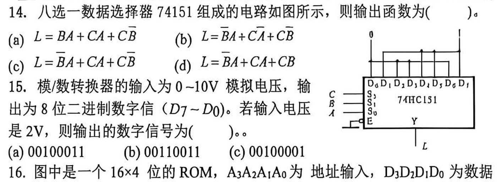

(a) $L=BA+CA+C\bar B$　(b) $L=\bar BA+\bar CA+C\bar B$　(c) $L=\bar BA+CA+C\bar B$　(d) $L=\bar BA+CA+CB$

**答案：(c) $L=\bar BA+CA+C\bar B$**

**解析**：核心公式——**74151 的输出就是"数据端按地址选择后相加"**：

$$L=\sum_{i=0}^{7}D_i m_i,\qquad m_i \text{ 由地址 }S_2S_1S_0\text{ 决定}$$

① **定地址**：图中 $C\to S_2$、$B\to S_1$、$A\to S_0$，故地址码 $=CBA$，最小项编号 $i=4C+2B+A$：

| $i$ | $C\,B\,A$ | $m_i$ |
|---|---|---|
| 0 | 000 | $\bar C\bar B\bar A$ |
| 1 | 001 | $\bar C\bar B A$ |
| 2 | 010 | $\bar C B\bar A$ |
| 3 | 011 | $\bar C B A$ |
| 4 | 100 | $C\bar B\bar A$ |
| 5 | 101 | $C\bar B A$ |
| 6 | 110 | $C B\bar A$ |
| 7 | 111 | $C B A$ |

② **读数据端接法**（看图中竖线与两条横"母线"的连接点）：

| 数据端 | 接法 | 值 |
|---|---|---|
| $D_0$ | 单独上引到标"0"的端点 | **0** |
| $D_1$ | 接上方母线（该母线右端上引到"1"） | **1** |
| $D_2$ | 接下方母线（该母线左端接 $D_0$ 的"0"） | **0** |
| $D_3$ | 接下方母线 | **0** |
| $D_4$ | 接上方母线 | **1** |
| $D_5$ | 接上方母线 | **1** |
| $D_6$ | 接下方母线 | **0** |
| $D_7$ | 直接上引到"1" | **1** |

③ **相加**：

$$L=m_1+m_4+m_5+m_7$$

④ **化简**（按 $C,B,A$）：

$$m_1=\bar C\bar BA,\quad m_4=C\bar B\bar A,\quad m_5=C\bar BA,\quad m_7=CBA$$

$$m_1+m_5=\bar BA(C+\bar C)=\bar BA$$
$$m_4+m_5=C\bar B(\bar A+A)=C\bar B$$
$$m_7=CBA=CBA$$

合并 $m_5$ 用了两次（可重复使用），得

$$L=\bar BA+C\bar B+CBA=\bar BA+C\bar B+CA(C+\text{式})$$

更直接的做法：把 $m_7$ 与 $m_4+m_5$ 结合：

$$m_4+m_5+m_7=C\bar B\bar A+C\bar BA+CBA=C\bar B+CA$$

故

$$\boxed{L=\bar BA+CA+C\bar B}$$

**易错**：
- **地址顺序搞反**（把 $A$ 当 $S_2$）：最小项编号全乱，会误选 (a) 或 (b)；
- 把"×／•"看成"断开"：母线上的实心点是**连接**，与门阵列里的"×"也是连接；
- 漏掉 $D_7=1$：会算出 $\bar BA+C\bar B$ 而找不到对应选项。

**拓展**：用 74151 实现任意三变量函数是**送分题**，步骤固定：地址接三个变量 → 列最小项 → 对应 $D_i$ 接 1，其余接 0。若函数是四变量，可把一个变量接到某个 $D_i$ 上（如 $D_i=C$ 或 $\bar C$），这就是"**降维**"用法。74151 还有**互补输出** $\bar Y$，接 $\bar Y$ 即可直接得到反函数。

---

## 15. 模/数转换器的输入为 0～10 V 模拟电压，输出为 8 位二进制数字信 $(D_7\sim D_0)$。若输入电压是 2 V，则输出的数字信号为（　）

(a) 00100011　(b) 00110011　(c) 00100001

**答案：(b) $00110011$**

**解析**：8 位 ADC 把 $0\sim10\ \mathrm{V}$ 分成 $2^8-1=255$ 个刻度：

$$\text{量化单位}\ \Delta=\frac{10}{255}\approx0.0392\ \mathrm{V/级}$$

$$D=\left\lfloor\frac{U_I}{\Delta}\right\rfloor=\left\lfloor\frac{2}{10}\times255\right\rfloor=\lfloor 51.0\rfloor=51$$

$$51=(00110011)_2$$

**易错**：
- 用 $2^8=256$ 当分母：$\dfrac{2}{10}\times256=51.2\to51$，本题结果碰巧相同，但很多题会差 1；
- 十进制转二进制转错：$51=32+16+2+1=00110011$ ✓（$00100011=35$，$00100001=33$，都是典型干扰项）。

**拓展**：ADC 两个基本参数：

| 参数 | 定义 | 8 位、10 V 时 |
|---|---|---|
| 分辨率 | $\Delta=\dfrac{U_{FS}}{2^n-1}$ | $39.2\ \mathrm{mV}$ |
| 量化误差 | $\pm\dfrac{\Delta}{2}$（或 $\pm1$ LSB） | $\pm19.6\ \mathrm{mV}$ |

DAC 的对应公式是 $U_O=\dfrac{D}{2^n}\cdot U_{REF}$（分母用 $2^n$，因 DAC 的 0 与满量程都可达）。

---

## 16. 图中是一个 $16\times4$ 位的 ROM，$A_3A_2A_1A_0$ 为地址输入，$D_3D_2D_1D_0$ 为数据输出，当 $A_3A_2A_1A_0=0001$ 和 $1001$ 时，$D_3D_2D_1D_0$ 的输出应为（　）

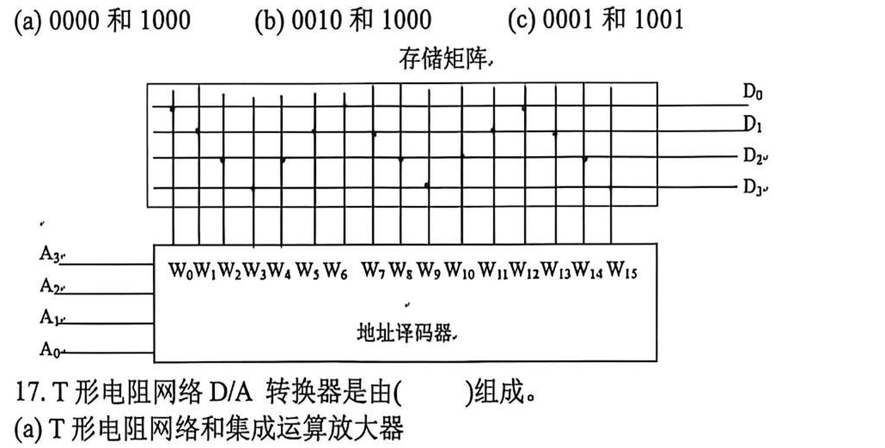

(a) 0000 和 1000　(b) 0010 和 1000　(c) 0001 和 1001

**答案：(b) $0010$ 和 $1000$**

**解析**：ROM 的存储矩阵中，**字线（竖线，共 16 根，对应 $W_0\sim W_{15}$）与位线（横线，共 4 根，对应 $D_0\sim D_3$）的交叉点上有二极管（图中画作实心小点）表示存"1"，无点表示存"0"**。

① 地址 $A_3A_2A_1A_0=0001$ → 选中第 1 根字线 $W_1$（左起第 2 根竖线）。
沿 $W_1$ 自下而上（$D_3\to D_0$）看点：

| 位线 | 有无存储点 | 值 |
|---|---|---|
| $D_3$（最下） | 无 | 0 |
| $D_2$ | 无 | 0 |
| $D_1$ | **有** | 1 |
| $D_0$（最上） | 无 | 0 |

$$\Rightarrow D_3D_2D_1D_0=0010$$

② 地址 $1001$ → 选中第 9 根字线 $W_9$：
只有 $D_3$ 上有存储点，其余无：

$$\Rightarrow D_3D_2D_1D_0=1000$$

**易错**：
- 把 $D_3D_2D_1D_0$ 的顺序读反（从上往下读成 $D_3\to D_0$，实际图中标注是 $D_0$ 在上、$D_3$ 在下）；
- 数错字线：$W_1$ 是**第 2 根**（$W_0$ 是第 1 根），差一位就全错；
- 把"有点"当作 0（点＝二极管＝导通＝读出 1）。

**拓展**：ROM 的三部分组成：**地址译码器**（$n$ 位地址 → $2^n$ 根字线，$n=4$ 时即 4-16 译码器）＋**存储矩阵**（二极管/熔丝/MOS 管阵列）＋**输出缓冲器**。容量 $2^n\times m$ 中，$n$ 是地址线、$m$ 是数据线。ROM 属于**组合逻辑**器件（无时钟），可用作"查表法"实现任意组合函数，这正是 PLD/FPGA 的思想起点。

---

## 17. T 形电阻网络 D/A 转换器是由（　）组成

(a) T 形电阻网络和集成运算放大器
(b) T 形电阻网络和触发器
(c) T 形电阻网络和振荡器

**答案：(a) T 形电阻网络和集成运算放大器**

**解析**：T 形（倒 T 形）电阻网络 DAC 的两大部件：

① **T 形电阻网络**：只有 $R$ 和 $2R$ 两种阻值，无论从哪个节点看进去，等效电阻都是 $R$，因此各支路电流按 $2$ 的幂次分流（$I/2,I/4,\dots$）；
② **集成运算放大器**：作为**求和放大器**，把各支路电流汇集成输出电压，同时保证虚地（各支路切换时节点电压不变，消除开关时间误差）。

$$u_O=-R_F\sum_{i=0}^{n-1}\frac{D_i\,U_{REF}}{2^{n-i}R}$$

**易错**：选 (b)。DAC 里虽然有"开关"（受数字位控制），但那是**模拟开关**（CMOS 传输门），不是触发器；触发器是**时序**元件，DAC 是纯**组合**电路。

**拓展**：三种常见 DAC 结构对比：

| 类型 | 电阻特点 | 优点 | 缺点 |
|---|---|---|---|
| 权电阻网络 | $R,2R,4R,\dots$ | 结构直观 | 阻值范围大、难集成 |
| 倒 T 形网络 | 只有 $R$、$2R$ | 易集成、速度快 | 开关非理想有误差 |
| 权电流型 | 恒流源 | 精度高、速度快 | 电路复杂 |

倒 T 形是集成 DAC（如 DAC0832）的主流结构，**转换速度**主要取决于运放的压摆率和开关的建立时间。

---

## 18. 单稳态触发器的暂稳态持续时间的长短取决于（　）

(a) 触发脉冲的宽度　(b) 电路本身的参数　(c) 触发脉冲的幅度

**答案：(b) 电路本身的参数**

**解析**：单稳态的暂稳态时间由**内部定时元件**决定，与触发信号无关。以 555 单稳态为例：

$$t_W=1.1RC$$

只要触发脉冲足够窄（小于 $t_W$），输出脉宽恒为 $1.1RC$；触发脉冲再宽也不会拉长输出——这正是单稳态"**定时**"功能的基础。

**易错**：选 (a)。注意区分：**触发脉冲只负责"启动"**，宽度必须 < $t_W$（否则要在输入端加微分网络），但**不决定** $t_W$ 的长短。

**拓展**：单稳态的三大用途：**定时**（如延时 5 s 关灯）、**整形**（把不规则脉冲整成等宽脉冲）、**消抖**（按键去抖）。除了 555 单稳态，还有**微分型**（RC 微分＋门电路，$t_W\approx0.7RC$）和**积分型**（$t_W\approx RC\ln\frac{V_{DD}}{V_{TH}}$）。集成单稳态 74121 用外接 $R_{ext}C_{ext}$ 定时，$t_W\approx0.7R_{ext}C_{ext}$。

---

## 19. 在 PLD 电路中，$F$ 的逻辑表达式为（　）

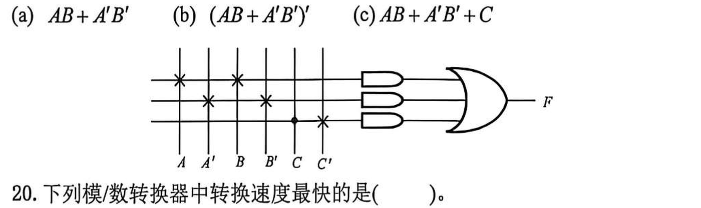

(a) $AB+A'B'$　(b) $(AB+A'B')'$　(c) $AB+A'B'+C$

**答案：(c) $AB+A'B'+C$**

**解析**：PLD 图形读法——**竖线是输入线（$A,A',B,B',C,C'$），横线是乘积项（与门输入线），"×"或"•"表示该输入被接入该乘积项**。

① **与阵列**（三条横线＝三个与项）：

| 与项 | 接入的输入线 | 乘积项 |
|---|---|---|
| 第 1 行 | $A$、$B$ | $AB$ |
| 第 2 行 | $A'$、$B'$ | $A'B'$ |
| 第 3 行 | $C$ | $C$ |

② **或阵列**：三个与项送入一个**三输入或门**（图中最右侧的或门，无小圆圈 → 不是或非门），输出

$$F=AB+A'B'+C$$

**易错**：
- 把或门看成或非门（漏看有没有小圆圈）→ 误选 (b)；
- 只看到 $A,A',B,B'$ 就以为 $C$ 无关，漏掉第三项 → 误选 (a)。**判断依据：图中专门引出了 $C$、$C'$ 两条输入线，若不用就没必要画**；
- 把"×"当作"断开"：那样三个与项全为 0，显然荒谬。

**拓展**：PLD 的三种基本结构：

| 类型 | 与阵列 | 或阵列 | 用途 |
|---|---|---|---|
| PROM | 固定（全译码） | 可编程 | 查表、小容量存储 |
| PAL | 可编程 | 固定 | 组合逻辑（每个或门输入固定） |
| PLA | 可编程 | 可编程 | 最灵活，速度稍慢 |

读图口诀：**"与阵列找×，或阵列找线"**——先在横线上数出"×"对应的输入变量组成乘积项，再看这些横线接到哪个或门。

---

## 20. 下列模/数转换器中转换速度最快的是（　）

(a) 逐次渐近型　(b) 双积分型　(c) 并联比较型

**答案：(c) 并联比较型**

**解析**：三种 ADC 的速度对比（由快到慢）：

| 类型 | 转换时间 | 精度 | 器件量 | 特点 |
|---|---|---|---|---|
| **并联比较型**（Flash） | ns 级（最快） | 低（8 位已很勉强） | $2^n-1$ 个比较器，$n=8$ 时 255 个 | 速度换面积与功耗 |
| 逐次渐近型 | µs 级 | 高（12～16 位常见） | 1 个比较器 + DAC | **速度与精度折中最好**，最常用 |
| 双积分型 | ms 级（最慢） | 高、抗干扰极强 | 1 个比较器 + 积分器 | 数字电压表首选 |

**易错**：选 (a)。逐次渐近型是"**综合性能最好**"，不是"最快"；并联比较型一次比较就出结果（并行比较），速度最快。

**拓展**：并联比较型 ADC 的比较器数目随位数**指数增长**（$2^n-1$），所以 8 位以上几乎不用纯 Flash，改用**流水线型**（Pipeline）或**分级型**（Two-Step）。工程选择口诀：**要快选 Flash，要准选 Σ-Δ，要性价比选逐次渐近，要抗干扰选双积分**。

---

# 三、非客观题（本大题 10 分）

> **题目**：采用 74LS138 译码器和多输入端与非门设计并实现一位二进制全减器。电路实现 $D=A-B-C$ 的功能，其中 $C$ 是来自低位的借位信号，$D$ 是本位求得的差信号；电路还要产生向高位借位信号 $E$。
> 要求：1）画出真值表；2）写出输出函数的最小项表达式；3）画出电路图，标明各端子名称、状态。

## 1）真值表

全减器的三个输入：被减数 $A$、减数 $B$、低位借位 $C$；两个输出：本位差 $D=A-B-C$、向高位借位 $E$。

| $A$ | $B$ | $C$ | $A-B-C$ | $D$（本位差） | $E$（向高位借位） |
|---|---|---|---|---|---|
| 0 | 0 | 0 | 0 | 0 | 0 |
| 0 | 0 | 1 | $-1$ | **1** | **1** |
| 0 | 1 | 0 | $-1$ | **1** | **1** |
| 0 | 1 | 1 | $-2$ | **0** | **1** |
| 1 | 0 | 0 | 1 | **1** | 0 |
| 1 | 0 | 1 | 0 | **0** | 0 |
| 1 | 1 | 0 | 0 | **0** | 0 |
| 1 | 1 | 1 | $-1$ | **1** | **1** |

> 说明：$A-B-C$ 为负时，本位差加 2 取正、同时向高位借 1（即 $E=1$）。

## 2）最小项表达式

由真值表读出 $D=1$ 的行：$m_1,m_2,m_4,m_7$；$E=1$ 的行：$m_1,m_2,m_3,m_7$。

$$D(A,B,C)=\sum m(1,2,4,7)=A\oplus B\oplus C$$

$$E(A,B,C)=\sum m(1,2,3,7)=\bar AB+\bar AC+BC$$

**化简验算**：$E=\bar AB+\bar AC+BC$，用卡诺图可确认已是最简与或式（三个二变量项，互相"相邻"构成桥接，不能再合并）。

## 3）电路图

**74LS138 的两个关键性质**（用它的理由就在这两条）：

$$\text{使能时：}\ Y_i=\overline{m_i}\qquad(i=0\sim7),\qquad \text{地址 }A_2A_1A_0=ABC$$

即**译码器的每个输出就是对应最小项的反**。于是"最小项之和"可以直接用**与非门**再取一次反得到：

$$D=m_1+m_2+m_4+m_7=\overline{\bar m_1\cdot \bar m_2\cdot\bar m_4\cdot\bar m_7}=\overline{Y_1\cdot Y_2\cdot Y_4\cdot Y_7}$$

$$E=m_1+m_2+m_3+m_7=\overline{Y_1\cdot Y_2\cdot Y_3\cdot Y_7}$$

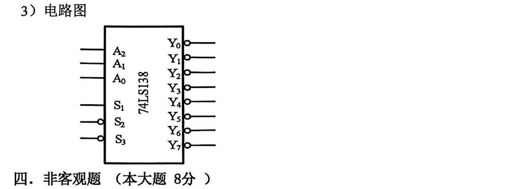

**接线方案**：

| 74LS138 端子 | 接法 |
|---|---|
| $A_2$ | 接 $A$（被减数，最高位） |
| $A_1$ | 接 $B$（减数） |
| $A_0$ | 接 $C$（低位借位） |
| $S_1$（高有效） | 接 **1**（$+5\ \mathrm{V}$） |
| $\bar S_2,\bar S_3$（低有效） | 均接 **0**（地），保证译码器始终使能 |
| $Y_1,Y_2,Y_4,Y_7$ | 接**四输入与非门** → 输出 $D$ |
| $Y_1,Y_2,Y_3,Y_7$ | 接**另一个四输入与非门** → 输出 $E$ |
| 其余 $Y_0,Y_5,Y_6$ | 空脚（不影响逻辑） |

**画图要点**（阅卷给分点）：

1. 74LS138 方块图，左侧画 $A_2A_1A_0$、$S_1\bar S_2\bar S_3$，右侧画 $Y_0\sim Y_7$（**输出端要画小圆圈**，表示低有效）；
2. 地址端标清 $A,B,C$ 的对应关系；
3. 两个与非门分别引出，扇入写"4"（或画四个输入脚）；
4. 输出端标 $D$、$E$，并在旁标注"本位差""向高位借位"。

**易错**：
- 把 $A_2A_1A_0$ 接成 $CBA$（顺序反了）→ 输出全错。**地址高位接权值高位**；
- 忘了 $\bar S_2,\bar S_3$ 接地，译码器不工作；
- 用 $Y_i$ 直接或起来（应该是**与非**，因为 $Y_i=\bar m_i$）；
- 用**八输入与非门**把 $Y_1Y_2Y_3Y_4Y_7$ 一起与非——$D,E$ 是两个不同函数，必须分开。

**拓展**：用 74LS138 实现组合函数的"万能三步法"：

1. 把函数写成最小项之和 $\sum m(\cdot)$；
2. 若函数是"与或"形式且变量 ≤3，地址直接接变量；若变量 >3，需先降维（把多出的变量接到与非门的输入上或改用 74151）；
3. 输出接**与非门**（得到 $\sum m$）或**与门**（得到 $\overline{\sum m}$，即反函数）。

同一年份的另一考点是"**用 138 实现多数表决器**"，方法与本题完全一致。

---

# 四、非客观题（本大题 8 分）

> **题目**：已知边沿 D 触发器的各输入端波形如图所示，试画出 $Q$、$Q'$ 端对应的波形。

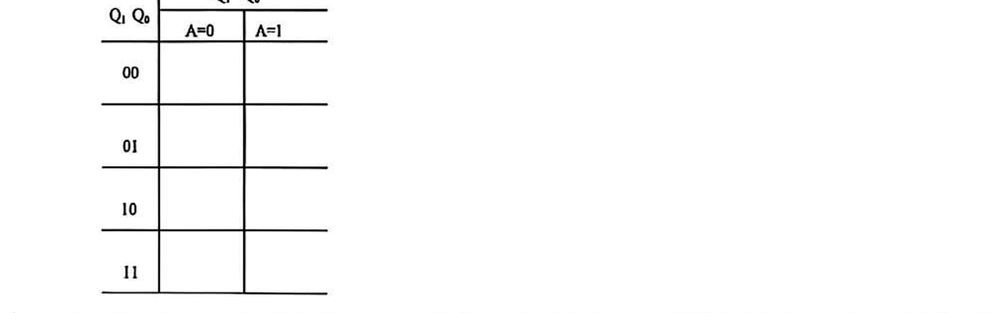

## 一、先读电路

| 端子 | 连接 | 说明 |
|---|---|---|
| $1D$ | $D_1$ 与 $D_2$ 经**与门** | $D=D_1\cdot D_2$ |
| $S$ | 接 **1** | 置位端无效（图中 $S$ 无小圆圈，为高有效；接 1 意为"不置位"） |
| $C1$ | 接 CLK | 小三角无小圆圈 → **上升沿触发** |
| $R$（$\bar R_D$） | 接 $\bar R_D$ 信号 | 有**小圆圈** → **低电平有效**的异步复位 |
| $Q,Q'$ | 输出 | — |

**两条铁律**：
1. **异步复位优先**：只要 $\bar R_D=0$，$Q$ 立即被清 0，与时钟无关；
2. **上升沿采样**：$\bar R_D=1$ 期间，$Q$ 只在 CLK 上升沿按 $Q^*=D=D_1D_2$ 更新。

## 二、按时间轴逐段分析

把 CLK 的 5 个上升沿记为 $t_1,t_2,t_3,t_4,t_5$，并把数据变化点标出（图中 $D_1$ 在第 3 个周期中间由 1 变 0、第 4 个周期中间由 0 变 1；$D_2$ 在第 4 周期末由 1 变 0）。

| 时刻 | $\bar R_D$ | $D_1$ | $D_2$ | $D=D_1D_2$ | 事件 | $Q$ |
|---|---|---|---|---|---|---|
| 起始 | **0** | 1 | 1 | 1 | 异步复位 | **0** |
| 起始后 | 1 | 1 | 1 | 1 | 复位解除 | 0 |
| $t_1$ | 1 | 1 | 1 | 1 | 上升沿，$Q\leftarrow1$ | **1** |
| $t_2$ | 1 | 1 | 1 | 1 | 上升沿，$Q\leftarrow1$ | 1 |
| $t_3$ | 1 | **0** | 1 | 0 | 上升沿，$Q\leftarrow0$ | **0** |
| $t_4$ | 1 | **1** | 1 | 1 | 上升沿，$Q\leftarrow1$ | **1** |
| 中段 | **0** | 1 | 1 | 1 | **异步复位**（与时钟无关） | **0** |
| $t_5$ | 1 | 1 | **0** | 0 | 上升沿，$Q\leftarrow0$ | 0 |

## 三、$Q$、$Q'$ 波形

- **$Q$**：`0`（起始）→ $t_1$ 起高 → $t_3$ 起低 → $t_4$ 起高 → 复位脉冲到达时立即变低 → 之后保持低。
- **$Q'$**：与 $Q$ **完全反相**（$Q'=\bar Q$），注意复位期间 $Q'=1$。

**关键结论（三个得分点）**：

1. **初态由 $\bar R_D$ 的起始低电平强制为 0**，不必猜测；
2. **数据 $D$ 在两个时钟沿之间的变化，不改变已锁存的状态**（只在上升沿采样）；
3. **$Q$ 在复位脉冲处"立刻"变低**，不必等到下一个时钟沿——这是异步端与同步端的本质区别。

**易错**：
- 把触发沿判成下降沿：$Q$ 整体延后半拍；
- 忘了 $D=D_1D_2$（不是 $D_1+D_2$），导致 $t_3$、$t_5$ 的判断全反；
- 把 $S=1$ 当成"置位"：$S$ 是**高有效**时接 1 才置位——本题 $S$ 端画在方框内侧、与 1 相连，而实际四输入端 D 触发器（74LS74）的 $S_D$、$R_D$ 都是**低有效**，此处应理解为"置位端不起作用"；
- $Q'$ 忘记画（题目明确要求画 $Q,Q'$ 两条）。

**拓展**：边沿 D 触发器的特性方程与激励表：

$$Q^*=D$$

| 现态 $Q$ | 次态 $Q^*$ | 所需 $D$ |
|---|---|---|
| 0 | 0 | 0 |
| 0 | 1 | 1 |
| 1 | 0 | 0 |
| 1 | 1 | 1 |

即 $D_{\text{激励}}=Q^*$，这也是用 D 触发器设计时序电路时"**次态直接当驱动方程**"的原因，比 JK 触发器省事。74LS74 是双 D 触发器，$S_D$、$R_D$ 低有效且**不允许同时为 0**。

---

# 五、非客观题（本大题 6 分）

> **题目**：分析下面 VerilogHDL 程序。要求：1）画出电路图，标出端口名称；2）列出真值表；3）说明电路功能。
>
> ```verilog
> module mux2to1(a, b, sel, out);
>     input  a, b, sel;
>     output out;
>     wire   selnot, a1, b1;
>     not  U1(selnot, sel);
>     and  U2(a1, a, selnot);
>     and  U3(b1, b, sel);
>     or   U4(out, a1, b1);
> endmodule
> ```

## 1）电路图

**门级原语的端口顺序**（关键！）：`门类型 实例名(输出, 输入1, 输入2, ...)`——**第一个端口永远是输出**。

| 语句 | 读法 |
|---|---|
| `not U1(selnot, sel)` | `selnot = ~sel` |
| `and U2(a1, a, selnot)` | `a1 = a & selnot` |
| `and U3(b1, b, sel)` | `b1 = b & sel` |
| `or  U4(out, a1, b1)` | `out = a1 ｜ b1` |

故：

$$\text{out}=a\cdot\overline{sel}+b\cdot sel$$

对应电路：一个非门（$sel\to\overline{sel}$）、两个与门、一个或门，共 4 个门。

```
        ┌────┐
 sel ──►│not │── selnot ──┐
        └────┘             │   ┌────┐
 a ───────────────────────┴──►│and │── a1 ──┐
                              └────┘        │   ┌────┐
                                            ├──►│ or │── out
                              ┌────┐        │   └────┘
 b ──────────────────────────►│and │── b1 ──┘
                    sel ─────►└────┘
```

## 2）真值表

| $sel$ | $a$ | $b$ | $out$ |
|---|---|---|---|
| 0 | 0 | 0 | 0 |
| 0 | 0 | 1 | **0** |
| 0 | 1 | 0 | **1** |
| 0 | 1 | 1 | **1** |
| 1 | 0 | 0 | 0 |
| 1 | 0 | 1 | **1** |
| 1 | 1 | 0 | **0** |
| 1 | 1 | 1 | **1** |

即：**$sel=0$ 时 $out=a$，$sel=1$ 时 $out=b$**。

## 3）电路功能

这是一个**二选一数据选择器（2-to-1 MUX）**，$sel$ 为选择（地址）控制端：

- $sel=0$ → 选中 $a$ 送到输出；
- $sel=1$ → 选中 $b$ 送到输出。

**易错**：
- **端口顺序读反**：把 `and U2(a1, a, selnot)` 读成 $a1=$ 第一个输入——实际第一个是**输出**。这是 Verilog 门级原语最容易踩的坑，顺序记反就会得到"$out$ 由 $b$ 和 $\overline{sel}$ 决定"的荒谬结论；
- 把 `wire` 语句当成赋值语句（它只是声明内部连线）；
- 忽略 $sel$ 只驱动了一个非门、两个与门共享它（结构上的并行性）。

**拓展**：如果把这行改成 `module mux2to1(a, b, sel, out)` 但内部写成 `assign out = sel ? b : a;`，功能完全相同——**行为描述与结构描述等价**，这是 Verilog 三种描述风格（门级/数据流/行为级）的核心思想。二选一 MUX 还是构建**查找表（LUT）**的基本单元：$2^k$ 选一 MUX 可存储 $k$ 变量函数的真值表，FPGA 的 LUT-4 就是 16 选一 MUX 加 16 位 SRAM。

---

# 六、非客观题（本大题 8 分）

> **题目**：分析下图所示电路，要求：1）写出它的驱动方程（激励方程）；2）写出状态方程；3）写出输出方程；4）画出状态表；5）画出状态图。

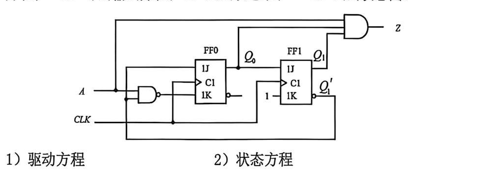

## 1）驱动方程（激励方程）

逐点读图：

① 与非门 $G$：一个输入接 $A$，另一个输入经底部走线接 $FF_1$ 的 $Q'$ 端，故

$$\overline{A\cdot Q_1'}$$

② $G$ 的输出同时接到 $FF_0$ 的 $1J$ 和 $1K$（同一条竖线分两路），故

$$J_0=K_0=\overline{AQ_1'}$$

③ $FF_1$ 的 $J$ 端由 $Q_0$ 直接送来，$K$ 端接固定 1：

$$J_1=Q_0,\qquad K_1=1$$

**汇总（驱动方程）**：

$$\boxed{J_0=K_0=\overline{AQ_1'},\qquad J_1=Q_0,\qquad K_1=1}$$

## 2）状态方程

JK 触发器的特性方程 $Q^*=JQ'+K'Q$，逐片代入：

**对 $FF_0$**（$J_0=K_0=f$，其中 $f=\overline{AQ_1'}$）：

$$Q_0^*=f\,Q_0'+f'\,Q_0=f\oplus Q_0$$

即

$$Q_0^*=\overline{AQ_1'}\cdot Q_0'+AQ_1'\cdot Q_0$$

**对 $FF_1$**（$J_1=Q_0,\ K_1=1\Rightarrow K_1'=0$）：

$$Q_1^*=Q_0\,Q_1'+0\cdot Q_1=Q_0Q_1'$$

**汇总（状态方程）**：

$$\boxed{Q_0^*=\overline{AQ_1'}\oplus Q_0,\qquad Q_1^*=Q_0Q_1'}$$

## 3）输出方程

顶部三输入与门（无小圆圈 → **与门**，不是与非门）的三个输入分别是：$A$（经最上方长横线）、$Q_0$（$Q_0$ 线上引）、$Q_1$（$Q_1$ 线上引），输出为 $Z$：

$$\boxed{Z=AQ_0Q_1}$$

## 4）状态表

以 $Q_1Q_0$ 为状态，分别对 $A=0$、$A=1$ 计算次态 $Q_1^*Q_0^*$。

**$A=0$**：$f=\overline{0\cdot Q_1'}=1$ → $Q_0^*=1\oplus Q_0=\overline{Q_0}$（**每拍必翻**）；$Q_1^*=Q_0Q_1'$。

**$A=1$**：$f=\overline{Q_1'}=Q_1$ → $Q_0^*=Q_1\oplus Q_0$；$Q_1^*=Q_0Q_1'$。

| $Q_1$ | $Q_0$ | $A=0$：$Q_1^*Q_0^*$ | $A=1$：$Q_1^*Q_0^*$ | $Z$（$A=1$ 时） |
|---|---|---|---|---|
| 0 | 0 | **01** | **00** | 0 |
| 0 | 1 | **10** | **11** | 0 |
| 1 | 0 | **01** | **01** | 0 |
| 1 | 1 | **00** | **00** | **1** |

**校验示例**：
- $Q_1Q_0=01,\ A=0$：$Q_0^*=\overline{1}=0$，$Q_1^*=Q_0Q_1'=1\cdot1=1$ → $10$ ✓
- $Q_1Q_0=01,\ A=1$：$Q_0^*=0\oplus1=1$，$Q_1^*=1$ → $11$ ✓
- $Q_1Q_0=11,\ A=1$：$Q_0^*=1\oplus1=0$，$Q_1^*=Q_0Q_1'=1\cdot0=0$ → $00$ ✓

## 5）状态图

**$A=0$ 时**（$Z\equiv0$）：

```
        00 ──► 01 ◄──┐
               │     │
               ▼     │
              10 ────┘
        11 ──► 00
```

- 主循环：$01\to10\to01$（**二状态循环，即二分频**）
- 入口：$00\to01$，$11\to00$

**$A=1$ 时**（$Z$ 在状态 11 输出 1）：

```
        00 ──┐（自循环）
             │
        10 ──► 01 ──► [11/Z=1] ──► 00
```

- $00\to00$（**保持**）
- $10\to01\to11\to00$
- 状态 $11$ 时 $Z=1$，且 $11$ 只停留一个时钟周期 → **$Z$ 是一个宽度为一个 CP 周期的正脉冲**

**功能总结**：这是一个**受 $A$ 控制的两状态发生器**——

- $A=0$：电路在 $01\leftrightarrow10$ 之间循环，$Q_1,Q_0$ 互为反相，等效于用 $Q_0$ 或 $Q_1$ 输出**二分频**信号；
- $A=1$：电路由 $10$ 经 $01$、$11$ 归零并停在 $00$（自启动到 $00$ 后保持），在 $11$ 状态给出一个周期的 $Z$ 脉冲，相当于"**来一个 $A$ 高电平，产生一个定宽脉冲**"的单脉冲发生器。

**易错**：
- **驱动方程写错**：把 $J_0$ 写成 $\overline{AQ_1}$（漏了 $Q_1$ 的反号）——底部走线取自 $Q_1'$（$FF_1$ 输出端带小圆圈的那一脚），不是 $Q_1$；
- **只看 $J_0$ 不看 $K_0$**：图中 $G$ 的输出经竖线同时接 $1J$ 与 $1K$，必须写 $J_0=K_0$；若漏掉，状态方程会完全变样；
- **输出方程写成与非**：顶部那个门**没有小圆圈**，是三输入**与门**；
- **列表时漏掉 $A$ 的两列**：题目要求状态表，必须按 $A=0/A=1$ 分两列；
- **忘记 $K_1=1$ 时 $Q_1$ 的保持条件**：$K_1=1$ 意味着 $Q_1$ 不能被置 0（$K$ 有效才清 0），只能靠 $J_1=Q_0$ 置 1，因此 $Q_1$ 只会在 $Q_0=1$ 且 $Q_1=0$ 时变 1。

**拓展**：时序电路分析的**标准五步**（本题就是模板）：

1. 写**驱动方程**（各触发器 $J,K$ 或 $D,T$ 的表达式）；
2. 代入**特性方程**得**状态方程**；
3. 写**输出方程**；
4. 列**状态表**（含输入变量的各列）；
5. 画**状态图**，检查**自启动**（若有无效状态）。

本题 4 个状态全部用到，**无无效状态**，故不存在自启动问题。

---

# 七、非客观题（本大题 10 分）

> **题目**：分析用 74LS160 及 74LS290 构成的电路为多少进制计数器。画出对应的状态转换图。其中 74LS290 是异步 2-5-10 进制计数器，具有异步清零与置 9 端；74LS160 是十进制同步加法计数器，具有异步清零与同步置数端。

## 图 1：74LS160 构成的计数器


**读图**：

| 端子 | 接法 | 结论 |
|---|---|---|
| $EP$、$ET$ | 均接 **1** | 计数使能，正常累加 |
| $D_0\sim D_3$ | 顶部母线统一接**地**（图示接地符号） | **置数值 $=0000$** |
| $CP$ | 接计数输入脉冲 | — |
| $\bar{LD}$ | 经**反相器**接 $Q_3$ | $\bar{LD}=\overline{Q_3}$ |
| $\bar R_D$ | 接 **1** | 异步清零**不用** |
| $C$（进位输出） | 悬空 | 不用 |

**判进制**：74160 是**同步**置数——$\bar{LD}=0$ 时，**下一个 CP 上升沿**才把 $D_3D_2D_1D_0$ 装入。

$$\bar{LD}=\overline{Q_3}=0\ \Longleftrightarrow\ Q_3=1\ \Longleftrightarrow\ \text{状态}\ \ge 8$$

计数过程：

$$0000\to0001\to0010\to\cdots\to0111\to\underbrace{1000}_{Q_3=1,\ \bar{LD}=0}\xrightarrow{\ \text{下一个 CP}\ }0000$$

有效状态：$0000\sim1000$ 共 **9 个**。

$$\boxed{\text{图 1 为九进制计数器}}$$

**状态转换图**：

```
  0000 ──► 0001 ──► 0010 ──► 0011 ──► 0100
    ▲                                    │
    │                                    ▼
  1000 ◄── 0111 ◄── 0110 ◄── 0101 ◄─────┘
```

（$0000\to0001\to\cdots\to1000\to0000$，共 9 个状态循环）

**易错**：
- 把 $\bar{LD}$ 当成"计到 9 才置数"：74160 的进位 $C$ 在 $Q_3Q_0=11$（即 9）时为 1，但本题 $\bar{LD}$ 取自 **$Q_3$**，不是 $C$；
- 记成"十进制"（以为 74160 本身就是十进制，电路没作用）。本题通过**反馈置数**改变了模值；
- 把"同步置数"当"异步清零"处理：同步置数要**多算一个状态**（1000 也是一个有效状态），若按异步清零算就变成八进制，**这是本题最大的陷阱**。

## 图 2：74LS290 构成的计数器

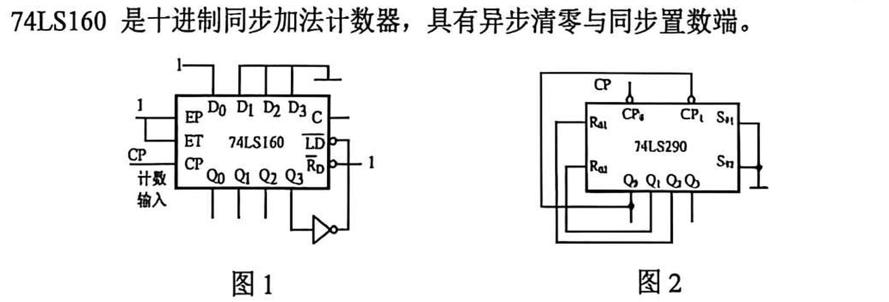

**读图**：

| 端子 | 接法 | 结论 |
|---|---|---|
| $CP_0$ | 接计数输入脉冲 | 脉冲先进二进制计数器 |
| $CP_1$ | 接 $Q_0$（左侧长走线绕回） | **内部级联成 8421 十进制** |
| $R_{0(1)}$ | 接 $Q_2$ | 清零条件之一 |
| $R_{0(2)}$ | 接 $Q_1$ | 清零条件之二 |
| $S_{9(1)}$、$S_{9(2)}$ | 并联后**接地** | 置 9 功能**不用** |

**判进制**：74LS290 的清零是**异步**的——只要 $R_{0(1)}=R_{0(2)}=1$，输出**立即**清 0，不等时钟。

清零条件：

$$R_{0(1)}\cdot R_{0(2)}=Q_2Q_1=1\ \Longleftrightarrow\ Q_3Q_2Q_1Q_0=0110=(6)_{10}$$

计数过程：

$$0000\to0001\to0010\to0011\to0100\to0101\to\underbrace{0110}_{\text{瞬时}}\xrightarrow{\text{立即清零}}0000$$

有效状态：$0000\sim0101$ 共 **6 个**（$0110$ 只出现极短时间，不计入有效状态）。

$$\boxed{\text{图 2 为六进制计数器}}$$

**状态转换图**：

```
  0000 ──► 0001 ──► 0010 ──► 0011 ──► 0100 ──► 0101
    ▲                                            │
    └────────────── 0110（瞬时）◄────────────────┘
```

（虚线表示瞬时状态，实际稳定循环是 $0000\sim0101$ 六个状态）

**易错**：
- 忘记 $Q_0\to CP_1$ 的级联，误以为只用了五进制部分；
- 把 $S_9$ 端悬空：74LS290 的 $S_9$ 端必须**明确接地**，悬空可能误置 9；
- 把 $R_0$ 接成 $Q_3Q_0$（那是模 10）、或 $Q_3Q_1$ ——**接哪两位就清到哪一位对应的数值**；
- 异步清零与同步置数的状态数差 1：**异步清零 ⇒ 反馈值 $N$；同步置数 ⇒ 反馈值 $N-1$**，这是全章最重要的一条口诀。

**拓展**：74LS290 是"**二-五-十**"结构：内部一个二进制计数器（$CP_0\to Q_0$）和一个五进制计数器（$CP_1\to Q_1Q_2Q_3$）。不同的级联方式可得不同进制：

| 接法 | 进制 | 说明 |
|---|---|---|
| $CP\to CP_0$，$Q_0\to CP_1$ | 十进制（8421） | 标准接法，本题采用 |
| $CP\to CP_1$，$Q_3\to CP_0$ | 十进制（5421） | $Q_0$ 变成最高位 |
| 只用 $CP_0\to Q_0$ | 二进制 | — |
| 只用 $CP_1\to Q_1Q_2Q_3$ | 五进制 | — |

**两种反馈方式对比（必背）**：

| 器件 | 反馈方式 | 反馈信号取 | 状态数 | 例 |
|---|---|---|---|---|
| 74LS160/161/162/163 | **同步置数** | 终态 $N$，反馈 $N-1$ | 置数时状态**保留** | 本题 $Q_3=1$ → 9 进制 |
| 74LS160/161/162/163 | **异步清零** | 终态 $N-1$，反馈 $N$ | 清零时状态**一闪而过** | $Q_3Q_0=1$ → 10 进制 |
| 74LS290 | **异步清零** | 反馈 $N$ | $N$ 状态瞬时 | 本题 $Q_2Q_1$ → 6 进制 |
| 74LS290 | **异步置 9** | 反馈 $N-1$（置 9 后还要数） | — | 较少用 |

---

# 八、非客观题（本大题 10 分）

> **题目**：图为由 555 定时器和 D 触发器构成的电路，请问：
> 1、555 定时器构成的是哪种电路？
> 2、画出 $u_C$、$u_{O1}$、$u_{O2}$ 的波形；
> 3、计算 $u_{O1}$ 和 $u_{O2}$ 的频率。

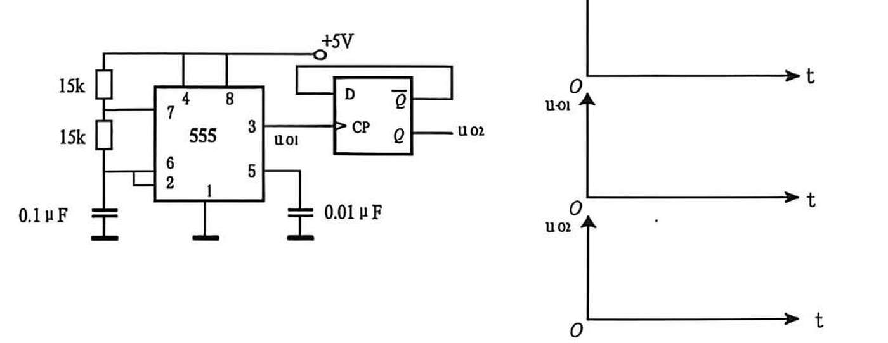

## 1）555 构成何种电路

**读图**：

| 555 引脚 | 接法 | 作用 |
|---|---|---|
| 4（复位） | 接 $+5\ \mathrm{V}$ | 不复位 |
| 8（电源） | 接 $+5\ \mathrm{V}$ | 供电 |
| 7（放电） | 接在两个 $15\ \mathrm{k}\Omega$ 电阻之间 | 放电端 |
| 2（触发）＋6（阈值） | **短接在一起**，接电容 $C=0.1\ \mu\mathrm{F}$ 上端 | 电容电压既作触发又作阈值 |
| 5（控制） | 经 $0.01\ \mu\mathrm{F}$ 接地 | 旁路滤波，$V_{CO}\approx\frac23V_{CC}$ 不变 |
| 1（地） | 接地 | — |
| 3（输出） | 送 $u_{O1}$，并作为 D 触发器的 CP | — |

**判据**：2 脚与 6 脚**短接**在同一个 RC 定时节点上，7 脚接在两电阻之间——这是**多谐振荡器（自激方波发生器）**的标准接法。电容在 $\frac13V_{CC}\sim\frac23V_{CC}$ 之间反复充放电，输出端自动输出方波，**无需外加触发信号**。

$$\boxed{\text{555 构成多谐振荡器（自激振荡器 / 方波发生器）}}$$

**三种基本接法的判别口诀**：

| 接法 | 特征 | 输出 |
|---|---|---|
| 单稳态 | 2 脚单独接**触发输入**，6、7 接 RC | 一个定宽脉冲（$1.1RC$） |
| 多谐振荡器 | **2、6 短接**接电容，7 接两电阻之间 | 连续方波 |
| 施密特触发器 | **2、6 短接**接**输入信号**，7 悬空 | 整形后的方波 |

**本题 2、6 短接且 7 接在两电阻之间 → 一定是多谐振荡器**（不是施密特）。

## 2）画出 $u_C$、$u_{O1}$、$u_{O2}$ 波形

**波形要点**：

| 波形 | 特征 |
|---|---|
| $u_C$ | 在 $\frac13V_{CC}\sim\frac23V_{CC}$（即 $1.67\sim3.33\ \mathrm{V}$）之间**指数充放电**，呈"锯齿"状；充电经 $R_1+R_2$（慢），放电路径经 $R_2$（快），故**上升段长、下降段短** |
| $u_{O1}$ | 方波：$u_C<\frac13V_{CC}$ 时输出高，$u_C>\frac23V_{CC}$ 时输出低；**高电平宽度 > 低电平宽度**（占空比 > 50%） |
| $u_{O2}$ | $u_{O1}$ 经 D 触发器（$\bar Q\to D$）**二分频**后的方波，频率减半，占空比恰为 **50%** |

```
u_C  ╱|╲╱|╲╱|╲        （在 1/3Vcc ~ 2/3Vcc 之间锯齿）
   2/3Vcc ┈┈┈┈┈┈┈┈
   1/3Vcc ┈┈┈┈┈┈┈┈

u_O1 ┌────┐  ┌────┐  ┌────┐      高电平宽、低电平窄
   ──┘    └──┘    └──┘    └──

u_O2 ┌──────┐      ┌──────┐      频率减半、占空比 50%
   ──┘      └──────┘      └──
```

**画波形得分点**：
1. $u_C$ 必须画在 $\frac13V_{CC}$、$\frac23V_{CC}$ 两条虚线之间，且**充电段缓、放电段陡**；
2. $u_{O1}$ 的跳变必须**对准** $u_C$ 触到 $\frac13V_{CC}$（上升沿）和 $\frac23V_{CC}$（下降沿）的时刻；
3. $u_{O2}$ 的每个跳变必须对准 $u_{O1}$ 的**上升沿**（D 触发器上升沿触发），且周期是 $u_{O1}$ 的两倍。

## 3）计算 $u_{O1}$、$u_{O2}$ 的频率

**已知**：$R_1=15\ \mathrm{k}\Omega$、$R_2=15\ \mathrm{k}\Omega$、$C=0.1\ \mu\mathrm{F}$。

**多谐振荡器的三个基本公式**：

$$t_{W1}=0.7(R_1+R_2)C\quad(\text{充电，输出高})$$
$$t_{W2}=0.7R_2C\quad(\text{放电，输出低})$$
$$T=t_{W1}+t_{W2}=0.7(R_1+2R_2)C$$

代入：

$$T_1=0.7\times(15\times10^3+2\times15\times10^3)\times0.1\times10^{-6}$$
$$=0.7\times45\times10^3\times0.1\times10^{-6}=0.7\times4.5\times10^{-3}=3.15\times10^{-3}\ \mathrm{s}=3.15\ \mathrm{ms}$$

$$f_1=\frac{1}{T_1}=\frac{1}{3.15\times10^{-3}}\approx317.5\ \mathrm{Hz}\approx318\ \mathrm{Hz}$$

**D 触发器二分频**：

$$f_2=\frac{f_1}{2}=\frac{317.5}{2}\approx158.7\ \mathrm{Hz}\approx159\ \mathrm{Hz}$$

$$\boxed{f_{uO1}\approx318\ \mathrm{Hz},\qquad f_{uO2}\approx159\ \mathrm{Hz}}$$

**占空比（可加答，常给分）**：

$$q=\frac{t_{W1}}{T}=\frac{R_1+R_2}{R_1+2R_2}=\frac{30}{45}\approx66.7\%$$

**易错**：
- 把公式记成 $T=0.7(R_1+R_2)C$（漏掉"$2R_2$"）→ 周期只有一半，频率翻倍；
- 忘记 7 脚在**两电阻之间**，把 $R_1$、$R_2$ 的位置搞反（若 $R_1$ 是接 $V_{CC}$ 的那个、$R_2$ 是接 7 脚与电容之间的那个，公式才是 $R_1+2R_2$）；
- 单位换算：$15\ \mathrm{k}\Omega\times0.1\ \mu\mathrm{F}=1.5\ \mathrm{ms}$，别算成 $1.5\ \mathrm{s}$；
- 忘记 $u_{O2}$ 是**二分频**（D 触发器 $\bar Q$ 接 $D$），把两者频率写成相同；
- 5 脚接了 $0.01\ \mu\mathrm{F}$ 电容——这只是**滤波**，$V_{CO}$ 仍为 $\frac23V_{CC}$，**不改变**频率公式（若 5 脚外接直流电压 $V_{CO}$，则阈值变为 $V_{CO}$ 与 $\frac12V_{CO}$，公式要改）。

**拓展**：555 多谐振荡器的三个衍生考点：

| 变形 | 变化 |
|---|---|
| 占空比可调 | 在 7 脚串入电位器 + 两个二极管，使充放电分别经不同电阻 |
| 5 脚外接 $V_{CO}$ | 阈值变成 $V_{CO}$、$\frac12V_{CO}$，周期随之改变（用于**压控振荡**） |
| 石英晶体稳频 | 用晶体替换 RC，频率稳定度提高几个数量级 |

用 D 触发器二分频的好处：**占空比恒为 50%**（而 555 直接输出是 66.7%），且输出频率稳定；这也是"**用 555 产生 2f，再二分频得到 f 的 50% 方波**"这一经典技巧的由来。

---

# 附录 A　考点分布统计

| 章节 | 考点 | 题号 | 分值（估） |
|---|---|---|---|
| 第 1 章 数制与码制 | 十进制↔二/十六进制、原反补码 | 一1、一2 | 4 |
| 第 2 章 逻辑代数 | 摩根定理、对偶式 | 一4 | 2 |
| 第 3 章 门电路 | 晶体管开关状态、OC 门线与、TTL 输入负载、扇出系数、CMOS 门识别 | 二1、二2、二4、二6、二10 | 10 |
| 第 4 章 组合逻辑 | 逻辑图读式、与非-与非式、译码器设计、数据选择器、编码位数 | 二3、二5、二13、二14、三 | 18 |
| 第 5 章 触发器 | JK 功能、D 触发器波形时刻、主从 JK 分频 | 二8、二9、二12、四 | 14 |
| 第 6 章 时序逻辑 | 双 JK 电路分析、74160/74290 判进制、触发器个数 | 二11、六、七 | 22 |
| 第 7 章 半导体存储器 | EPROM 容量、ROM 存储矩阵 | 一3、二16 | 4 |
| 第 8 章 可编程逻辑 | PLD 表达式读取 | 二19 | 2 |
| 第 9 章 脉冲电路 | 单稳态定时、555 多谐振荡器 | 二18、八 | 12 |
| 第 10 章 A/D 与 D/A | T 形网络 DAC、ADC 编码、ADC 速度 | 二17、二20、二15 | 6 |
| 第 11 章 硬件描述语言 | Verilog 门级描述 | 五 | 6 |

**分值最高的三块**：时序逻辑（22 分）、组合逻辑（18 分）、触发器（14 分）——合计 54 分，占全卷一半以上。这也印证了数电复习的主线：**组合 + 时序**。

# 附录 B　复习建议（针对本卷暴露的薄弱点）

## 1. 客观题（48 分）—— 全靠"记忆点"，性价比最高

本卷 20 道选择题几乎**没有计算**，全部是概念辨析。建议整理成一张"**一句话考点表**"：

| 考点 | 一句话 |
|---|---|
| 晶体管工作状态 | 数电里只待在截止与饱和（开关状态） |
| 线与 | 只有 OC 门（OD 门）能直接并联 |
| 扇出系数 | 驱动**同类门**的**最大**数目，由 $N_{OL}$ 决定 |
| TTL 悬空 | 相当于 **1**；CMOS 悬空 = 随机，绝对禁止 |
| 多余端处理 | 与非门接 1，或非门接 0 |
| 共阴数码管 | 段码高电平点亮；"2"= $a,b,d,e,g$ |
| 编码位数 | $n=\lceil\log_2 N\rceil$ |
| 触发器个数 | $n=\lceil\log_2 N\rceil$（$N$ 为进制数） |
| 主从 JK $J=K=1$ | $f_Q=f_{CP}/2$ |
| 单稳态 | $t_W$ 只由 $R,C$ 决定，与触发脉冲无关 |
| ADC 最快 | 并联比较型（Flash） |
| ADC 分辨率 | $\Delta=\dfrac{U_{FS}}{2^n-1}$ |
| DAC 输出 | $u_O=\dfrac{D}{2^n}U_{REF}$ |
| EPROM 容量 | $2^{\text{地址线}}\times\text{数据线}$ |

## 2. 非客观题（52 分）—— 五类模板必须背下来

| 题型 | 模板步骤 | 本卷对应 |
|---|---|---|
| **译码器设计** | 写真值表 → 写 $\sum m$ → 接地址 → $Y_i$ 接与非门 | 三（全减器） |
| **画波形** | 定触发沿 → 找异步端 → 逐段列"时刻/输入/事件/输出"表 | 四（D 触发器） |
| **读 Verilog** | 门级原语"第一个端口是输出" → 逐行写表达式 → 化简 | 五（MUX） |
| **时序分析** | 驱动 → 状态 → 输出 → 状态表 → 状态图 → 查自启动 | 六（双 JK） |
| **判进制** | 看反馈取自哪几个 $Q$ → 判同步/异步 → $N$ 或 $N-1$ → 画圈 | 七（160/290） |
| **555 计算** | 判接法（2、6 是否短接）→ 选公式 → 代数值 → 算频率/脉宽 | 八（多谐） |

## 3. 三个最容易丢分的"小地方"

1. **同步置数 vs 异步清零的状态数差 1**：同步置数 → 反馈取 $N-1$；异步清零 → 反馈取 $N$。七题两小问正好一正一反，几乎每年都考。
2. **门级原语的端口顺序**：`and U2(a1, a, selnot)` 中 `a1` 是**输出**。读反了整道题报废。
3. **波形题不写"初态"**：$Q$ 的初值必须由复位信号或题目给定条件确定，不能凭空假设。

## 4. 建议的复习顺序（按本卷分值权重）

```
时序逻辑（22分）→ 组合逻辑（18分）→ 触发器（14分）
      ↓                  ↓                ↓
 六、七题（判进制）   三题（138设计）    四题（画波形）
      ↓                  ↓                ↓
 再刷 74160/161/290     再刷 74151/138    再刷 JK/D/T
      ↓
 555（12分）→ 门电路（10分）→ 存储器/ADC/PLD（12分）→ Verilog（6分）
```

---

> **本卷是 6 套真题里最"规矩"的一套**：没有一道偏题，全部是教材例题的同构变形。如果时间紧，**优先做透这一套**，再用 2016—2017 卷（第 5 套）补 74LS151/194 的缺口。
