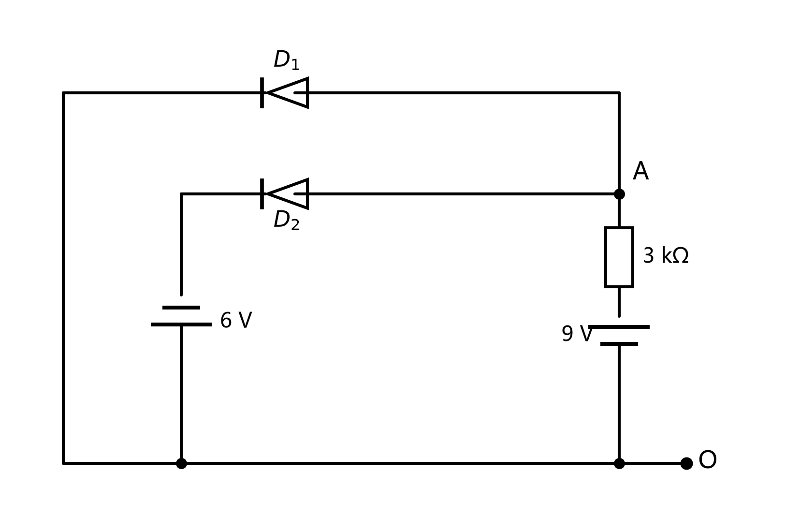
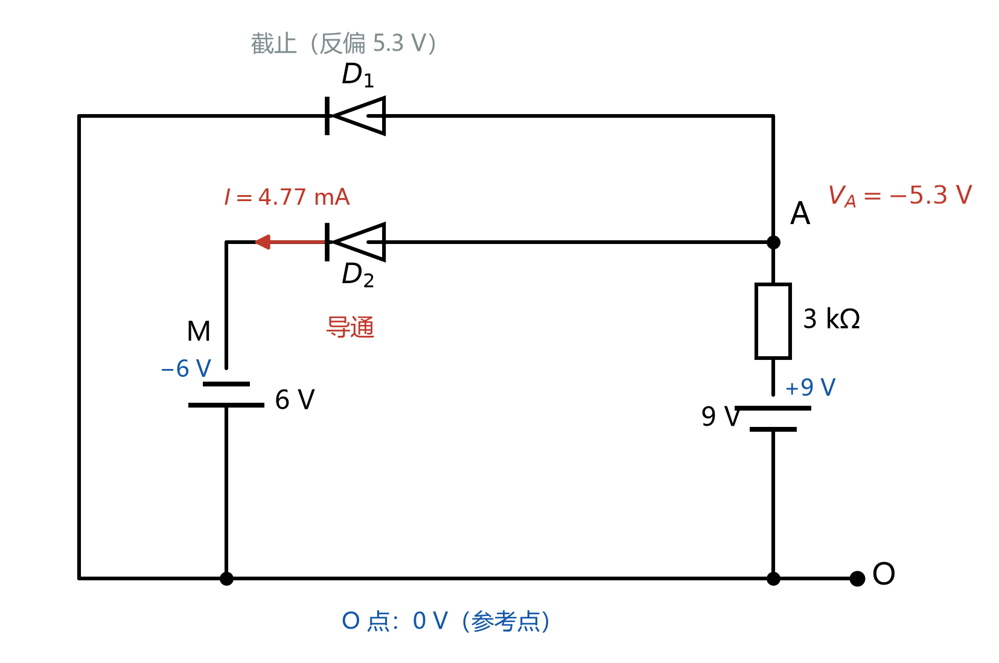

# 《数字电路与逻辑》练习题集 · 逐题精析

> **对应文件**：`练习题集.docx`（四套练习卷，含参考答案）
> **每题固定六段**：题目原文 → 详解 → 知识点总结 → 考点归纳 → 所属章节 → 延伸扩展
> **题量**：填空 30 + 简答 21 + 大题 16 = **67 题**，按原卷顺序逐题排列
> **章节编号**对本仓库笔记体系：第 1 章 模拟电子元件与分立电子元件 / 第 2 章 数字电路基础 / 第 3 章 逻辑代数基础 / 第 4 章 组合逻辑电路 / 第 5 章 触发器 / 第 6 章 时序逻辑电路 / 第 7 章 集成运放与脉冲波形
> **直达链接**：每道题「考点」行末尾都有一个 `→ 直达 §x.y 某某`，点它直接跳到对应讲义小节（Gitee 页面上是可点的相对链接，本地预览同样生效）。**注意**：题目里写的节号沿用课堂讲义的编号，与仓库 `第N章_xxx/` 的文件序号并不一一对应（例如本文 §3.4 卡诺图化简 = 仓库 3.7），**链接文字给出的才是仓库真实节号与标题，以链接为准**。全仓库 53 篇讲义见各章 `第N章_例题与考法解析.md`。
> **讲义未覆盖的两处**：§1.1 电路基本定律（KCL/KVL）——第 1 章讲义从模拟电子技术起讲，电路分析基础未单列；这类题只在本文给出解析，暂无讲义可跳。
> **重要前提**：**第二套与第三套是同一份卷子的两次收录**（仅题号续编），题干、函数式、答案完全一致。第三套仍逐题列出并保留六段结构，但详解部分指向第二套，不重复推导。

---

# 第一套（原卷 P1–5）

## 一、填空题（1～7，每空 1 分，共 15 分）

### 填空 1　基尔霍夫电流定律

**题目**：基尔霍夫电流定律指出：在任何电路中，任何结点上的所有支路电流的代数和在任何时刻都等于 \_\_\_\_\_\_。

**详解**：答案是**零**。KCL 的本质是**电荷守恒**——电荷不能在结点上堆积，单位时间内流入结点的电荷量必须等于流出的电荷量。写成式子就是 $\sum I=0$（规定流入为正、流出为负，或反之，只要全图统一）。注意"代数和"三个字：不是绝对值相加，而是带符号相加。

**知识点**：KCL（电流定律）——任一结点、任一时刻，各支路电流代数和为零；也可推广到任一**闭合面**（广义结点），即流入闭合面的电流和 = 流出的电流和。

**考点**：【填空】★★★　｜　**章节**：第 1 章 §1.1 电路基本定律　→　〔讲义未单列此节：第 1 章自模拟电子技术起讲，KCL/KVL 属电路分析基础〕

**延伸**：① KCL 的对偶是 **KVL**（第二套填空 8 考的就是它）——沿任一闭合回路，各支路电压代数和为零，本质是**能量守恒**（电场力做功与路径无关）。② KCL 只与**拓扑结构**有关，与元件性质无关，所以对非线性电路（含二极管、三极管）同样成立——这正是"假设—检验法"里能用 KCL 算电流的原因。③ 解题时若出现负值，说明实际方向与假设方向相反，不必回头改图，负号本身就是答案的一部分。

---

### 填空 2　硅二极管的两个电压

**题目**：硅二极管的死区电压约是 \_\_\_\_\_\_ V，导通电压约是 \_\_\_\_\_\_ V。

**详解**：**死区电压 0.5 V，导通电压 0.7 V**。这是两个不同的量，最容易被合并成一个数：
- **死区电压** $U_{\text{th}}$：正向电压低于它时，外电场还不足以抵消 PN 结内建电场，扩散电流几乎为零，管子"看起来没通"；
- **导通电压**（导通压降）$U_F$：真正导通后，管子两端稳定下来的电压值。

锗管对应的是 **0.1 V / 0.3 V**（第四套填空 22 就考锗管，两题要对照记）。

**知识点**：二极管的伏安特性是**指数曲线**（$I=I_S(e^{U/U_T}-1)$），没有硬拐点。所谓"0.7 V 导通"是工程约定：在常用电流（mA 级）下硅管压降大致落在 0.6～0.7 V，取 0.7 V 作代表值。

**考点**：【填空】★★★　｜　**章节**：第 1 章 §1.2 半导体二极管　→　[直达 1.2 二极管](../第1章_模拟电子元件与分立电子元件/1.2_二极管.md)

**延伸**：① **0.7 V 从哪来**——它来自硅 PN 结的**内建电势**（势垒高度），$V_{bi}=V_T\ln(N_AN_D/n_i^2)$，硅约 0.7～0.9 V。外加正压要先"削平"这个势垒，电流才大量通过。硅的禁带宽度 1.12 eV、锗 0.66 eV，所以硅的门槛高出一倍。② 它有**负温度系数**，约 −2 mV/℃，所以同一只管子夏天和冬天的压降不一样，精密电路要做温度补偿。③ 三种模型的分工：理想模型取 0 V（本题答案 −6 V 用的就是它）、恒压降模型取 0.7 V、折线模型再加动态电阻 $r_d$。

---

### 填空 3　三极管放大区的偏置条件

**题目**：当三极管工作在放大区时，发射结电压 \_\_\_\_\_\_，集电结电压 \_\_\_\_\_\_。

**详解**：**发射结正偏、集电结反偏**。这是放大区唯一的判据，三个区的完整对照如下：

| 工作区 | 发射结 | 集电结 | 数字电路里的角色 |
| --- | --- | --- | --- |
| 截止 | 反偏（$U_{BE}<0.5$ V） | 反偏 | 当"开关断开" |
| 放大 | **正偏** | **反偏** | 模拟电路用来放大，数电里禁止停留 |
| 饱和 | 正偏 | 正偏 | 当"开关闭合"，$U_{CE}\approx0.3$ V |

记法：**"一正一反才放大"**——两个结状态不同才有放大能力；两结同向（都反=截止、都正=饱和）都成了开关。

**知识点**：三极管是**电流控制器件**，$I_C=\beta I_B$ 只在放大区成立；饱和后 $I_C$ 由外电路决定，不再受 $I_B$ 控制（$I_B\ge I_{CS}/\beta$ 即进入饱和）。

**考点**：【填空】★★★　｜　**章节**：第 1 章 §1.3 半导体三极管　→　[直达 1.3 晶体管](../第1章_模拟电子元件与分立电子元件/1.3_晶体管BJT.md)

**延伸**：① 数字电路为什么只用截止/饱和两态——**抗干扰**。放大区输出既不是标准高电平也不是标准低电平，一点扰动就会让下级误判。② 判断是否饱和有个实用办法：先按放大区假设算出 $I_C$，若 $I_C>V_{CC}/R_c$，说明实际已饱和，应改用 $U_{CE}=0.3$ V 重算。③ 分立元件门电路（如第二套简答 7 的或非门）就是靠三极管在饱和/截止间切换来产生逻辑电平。

---

### 填空 4　二进制转八进制与十六进制

**题目**：将二进制数 $(110101.011000111)_2$ 转换成八进制数和十六进制数，分别是 \_\_\_\_\_\_、\_\_\_\_\_\_。

**详解**：**$(65.307)_8$ 和 $(35.638)_{16}$**。

以小数点为界向两侧**分组**，八进制每 **3 位**一组、十六进制每 **4 位**一组，不足位在小数末尾补 0：

```
八进制（3 位一组）  110 101 . 011 000 111
                    6   5  .  3   0   7   → (65.307)₈

十六进制（4 位一组）0011 0101 . 0110 0011 1000
                     3    5  .  6    3    8  → (35.638)₁₆
```

验算：$110101.011000111_2=32+16+4+1+0.25+0.125+0.0078125=53.3828125$，与 $(65.307)_8=48+5+0.375+0.0107\ldots$ 一致。

**知识点**：分组法成立的根据是 $8=2^3$、$16=2^4$——**每 3 位二进制恰好对应 1 位八进制，每 4 位对应 1 位十六进制**，所以能整体替换而不用逐位算权。

**考点**：【填空】★★★　｜　**章节**：第 2 章 §2.1 数制　→　[直达 2.2 数制与数制转换](../第2章_数字电路基础/2.2_数制与数制转换.md)

**延伸**：① 十进制转其他进制才需要"除基取余、逆序排列"，二↔八↔十六之间**一律用分组**，比除法快一个数量级。② 分组必须**从小数点向两侧**进行，整数部分向左、小数部分向右，方向反了整题作废。③ 十六进制在计算机里的意义：1 位十六进制 = 4 bit = 半个字节，所以内存地址、颜色值（`#FF8800`）都用它写。

---

### 填空 5　十进制 146 的二进制与 8421BCD

**题目**：十进制数 146 对应的二进制数和 8421BCD 码分别是 \_\_\_\_\_\_、\_\_\_\_\_\_。

**详解**：二进制 **$10010010$**，8421BCD **$0001\,0100\,0110$**。

- 二进制：$146=128+16+2=2^7+2^4+2^1$ → 位 7、4、1 置 1 → `1001 0010`
- 8421BCD：**逐位**编码，1→`0001`、4→`0100`、6→`0110`，拼起来 `0001 0100 0110`

两者形状完全不同，长度也不同（8 位 vs 12 位），这是本章第一杀手。

**知识点**：**BCD 码是"十进制的二进制写法"，不是二进制数**。它保留十进制的每一位，只是把 0～9 用 4 位二进制表示，因此有 6 个码（1010～1111）是**非法码**，永远不会出现——这 6 个非法码在卡诺图里就是天然的无关项。

**考点**：【填空】★★★　｜　**章节**：第 2 章 §2.2 码制　→　[直达 2.3 码制](../第2章_数字电路基础/2.3_码制.md)

**延伸**：① 8421BCD 的权就是 8-4-2-1，所以又叫"有权码"；对应的还有余 3 码（+3）、2421 码（权 2-4-2-1）、格雷码（相邻只变 1 位）。② 为什么数码管用 BCD 而不用二进制：显示译码器（7448）就是按 4 位一组设计的，二进制要先做除法取余才能显示，硬件代价大得多。③ 第四套填空 24 考的是余 3 码 → 2421 码，中间必须**先还原十进制**再重新编码，不能直接位变换。

---

### 填空 6　负数的原码、反码、补码

**题目**：$-01011$ 的原码、反码、补码分别为 \_\_\_\_\_\_、\_\_\_\_\_\_、\_\_\_\_\_\_。

**详解**：**原码 $101011$、反码 $110100$、补码 $110101$**。

数值 $01011$ 是 **5 位**，加 1 位符号位共 6 位：

| 码制 | 求法 | 结果 |
| --- | --- | --- |
| 原码 | 符号位取 1，数值位照抄 | `1 01011` |
| 反码 | 符号位不变，**数值位逐位取反** | `1 10100` |
| 补码 | 反码**末位加 1** | `1 10101` |

**知识点**：正数的三种码完全相同；负数的反码 = 数值位取反、补码 = 反码 +1。补码的本质是**模运算**：$[-x]_{补}=2^n-x$，把减法变成加法，所以计算机内部统一用补码。

**考点**：【填空】★★★　｜　**章节**：第 2 章 §2.3 带符号数的表示　→　[直达 2.4 机器数与码制](../第2章_数字电路基础/2.4_机器数与码制.md)

**延伸**：① **补码的零唯一**——这是它优于原码、反码的根本原因。原码和反码都有 $+0$ 与 $-0$ 两个零，补码只有一个（第二套填空 13 专考这一点，且原卷答案有笔误，见该题）。② 符号位**不参与**取反，只参与运算；一旦把符号位也取反，结果必错。③ 补码还能多表示一个负数：$n$ 位补码的范围是 $-2^{n-1}\sim+2^{n-1}-1$，比原码多一个 $[-2^{n-1}]$。

---

### 填空 7　理想集成运放的三条件

**题目**：理想集成运放的开环电压放大倍数趋近于 \_\_\_\_\_\_，开环输入电阻趋近于 \_\_\_\_\_\_，开环输出电阻趋近于 \_\_\_\_\_\_。

**详解**：**$A_{od}\to\infty$、$R_{id}\to\infty$、$R_o\to0$**。

这三条不是随便定的，每条都对应一个"理想化假设"，并且直接推出分析工具：

| 理想条件 | 推出的结论 | 用在哪 |
| --- | --- | --- |
| $A_{od}\to\infty$ | **虚短** $u_+=u_-$ | 线性区（有负反馈） |
| $R_{id}\to\infty$ | **虚断** $i_+=i_-=0$ | 线性区、非线性区都成立 |
| $R_o\to0$ | 输出是理想电压源，带载不掉压 | 输出级分析 |

**知识点**：**虚短只在负反馈下成立**（因为 $u_o=A_{od}(u_+-u_-)$，只有 $u_o$ 有限时才要求 $u_+-u_-\to0$）；**虚断在任何情况下都成立**（$R_{id}\to\infty$ 与反馈无关）。这是本课程最容易被混用的一对概念。

**考点**：【填空】★★★　｜　**章节**：第 7 章 §7.1 集成运放基础　→　[直达 7.1 放大器与集成运放基础](../第7章_集成运算放大器和脉冲波形的产生与变换/7.1_放大器与集成运放基础.md)

**延伸**：① 运放有两个截然不同的工作区——**线性区**（有负反馈，用虚短+虚断）与**非线性区**（开环或正反馈，输出只有 $\pm U_{OM}$，**只有虚断**）。第四套填空 30 就考这个区分。② 比较器的阈值不能用虚短算，要用"$u_+=u_-$ 的**临界点**"列等式；迟滞比较器还要对上升、下降两个方向分别求阈值。③ 理想条件是分析工具，真实运放有失调电压、偏置电流、带宽限制，精密电路要考虑这些非理想因素。

---

## 二、简答题（1～6，共 30 分）

### 简答 1　判断 D₁、D₂ 通断并求 $U_{AO}$（6 分）

**题目**：判断如图 1 所示电路二极管 D₁ 和 D₂ 导通还是截止？并计算出 A、O 两端电压 $U_{AO}$。



**详解**：用**假设—检验法（断开法）**，四步走。

**第一步　定参考点**：$V_O=0$，则 $V_M=-6$ V（6 V 电源上短下长，上端为负）、9 V 电源上端 $=+9$ V。

**第二步　逐个假设四种组合**，列出检验表：

| 假设 | 推得的 $V_A$ | 检验 D₁ | 检验 D₂ | 结论 |
| --- | --- | --- | --- | --- |
| ① 两管全截止 | 无电流，$+9$ V | $9>0.7$ 该通 ✗ | $9+6=15>0.7$ 该通 ✗ | 矛盾 |
| ② 仅 D₁ 通 | $0+0.7=+0.7$ V | — | $0.7+6=6.7>0.7$ 该通 ✗ | 矛盾 |
| ③ 仅 D₂ 通 | $-6+0.7=-5.3$ V | $-5.3<0.7$ 该止 ✓ | — | **自洽** |
| ④ 两管全通 | 需同时 $0.7$ 与 $-5.3$ | 不可能 | 不可能 | 矛盾 |

**第三步　确认答案**：D₁ **截止**、D₂ **导通**；恒压降模型 $V_A=-5.3$ V。参考答案用**理想模型**（压降取 0），故 $V_A=V_M=-6$ V，$\boxed{U_{AO}=-6\ \text{V}}$。

**第四步　定量核算**：$I=\dfrac{9-(-6)}{3\ \text{k}\Omega}=5$ mA（理想）或 $\dfrac{14.3}{3\text{k}}=4.77$ mA（恒压降）；KVL 校验 $9-15-0-6=0$ ✓。



*图中红色箭头为电流方向：9 V 电源 → 3 kΩ → A → D₂ → M → 6 V 电源 → O。*

**知识点**：① **二极管是电压控制的双向开关**——正偏导通（相当于 0.7 V 电池串联），反偏截止（相当于开路），判断时**只看偏置方向，不看电流大小**。② **共阳极并联时，阴极电位最低者先导通**，并把公共阳极钳在其"阴极电位 + 0.7 V"上，其余管子随之反偏。③ **钳位**是本题的核心机制：先通的那只把公共点电位"焊死"，后面的判断必须用新电位。

**考点**：【简答】★★★　｜　**章节**：第 1 章 §1.2 二极管应用　→　[直达 1.2 二极管](../第1章_模拟电子元件与分立电子元件/1.2_二极管.md)

**延伸**：① 为什么 D₂ 一通 D₁ 就通不了——D₂ 把 A 钉在 −5.3 V 后，A 想再升高就会被 D₂ 吸走更多电流，是个自稳的负反馈；而 D₁ 需要 $V_A>+0.7$ V，差着 6 V 够不着。② 反向验证：若假设 D₁ 也通，则 $V_A=+0.7$ V，可这个电位加到 D₂ 上就是 6.7 V 正偏，D₂ 立刻把 A 拽回 −5.3 V——两管不可能同时"抢"住同一节点。③ 换个数就换答案：把 6 V 电源改成 12 V，答案变 $-12$ V；把 3 kΩ 改成 10 kΩ，答案**还是** −6 V（只影响电流）。这说明"6"来自电源，不是电阻分压算出来的。④ 完整推导见 `试卷/二极管导通判断与A点电位_图1专题分析.md`（含 8 张分步图）。

---

### 简答 2　求反函数（5 分）

**题目**：已知逻辑函数 $F=\bar AB+A\bar BC$，写出其反函数的逻辑表达式。

**详解**：对**与或式整体取反**，再用摩根定律拆成或与式：

$$\bar F=\overline{\bar AB+A\bar BC}=\overline{\bar AB}\cdot\overline{A\bar BC}=(A+\bar B)(\bar A+B+\bar C)$$

关键在第一步：**整条横线覆盖整个和式**，所以取反后变成"两个乘积项各自取反、再相乘"。第二项 $\overline{A\bar BC}=\bar A+B+\bar C$——三个变量逐个取反，与变或。

**答案**：$\bar F=(A+\bar B)(\bar A+B+\bar C)$

**知识点**：**摩根定律**：$\overline{A+B}=\bar A\bar B$、$\overline{AB}=\bar A+\bar B$。口诀"**长杠变短杠，符号要变向**"。规律：**与或式取反必得或与式**，反之亦然——这是检查答案形式的快速手段。

**考点**：【简答】★★★　｜　**章节**：第 3 章 §3.1 逻辑代数基本定律　→　[直达 3.3 逻辑代数公理、基本定理与运算规则](../第3章_逻辑代数基础/3.3_公理定理与规则.md)

**延伸**：① 常见错法是"只给每个变量加非号、忘了换运算符"，写成 $\bar A B+\bar A\bar B\bar C$——那是把"或"当成了"与"。② 拆括号时容易把 $(A+\bar B)$ 里的 $A$ 也加非号，注意**第二项拆出来的 $\bar A$ 是第一项 $A$ 取反的结果，不是笔误**。③ 反函数与原函数的关系：$F+\bar F=1$、$F\cdot\bar F=0$，可用来验算。

---

### 简答 3　求对偶函数（5 分）

**题目**：已知逻辑函数 $F=(A+\bar B)(A+C)$，写出其对偶函数的逻辑表达式。

**详解**：**对偶规则**——运算符互换（与↔或）、常量互换（0↔1）、**变量保持不变**。原来是"或与式"（两个和式相乘），对偶后变成"与或式"（两个乘积式相加）：

$$F^D=A\bar B+AC$$

**答案**：$F^D=A\bar B+AC$

**知识点**：反函数与对偶函数的对照——**这是本课程最高频的辨析题**：

| 变换 | 运算符 | 常量 0/1 | 变量 |
| --- | --- | --- | --- |
| 反函数 $\bar F$ | 与 ↔ 或 | 互换 | **取反** |
| 对偶函数 $F^D$ | 与 ↔ 或 | 互换 | **不变** |

一句记法：**反函数"什么都反"，对偶函数"只反符号不反字母"**。

**考点**：【简答】★★★　｜　**章节**：第 3 章 §3.2 逻辑代数三条规则　→　[直达 3.3 逻辑代数公理、基本定理与运算规则](../第3章_逻辑代数基础/3.3_公理定理与规则.md)

**延伸**：① 求对偶时顺手给变量加非号，是最常见的错——那求的是反函数。② 对偶规则有个重要用途：**若两个逻辑式互为对偶且一个成立，另一个必成立**，所以基本定律都是成对出现的（如 $A+AB=A$ 与 $A(A+B)=A$）。③ 考场互检技巧：把 $\bar F$ 中每个变量取反，应正好得到 $F^D$（第二套简答 8 就用这招验算三项式）。

---

### 简答 4　公式法化简（5 分）

**题目**：化简函数 $F=AB+\bar A+AC$。

**详解**：用**吸收律**，两步到位：

$$F=AB+\bar A+AC=(\bar A+AB)+AC=(\bar A+B)+AC=\bar A+B+AC=\bar A+B+C$$

逐步看：
1. $\bar A+AB=\bar A+B$（吸收律 $A+\bar AB=A+B$ 的变形：$\bar A+AB=\bar A+B$）
2. $\bar A+AC=\bar A+C$（同上，把 $B$ 换成 $C$）
3. 两式合并，得 $\bar A+B+C$

**答案**：$F=\bar A+B+C$

**秒判技巧**：式中一旦出现**单变量项**（如 $\bar A$），凡含 $A$ 的乘积项都能把 $A$ **吸收掉**（$AB\to B$、$AC\to C$），最后把剩下的单变量项并起来即可——这类题可以一眼看出答案。

**知识点**：化简两大主力——**吸收律** $A+\bar AB=A+B$（用于"消变量"）与**冗余律** $AB+\bar AC=AB+\bar AC+BC$（用于"补项消冒险"）。另有 $A+A B=A$（$A$ 吸收 $AB$）、$A+\bar A B=A+B$。

**考点**：【简答】★★★　｜　**章节**：第 3 章 §3.3 公式化简法　→　[直达 3.6 逻辑函数的公式化简法](../第3章_逻辑代数基础/3.6_公式化简法.md)

**延伸**：① 把 $\bar A+AB$ 化成 $\bar A+B$ 后，容易误把 $AC$ 中的 $C$ 丢掉——注意 $AC$ 是独立的一项，也要吸收。② 反过来，$\bar A+AB=\bar A$ 是**错**的（漏了 $B$）：当 $A=0$、$B=1$ 时左边为 1、右边也为 1，看似对；但 $A=1$、$B=1$ 时左边 $=1$，右边 $\bar A=0$，矛盾。③ 公式化简靠"眼力"，卡诺图靠"图形"，两者结果必须一致，可以互相验算。

---

### 简答 5　含无关项的卡诺图化简（5 分）

**题目**：化简函数 $F(A,B,C,D)=\sum m(1,3,5,7,9)+\sum d(10,11,12,13)$（$d$ 表示无关项）。

**详解**：**四步走**：

1. **填图**：最小项填 1，无关项填 $d$，其余填 0；
2. **圈 1**：只圈 1，但**允许把 $d$ 拉进来一起圈**——这是 $d$ 唯一的用法，能让圈变大、项变少；
3. **禁止纯 $d$ 圈**：一圈里至少含一个真的 1，否则会把本该输出 0 的状态改成 1；
4. **每圈至少含一个新 1**，圈尽量大、尽量少。

**卷面答案**：$F=A+BD+BC$

**重要说明**：本题**题面与卷面答案不完全自洽**——$A+BD+BC$ 在 $m_1$、$m_3$ 处算出来是 0，而题面把 $m_1$、$m_3$ 列为 1。考场做法是**以题面最小项为准、老老实实填图圈图**，得到什么写什么，不要为了凑答案去改题。这套卷子这里印错了，遇到时按方法写过程分即可。

**知识点**：**无关项（任意项）的两大来源**——① 输入组合根本不会出现（如 8421BCD 的 1010～1111）；② 输入会出现但输出被忽略。**两条铁律**：只能帮 1 变胖，不能自己单独成圈；能不圈就不圈。

**考点**：【简答】★★★　｜　**章节**：第 3 章 §3.4 卡诺图化简　→　[直达 3.7 逻辑函数的卡诺图化简法](../第3章_逻辑代数基础/3.7_卡诺图化简法.md)

**延伸**：① 纯 $d$ 圈为什么错——它会强行规定"本来可以任意"的输入必须输出 1，虽然在某些场合无害，但违反"无关"的定义，动态逻辑里可能出问题。② 圈完必须**回查**：把每个圈覆盖的格子代回真值表，确认没有把 0 圈进去。③ 第四套三大题（8421 判别）是"无关项省硬件"的最佳案例：考虑 $d$ 后从四项三变量降到三项，门数少一半。

---

### 简答 6　叙述施密特触发器的电压传输特性及工作特点（4 分）

**题目**：叙述施密特触发器电压传输特性及工作特点。

**详解**：标准答案两条，各 2 分：

1. **属于电平触发器件**：当输入信号达到某一**确定电压值**时，输出电压发生**突变**（跳变）。
2. **有两个阈值电压**：输入**上升**过程对应的阈值称**正向阈值电压** $V_{T+}$，输入**下降**过程对应的阈值称**负向阈值电压** $V_{T-}$。

展开理解（答题时可作为补充）：

```
 v_o
 V_OH ┤      ┌───────
      │      │
      │   ←──┘        下降沿走左线（V_T-）
 V_OL ┤──────┘
      └──┬───┬──────── v_i
        V_T- V_T+      ← 回差 ΔV →
```

- 传输特性是一条**滞回（回差）曲线**：上升沿走右侧竖线、下降沿走左侧竖线，两条竖线**不重合**，宽度即回差 $\Delta V=V_{T+}-V_{T-}$；
- **回差不是缺点，而是抗干扰的本钱**：输入毛刺幅度小于回差时，输出不会误翻转；
- 回差的物理来源是内部的**正反馈 + 记忆（RS 触发器）**——输出记住了上次翻转方向，所以去程与回程阈值不同。

**典型用途**：脉冲**整形**（把缓慢边沿变成陡峭方波）、**消抖**、把模拟量变成开关量。

**知识点**：施密特触发器 = **电平触发 + 双阈值 + 正反馈**。它与普通比较器的唯一区别就是"两个阈值"，与单稳态电路的区别是它**没有稳态时间概念**（单稳态有暂稳态持续时间）。

**考点**：【简答】★★★　｜　**章节**：第 7 章 §7.4 施密特触发器　→　[直达 7.5 555 构成的施密特触发器](../第7章_集成运算放大器和脉冲波形的产生与变换/7.5_555构成的施密特触发器.md)

**延伸**：① 第四套简答 21 要求"输入三角波时画出传输特性"，本质是把这张图画成 $v_o$–$v_i$ 曲线，注意箭头方向（上升走右线、下降走左线）。② 回差越大抗干扰越强，但**灵敏度越低**——干扰抑制与信号分辨是一对矛盾，工程上按噪声幅度选。③ 555 接成施密特用法时，两个阈值就是 $\frac13V_{CC}$ 与 $\frac23V_{CC}$，回差固定为 $\frac13V_{CC}$。

---

## 三、组合逻辑电路设计（火灾报警，15 分）

**题目**：有一火灾报警系统，设烟感、温感、紫外光感三种探测器（输出 A、B、C，1 = 探测到火情）。为防止误报警，**只有当两种及两种以上**探测器发出信号时，才产生报警控制信号 F。请：（1）列真值表；（2）写逻辑表达式并化成最简与-或式；（3）画逻辑图。

**详解**：

**（1）真值表**（5 分）——"两种及以上"就是统计 1 的个数 ≥ 2：

| A | B | C | F | A | B | C | F |
| --- | --- | --- | --- | --- | --- | --- | --- |
| 0 | 0 | 0 | 0 | 1 | 0 | 0 | 0 |
| 0 | 0 | 1 | 0 | 1 | 0 | 1 | **1** |
| 0 | 1 | 0 | 0 | 1 | 1 | 0 | **1** |
| 0 | 1 | 1 | **1** | 1 | 1 | 1 | **1** |

**（2）表达式与化简**（3 分）——由真值表写出四个最小项：

$$F=\bar ABC+A\bar BC+AB\bar C+ABC$$

三项两两合并（每项都与 $ABC$ 合并，各消去一个变量）：

$$\bar ABC+ABC=BC,\quad A\bar BC+ABC=AC,\quad AB\bar C+ABC=AB$$

$$F=AB+AC+BC$$

**（3）逻辑图**（5 分）——3 个二输入与门 + 1 个三输入或门；也可画成两级结构 $F=AB+C(A+B)$（省一个与门）。卷面允许两种画法。

**知识点**：$F=AB+AC+BC$ 是**三变量多数表决函数**（"三取二"），属于**对称函数**——三个变量地位完全平等，所以最简式三项也完全对称。**看到答案不对称，就说明化错了**，这是本类题的自检信号。

**考点**：【大题】★★★　｜　**章节**：第 4 章 §4.2 组合逻辑电路设计　→　[直达 4.2 组合逻辑电路的设计方法](../第4章_组合逻辑电路/4.2_组合逻辑电路的设计方法.md)

**延伸**：① 描述里的"两种及以上 / 至少两种 / 多数同意"都是**组合计数**问题，一律列真值表最稳，不要凭直觉写式。② 本题的答案在第四套译码器题里又出现一次（$Y=\sum m(3,5,6,7)=AB+AC+BC$）——出题人直接把组合设计的答案拿来考 138。③ 若改成"恰好两种"，则去掉 $ABC$ 那一行，答案变成 $F=AB\bar C+A\bar BC+\bar ABC$，无法化成三项，这正是"多数表决"与"恰好两个"的区别。

---

## 四、译码器应用（74LS138 实现函数，8 分）

**题目**：试用 74LS138 译码器实现逻辑函数 $Y=AB\bar C+A\bar BC+BC$。请：（1）将函数变换为最小项表达式；（2）画出用 74LS138 实现的逻辑电路。

**详解**：

**（1）化为最小项之和**（3 分）——缺变量的项要补齐：

$$Y=AB\bar C+A\bar BC+BC$$

其中 $BC=BC(A+\bar A)=ABC+\bar ABC$，$ABC$ 已存在，新增 $\bar ABC$：

$$Y=\bar ABC+A\bar BC+AB\bar C+ABC=\sum m(3,5,6,7)$$

**（2）接法**（5 分）——把 138 的 **3、5、6、7 四个输出脚接到一个四输入与非门**，与非门输出即 $Y$；地址端 $A_2A_1A_0=ABC$；使能端 $S_1=1$、$\bar S_2=\bar S_3=0$。

原理：138 输出**低有效**，$\bar Y_i=\overline{m_i}$，所以

$$F=\sum m_i=\overline{\overline{m_{i_1}}\cdot\overline{m_{i_2}}\cdots}=\overline{Y_{i_1}Y_{i_2}\cdots}$$

**必须用与非门**才能得到"最小项之和"；若直接接或门，得到的是别的函数。

**知识点**：74LS138 是 **3 线-8 线译码器**，本质是**最小项发生器**——给定地址就选中一路输出为 0。用它实现函数的完整套路：**化成最小项 → 取对应输出脚 → 汇总到与非门 → 使能端配对**。

**考点**：【大题】★★★　｜　**章节**：第 4 章 §4.4 译码器应用　→　[直达 4.4 译码器](../第4章_组合逻辑电路/4.4_译码器.md)

**延伸**：① 本题最大失分点是**漏补最小项**：$BC$ 只补成 3 个脚，漏掉 $\bar ABC$（$m_3$）。凡遇到"项中含的变量不足 3 个"，都要用 $X=X(Y+\bar Y)$ 补到三个变量。② 为什么必须接与非门：$Y_i=\overline{m_i}$，而 $\overline{m_3}+\overline{m_5}+\cdots$ 是或；由摩根 $\overline{m_3}\cdot\overline{m_5}\cdots=\overline{m_3+m_5+\cdots}$，**"与非"才等于"和"**。③ 一片 138 只能实现 **3 变量**函数；4 变量要用两片级联，最高位做片选。④ 顺带验证：$\sum m(3,5,6,7)=AB+AC+BC$，与上一题同一函数。

---

## 五、时序逻辑电路分析（20 分）

**题目**：分析图 2 所示电路（两个 JK 触发器 FF0、FF1，输入 X，输出 Z）。请：（1）写激励方程、输出方程、触发器特征方程、状态方程；（2）列状态表；（3）画状态图；（4）说明电路功能。

**详解**：

**（1）四组方程**

激励（驱动）方程：
$$J_0=K_0=X,\qquad J_1=K_1=XQ_0^n$$

输出方程：
$$Z=XQ_0^nQ_1^n$$

JK 触发器特征方程：
$$Q^{n+1}=J\bar Q^n+\bar KQ^n$$

状态方程（代入特征方程）：
$$Q_0^{n+1}=X\bar Q_0^n+\bar XQ_0^n=X\oplus Q_0^n$$
$$Q_1^{n+1}=XQ_0^n\bar Q_1^n+\overline{XQ_0^n}\,Q_1^n$$

**（2）状态表**（5 分）——8 行全填：

| $X$ | $Q_1^n$ | $Q_0^n$ | $Q_1^{n+1}$ | $Q_0^{n+1}$ | $Z$ |
| --- | --- | --- | --- | --- | --- |
| 0 | 0 | 0 | 0 | 0 | 0 |
| 0 | 0 | 1 | 0 | 1 | 0 |
| 0 | 1 | 0 | 1 | 0 | 0 |
| 0 | 1 | 1 | 1 | 1 | 0 |
| 1 | 0 | 0 | 0 | 1 | 0 |
| 1 | 0 | 1 | 1 | 0 | 0 |
| 1 | 1 | 0 | 1 | 1 | 0 |
| 1 | 1 | 1 | 0 | 0 | 1 |

**（3）状态图**（5 分）

```
         X=1（加 1）
    00 ──→ 01 ──→ 10 ──→ 11 ──→ 00
                              │
                              └── 此处 Z=1（进位）

    X=0 时：每个状态画自环（保持不动）
```

**（4）功能**（2 分）：**受输入 X 控制的 2 位二进制（4 进制）同步加计数器**——$X=1$ 时每来一个时钟加 1，$X=0$ 时保持；$Z$ 为进位输出（在 $Q_1Q_0=11$ 且 $X=1$ 时为 1）。

**知识点**：**同步时序分析六步法**：时钟方程 → 输出方程 → 驱动方程 → 状态方程 → 状态表/状态图 → 功能说明。**同步**电路共用同一个 CP，无需写时钟方程；**异步**电路各级 CP 不同，必须先写时钟方程。

**考点**：【大题】★★★　｜　**章节**：第 6 章 §6.2 时序逻辑电路分析　→　[直达 6.2 时序逻辑电路的分析方法](../第6章_时序逻辑电路/6.2_时序逻辑电路的分析方法.md)

**延伸**：① 判断"计数/保持"最快的方法：看状态方程里 $X$ 的系数——$Q_0^{n+1}=X\oplus Q_0^n$，$X=0$ 时退化为 $Q_0^{n+1}=Q_0^n$，即保持；$X=1$ 时为 $\bar Q_0^n$，即翻转。② 进位输出取在哪：计数器在**最大状态**（本题 11）给出进位。③ 易错点：$\overline{XQ_0^n}$ 不能写成 $\bar X\bar Q_0^n$（漏用摩根）。④ 若把两个触发器换成 D 触发器，方程形式会变但功能不变——这就是第二套五大题（模 4 可逆）的由来。

---

## 六、时序逻辑电路设计（D 触发器，12 分）

**题目**：选用 D 触发器，求出表 1 所示二进制状态表的激励函数（驱动方程）与输出函数（输出方程）。请：（1）画出激励函数卡诺图和输出函数卡诺图；（2）写出最简表达式。

**表 1**

| 现态 $Y_2Y_1$ | $x=0$ 次态/输出 Z | $x=1$ 次态/输出 Z |
| --- | --- | --- |
| 0 0 | 10 / 0 | 01 / 0 |
| 0 1 | 00 / 0 | 00 / 1 |
| 1 1 | 01 / 1 | 10 / 1 |
| 1 0 | 00 / 1 | 11 / 1 |

**详解**：

**关键前提**：$D\equiv Q^{n+1}$——D 触发器的激励就是次态本身，所以**直接把状态表里的"次态"抄进卡诺图**，不需要查激励表。这是 D 触发器的最大便利。

**（1）画卡诺图**（6 分，每个 2 分）——变量取 $x$（列）× $Y_2Y_1$（行，格雷码顺序 00-01-11-10）：

$D_2$（次态的高位）：

| $Y_2Y_1$ \ $x$ | 0 | 1 |
| --- | --- | --- |
| 0 0 | 1 | 0 |
| 0 1 | 0 | 0 |
| 1 1 | 0 | 1 |
| 1 0 | 0 | 1 |

$D_1$（次态的低位）：

| $Y_2Y_1$ \ $x$ | 0 | 1 |
| --- | --- | --- |
| 0 0 | 0 | 1 |
| 0 1 | 0 | 0 |
| 1 1 | 1 | 0 |
| 1 0 | 0 | 1 |

**（2）最简表达式**（6 分）：

$$D_2=xY_2+\bar x\bar Y_2\bar Y_1$$
$$D_1=x\bar Y_1+\bar xY_2Y_1$$
$$Z=Y_2+x\bar Y_2Y_1$$

**验证**（取 $x=1$、$Y_2Y_1=00$）：$D_2=0$、$D_1=1$ → 次态 $01$，与状态表一致 ✓

**知识点**：**四种触发器的激励表**（设计题第一步就要查它）：

| $Q^n\to Q^{n+1}$ | D | JK | T | RS |
| --- | --- | --- | --- | --- |
| 0 → 0 | 0 | J=0, K=× | 0 | R=×, S=0 |
| 0 → 1 | 1 | J=1, K=× | 1 | R=0, S=1 |
| 1 → 0 | 0 | J=×, K=1 | 1 | R=1, S=0 |
| 1 → 1 | 1 | J=×, K=0 | 0 | R=0, S=× |

**为什么 D 最好设计**：$D$ 与 $Q^{n+1}$ 完全一致，等于"把次态抄下来"，卡诺图数量少一半、不用查表。FPGA/CPLD 内部全用 D 触发器，原因就在这里。

**考点**：【大题】★★★　｜　**章节**：第 6 章 §6.3 时序逻辑电路设计　→　[直达 6.3 同步时序逻辑电路的设计](../第6章_时序逻辑电路/6.3_同步时序逻辑电路的设计.md)

**延伸**：① 常见致命错误：用 JK 的激励表去做 D 的题（或反之），全盘皆错。拿到题第一件事是**看清"选用什么触发器"**。② 卡诺图的行变量必须按**格雷码** 00-01-11-10 排列，按二进制 00-01-10-11 排会圈错、少一个变量。③ 卡诺图里的 × （无关项，来自状态表中未出现的状态）当 1 用，可让圈更大、表达式更短。④ 与第二套六大题（JK 设计）对照看：同一份状态表，JK 要画 5 张卡诺图、D 只要 3 张，但 JK 的表达式通常更短——这就是"D 省事、JK 省门"的由来。

---

# 第二套（原卷 P5–11）

## 一、填空题（8～14，每空 1 分）

### 填空 8　基尔霍夫电压定律

**题目**：基尔霍夫电压定律指出：在任何电路中，形成任何一个回路的所有支路沿同一循行方向电压的代数和在任何时刻都等于 \_\_\_\_\_\_。

**详解**：答案是**零**。KVL 的本质是**能量守恒**——沿闭合回路绕行一周，电场力做功总和为零，电位回到起点。写成 $\sum U=0$，前提是**统一循行方向**（顺时针或逆时针，全回路一致）。

它与第一套填空 1 的 KCL 是一对：
- **KCL 管"点"**：任一结点，电流代数和为零（电荷守恒）；
- **KVL 管"圈"**：任一回路，电压代数和为零（能量守恒）。

**知识点**：两条定律都只依赖**拓扑结构**，与元件是否线性无关——所以对含二极管的非线性电路照样成立，这也是"断开法"能用 KVL 核算的原因。

**考点**：【填空】★★★　｜　**章节**：第 1 章 §1.1 电路基本定律　→　〔讲义未单列此节：第 1 章自模拟电子技术起讲，KCL/KVL 属电路分析基础〕

**延伸**：① 用 KVL 分析含二极管回路时，要注意**导通管用 0.7 V（或 0 V）压降代入**，截止管相当于开路（该支路电流为 0）。② 第一套简答 1 的验算就是 KVL：$9-15-0-6=0$（9 V 升、3 kΩ 降 15 V、D₂ 无压降、6 V 电源降）。③ KVL 还能推广到"开口回路"：$U_{ab}$ 等于从 a 到 b 任一路径上各段电压的代数和——这是求两点电压 $U_{AO}$ 的基本手法。

---

### 填空 9　理想二极管的正反向行为

**题目**：理想状态的二极管，只要加正向电压，二极管就 \_\_\_\_\_\_，加反向电压，二极管就 \_\_\_\_\_\_。

**详解**：**导通 / 截止**。注意"理想"二字：理想二极管**没有死区、没有导通压降**，正偏即短路（$U_D=0$）、反偏即开路（$I=0$），相当于一个理想开关。所以判据简化成一句话：**看偏置方向，不看电压大小**。

与真实硅管的差别：

| 项目 | 理想二极管 | 硅二极管 |
| --- | --- | --- |
| 正偏导通条件 | $U_D>0$ 即通 | $U_D>0.5$ V 才明显导通 |
| 导通后压降 | **0 V** | 约 0.7 V |
| 反偏 | 完全开路 | 有 μA 级反向饱和电流 |

**知识点**：理想模型的价值是**免除计算 0.7 V 带来的联立方程**。第一套简答 1 的参考答案 $U_{AO}=-6$ V 就是用理想模型得出的；若用恒压降模型则是 $-5.3$ V。**做题先看题目/答案给的是哪种模型**。

**考点**：【填空】★★★　｜　**章节**：第 1 章 §1.2 半导体二极管　→　[直达 1.2 二极管](../第1章_模拟电子元件与分立电子元件/1.2_二极管.md)

**延伸**：① 三种模型的选择：题目说"理想"就取 0 V；说"硅管"通常取 0.7 V；要求精度高时用折线模型（加动态电阻 $r_d$）。② 理想模型下会出现"导通但两端电压为 0"的现象（如第一套简答 1 中 D₂ 的阳阴极都是 −6 V），这不是矛盾，是模型的必然结果。③ 判断状态时真正铁定的只有一条硬规则：**反偏必然截止**；"正偏是否导通"要看是否超过死区。

---

### 填空 10　三极管输出特性的三个区

**题目**：根据三极管的输出特性曲线的特点，可以把它分为三个区域：\_\_\_\_\_\_、\_\_\_\_\_\_ 和 \_\_\_\_\_\_。

**详解**：**截止区、放大区、饱和区**。

输出特性曲线（$i_C$–$u_{CE}$）被两条界线切开：

| 区域 | 界线 | 偏置特征 | 数字电路里 |
| --- | --- | --- | --- |
| 截止区 | $I_B=0$ 曲线以下 | 两结都反偏 | 开关"断开"，$I_C\approx0$ |
| 放大区 | 曲线平坦段 | 发射结正偏、集电结反偏 | 模拟放大用，数电禁止 |
| 饱和区 | 曲线陡升段左侧 | 两结都正偏 | 开关"闭合"，$U_{CE}\approx0.3$ V |

**知识点**：三个区的划分依据是**两个 PN 结的偏置组合**，这也是最快的判断方法（比看曲线快）。放大区里 $I_C=\beta I_B$ 成立；饱和区里 $I_C$ 由外电路 $V_{CC}/R_c$ 决定，$\beta$ 失效。

**考点**：【填空】★★★　｜　**章节**：第 1 章 §1.3 半导体三极管　→　[直达 1.3 晶体管](../第1章_模拟电子元件与分立电子元件/1.3_晶体管BJT.md)

**延伸**：① 与第一套填空 3、第四套填空 23 是同一考点，三套卷都出了，说明必考。② 判断饱和的实用判据：算出 $I_{CS}=V_{CC}/R_c$，若 $\beta I_B>I_{CS}$ 则已饱和，此时不能再用 $I_C=\beta I_B$。③ 数字电路中让三极管只走"截止—饱和"两个端点，中间的放大区是过渡瞬间，不能停驻，否则输出电平不确定。

---

### 填空 11　二进制与十进制的双向转换

**题目**：二进制数 $(1101.01)_2$ 对应的十进制数为 \_\_\_\_\_\_，十进制数 $(53)_{10}$ 对应的二进制数为 \_\_\_\_\_\_。

**详解**：**$(13.25)_{10}$** 和 **$(110101)_2$**。

**二→十（按权展开）**：
$$1101.01_2=8+4+0+1+0.5+0+0.25=13.25$$

**十→二（除 2 取余，逆序）**：
$$53\div2=26\ \text{余}1,\ 26\div2=13\ \text{余}0,\ 13\div2=6\ \text{余}1,\ 6\div2=3\ \text{余}0,\ 3\div2=1\ \text{余}1,\ 1\div2=0\ \text{余}1$$

余数自下而上读出：`110101`。验算：$32+16+4+1=53$ ✓

**知识点**：二→十看**权值**（$2^n$），十→二用**除法**。小数部分规则不同：**乘 2 取整，整数部分顺序排列**（$0.25\times2=0.5$ 取 0，$0.5\times2=1.0$ 取 1 → `.01`）。

**考点**：【填空】★★★　｜　**章节**：第 2 章 §2.1 数制　→　[直达 2.2 数制与数制转换](../第2章_数字电路基础/2.2_数制与数制转换.md)

**延伸**：① 十进制转二进制还有个"凑权法"更快：$53=32+16+4+1$，直接写 `110101`，适合心算和验算。② 小数转换可能**无限循环**（如 $0.1_{10}$），此时按题目要求取位数。③ 与第一套填空 4（二进制→八/十六）配合记：**二↔八↔十六用分组，涉及十进制才用除法**。

---

### 填空 12　8421BCD 码的双向转换

**题目**：$(1001)_{8421BCD}$ 所代表的十进制数为 \_\_\_\_\_\_；$(473)_{10}$ 用 8421BCD 码可写成 \_\_\_\_\_\_。

**详解**：**$(9)_{10}$** 和 **$(0100\,0111\,0011)_{8421BCD}$**。

- BCD → 十进制：`1001` 是 4 位一组，权 8+0+0+1 = **9**；
- 十进制 → BCD：**逐位**编码，4→`0100`、7→`0111`、3→`0011`，拼成 12 位。

注意 `1001` 作为**二进制数**也是 9，这里恰好相同；但换成 `1000 1000`（BCD 表示 88）就会和二进制数 136 完全不同——**位数越多差别越大**。

**知识点**：8421BCD 是**有权码**，4 位的权依次为 8、4、2、1，但**只在 0～9 范围内有效**，1010～1111 是非法码。它与二进制数的根本区别：BCD 保留**十进制位结构**，二进制数是一个整体数值。

**考点**：【填空】★★★　｜　**章节**：第 2 章 §2.2 码制　→　[直达 2.3 码制](../第2章_数字电路基础/2.3_码制.md)

**延伸**：① 与第一套填空 5 对照：那道题考"146 的二进制 vs BCD"，正是利用两者长度不同设陷阱。② BCD 的非法码 1010～1111 在卡诺图里是天然无关项，第四套三大题就靠它们把表达式从四项降到三项。③ 相关码制：余 3 码（BCD+3，第四套填空 24 考）、2421 码（自补码）、格雷码（相邻只变一位，用于编码器/计数器防毛刺）。

---

### 填空 13　$[-0]$ 的原码、反码、补码

**题目**：$[-0]$ 的原码、反码、补码分别为 \_\_\_\_\_\_、\_\_\_\_\_\_、\_\_\_\_\_\_。

**详解**：**原码 $1.00\ldots0$、反码 $1.11\ldots1$、补码 $0.00\ldots0$**。

设小数位共 $n$ 位：

| 码制 | 求法 | 结果 |
| --- | --- | --- |
| 原码 | 符号位 1 + 数值位全 0 | $1.00\ldots0$ |
| 反码 | 符号位不变，**数值位逐位取反**（全 0 → 全 1） | $1.11\ldots1$ |
| 补码 | 反码末位 +1 → 全部进位溢出丢弃 | $0.00\ldots0$ |

**重要提示**：**原卷此处把 $[-0]_{反}$ 印作 $1.00\ldots0$，属印刷错误**。按定义数值位必须逐位取反，正确结果是 $1.11\ldots1$。考场上写 $1.11\ldots1$ 才对。

**知识点**：**补码的零唯一**——$[+0]_{补}=[-0]_{补}=0.00\ldots0$。这正是补码比原码、反码优越的根本原因：原码和反码有两个零，做减法时要额外判断，硬件复杂；补码把 $+0$ 与 $-0$ 合并，且能多表示一个负数。

**考点**：【填空】★★★　｜　**章节**：第 2 章 §2.3 带符号数的表示　→　[直达 2.4 机器数与码制](../第2章_数字电路基础/2.4_机器数与码制.md)

**延伸**：① 补码的数学本质是**模运算**：$[-x]_{补}=2^n-x$，所以 $[-0]_{补}=2^n-0=2^n$，溢出后归零。② 求补码还有更快的方法：**从右往左，第一个 1 及其右侧不变，左侧全部取反**（对 $-01011$：`10101` 的末位 1 保留，左边 `1010` 取反得 `0101`，拼成 `1 10101` ✓）。③ $n$ 位补码的表示范围是 $-2^{n-1}\sim+2^{n-1}-1$，比原码多一个 $[-2^{n-1}]$，这是"零唯一"带来的红利。

---

### 填空 14　集成运放的特点

**题目**：集成运放的特点：电压增益 \_\_\_\_\_\_，输入电阻 \_\_\_\_\_\_，输出电阻 \_\_\_\_\_\_。

**详解**：**高、大、小**（电压增益高、输入电阻大、输出电阻小）。

这三条正是"理想运放三条件"的现实版本：

| 参数 | 理想值 | 实际典型值 | 带来的好处 |
| --- | --- | --- | --- |
| 开环电压增益 $A_{od}$ | $\to\infty$ | $10^5\sim10^6$ | 闭环增益只由外接电阻决定 |
| 输入电阻 $R_{id}$ | $\to\infty$ | $10^6\sim10^{12}\ \Omega$ | 不从信号源取电流（虚断） |
| 输出电阻 $R_o$ | $\to0$ | 几十欧 | 带负载不掉压 |

**知识点**：运放的高增益 + 深度负反馈 = **闭环增益只与外接反馈网络有关**，这是所有运放电路（比例、加减、积分、微分）能"用电阻算增益"的前提。

**考点**：【填空】★★★　｜　**章节**：第 7 章 §7.1 集成运放基础　→　[直达 7.1 放大器与集成运放基础](../第7章_集成运算放大器和脉冲波形的产生与变换/7.1_放大器与集成运放基础.md)

**延伸**：① 与第一套填空 7 是同一考点（那道问"趋近于无穷大/零"，这道问"高/大/小"，答法不同但内容一致）。② 输入电阻大 → 对信号源几乎不取电流；输出电阻小 → 可带较重负载。这两条决定了运放适合做**传感器信号调理**（信号源内阻大、需要高输入阻抗）。③ 理想条件推出**虚短**（$A_{od}\to\infty$ → $u_+=u_-$）与**虚断**（$R_{id}\to\infty$ → $i_+=i_-=0$），其中虚短**只在负反馈下成立**。

---

## 二、简答题（7～11，共 30 分）

### 简答 7　用二极管和三极管设计 2 输入或非门（5 分）

**题目**：用二极管和三极管设计一个 2 输入的"或非门"，画出电路图，写出逻辑真值表。

**详解**：**两级串联**——第一级"二极管或门"，第二级"三极管反相器"。

**第一级：二极管或门**

两只二极管的**阳极**分别接输入 A、B，**阴极**并接在一起作为或输出；公共阴极经电阻接**负电源** $-U$（或门成立的必备条件）。

**第二级：三极管反相器**

或门输出经基极限流电阻 $R_b$ 送到 NPN 管基极；集电极经 $R_c$ 接 $+V_{CC}$ 并作为输出 F；发射极接地。

**工作原理**：或门输出高 → 三极管**饱和** → F 为低；或门输出低 → 三极管**截止** → F 为高。故 $F=\overline{A+B}=\bar A\bar B$。

```
 A ──|>──┐
         ├──┬── R ── (-U)
 B ──|>──┘  │
            └── Rb ──┐
                     │  NPN
       +Vcc ── Rc ────┤ C
                     │
              F ←─────┘ E ── GND
```

**真值表**：

| A | B | 或门输出 | F |
| --- | --- | --- | --- |
| 0 | 0 | 0 | **1** |
| 0 | 1 | 1 | 0 |
| 1 | 0 | 1 | 0 |
| 1 | 1 | 1 | 0 |

**答案**：$F=\overline{A+B}=\bar A\bar B$（"全 0 出 1"，符合或非门定义）。

**知识点**：分立元件门电路的识别口诀——**与门"阴极共接 + 电阻接 $+U$"，或门"阳极共接 + 电阻接 $-U$"**。方向搞反，门就变成另一种。

**考点**：【简答】★★　｜　**章节**：第 1 章 §1.4 分立元件门电路　→　[直达 1.6 分立元件组成的基本门电路](../第1章_模拟电子元件与分立电子元件/1.6_分立元件组成的基本门电路.md)

**延伸**：① **或门为什么必须接负电源**：若电阻接地或悬空，输入全 0 时两只二极管都截止，输出端没有直流通路，电平不确定（浮空）。② **三极管必须工作在饱和或截止**，不能停在放大区，否则输出既非标准高也不是标准低，抗干扰差。③ 或非门与与非门一样是**万能门**——只用或非门就能实现任何逻辑函数（和与非门并列）。④ 常见错法：画成"二极管与门 + 反相器"（那是与非门），或漏画基极限流电阻 $R_b$（三极管会因基极电流过大而烧毁）。

---

### 简答 8　求三项式的反函数与对偶函数（10 分）

**题目**：已知逻辑函数 $F=\bar AC+\bar BC+B\bar CD$，写出其反函数和对偶函数的逻辑表达式。

**详解**：各 5 分。

**反函数**（运算符互换 + 变量取反）——与或式取反变或与式，每个乘积项各自取反再相乘：

$$\bar F=\overline{\bar AC}\cdot\overline{\bar BC}\cdot\overline{B\bar CD}=(A+\bar C)(B+\bar C)(\bar B+C+\bar D)$$

**对偶函数**（运算符互换，**变量不变**）——或与式变与或式：

$$F^D=(\bar A+C)(\bar B+C)(B+\bar C+D)$$

**互检技巧**：把 $\bar F$ 中每个变量取反，应正好得到 $F^D$：
$(A+\bar C)\to(\bar A+C)$、$(B+\bar C)\to(\bar B+C)$、$(\bar B+C+\bar D)\to(B+\bar C+D)$ ✓

**知识点**：三项式求反/求对偶时，最容易在**非号层次**上出错。稳妥做法是**先给每一项单独加括号再变换**，避免"非号挂错位置"。$\bar F$ 与 $F^D$ 互为"变量取反"关系，这一步互检能在考场上立刻发现算错。

**考点**：【简答】★★★　｜　**章节**：第 3 章 §3.2 逻辑代数三条规则　→　[直达 3.3 逻辑代数公理、基本定理与运算规则](../第3章_逻辑代数基础/3.3_公理定理与规则.md)

**延伸**：① 本题在第四套简答 18 原样再考一次，可见是**必背题**——直接记住这两行结果能省 10 分钟。② 求反函数时只对第一项取反、漏乘后两项，是最常见失分点。③ 三项相乘时把中间项写成 $(B+C)$（漏了 $\bar C$ 的非号），属于"看漏上划线"，第四章简答 10 就是专治这个毛病的。

---

### 简答 9　化简三项式（5 分）

**题目**：化简函数 $F=\bar ABC+AB\bar C+ABC$。

**详解**：

**方法一（提公因式，最快）**

$$\bar ABC+ABC=BC(\bar A+A)=BC$$
$$AB\bar C+ABC=AB(\bar C+C)=AB$$

两式合并：

$$F=BC+AB=B(A+C)$$

**方法二（卡诺图）**：三个最小项 $m_3(A=0,B=1,C=1)$、$m_6$、$m_7$。$m_6$ 与 $m_7$ 相邻，消去 $C$ 得 $AB$；$m_3$ 与 $m_7$ 相邻，消去 $A$ 得 $BC$。

**答案**：$F=AB+BC=B(A+C)$

**知识点**：**同一个最小项可以被多个圈共用**——$m_7$（$ABC$）同时被 $AB$ 和 $BC$ 两个圈用到，这是允许的，也是卡诺图化简"结果不唯一但等效"的根源。三个最小项、共用一项，是 3 变量化简的典型形态。

**考点**：【简答】★★★　｜　**章节**：第 3 章 §3.4 卡诺图化简　→　[直达 3.7 逻辑函数的卡诺图化简法](../第3章_逻辑代数基础/3.7_卡诺图化简法.md)

**延伸**：① 提公因式法本质就是"两两合并"，与卡诺图的圈法是同一件事的代数与图形两种表达。② 三种结果 $AB+BC$、$B(A+C)$、$BC+AB$ 都对，考试写最简与或式最保险。③ 若把本题的 $\bar ABC$ 换成 $\bar AB\bar C$（$m_2$），三项就互不相邻，无法化成两项——这说明**相邻性**才是化简的关键，不是项数。

---

### 简答 10　长横线函数化最小项之和（5 分）

**题目**：将逻辑函数 $F(A,B,C)=\overline{\bar AB+\bar AC}$ 变换为最小项之和形式。

**读题要点**：整条横线覆盖 $\bar AB+\bar AC$ **整个和式**（不是两个乘积项各自取反）。这是本题唯一难点，也是最容易看错的地方。

**详解**：

**路线 A（先化简再展开，推荐）**

$$\overline{\bar AB+\bar AC}=\overline{\bar A(B+C)}=A+\overline{B+C}=A+\bar B\bar C$$

再把 $A$ 补全变量：$A=A(B+\bar B)(C+\bar C)=ABC+AB\bar C+A\bar BC+A\bar B\bar C$，即 $m_7,m_6,m_5,m_4$；再加 $\bar B\bar C=\bar A\bar B\bar C+A\bar B\bar C$，补出 $m_0$。

$$F=A+\bar B\bar C=\sum m(0,4,5,6,7)$$

**路线 B（两次取反法）**

$$\overline{\bar AB+\bar AC}=\overline{\bar AB}\cdot\overline{\bar AC}=(A+\bar B)(A+\bar C)=A+\bar B\bar C$$

**答案**：$F=A+\bar B\bar C=\sum m(0,4,5,6,7)$（共 5 个最小项）。

**知识点**：**标准与或式 = 最小项之和**——每项必须含**全部变量**（每个变量以原/反形式出现一次），每项对应真值表的一行"1"。**编号规则**：变量从左到右为高位到低位，原变量记 1、反变量记 0，得到的十进制数就是编号。

**考点**：【简答】★★★　｜　**章节**：第 3 章 §3.5 最小项与标准形式　→　[直达 3.5 逻辑函数的两种标准形式](../第3章_逻辑代数基础/3.5_两种标准形式.md)

**延伸**：① **最大陷阱**：把长横线看成"两项各自取反"，得 $F=A+\bar B+\bar C$，答案变成 $\sum m(0,1,2,4,5,6,7)$——错在漏掉了整个和式的取反。判断方法：**横线画到哪个字符上方，管辖就到哪**。② 补项时容易只补一个变量就停手，必须补到三个变量齐全。③ 用真值表验算最快：$A=1$ 的 4 行（$m_4\sim m_7$）加上 $A=0,B=0,C=0$ 的 $m_0$，共 5 个 1，与 $\sum m(0,4,5,6,7)$ 一致。

---

### 简答 11　555 + 光敏电阻电路的工作过程（5 分）

**题目**：如图 1 所示，$R_G$ 为光敏电阻，光强时为低阻。请叙述该电路的工作过程。

**详解**：按 555 的两个阈值判读，分三种情况：

**① 光强时**：$R_G$ 阻值小、分压小，**2 脚（TL）电位低于 $\frac13V_{CC}$** → 下比较器使 RS 触发器**置位** → 3 脚输出**高电平** → 放电管 TD 截止 → 继电器 **J 不动作**。

**② 光弱时**：$R_G$ 阻值大、分压升高，**6 脚（TH）电位高于 $\frac23V_{CC}$** → 上比较器使 RS 触发器**复位** → 3 脚输出**低电平** → 放电管导通 → 继电器线圈得电，**J 吸合**。

**③ 回差作用**：判 $\frac13V_{CC}$ 与判 $\frac23V_{CC}$ 之间存在 $\frac13V_{CC}$ 的回差，可防止临界光照下继电器反复抖动（这正是施密特特性的实用价值）。

**知识点**：**555 四脚判读口诀**：

| 引脚 | 判据 | 结果 |
| --- | --- | --- |
| 2 脚 TL | $<\frac13V_{CC}$ | 置位 → 输出**高** |
| 6 脚 TH | $>\frac23V_{CC}$ | 复位 → 输出**低** |
| 4 脚 $\overline{R_D}$ | 低电平 | 强制清零（优先级最高） |
| 7 脚 DIS | 与 3 脚**反相** | 输出低时放电管导通 |

**考点**：【简答】★★　｜　**章节**：第 7 章 §7.3 555 定时器　→　[直达 7.3 集成 555 定时器](../第7章_集成运算放大器和脉冲波形的产生与变换/7.3_集成555定时器.md)

**延伸**：① **最容易错的地方**：把"置位"当成输出低。记住 **置位（Set）→ 输出高**、**复位（Reset）→ 输出低**，与字面直觉相反。② 光敏电阻的接法决定逻辑：本题 $R_G$ 与另一电阻分压，光强时 $R_G$ 小、分压点低，所以"光强 → 2 脚低"。若把 $R_G$ 与固定电阻的位置对调，逻辑就反过来了。③ 典型应用：光控路灯、烟雾报警、光电计数、按键消抖。④ 与第一套简答 6（施密特触发器）对照：555 接成施密特时，两个阈值正是 $\frac13V_{CC}$ 与 $\frac23V_{CC}$，回差固定 $\frac13V_{CC}$。

---

## 三、组合逻辑电路设计（保密锁，15 分）

**题目**：保密锁有三个按键 A、B、C。当 **A 单独按下**时，锁既不打开也不报警；只有 **A、B、C** 或 **A、B** 或 **A、C** 同时按下时，锁才能打开；当不符合上述组合状态时，将发出报警。设 F 为开锁信号、G 为报警信号，设计该组合电路。请：（1）列真值表；（2）写逻辑表达式；（3）画逻辑图。

**详解**：

**（1）真值表**（5 分）——注意两个特殊行：**000**（无人按，属于"不符合组合"，要报警）与 **100**（A 单独按下，既不报警也不开锁）：

| A B C | F（开锁） | G（报警） | 说明 |
| --- | --- | --- | --- |
| 0 0 0 | 0 | **1** | 无人按 → 报警 |
| 0 0 1 | 0 | **1** | 只按 C |
| 0 1 0 | 0 | **1** | 只按 B |
| 0 1 1 | 0 | **1** | 按 B、C（无 A） |
| 1 0 0 | 0 | **0** | **A 单独按下：不开不报** |
| 1 0 1 | **1** | 0 | AC 组合，开锁 |
| 1 1 0 | **1** | 0 | AB 组合，开锁 |
| 1 1 1 | **1** | 0 | ABC 组合，开锁 |

**（2）逻辑表达式**（各 2 分）：

$$F=\bar AB\bar C+AB\bar C+ABC$$

三项两两合并：$\bar AB\bar C+AB\bar C=B\bar C$、$AB\bar C+ABC=AB$，得

$$F=B\bar C+AB=AB+AC=A(B+C)$$

$$G=\bar A\bar B\bar C+\bar A\bar BC+\bar AB\bar C+\bar ABC=\bar A$$

**$G$ 的化简是本题最漂亮的一步**：四个最小项 $m_0,m_1,m_2,m_3$ 恰好是 $A=0$ 的**全部四行**，直接合并成 $\bar A$，不用画卡诺图。

**（3）逻辑图**（5 分）：B、C 先过或门得 $B+C$，再与 A 相与得 F；A 经反相器直接得 G。共 **1 个或门 + 1 个与门 + 1 个反相器**。

**知识点**：① **"既不…也不…"要在真值表里落实为"两个输出都为 0"的行**（本题的 100），这是唯一的陷阱行。② **多输出设计要分别化简**，不能共用一个卡诺图；但可以共享中间项（这里 $B+C$ 只算一次）。③ $F$ 与 $G$ **互斥**：$F=1$ 时必有 $A=1$，故 $G=\bar A=0$——物理上保证"开锁就不报警"。

**考点**：【大题】★★★　｜　**章节**：第 4 章 §4.2 组合逻辑电路设计　→　[直达 4.2 组合逻辑电路的设计方法](../第4章_组合逻辑电路/4.2_组合逻辑电路的设计方法.md)

**延伸**：① **000 行最容易判错**：很多人以为"没人按"应该不报警，但题面说"不符合上述组合状态时报警"，000 不符合 → 必须报警（安全设计：断电/断线也要响）。② **A 单独按下**是题目专门设的例外，若忽略这一点，$G$ 会算成 $A=0$ 或 $B=C=0$ 的混合式，全错。③ 与第一套火灾报警（多数表决）对比：那道题的输出"对称"，本题的输出**不对称**（A 是"钥匙"变量，B、C 是"陪衬"变量）——识别出这种不对称，能快速判断化简结果对不对。

---

## 四、译码器应用（74LS138 读图，10 分）

**题目**：已知由译码器 74LS138 组成的逻辑电路如图 2 所示。试写出 Z、Y 的逻辑表达式，列出真值表。

**读图信息**：$A_2A_1A_0$ 分别接 A、B、C；$S_1$ 接 $+5$ V（高）、$\bar S_2=\bar S_3$ 接地（低）；输出 $\bar Y_0\sim\bar Y_7$ 中，两个与非门分别取若干路汇总，输出 Z、Y。

**详解**：

**第一步　确认地址顺序**：$A_2\leftrightarrow A$、$A_1\leftrightarrow B$、$A_0\leftrightarrow C$，故第 $i$ 路输出对应最小项编号 $i=(ABC)_2$。

**第二步　看与非门接了哪几路**——接到同一个与非门的那些 $\overline{m_i}$ 相乘再取反，就是这些最小项之和：

$$Y=\overline{\overline{m_3}\cdot\overline{m_5}\cdot\overline{m_6}\cdot\overline{m_7}}=\bar ABC+A\bar BC+AB\bar C+ABC=\sum m(3,5,6,7)$$

$$Z=\overline{\overline{m_1}\cdot\overline{m_2}\cdot\overline{m_4}\cdot\overline{m_7}}=\bar A\bar BC+\bar AB\bar C+A\bar B\bar C+ABC=\sum m(1,2,4,7)$$

**第三步　列真值表**（8 行全填）：

| A B C | Y | Z |
| --- | --- | --- |
| 0 0 0 | 0 | 0 |
| 0 0 1 | 0 | 1 |
| 0 1 0 | 0 | 1 |
| 0 1 1 | 1 | 0 |
| 1 0 0 | 0 | 1 |
| 1 0 1 | 1 | 0 |
| 1 1 0 | 1 | 0 |
| 1 1 1 | 1 | 1 |

**化简后的物理意义（读图的加分项）**：

$$Y=AB+AC+BC\quad(\text{三取二多数函数}),\qquad Z=A\oplus B\oplus C\quad(\text{三位奇校验})$$

**知识点**：**138 是最小项发生器**——给定地址就选中一路输出为 0，"取输出 → 与非"= "选最小项 → 求和"。读图题三步：**确认地址顺序 → 看与非门接哪几路 → 补全真值表**。

**考点**：【大题】★★★　｜　**章节**：第 4 章 §4.4 译码器应用　→　[直达 4.4 译码器](../第4章_组合逻辑电路/4.4_译码器.md)

**延伸**：① **最常见的错**：把 138 输出当**高有效**处理（直接接或门），结论全错——记住 $\bar Y_i=\overline{m_i}$ 带非号。② 地址顺序看错会导致最小项编号整体错位（把 $A_2A_1A_0$ 与 $ABC$ 对反），这是第二大失分点。③ 能说出"Y 是多数函数、Z 是奇校验"说明真的读懂了电路——阅卷时这类物理意义的说明是加分项，也是理解型题目的标准答法。④ 本题与第一套四大题（138 实现）方向相反：那题"给函数画电路"，本题"给电路写函数"，一正一反要都会。

---

## 五、时序逻辑电路分析（模 4 可逆计数器，20 分）

**题目**：分析图 3 所示电路的逻辑功能（两个 D 触发器 $D_1$、$D_2$，输入 X，输出 Y）。请：（1）写激励函数和输出函数表达式；（2）列状态表；（3）画状态图；（4）说明电路功能。

**详解**：

**（1）激励函数与输出函数**（6 分）

$$D_1=\bar Q_1^n,\qquad D_2=X\oplus Q_1^n\oplus Q_2^n$$

$$Y=\overline{(\bar XQ_1^nQ_2^n)\cdot(X\bar Q_1^n\bar Q_2^n)}=\bar XQ_1^nQ_2^n+X\bar Q_1^n\bar Q_2^n$$

注意 $Y$ 给的是"与非式"，化简要用摩根定律展开成最小项之和。

**（2）状态表**（5 分）

| 现态 $Q_2^nQ_1^n$ | $X=0$ 次态/输出 | $X=1$ 次态/输出 |
| --- | --- | --- |
| 0 0 | 0 1 / 0 | 1 1 / 1 |
| 0 1 | 1 0 / 0 | 0 0 / 0 |
| 1 0 | 1 1 / 0 | 0 1 / 0 |
| 1 1 | 0 0 / 1 | 1 0 / 0 |

**（3）状态图**（5 分）

```
         X=0（加 1）
    00 ──→ 01 ──→ 10 ──→ 11 ──→ 00
     ↑                     │
     └─────────────────────┘
         X=1（减 1），走向相反
```

- $X=0$：$00\to01\to10\to11\to00$（加 1），**在 11 时 $Y=1$**（进位）；
- $X=1$：$00\to11\to10\to01\to00$（减 1），**在 00 时 $Y=1$**（借位）。

**（4）功能**（4 分）：**受输入 X 控制的模 4（4 进制）可逆计数器**——$X=0$ 为加法计数，现态 11 时输出 $Y=1$；$X=1$ 为减法计数，现态 00 时输出 $Y=1$。

**知识点**：① **异或就是"可控翻转"**：$Q^{n+1}=X\oplus Q^n$ 表示"$X=1$ 翻转、$X=0$ 保持"，是 T 触发器的一种实现。② **可逆计数器的判据**：状态表中 $X=0$ 与 $X=1$ 两列对应的状态图**走向相反**。③ $D_1=\bar Q_1^n$ 的含义：$Q_1$ 每个时钟翻转一次，这正是二进制计数器**最低位**的标准行为。

**考点**：【大题】★★★　｜　**章节**：第 6 章 §6.2 时序逻辑电路分析　→　[直达 6.2 时序逻辑电路的分析方法](../第6章_时序逻辑电路/6.2_时序逻辑电路的分析方法.md)

**延伸**：① **最易错**：把 $D_2$ 的异或链漏掉一环（写成 $X\oplus Q_1$），高位就跟不上，状态表全错。② 输出 $Y$ 取"**现态**"还是"次态"必须看清——本题按现态译码（11 或 00），若按次态就会差一拍。③ 本题与第一套五大题（JK 加计数）对比：那题只能加、这题可加可减，自由度来自"$X$ 与低位异或"这一项。④ 本题与第四套五大题（JK 可逆）是同一功能的两种实现（D 版与 JK 版），方程不同、状态表相同，可以对照记忆。

---

## 六、时序逻辑电路设计（JK 触发器，10 分）

**题目**：选用 JK 触发器，求出表 1 所示二进制状态表的激励函数（驱动方程）与输出函数（输出方程）。请：（1）画卡诺图；（2）写最简表达式。

**表 1**（原表只列 00、01、11 三行，**10 未出现 → 按无关项处理**）

| 现态 $y_2y_1$ | $x=0$ 次态/输出 | $x=1$ 次态/输出 |
| --- | --- | --- |
| 0 0 | 00 / 0 | 01 / 0 |
| 0 1 | 00 / 0 | 11 / 0 |
| 1 1 | 00 / 0 | 11 / 1 |
| 1 0 | ×× / × | ×× / × |

**详解**：

**第一步　查 JK 激励表，展开成激励矩阵**

| 现态 | $x=0$ 次态 | $J_2K_2$ | $J_1K_1$ | $x=1$ 次态 | $J_2K_2$ | $J_1K_1$ | $Z$ |
| --- | --- | --- | --- | --- | --- | --- | --- |
| 00 | 00 | 0× | ×0 | 01 | 0× | 1× | 0 |
| 01 | 00 | 0× | ×1 | 11 | 1× | ×0 | 0 |
| 11 | 00 | ×1 | ×1 | 11 | ×0 | ×0 | 1 |
| 10 | ×× | ×× | ×× | ×× | ×× | ×× | × |

**第二步　画 5 张卡诺图**（$J_2$、$K_2$、$J_1$、$K_1$、$Z$），变量取 $x$（列）× $y_2y_1$（行，格雷码顺序）。$J$ 与 $K$ 是**两个独立函数**，必须分开化简，绝不能合并。

**第三步　写最简表达式**：

$$J_1=x,\qquad K_1=\bar x$$
$$J_2=xy_1,\qquad K_2=\bar x$$
$$Z=xy_2$$

**验证**（取 $x=1$、$y_2y_1=11$）：$J_2=1,K_2=0$ → $y_2$ 保持 1；$J_1=1,K_1=0$ → $y_1$ 保持 1；$Z=xy_2=1$ ✓ 与状态表一致。

**知识点**：**JK 设计五步**：列激励表（含 ×）→ 画卡诺图（$J_1K_1J_2K_2Z$ 共 5 张）→ 分别圈 1 → 写最简与或式 → 回代表 1 验证。JK 的激励表有 **×（可任意）**，卡诺图容易圈大，最终表达式更短——这就是"**JK 比 D 麻烦但更省门**"的含义。

**考点**：【大题】★★★　｜　**章节**：第 6 章 §6.3 时序逻辑电路设计　→　[直达 6.3 同步时序逻辑电路的设计](../第6章_时序逻辑电路/6.3_同步时序逻辑电路的设计.md)

**延伸**：① **绝对禁止**把 $J$ 和 $K$ 合成一张卡诺图化简——它们是两个不同的输出函数。② 不敢在"10"状态写 × ，是常见保守错误，会导致表达式变复杂、多出冗余项。③ 结果的物理意义：$J_2=xy_1$、$K_2=\bar x$ 说明"只有 $x=1$ 且低位 $y_1=1$ 时才置 1；$x=0$ 时清零"——正是"**加法进位到高位**"的动作。④ 与第一套六大题（D 设计）对照：同一张表，D 版 $D=Q^{n+1}$ 直接抄、只需 3 张卡诺图；JK 版要查表、要 5 张，但表达式更短。

---

# 第三套（原卷 P11–16）

> **重要前提**：第三套与第二套是**同一份卷子的两次收录**，除题号续编（填空 8～14 → 15～21、简答 7～11 → 12～16）外，**题干、函数式、参考答案逐字相同**。因此本套每题仍保留六段结构，但"详解"改为**直接给答案 + 关键一句 + 指向第二套**，不再重复推导；"延伸"改为**换一个角度**补充，方便第二遍复习时看到新东西。

## 一、填空题（15～21，每空 1 分）

### 填空 15　基尔霍夫电压定律

**题目**：基尔霍夫电压定律指出：……沿同一循行方向电压的代数和在任何时刻都等于 \_\_\_\_\_\_。

**详解**：**零**。与第二套填空 8 完全相同。一句话抓要点：KVL 管"圈"（能量守恒），KCL 管"点"（电荷守恒）。

**知识点**：$\sum U=0$，前提是全程统一循行方向。
**考点**：【填空】★★★　｜　**章节**：第 1 章 §1.1　→　〔讲义未单列此节：第 1 章自模拟电子技术起讲，KCL/KVL 属电路分析基础〕

**延伸**：这条定律的实用价值在于"**求两点电压**"——从 A 到 O 任选一条路径，把沿途各段电压代数相加，就得到 $U_{AO}$。第一套简答 1 的答案就是这么来的，且**与选哪条路径无关**（这是自检的好办法：走两条路算两次，结果应相同）。

---

### 填空 16　理想二极管的正反向行为

**题目**：理想状态的二极管，加正向电压就 \_\_\_\_\_\_，加反向电压就 \_\_\_\_\_\_。

**详解**：**导通 / 截止**。与第二套填空 9 相同。

**知识点**：理想二极管 = 理想开关，正偏压降 0、反偏电流 0。
**考点**：【填空】★★★　｜　**章节**：第 1 章 §1.2　→　[直达 1.2 二极管](../第1章_模拟电子元件与分立电子元件/1.2_二极管.md)

**延伸**：真正的考点不在记这两个词，而在**换成数值时敢不敢用 0**。若题目说"理想二极管"，计算时就要敢写 $U_D=0$、$V_A=V_M$；一旦犹豫着代 0.7 V，答案就从 −6 V 变成 −5.3 V，与参考答案不符。

---

### 填空 17　三极管输出特性的三个区

**题目**：根据三极管输出特性曲线的特点，可以把它分为三个区域：\_\_\_\_\_\_、\_\_\_\_\_\_ 和 \_\_\_\_\_\_。

**详解**：**截止区、放大区、饱和区**。与第二套填空 10 相同。

**知识点**：三区判据看两个结的偏置组合（反反=截止、正反=放大、正正=饱和）。
**考点**：【填空】★★★　｜　**章节**：第 1 章 §1.3　→　[直达 1.3 晶体管](../第1章_模拟电子元件与分立电子元件/1.3_晶体管BJT.md)

**延伸**：这张卷子把同一考点在填空里出了三遍（第二套 10、第三套 17、第四套 23），说明老师认为它是"送分题但必考"。答题时**顺序别写反**（截止 → 放大 → 饱和，按曲线从下到上），有些老师按顺序给分。

---

### 填空 18　二进制与十进制互转

**题目**：二进制数 $(1101.01)_2$ 对应的十进制数为 \_\_\_\_\_\_，十进制数 $(53)_{10}$ 对应的二进制数为 \_\_\_\_\_\_。

**详解**：**$(13.25)_{10}$** 与 **$(110101)_2$**。与第二套填空 11 相同。

**知识点**：二→十按权展开；十→二除 2 取余、逆序排列。
**考点**：【填空】★★★　｜　**章节**：第 2 章 §2.1　→　[直达 2.2 数制与数制转换](../第2章_数字电路基础/2.2_数制与数制转换.md)

**延伸**：$13.25$ 这个数值得记——它同时考了"整数部分按权"和"小数部分按权"两件事（$0.01_2=0.25$）。很多人在小数位上手滑写成 0.01 十进制，或把 0.25 记成 $0.1_2$。

---

### 填空 19　8421BCD 码双向转换

**题目**：$(1001)_{8421BCD}$ 所代表的十进制数为 \_\_\_\_\_\_；$(473)_{10}$ 用 8421BCD 码可写成 \_\_\_\_\_\_。

**详解**：**$(9)_{10}$** 与 **$(0100\,0111\,0011)_{8421BCD}$**。与第二套填空 12 相同。

**知识点**：BCD 逐位编码，4 位一组，1010～1111 为非法码。
**考点**：【填空】★★★　｜　**章节**：第 2 章 §2.2　→　[直达 2.3 码制](../第2章_数字电路基础/2.3_码制.md)

**延伸**：注意 $473$ 编成 BCD 是 **12 位**（3 位十进制 × 4 位），而 473 的二进制是 9 位（`111011001`）。**长度不同**正是判断"这是 BCD 还是二进制"的直接信号——考场上写完可以对一下位数。

---

### 填空 20　$[-0]$ 的原码、反码、补码

**题目**：$[-0]$ 的原码、反码、补码分别为 \_\_\_\_\_\_、\_\_\_\_\_\_、\_\_\_\_\_\_。

**详解**：**$1.00\ldots0$、$1.11\ldots1$、$0.00\ldots0$**。与第二套填空 13 相同。

**再强调一次**：**原卷此处答案印错**，把反码写成 $1.00\ldots0$。按定义数值位必须逐位取反（全 0 → 全 1），正确是 $1.11\ldots1$。这道题在第二套、第三套各出现一次，两处都印错，说明是同一份原稿带过来的笔误。

**知识点**：补码零唯一是它优于原码/反码的根本原因。
**考点**：【填空】★★★　｜　**章节**：第 2 章 §2.3　→　[直达 2.4 机器数与码制](../第2章_数字电路基础/2.4_机器数与码制.md)

**延伸**：考场上遇到"标准答案看起来不对"时，**先按定义算，再把原卷答案和推导过程都写上**——写清"按定义应为 $1.11\ldots1$，原卷 $1.00\ldots0$ 疑为笔误"，这样无论按哪种判分都不会全丢。

---

### 填空 21　集成运放的特点

**题目**：集成运放的特点：电压增益 \_\_\_\_\_\_，输入电阻 \_\_\_\_\_\_，输出电阻 \_\_\_\_\_\_。

**详解**：**高、大、小**。与第二套填空 14 相同。

**知识点**：与理想三条件一一对应（$A_{od}\to\infty$、$R_{id}\to\infty$、$R_o\to0$）。
**考点**：【填空】★★★　｜　**章节**：第 7 章 §7.1　→　[直达 7.1 放大器与集成运放基础](../第7章_集成运算放大器和脉冲波形的产生与变换/7.1_放大器与集成运放基础.md)

**延伸**：这三个字其实各有"用处"：增益高 → 闭环增益只由外接电阻定；输入电阻大 → 不取信号电流（虚断）；输出电阻小 → 带负载不掉压。答题时若能各补一句用处，比只写"高、大、小"更像理解型答案。

---

## 二、简答题（12～16，共 30 分）

### 简答 12　用二极管和三极管设计 2 输入或非门（5 分）

**题目**：用二极管和三极管设计一个 2 输入的"或非门"，画出电路图，写出逻辑真值表。

**详解**：与第二套简答 7 完全相同的题。答案：**二极管或门（阳极接输入、阴极共接、电阻接 $-U$）+ 三极管反相器**，$F=\overline{A+B}=\bar A\bar B$，真值表"全 0 出 1"。

**知识点**：与门"阴极共接+接 $+U$"，或门"阳极共接+接 $-U$"。
**考点**：【简答】★★　｜　**章节**：第 1 章 §1.4　→　[直达 1.6 分立元件组成的基本门电路](../第1章_模拟电子元件与分立电子元件/1.6_分立元件组成的基本门电路.md)

**延伸**：这一遍复习请重点确认两处**画图细节**——① 或门的公共阴极电阻必须接**负电源**（不是地）；② 三极管基极前的限流电阻 $R_b$ 不能省。这两处是本题的给分点，逻辑式谁都会写，图才是分水岭。

---

### 简答 13　求三项式的反函数与对偶函数（10 分）

**题目**：已知 $F=\bar AC+\bar BC+B\bar CD$，写出其反函数和对偶函数。

**详解**：与第二套简答 8 相同。直接记结果：

$$\bar F=(A+\bar C)(B+\bar C)(\bar B+C+\bar D)$$
$$F^D=(\bar A+C)(\bar B+C)(B+\bar C+D)$$

**知识点**：反函数什么都反，对偶只反符号；两者互为"变量取反"。
**考点**：【简答】★★★　｜　**章节**：第 3 章 §3.2　→　[直达 3.3 逻辑代数公理、基本定理与运算规则](../第3章_逻辑代数基础/3.3_公理定理与规则.md)

**延伸**：这道题在**第二套、第三套、第四套（简答 18）各出现一次**——三套卷同一道题，等于明确告诉你期末必考。**直接背下这两行结果**是性价比最高的复习动作，考场上按"运算符互换 + 变量取反"复核一遍即可。

---

### 简答 14　化简三项式（5 分）

**题目**：化简函数 $F=\bar ABC+AB\bar C+ABC$。

**详解**：与第二套简答 9 相同。答案 $F=AB+BC=B(A+C)$。

**知识点**：最小项可被多个圈共用；两两合并即提公因式。
**考点**：【简答】★★★　｜　**章节**：第 3 章 §3.4　→　[直达 3.7 逻辑函数的卡诺图化简法](../第3章_逻辑代数基础/3.7_卡诺图化简法.md)

**延伸**：这道题值得练"**先看有没有公共项**"的习惯——$ABC$ 同时与另外两项相邻，是化简的枢纽。若一眼看不出，就老实画三变量卡诺图，两个圈一画就出来了，比在式子上试快得多。

---

### 简答 15　长横线函数化最小项之和（5 分）

**题目**：将 $F(A,B,C)=\overline{\bar AB+\bar AC}$ 变换为最小项之和形式。

**详解**：与第二套简答 10 相同。$F=A+\bar B\bar C=\sum m(0,4,5,6,7)$。

**知识点**：标准与或式每项含全部变量；最小项编号按变量顺序高位到低位。
**考点**：【简答】★★★　｜　**章节**：第 3 章 §3.5　→　[直达 3.5 逻辑函数的两种标准形式](../第3章_逻辑代数基础/3.5_两种标准形式.md)

**延伸**：第二遍复习时换个练法——**不看化简过程，直接从真值表数 1 的个数**：$A=1$ 的 4 行 + $A=0,B=0,C=0$ 的 1 行 = 5 个最小项。能一口报出"5 个"，说明真的理解了，而不是背下来的。

---

### 简答 16　555 + 光敏电阻电路（5 分）

**题目**：如图 1 所示，$R_G$ 为光敏电阻，光强时为低阻。请叙述该电路的工作过程。

**详解**：与第二套简答 11 相同。**光强 → 2 脚低于 $\frac13V_{CC}$ → 置位 → 输出高 → J 不动作；光弱 → 6 脚高于 $\frac23V_{CC}$ → 复位 → 输出低 → J 吸合。**

**知识点**：2 脚低置位出高、6 脚高复位出低、4 脚强制清零、7 脚与 3 脚反相。
**考点**：【简答】★★　｜　**章节**：第 7 章 §7.3　→　[直达 7.3 集成 555 定时器](../第7章_集成运算放大器和脉冲波形的产生与变换/7.3_集成555定时器.md)

**延伸**：叙述这类"工作过程"题时，**按"物理量变化 → 引脚电位 → 比较器动作 → 触发器状态 → 输出电平 → 负载动作"六步写**，一步不落。只写"光强时灯不亮"这种结论式答案，通常只能得一半分。

---

## 三、组合逻辑电路设计（保密锁，15 分）

**题目**：与第二套三大题**逐字相同**——A 单独按下不开不报，ABC/AB/AC 开锁，其余报警。

**详解**：真值表见第二套；答案 $F=AB+AC=A(B+C)$、$G=\bar A$。逻辑图：1 个或门 + 1 个与门 + 1 个反相器。

**知识点**："既不…也不…"对应"两个输出都为 0"的行（100）；多输出分别化简、共享中间项。
**考点**：【大题】★★★　｜　**章节**：第 4 章 §4.2　→　[直达 4.2 组合逻辑电路的设计方法](../第4章_组合逻辑电路/4.2_组合逻辑电路的设计方法.md)

**延伸**：这道题在两套卷里重复，价值在于它同时踩了**三个坑**：000 要报警、100 例外、$G$ 能化简成单变量 $\bar A$。复习时合上答案重做一遍真值表，若 000 和 100 两行都填对，这题就算过关。

---

## 四、译码器应用（74LS138 读图，10 分）

**题目**：与第二套四大题**逐字相同**——已知 74LS138 组成的电路，写 Z、Y 表达式并列真值表。

**详解**：$Y=\sum m(3,5,6,7)=AB+AC+BC$（三取二多数），$Z=\sum m(1,2,4,7)=A\oplus B\oplus C$（三位奇校验）；真值表 8 行见第二套。

**知识点**：138 输出低有效，接与非门才等于最小项之和。
**考点**：【大题】★★★　｜　**章节**：第 4 章 §4.4　→　[直达 4.4 译码器](../第4章_组合逻辑电路/4.4_译码器.md)

**延伸**：读图题有个**自检技巧**——把算出的表达式代回真值表，看 Y 是否在"1 的个数 ≥ 2"时为 1、Z 是否在"1 的个数为奇数"时为 1。如果规律对不上，一定是某一路引脚看错了。

---

## 五、时序逻辑电路分析（模 4 可逆，20 分）

**题目**：与第二套五大题**逐字相同**——两个 D 触发器、输入 X、输出 Y，求激励/输出函数、状态表、状态图、功能。

**详解**：$D_1=\bar Q_1^n$、$D_2=X\oplus Q_1^n\oplus Q_2^n$、$Y=\bar XQ_1^nQ_2^n+X\bar Q_1^n\bar Q_2^n$；功能为**受 X 控制的模 4 可逆计数器**（$X=0$ 加、$X=1$ 减，$Y$ 为进位/借位）。

**知识点**：异或 = 可控翻转；可逆计数器判据看两列状态图走向是否相反。
**考点**：【大题】★★★　｜　**章节**：第 6 章 §6.2　→　[直达 6.2 时序逻辑电路的分析方法](../第6章_时序逻辑电路/6.2_时序逻辑电路的分析方法.md)

**延伸**：这道题的得分点是**状态表 8 格全填**（4 个现态 × 2 个输入值）。很多人只填了一半就急着画状态图，结果图少两条边。建议顺序：先填表、再照表画图，不要跳步。

---

## 六、时序逻辑电路设计（JK 触发器，10 分）

**题目**：与第二套六大题**逐字相同**——用 JK 触发器求表 1 状态表的驱动方程与输出方程。

**详解**：$J_1=x$、$K_1=\bar x$、$J_2=xy_1$、$K_2=\bar x$、$Z=xy_2$。表 1 中"10"状态未出现，按无关项 × 处理。

**知识点**：JK 激励表含 ×；$J$、$K$ 是独立函数，绝不合并化简。
**考点**：【大题】★★★　｜　**章节**：第 6 章 §6.3　→　[直达 6.3 同步时序逻辑电路的设计](../第6章_时序逻辑电路/6.3_同步时序逻辑电路的设计.md)

**延伸**：只有三个有效现态（00、01、11）的状态表，说明**有一位状态永远不会单独为 1**。遇到这种表要立刻想到"这是无关项密集的表，卡诺图会很好圈"——敢用 × 的同学，表达式往往比保守做法短一半。

---

# 第四套（原卷 P25–32）

## 一、填空题（22～30，每空 1 分，共 15 分）

### 填空 22　硅管与锗管的导通压降

**题目**：对于理想二极管，$U_D$ 的数值通常为：硅管 \_\_\_\_\_\_ V，锗管 \_\_\_\_\_\_ V。

**详解**：**硅管 0.7 V、锗管 0.3 V**。

**注意题面措辞不严谨**：题目写"**理想**二极管"，但理想二极管的压降应为 **0 V**；这里实际问的是"**实际二极管导通后的正向压降**"。答 0.7/0.3 是与参考答案一致的，但心里要清楚这两个概念不是一回事：

| 模型 | 硅管 $U_D$ | 锗管 $U_D$ |
| --- | --- | --- |
| 理想模型 | **0 V** | 0 V |
| 恒压降模型 | **0.7 V** | 0.3 V |
| 折线模型 | $0.7+I_F r_d$ | $0.3+I_F r_d$ |

**知识点**：硅管死区 0.5 V、导通压降 0.7 V；锗管死区 0.1 V、导通压降 0.3 V。**死区 ≠ 导通压降**，这是两个数（第一套填空 2 专考硅管的这一对）。

**考点**：【填空】★★★　｜　**章节**：第 1 章 §1.2 半导体二极管　→　[直达 1.2 二极管](../第1章_模拟电子元件与分立电子元件/1.2_二极管.md)

**延伸**：① 锗管为什么被淘汰——漏电流大、温度稳定性差，虽然压降低（0.3 V 更省功耗），但现代电路几乎全用硅管。② 遇到"理想"二字就要警觉：理想 = 压降 0，若题目说"理想二极管"而答案给 0.7 V，说明出题人把"理想"当口头禅用了，此时**以答案口径为准，但在解答里注明所用模型**最稳妥。③ 导通压降有负温度系数（−2 mV/℃），大电流时还会升到 0.8～1.0 V，0.7 V 只是典型值。

---

### 填空 23　放大区的偏置条件

**题目**：当晶体管工作在放大区时，发射结电压 \_\_\_\_\_\_，集电结电压 \_\_\_\_\_\_。

**详解**：**正偏 / 反偏**。与第二套填空 10、第三套 17 同一考点（那张卷考"三个区"，这张考"放大区"）。

**知识点**："一正一反才放大"；两结同向则成开关（反反=截止、正正=饱和）。
**考点**：【填空】★★★　｜　**章节**：第 1 章 §1.3　→　[直达 1.3 晶体管](../第1章_模拟电子元件与分立电子元件/1.3_晶体管BJT.md)

**延伸**：这道题四套卷里出现三次，说明是必得分点。若在答题时能顺手补一句"此时 $I_C=\beta I_B$ 成立"，比只填两个词更显得理解到位。

---

### 填空 24　余 3 码转 2421 码

**题目**：余 3 码 $10001000$ 对应的 2421 码为 \_\_\_\_\_\_。

**详解**：答案是 **$10111011$**。**必须先把余 3 码还原成十进制，再重新编码**，不能直接做位变换：

**第一步　余 3 码 → 十进制**：每 4 位一组，`1000` 的二进制值是 8，**减 3** 得 **5**；`1000` 同理得 5。故这 8 位表示十进制 **55**。

**第二步　十进制 → 2421 码**：2421 码的权是 2-4-2-1，数字 5 的编码是 `1011`（$2+0+2+1=5$）。故

$$55\to 1011\,1011$$

**知识点**：**余 3 码 = 8421 码 + 3**（所以同一数字在余 3 码中的编码，等于它在 8421 码中的编码加 3）；2421 码是**自补码**——某数的编码取反正好等于 $9-$该数 的编码。2421 码还有个规律：**5 以下的编码与 8421 相同，5 以上取反**。

**考点**：【填空】★★　｜　**章节**：第 2 章 §2.2 码制　→　[直达 2.3 码制](../第2章_数字电路基础/2.3_码制.md)

**延伸**：① 为什么不能直接位变换：余 3 码与 2421 码的"权"定义完全不同，中间必须经过十进制这个"共同语言"。这是码制转换题的通用纪律：**不是同一家族的码，一律经十进制中转**。② 2421 码的自补性使它适合做**减法运算**（取反即得 9 的补数），这是它在早期计算器里流行的原因。③ 与第一套填空 5、第二套填空 12 连起来看：8421、余 3、2421 三种码各考了一次，说明老师要求三个都会转。

---

### 填空 25　逻辑函数的描述形式

**题目**：逻辑函数通常有 \_\_\_\_\_\_、\_\_\_\_\_\_、\_\_\_\_\_\_ 等描述形式。

**详解**：**函数表达式、真值表、卡诺图**（有些教材还会加"逻辑图""波形图"，答四种也不错）。

四种形式各有用途：

| 形式 | 优点 | 典型用途 |
| --- | --- | --- |
| 真值表 | 最直观、无歧义 | 从实际问题抽象、验证结果 |
| 函数表达式 | 便于代数化简 | 公式法化简、求反/求对偶 |
| 卡诺图 | 图形化化简最简 | 化简、观察相邻性 |
| 逻辑图 | 直接对应硬件 | 画电路、估算门数 |

**知识点**：这四种形式**互相等价、可以互相转换**——这正是"同一逻辑功能有多种实现"的根源。考试里的"分析"是"图 → 式 → 表"，"设计"是"表 → 式 → 图"，方向正好相反。

**考点**：【填空】★★　｜　**章节**：第 3 章 §3.1　→　[直达 3.3 逻辑代数公理、基本定理与运算规则](../第3章_逻辑代数基础/3.3_公理定理与规则.md)

**延伸**：答题时若不确定要写几个，**写三个最核心的（表达式、真值表、卡诺图）**最保险——这三个是"化简三件套"。逻辑图虽然也算，但它更偏"实现"而不是"描述"。

---

### 填空 26　无关项的定义

**题目**：不会出现的变量取值组合所对应的 \_\_\_\_\_\_ 叫做无关项。

**详解**：**一组变量最小项**（也可答"最小项"）。完整定义：**不会出现的变量取值组合所对应的最小项，称为无关项（任意项），记作 $d$ 或 ×**。

无关项有两大来源：
1. **输入组合根本不会出现**——如 8421BCD 中的 1010～1111，因为没有"十进制 10～15 的单个数字"；
2. **输入会出现，但输出被忽略**——如某些控制场合的冗余状态。

**知识点**：无关项在卡诺图里填 $d$，用法有两铁律：**只能帮 1 变胖，不能自己单独成圈**；能不用就不用。

**考点**：【填空】★★　｜　**章节**：第 3 章 §3.4　→　[直达 3.7 逻辑函数的卡诺图化简法](../第3章_逻辑代数基础/3.7_卡诺图化简法.md)

**延伸**：① 定义里的"**一组变量**"不能漏——最小项必须是**包含全部变量**的乘积项，只含部分变量的项不叫最小项。② 与"约束项"的区别：约束项是"输入组合被限制"，无关项是"输出被忽略"，教材常混用，考试按"不会出现"理解即可。③ 第四套三大题就是无关项的实战：8421 码的 6 个非法码作 $d$，使表达式从四项降到三项。

---

### 填空 27　六位奇偶校验

**题目**：欲实现 6 位码 A、B、C、D、E、F 的奇偶校验电路，当要求输入**奇数个 1** 时输出 $Y=1$，否则 $Y=0$，则 $Y=$ \_\_\_\_\_\_；若采用**偶校验**方式，信息码 $1110101$ 的偶校验位为 \_\_\_\_\_\_。

**详解**：**$Y=A\oplus B\oplus C\oplus D\oplus E\oplus F$**；偶校验位为 **1**。

**第一问**："奇数个 1 输出 1"正是**多输入异或**的定义——异或的级联结果在"1 的个数为奇数"时等于 1。

**第二问**：信息码 $1110101$ 数一下 1 的个数：$1,1,1,0,1,0,1$ 共 **5 个**（奇数）。偶校验要求"数据位 + 校验位"中 1 的总数为**偶数**，所以校验位补 **1**（$5+1=6$，偶数）。

**知识点**：**奇校验** = 让 1 的总数为奇数；**偶校验** = 让 1 的总数为偶数。校验位取值为：奇校验时 $P=\overline{A\oplus B\oplus\cdots}$，偶校验时 $P=A\oplus B\oplus\cdots$（与数据异或结果相同）。

**考点**：【填空】★★　｜　**章节**：第 2 章 §2.4 校验码　→　[直达 2.3 码制](../第2章_数字电路基础/2.3_码制.md)

**延伸**：① 异或还有个等价说法：**"1 的个数为奇数时输出 1"**——这就是奇校验的判据，也是异或被称为"奇函数"的原因。② 奇偶校验只能发现**奇数个**错误，发现不了偶数个（两个 bit 同时翻转，1 的个数奇偶性不变）。③ 更强的校验：CRC（循环冗余校验）能发现多位错误，用在通信和存储里；汉明码能**定位并纠正**一位错误。

---

### 填空 28　触发器的稳定状态数

**题目**：一个触发器可记录一位二进制代码，它有 \_\_\_\_\_\_ 个稳定状态。

**详解**：**2 个**（0 和 1）。触发器是**双稳态**电路——两个稳定状态，靠正反馈互相锁定，没有输入时能长期保持其中一个。

**知识点**：触发器 = **双稳态 + 可控制翻转**。三个关键词：① 双稳态（能存 1 位）；② 触发电平/边沿（什么时候接受输入）；③ 次态由现态与输入共同决定。

**考点**：【填空】★★★　｜　**章节**：第 5 章 §5.1 触发器概述　→　[直达 5.1 基本 RS 触发器](../第5章_触发器/5.1_基本RS触发器.md)

**延伸**：① 与"锁存器"的区别：锁存器是电平触发（$CP=1$ 期间一直可写），触发器通常指**边沿触发**。教材有时混用，看上下文。② $n$ 个触发器可存 $n$ 位、共 $2^n$ 个状态——这条直接推出下一题（无效状态数）。③ 双稳态的物理实现是**正反馈**：两个反相器首尾相接，任一点扰动都会被放大并锁定，这是所有存储元件的共同原理（SRAM 也是六管双稳态）。

---

### 填空 29　十进制计数器的无效状态数

**题目**：4 个触发器组成十进制计数器，其无效状态数为 \_\_\_\_\_\_ 个。

**详解**：**6 个**。计算：4 个触发器共 $2^4=16$ 个状态，十进制只用 10 个，无效状态 $=16-10=6$。

**知识点**：$n$ 位触发器的状态数 $2^n$；模 $N$ 计数器的无效状态数 $=2^n-N$。本题 $16-10=6$。

**考点**：【填空】★★★　｜　**章节**：第 6 章 §6.4 计数器　→　[直达 6.5 计数器](../第6章_时序逻辑电路/6.5_计数器.md)

**延伸**：① 这 6 个无效状态（1010～1111）必须检查**能否自启动**——若上电后落进无效状态，电路可能卡死。设计时要保证无效状态最终能回到有效循环，否则要加引导项。② 74390、74160 等十进制集成计数器内部已处理好自启动，用它们时不必操心。③ 与第四套六大题（74161 置数法）呼应：置数法无毛刺、且能自然跳过无效状态，所以工程上首选。

---

### 填空 30　集成运放的两个工作区

**题目**：集成运放有两个工作区，即 \_\_\_\_\_\_ 和 \_\_\_\_\_\_。

**详解**：**线性工作区** 与 **非线性工作区**（也称"线性区"和"饱和区/非线性区"）。

两者的判别依据与可用结论**完全不同**：

| 工作区 | 判别 | 可用结论 | 输出 |
| --- | --- | --- | --- |
| 线性区 | **有负反馈** | 虚短 + 虚断 | 连续值 |
| 非线性区 | 开环或正反馈 | **只有虚断** | 只有 $\pm U_{OM}$ |

**知识点**：**虚短只在负反馈下成立**（因为 $u_o=A_{od}(u_+-u_-)$，只有输出有限才要求 $u_+-u_-\to0$）；**虚断与反馈无关，永远成立**。这是整章最容易混用的一对。

**考点**：【填空】★★★　｜　**章节**：第 7 章 §7.1 集成运放基础　→　[直达 7.1 放大器与集成运放基础](../第7章_集成运算放大器和脉冲波形的产生与变换/7.1_放大器与集成运放基础.md)

**延伸**：① 比较器工作在非线性区，**不能**用虚短算阈值——要用"$u_+=u_-$ 的**临界点**"列等式。② 迟滞比较器是"正反馈进非线性区，但仍用临界点求两个阈值"，是两种工作区的混搭，最容易考。③ 判断工作区最快的方法：**看输出到输入端有没有电阻/电容连回去**——有负反馈就是线性区，没有（或接正端）就是非线性区。

---

## 二、简答题（17～21，共 30 分）

### 简答 17　用二进制和十六进制表示十进制 65（5 分）

**题目**：请分别用二进制数和十六进制数表示十进制数 65。（注：要求写出计算过程）

**详解**：题目明确要求"写出过程"，所以除法竖式必须写全。

**除以 2 取余法**：

```
65 ÷ 2 = 32  余 1
32 ÷ 2 = 16  余 0
16 ÷ 2 = 8   余 0
8  ÷ 2 = 4   余 0
4  ÷ 2 = 2   余 0
2  ÷ 2 = 1   余 0
1  ÷ 2 = 0   余 1
```

余数**逆序**排列 → $(1000001)_2$。验算：$65=64+1=2^6+2^0$ ✓

**转十六进制**（两种写法都对）：

- 分组法：`0100 0001` → $(41)_{16}$
- 除以 16 取余：$65\div16=4$ 余 1，$4\div16=0$ 余 4，逆序 → 41

**答案**：$(65)_{10}=(1000001)_2=(41)_{16}$

**知识点**：整数转换"**除基取余、逆序排列**"；二进制转八/十六进制用"**分组法**"（3 位 / 4 位一组）。两条路线可以互相验算。

**考点**：【简答】★★★　｜　**章节**：第 2 章 §2.1　→　[直达 2.2 数制与数制转换](../第2章_数字电路基础/2.2_数制与数制转换.md)

**延伸**：① 题目写了"要求写过程"，就是在提醒你**不能只写答案**——这类题通常答案 2 分、过程 3 分。② 凑权法是更快的验算：$65=64+1$，二进制第 6 位和第 0 位为 1，其余为 0 → `1000001`。③ 十六进制 `41` 的字母含义：A=10、B=11、C=12、D=13、E=14、F=15；本题只用到数字位，但下一题可能用到字母。

---

### 简答 18　求三项式的反函数与对偶函数（10 分）

**题目**：已知逻辑函数 $F=\bar AC+\bar BC+B\bar CD$，写出其反函数和对偶函数的逻辑表达式。

**详解**：**本题在第二套简答 8、第三套简答 13 已出现两次，这是第三次**。结果直接记：

$$\bar F=(A+\bar C)(B+\bar C)(\bar B+C+\bar D)$$
$$F^D=(\bar A+C)(\bar B+C)(B+\bar C+D)$$

推导要点：反函数 = 整体取反 + 每项摩根展开 + 与变或；对偶函数 = 与或互换、变量不变。

**知识点**：反函数"什么都反"，对偶"只反符号"；两者互为"变量取反"关系。
**考点**：【简答】★★★　｜　**章节**：第 3 章 §3.2　→　[直达 3.3 逻辑代数公理、基本定理与运算规则](../第3章_逻辑代数基础/3.3_公理定理与规则.md)

**延伸**：同一道题在四套卷里出现**三次**（第二套 8、第三套 13、第四套 18），这是全卷重复率最高的题。三套卷都考它，说明期末极可能再考——**把它当作必背题**，考场上按规则复核一遍即可，能省 8 分钟给后面的设计题。

---

### 简答 19　含整体取反的化简（5 分）

**题目**：化简函数 $F=(AC+\bar BC)\cdot\overline{B(A\bar C+\bar AC)}$。

**详解**：长横线下面是一整个"与项"，**先用摩根定律从最外层拆，再逐层往内**。

**第 1 步　拆最外层**

$$F=(AC+\bar BC)\cdot\left[\bar B+\overline{(A\bar C+\bar AC)}\right]$$

**第 2 步　内层取反**（和式取反 → 各项取反后相乘）

$$\overline{A\bar C+\bar AC}=(\bar A+C)(A+\bar C)$$

**第 3 步　化简中括号里的乘积**

$$(\bar A+C)(A+\bar C)=\bar AA+\bar A\bar C+AC+C\bar C=\bar A\bar C+AC$$

**第 4 步　代回并展开**

$$F=(AC+\bar BC)(\bar B+\bar A\bar C+AC)$$

逐项相乘：$AC\cdot\bar B=A\bar BC$、$AC\cdot\bar A\bar C=0$、$AC\cdot AC=AC$；$\bar BC\cdot\bar B=\bar BC$、$\bar BC\cdot\bar A\bar C=0$、$\bar BC\cdot AC=0$。故

$$F=A\bar BC+AC+\bar BC=AC+\bar BC=C(A+\bar B)$$

**答案**：$F=AC+\bar BC=C(A+\bar B)$——**绕一大圈又回到了第一个括号**，这正是本题的设计意图（考"敢不敢硬算"）。

**知识点**：长横线的拆解顺序——**从最外层开始，`与`取反变`或`、`或`取反变`与`，一层一层剥**。化简主力：$X\bar X=0$（清零）、$X+X\bar Y=X$（吸收）、$A+\bar AB=A+B$。

**考点**：【简答】★★★　｜　**章节**：第 3 章 §3.3 公式化简法　→　[直达 3.6 逻辑函数的公式化简法](../第3章_逻辑代数基础/3.6_公式化简法.md)

**延伸**：① **最易错**：把 $\overline{B(A\bar C+\bar AC)}$ 直接写成 $\bar B(A\bar C+\bar AC)$——忘了整条横线管辖范围（横线覆盖了乘号后面的整个括号）。② 展开后不做吸收，会留下 4～5 项，白白丢分。③ 本题的"答案等于题干第一个括号"是个有趣信号：**遇到化简结果异常简单的题，往往说明题目本身设计成"绕回来"**，算到最后不必怀疑自己。

---

### 简答 20　双横线函数化最小项之和（5 分）

**题目**：将逻辑函数 $F=\overline{(AB+A\bar B+\bar C)}\cdot\overline{AB}$ 变换为最小项之和形式。

**详解**：**分因式化简，再相乘**，比整体展开快得多。

**第 1 步**：$AB+A\bar B=A(B+\bar B)=A$，故

$$\overline{AB+A\bar B+\bar C}=\overline{A+\bar C}=\bar AC$$

**第 2 步**：$\overline{AB}=\bar A+\bar B$

**第 3 步**：相乘并吸收

$$F=\bar AC(\bar A+\bar B)=\bar AC+\bar A\bar BC=\bar AC$$

（因为 $\bar A\bar BC\subset\bar AC$，被吸收掉）

**第 4 步**：补全变量

$$\bar AC=\bar AC(B+\bar B)=\bar ABC+\bar A\bar BC$$

**答案**：$F=\bar AC=\sum m(1,3)$（$m_1=\bar A\bar BC$，$m_3=\bar ABC$）。

**知识点**：**"两个因式分别化简后再乘"**比整体展开快得多；化简到只剩一个乘积项时，补变量只需 1 步。**补变量公式**：$X=X(Y+\bar Y)=X(Y+\bar Y)(Z+\bar Z)$，一直补到变量齐全。

**考点**：【简答】★★★　｜　**章节**：第 3 章 §3.5 最小项与标准形式　→　[直达 3.5 逻辑函数的两种标准形式](../第3章_逻辑代数基础/3.5_两种标准形式.md)

**延伸**：① **易错点**：把 $\overline{AB+A\bar B+\bar C}$ 里的 $A\bar B$ 漏掉，误算成 $\overline{AB+\bar C}$，结果完全不同——注意横线下面的三项都要参与化简。② 补变量是"最小项之和"题的**最后一步**，也是最容易被忘记的一步：算出 $\bar AC$ 就直接交卷，只能得一半分。③ 验算：$F=\bar AC$ 在 $A=0,C=1$ 时（$B$ 任意）为 1，正是 $m_1,m_3$ 两格，与 $\sum m(1,3)$ 一致。

---

### 简答 21　三角波输入时画施密特触发器的传输特性（5 分）

**题目**：令输入 $v_i$ 的波形是三角波，画出施密特触发器的电压传输特性曲线。

**详解**：**四个关键标记**，缺一扣分：

1. 横轴 $v_i$、纵轴 $v_o$，画成**两条不重合的竖线**（不是一条）；
2. **右侧竖线**（$v_i$ 上升时走）：位置在 $V_{T+}$，箭头**向上**；
3. **左侧竖线**（$v_i$ 下降时走）：位置在 $V_{T-}$，箭头**向下**；
4. 两竖线之间宽度标注**回差** $\Delta V=V_{T+}-V_{T-}$；上、下平台分别为 $V_{OH}$、$V_{OL}$。

```
 v_o
 V_OH ┤      ┌───────
      │      │
      │   ←──┘        下降沿走左线（V_T-），向下跳
 V_OL ┤──────┘
      └──┬───┬──────── v_i
        V_T- V_T+      ← 回差 ΔV →
```

**配合三角波的说法**（常考的第二问）：输入三角波**上升段**输出保持高电平、到达 $V_{T+}$ 时**跳到低**；**下降段**输出保持低电平、到达 $V_{T-}$ 时**跳回高**。若三角波幅度小于回差，输出**根本不翻转**——这就是抗干扰的实质。

**知识点**：施密特触发器的传输特性是**滞回**的，回差是"故意做出来的"，用来把含噪的缓变信号整形成干净方波。它与普通比较器的唯一区别就是"两个阈值"。

**考点**：【作图】★★★　｜　**章节**：第 7 章 §7.4 施密特触发器　→　[直达 7.5 555 构成的施密特触发器](../第7章_集成运算放大器和脉冲波形的产生与变换/7.5_555构成的施密特触发器.md)

**延伸**：① **最容易错**：画成一条竖线（那就成了普通比较器）；把 $V_{T+}$、$V_{T-}$ 标反（**上升**对应**大**阈值，记"上大下小"）。② 题目要求"令输入是三角波"，是在暗示你**把输入波形和输出波形对应起来画**——很多同学只画传输特性曲线，漏了 $v_o$ 波形，丢一半分。③ 与第一套简答 6（叙述特性）互补：那道题考"说"，这道题考"画"，两题合起来才是完整考点。

---

## 三、组合逻辑电路设计（8421 码判别，15 分）

**题目**：用与非门设计一个最简组合逻辑电路，输入为 1 位十进制数的 8421 码，当输入数字为 **0 或 2 的整数次幂**时输出 1，其余输出 0。要求：（1）列真值表；（2）写逻辑表达式；（3）画逻辑图。

**详解**：

**（1）真值表**（5 分）——先明确"0 或 2 的整数次幂"= 集合 $\{0,1,2,4,8\}$，**注意 0 也算**：

| A B C D | F | A B C D | F |
| --- | --- | --- | --- |
| 0 0 0 0 | **1** | 1 0 0 0 | **1** |
| 0 0 0 1 | **1** | 1 0 0 1 | 0 |
| 0 0 1 0 | **1** | 1 0 1 0 | $d$ |
| 0 0 1 1 | 0 | 1 0 1 1 | $d$ |
| 0 1 0 0 | **1** | 1 1 0 0 | $d$ |
| 0 1 0 1 | 0 | 1 1 0 1 | $d$ |
| 0 1 1 0 | 0 | 1 1 1 0 | $d$ |
| 0 1 1 1 | 0 | 1 1 1 1 | $d$ |

即 $F(A,B,C,D)=\sum m(0,1,2,4,8)+\sum d(10\sim15)$。**1010～1111 六个非法码作无关项**。

**（2）逻辑表达式**（5 分）

**考虑无关项（推荐）**：

$$F=\bar C\bar D+\bar B\bar D+\bar A\bar B\bar C$$

验证：$\bar C\bar D$ 覆盖 $m_0,m_4,m_8$（借用 $d_{12}$）；$\bar B\bar D$ 覆盖 $m_0,m_1,m_2,m_8$（借用 $d_{10}$）；$\bar A\bar B\bar C$ 覆盖 $m_0,m_1$。合起来正好 $m_0,m_1,m_2,m_4,m_8$ ✓

**不考虑无关项（对比）**：

$$F=\bar A\bar B\bar C+\bar A\bar B\bar D+\bar A\bar C\bar D+\bar B\bar C\bar D$$

四项、每项三变量，明显更复杂——这就是"无关项能省硬件"的直观证据。

> **原卷此处有误**：卷面印作"$\bar A\bar C\bar D+\bar A\bar B\bar C+\bar AB\bar D+\bar B\bar C\bar D$"，其中第三项 $\bar AB\bar D$ 会把 $m_6(0110)$ 也算成 1，与真值表冲突（$m_6$ 应输出 0）。正确应为 $\bar A\bar B\bar D$。

**（3）转成与非门形式**（5 分）

$$F=\overline{\overline{\bar C\bar D}\cdot\overline{\bar B\bar D}\cdot\overline{\bar A\bar B\bar C}}$$

即：三个二/三输入与非门各产生一个"反相乘积项"，再送一个三输入与非门，共 **4 个与非门**。

**知识点**：① **8421BCD 的 6 个非法码是"天然无关项"**，必须善用；② **与非-与非式 = 两次取反**：先把最简与或式整体加双横线，再用摩根定律把底层横线压到每一项上；③ **"0 或 2 的整数次幂"= $\{0,1,2,4,8\}$**，0 也算（这是最大易漏点）。

**考点**：【大题】★★★　｜　**章节**：第 4 章 §4.2 组合逻辑电路设计　→　[直达 4.2 组合逻辑电路的设计方法](../第4章_组合逻辑电路/4.2_组合逻辑电路的设计方法.md)

**延伸**：① **漏掉 $m_0$** 是本题最常见错误——很多同学认为"0 不是 2 的整数次幂"，但 $2^0=1$、且题面明确说"0 或 2 的整数次幂"，0 单独列出。② **忘记最后一步转与非门**：题目明确要求"用与非门设计"，写完与或式就交卷要扣分。③ 卷面还要求"比较考虑与不考虑无关项的项数"，这个对比本身就是考点——能说出"3 项 vs 4 项"就证明理解了无关项的价值。

---

## 四、数据选择器应用（74LS151 实现函数，10 分）

**题目**：试用 8 选 1 数据选择器 74LS151（如图 1 所示），实现逻辑函数 $F=A\bar B+C$。要求：（1）将函数 $F$ 变换为最小项表达式；（2）画出电路结构图。

**详解**：

**（1）化为最小项之和**（5 分）

$$F=A\bar B+C=A\bar B(C+\bar C)+(A+\bar A)(B+\bar B)C$$

$$=AB\bar C+A\bar B\bar C+ABC+A\bar BC+\bar ABC+\bar A\bar BC$$

去重后（$A\bar BC$ 出现两次）：

$$F=\bar A\bar BC+\bar ABC+A\bar B\bar C+AB\bar C+ABC=\sum m(1,3,4,5,7)$$

**（2）电路结构**（5 分）

- 地址端 $A_2A_1A_0=ABC$；
- 数据端：$D_1=D_3=D_4=D_5=D_7=1$，$D_0=D_2=D_6=0$；
- 使能端 $\bar S=0$（接地）。

$$D_0=D_2=D_6=0,\qquad D_1=D_3=D_4=D_5=D_7=1$$

**知识点**：74LS151 是 **8 选 1 数据选择器**，输出 $F=\sum_{i=0}^{7}m_iD_i$——**地址选最小项、数据端填 0/1/变量**。与 138 的分工要分清：

| 器件 | 角色 | 接口 |
| --- | --- | --- |
| 74LS138 | 最小项**发生器** | 输出低有效，要配**与非门** |
| 74LS151 | 最小项**选择器** | 数据端直接填 0/1，无需额外门 |

**考点**：【大题】★★★　｜　**章节**：第 4 章 §4.5 数据选择器应用　→　[直达 4.5 数据选择器与数据分配器](../第4章_组合逻辑电路/4.5_数据选择器与数据分配器.md)

**延伸**：① **地址顺序接反**是最大失分点——$A_2A_1A_0$ 必须依次接 $A$、$B$、$C$，接反了 $D_i$ 全部错位。② **使能端 $\bar S$ 低有效**，必须接地；悬空会不工作。③ 变量多于地址数的情形（如用 151 实现 4 变量函数）：3 个变量接地址，剩下的 1 个变量接数据端（$D_i$ 取 $0/1/X/\bar X$），片数不变——这是 MSI 器件的通用技巧。④ 与 138 对比记忆：**138 靠"与非门汇总"，151 靠"数据端填数"**，前者适合多输出，后者适合单输出。

---

## 五、时序逻辑电路分析（2 位可逆计数器，20 分）

**题目**：分析图 2 所示同步时序逻辑电路（两个 JK 触发器，输入 $x$，输出 $Z$）。请：（1）写激励函数、状态函数、输出；（2）列状态表；（3）画状态图；（4）叙述功能。

**详解**：

**（1）三组方程**（5 分）

激励函数：
$$J_2=K_2=x\oplus y_1,\qquad J_1=K_1=1$$

状态函数（代入 JK 特征方程 $Q^{n+1}=J\bar Q^n+\bar KQ^n$）：
$$y_2^{n+1}=J_2\bar y_2+\bar K_2y_2=x\oplus y_1\oplus y_2$$
$$y_1^{n+1}=J_1\bar y_1+\bar K_1y_1=\bar y_1$$

逻辑电路输出：
$$Z=y_2y_1$$

**（2）状态表**（8 分，每行 2 分）

| 现态 $y_2y_1$ | $x=0$ 次态 | $x=1$ 次态 | 输出 $Z$ |
| --- | --- | --- | --- |
| 0 0 | 0 1 | 1 1 | 0 |
| 0 1 | 1 0 | 0 0 | 0 |
| 1 0 | 1 1 | 0 1 | 0 |
| 1 1 | 0 0 | 1 0 | 1 |

**（3）状态图**（5 分）

```
         x=0（加 1）
    00 ──→ 01 ──→ 10 ──→ 11 ──→ 00
     ↑                     │
     └─────────────────────┘
         x=1（减 1），走向相反
```

$Z$ 标在状态 **11** 上（加计数到 11 时给出进位）。

**（4）功能**（2 分）：**2 位二进制可逆计数器**——$x=0$ 加计数、$x=1$ 减计数，$Z=y_2y_1$ 为进位/借位标志。

**知识点**：① **$J=K=1$ 就是 T′ 触发器**：$y_1^{n+1}=\bar y_1$，每来一个时钟翻转一次——这是"最低位"的标准写法。② **$J=K=x\oplus y_1$ 是"带方向的翻转控制"**：$x=0$ 时退化为 $J=K=y_1$，高位跟随低位；$x=1$ 时取反，方向反转。③ **$J=K$ 同式时就是 T 触发器**，本题正好满足。

**考点**：【大题】★★★　｜　**章节**：第 6 章 §6.2 时序逻辑电路分析　→　[直达 6.2 时序逻辑电路的分析方法](../第6章_时序逻辑电路/6.2_时序逻辑电路的分析方法.md)

**延伸**：① **易错**：把 $K_2$ 写成 $\overline{x\oplus y_1}$。注意题目给的是 $J_2=K_2=x\oplus y_1$（两者**同式**），不是"$K$ 等于 $J$ 的反"。② 状态表要列 4 行现态 × 2 个输入值，共 8 格；只写一半是最常见的丢分。③ 本题与第二套五大题（D 版模 4 可逆）**功能相同、器件不同**：那题用 D、这题用 JK，状态表完全一致——这说明"功能由状态表决定，与器件无关"，是理解时序电路的关键。

---

## 六、同步计数器应用（74LS161 进位输出置数法，10 分）

**题目**：集成二进制同步计数器 74LS161 如图 3 所示。画出使用**进位输出置数法**构成的十进制计数器的逻辑图。

**详解**：

**核心规律**：74LS161 的进位输出 $CO=Q_DQ_CQ_BQ_A\cdot ET$，**只在满值 1111 时为 1**。把 $CO$ 反相后接 $\overline{LD}$，则计数到 15 时 $\overline{LD}=0$，下一个时钟**同步**装入置数端的值。要构成**模 $N$** 计数器，置数值取 $16-N$。

**本题 $N=10$，故置数值 $=16-10=6$**：

$$D_3D_2D_1D_0=0110$$

**连线五步**：

1. $CO$ 经**反相器**接 $\overline{LD}$（低有效）；
2. 置数端 $D_3D_2D_1D_0=0110$（即 D=0、C=1、B=1、A=0）；
3. $ET=EP=1$（都接高电平，否则不计数、$CO$ 也不输出）；
4. $\overline{CR}=1$（不异步清零）；
5. 输出 $Q_DQ_CQ_BQ_A$ 即计数结果，状态序列 **6→7→…→15→6**，共 10 个状态。

```
 CO ──[反相]── LD̅
                │
        ┌───────┴───────┐
        │   74LS161      │
 D3D2D1D0 = 0 1 1 0      │
 ET = EP = 1             │
 CR̅ = 1                  │
        └───────┬───────┘
            QD QC QB QA  → 计数输出（6~15）
```

**知识点**：**两种反馈方式的对比**：

| 方法 | 反馈信号 | 反馈取自 | 特点 |
| --- | --- | --- | --- |
| **清零法**（异步） | $\overline{CR}$ | 某个中间状态译码 | 简单，但有**极短毛刺状态** |
| **置数法**（同步） | $\overline{LD}$ | 一般用 **CO 进位输出** | **无毛刺**，工程首选 |

**74LS161 的三个"坑"**：① $\overline{CR}$ 是**异步**清零（电平一到立即清，不看时钟）；② $\overline{LD}$ 是**同步**置数（要等时钟沿）；③ 计数必须 $ET$ 与 $EP$ **同时为 1**。

**考点**：【作图】★★★　｜　**章节**：第 6 章 §6.4 计数器　→　[直达 6.5 计数器](../第6章_时序逻辑电路/6.5_计数器.md)

**延伸**：① **置数值算错**：常见错误是算成 $16-N+1$ 或直接置 $N$。记住逻辑：从置数值数到 15 恰好 $N$ 个状态，所以置数值 $=16-N$。② **CO 不反相接 $\overline{LD}$**：极性反了，永远不置数，计数器走到 15 就卡住。③ **为什么置数法无毛刺**：同步置数把动作对齐到时钟沿，状态序列里不会出现"闪现一下"的非法码；而异步清零在译码信号出现的一瞬间就清零，可能产生一个纳秒级毛刺状态，对后续电路是隐患。④ 若改成模 6：置数值 $=16-6=10$，即 $D_3D_2D_1D_0=1010$，状态 $10\to11\to12\to13\to14\to15\to10$。

---

## 附、四套卷题号对照与重复题清单

**同一道题在不同卷里重复出现的情况**（复习时按"重复次数"排序，次数越多越可能再考）：

| 重复题 | 出现位置 | 次数 |
| --- | --- | --- |
| 反函数 + 对偶函数（三项式 $\bar AC+\bar BC+B\bar CD$） | 第二套 8、第三套 13、第四套 18 | **3** |
| 三极管放大区判据 | 第二套 10、第三套 17、第四套 23 | **3** |
| 8421BCD 双向转换 | 第一套 5、第二套 12、第三套 19 | **3** |
| 理想二极管正反向行为 | 第二套 9、第三套 16 | 2 |
| 进制互转 | 第一套 4、第二套 11、第三套 18、第四套 17 | **4** |
| 集成运放特点 | 第一套 7、第二套 14、第三套 21 | **3** |
| 保密锁组合设计 | 第二套 三、第三套 三 | 2 |
| 138 读图 | 第二套 四、第三套 四 | 2 |
| 模 4 可逆计数器分析 | 第二套 五、第三套 五 | 2 |
| JK 状态表设计 | 第二套 六、第三套 六 | 2 |
| 施密特触发器 | 第一套 6、第四套 21 | 2 |

> **备考结论**：上表前 6 行的填空类考点占了填空总分的一半以上，且几乎每套卷都出——**先把这 6 类背到能默写**，再攻大题。大题里"保密锁 / 138 读图 / 可逆计数 / JK 设计"四件套出现率最高，第二套与第三套完全重复，必须练到闭卷能写。

---

*本文件与 `试卷/练习题集_手写笔记速查.md`（28 个考法块的浓缩版）、`试卷/练习题集_逐题详解与核心知识点.md`（逐题推导 + 16 个知识点拓展）、`试卷/练习题集_无答案版.docx`（空白卷）配套使用。*
