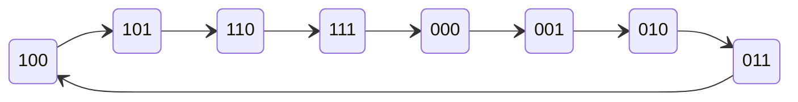
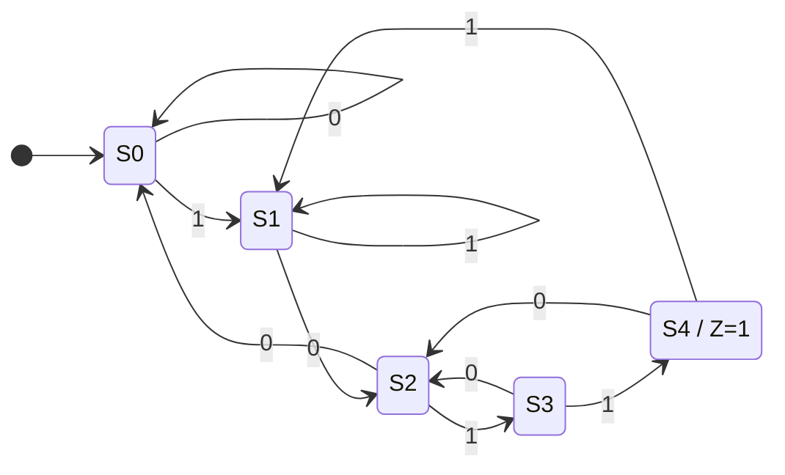
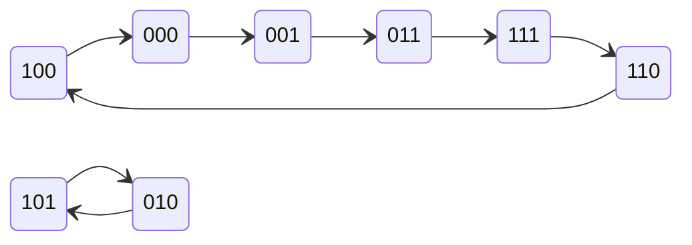

# 数字电路与逻辑 · 期末习题集（含答案与解析）

> 适用：哈尔滨理工大学《数字电路及逻辑》期末复习
> 依据：工作区 `试卷/` 内两份真题 —— **2021–2022 学年第二学期 A 卷**、**2019–2020 学年第二学期 A 卷**（均为 100 分钟、100 分）
> 覆盖：第 1–6 章全部内容

---

## 〇、使用说明与考情分析

### 1. 两份真题的实际结构

| 项目 | 2021–2022 A 卷 | 2019–2020 A 卷 |
|---|---|---|
| 考试时长 / 总分 | 100 分钟 / 100 分 | 100 分钟 / 100 分 |
| 一 | 填空题 10 分（7 题 10 空） | 简答题 32 分（6 问，每问 4 分） |
| 二 | 简答题 30 分（4 题） | TTL 与非门电路分析 8 分 |
| 三 | 时序电路分析 20 分（4 问） | 密码锁设计 20 分 |
| 四 | Moore 型原始状态图与状态表 10 分 | 时序电路分析 20 分（5 问） |
| 五 | 密码锁设计（与非门）15 分 | Verilog 霓虹灯控制器 20 分 |
| 六 | Verilog 1 位全加器 15 分 | — |

**结论**：命题框架高度稳定，永远是这五块——

```
① 基础填空/简答（进制码制、逻辑函数三形式、化简、触发器方程、555、三态门、门电路结构）
② 组合逻辑设计（密码锁类，用与非门实现）
③ 时序逻辑分析（写方程→状态表→状态图→说功能）
④ 状态图/状态表设计（序列检测，Moore 型）
⑤ Verilog 设计（全加器、移位类控制器）
```

### 2. 考点分布与分值权重

| 知识块 | 对应章节 | 真题中出现方式 | 估计分值 |
|---|---|---|---|
| 进制转换、码制、机器数 | 第 2 章 | 填空 / 简答 | 4–8 分 |
| 逻辑代数：反函数、对偶、标准形式 | 第 3 章 | 简答必考 | 8–12 分 |
| 卡诺图化简 | 第 3 章 | 简答必考 | 8–10 分 |
| 门电路内部结构（二极管门、TTL 与非门） | 第 2 章 | 填空 / 分析题 | 8 分 |
| 组合逻辑设计（密码锁） | 第 4 章 | 设计题必考 | 15–20 分 |
| 时序电路分析 | 第 5 章 | 分析题必考 | 20 分 |
| 状态图 / 状态表（序列检测） | 第 5 章 | 设计题 | 10 分 |
| 触发器状态方程 | 第 5 章 | 简答 | 6–10 分 |
| 555 定时器、集成运放（第 6 章新增） | 第 6 章 | 填空 / 简答 | 2–6 分 |
| Verilog HDL | 全课程 | 设计题必考 | 15–20 分 |

> **复习优先级**：时序分析（20 分）＝ 组合设计（15–20 分）＝ Verilog（15–20 分）＞ 化简与函数形式（18 分左右）＞ 基础概念填空。前三块拿下就是 55–60 分。

### 3. 关于本习题集的三点说明

- 本集共 **两套完整模拟卷（各 100 分）+ 一套第 6 章专项（50 分）**，题型、题量、分值严格对齐真题。
- **电路类题目一律用文字把连接关系写全**（如"三个 D 触发器，D₂ = Q₁"），不依赖模糊图片，保证你做题时信息完整、答案唯一可验。
- 每道题后的 **【考点】** 指向对应章节文件，**【拓展】** 是超出本题、但同源可考的相关知识，用来应对变式题。

---

# 模拟卷一（100 分）

> 题型对齐 2021–2022 A 卷

## 试题部分

### 一、填空题（每空 1 分，共 10 分）

1. $(34.5)_{10}=(\quad)_2=(\quad)_{16}$
2. 已知 $[X]_{原}=1.1101$，则 $[X]_{反}=(\quad)$，$[X]_{补}=(\quad)$。
3. 3-8 线译码器将 3 个输入变量变换成 ______ 个最小项输出。
4. 三态门是可以控制输出的门电路，控制端无效时，输出是 ______ 状态。
5. 555 定时器有两个阈值，分别是 ______ 和 ______。
6. 放大器处于开环工作状态，参考电压 $U_R$ 加在同相输入端，输入信号 $u_i$ 加到反相输入端，当 $u_i<U_R$ 时，$u_o=$ ______。
7. 下图中二极管阳极接输入 A、B，阴极共接后经电阻 $R_3$ 接 **负电源** $(-V_{CC})$，再经 $R_2$ 驱动 NPN 三极管，集电极经 $R_1$ 接 $+V_{CC}$ 并作为输出 F。该电路属于 ______ 逻辑门。

### 二、简答题（共 30 分）

1. （5 分）已知逻辑函数 $F=A\bar B+\bar AB$，写出其反函数 $\bar F$ 的逻辑表达。
2. （5 分）已知逻辑函数 $F=A\bar C+\bar BC$，写出其对偶函数 $F^D$ 的逻辑表达。
3. 化简下列函数（10 分）
   - （1）$F(A,B,C)=\sum m(0,1,2,3,4,5)$
   - （2）$F(A,B,C,D)=\sum m(0,2,4,6,8,10,12,14)$
4. （10 分）分别写出同步 RS 触发器、JK 触发器、T 触发器、T′ 触发器、D 触发器的状态方程（并注明 RS 的约束条件）。

### 三、分析下图所示时序电路（20 分）

**电路说明**：三个下降沿触发的 D 触发器 $FF_2、FF_1、FF_0$，输出为 $Q_2Q_1Q_0$，共用同一时钟 CP（同步电路）。各触发器输入：

$$
D_0=\bar Q_0,\qquad D_1=Q_1\oplus Q_0,\qquad D_2=Q_2\oplus(Q_1Q_0)
$$

输出 $Z=Q_2Q_1Q_0$。

（1）列出驱动方程和输出方程；
（2）求状态方程；
（3）列状态表，画状态图；
（4）说明电路功能。

### 四、（10 分）Moore 型原始状态图与状态表

设某同步时序电路输入为 $x$，输出为 $Z$。$x$ 为一组按时间顺序排列的串行二进制代码，当输入序列中出现 **1011** 时（高位先输入，允许重叠检测），输出 $Z$ 为 1，否则 $Z$ 为 0。试作出该电路的 **Moore 型原始状态图及状态表**。

### 五、（15 分）密码锁设计

保密锁有三个按键 A、B、C。**恰好两个键同时按下时开锁**；**只按下 A 一个键时，锁既不打开也不报警**；**其余情况一律报警**。设 F 为开锁信号（F=1 开锁），G 为报警信号（G=1 报警），要求用**与非门**实现，写出完整设计过程（逻辑抽象、真值表、化简、逻辑图）。

### 六、（15 分）Verilog 设计 1 位全加器

用 Verilog HDL 设计一个 1 位全加器，输入 $A$、$B$、$C_{in}$，输出 $S$（和）、$C_{out}$（进位）。要求分别用**连续赋值语句（数据流）**、**门级元件例化（结构化）**、**过程块（行为级）** 三种方式各写一个完整模块。

---

## 参考答案与解析

### 一、填空题

| 题号 | 答案 |
|---|---|
| 1 | $(100010.1)_2$ ； $(22.8)_{16}$ |
| 2 | $1.0010$ ； $1.0011$ |
| 3 | **8** |
| 4 | **高阻**（高阻态 / 悬浮态，Z 态） |
| 5 | $\dfrac{1}{3}V_{CC}$ ； $\dfrac{2}{3}V_{CC}$ |
| 6 | $+U_{om}$（正饱和输出电压） |
| 7 | **或非**（NOR） |

**第 1 题解析**：整数部分 34 = 32+2 = `100010`；小数部分 0.5 × 2 = 1.0，取整得 `1`，故二进制为 `100010.1`。十六进制按 4 位分组：`0010 0010 . 1000` → `22.8`。

**第 2 题解析**：原码 `1.1101` 表示负数，数值位为 `1101`。
- 反码：符号位不变，数值位逐位取反 → `1.0010`
- 补码：反码末位加 1 → `1.0011`

> **【拓展】** 若题目给的是补码求原码，规则相同（对负数：除符号位外取反加一，即"再求补"）。补码的 0 表示唯一（`0.0000`），原码和反码都有 +0 与 −0 两种，这是补码被计算机采用的根本原因。

**第 4 题解析**：三态门的输出有三种状态：高电平、低电平、高阻态。控制端（使能端 EN）无效时，输出级的两只管子同时截止，输出端呈高阻，相当于与负载断开。

> **【拓展】** 三态门最重要的用途是**总线结构**：多个三态门输出并接到同一根总线上，任何时刻只允许一个门处于工作态，其余全为高阻，从而避免输出短路冲突。这是"分时共享总线"的硬件基础。

**第 6 题解析**：$u_i$ 接反相端（$u_-$）、$U_R$ 接同相端（$u_+$）。$u_i<U_R$ 即 $u_-<u_+$，故 $u_+>u_-$，运放输出正向饱和 $+U_{om}$。

> **【拓展】** 若信号改从同相端输入，逻辑正好相反：$u_i>U_R$ 时输出 $+U_{om}$。判断口诀——**"同相端电位高，输出就高"**，与信号加在哪一端无关。

**第 7 题解析**：关键看两点。
1. **二极管极性**：阳极接输入、阴极共接，公共点经电阻接**负电源**。任一输入为高时，对应二极管导通，把公共点拉高；全为低时二极管截止，公共点被拉向负电源而呈低电平。即"任一高则高、全低才低" → 这是**或**的关系。
2. **三极管反相**：公共点高 → 基极电流大 → 三极管饱和导通 → 集电极输出低。所以最终 $F=\overline{A+B}$。

故为**或非门**。

> **【拓展·极重要的对照】** 若把 $R_3$ 改接**正电源** $+V_{CC}$，则二极管网络变成"全高才高、任一低则低"的**与**关系，再经三极管反相就是**与非门**。这就是经典的 **DTL 与非门**。**判断这类题的唯一要点是看偏置电阻接正电源还是负电源**，不要凭"看起来像"去猜。

---

### 二、简答题

#### 1. $F=A\bar B+\bar AB$，求 $\bar F$

**答案**：

$$
\bar F = AB+\bar A\bar B
$$

**解析**：$F$ 正是异或 $F=A\oplus B$。按德摩根定律展开：

$$
\bar F=\overline{A\bar B+\bar AB}=\overline{(A\bar B)}\cdot\overline{(\bar AB)}=(\bar A+B)(A+\bar B)
$$

展开：$\bar AA+\bar A\bar B+BA+B\bar B=\bar A\bar B+AB$。

**考点**：第 3 章 逻辑代数基础 —— 反演规则 / 德摩根定律。

> **【拓展】** 注意区分两个规则：
> - **反演规则**（求 $\bar F$）：与↔或、0↔1、**原变量↔反变量**、保持运算顺序。
> - **对偶规则**（求 $F^D$）：与↔或、0↔1、**变量保持不变**。
> 本题若改成"求对偶"，答案是 $F^D=(A+\bar B)(\bar A+B)$，与反函数形式恰好相同——因为 $A\oplus B$ 是"自对偶"函数。这正是考试爱考的陷阱。

#### 2. $F=A\bar C+\bar BC$，求 $F^D$

**答案**：

$$
F^D=(A+\bar C)(\bar B+C)
$$

**解析**：对偶规则——把式中所有"·"换成"+"、"+"换成"·"，0 和 1 互换，**变量（含反变量）原样不动**，运算先后顺序用括号保持。

$F=A\cdot\bar C+\bar B\cdot C$ → $F^D=(A+\bar C)\cdot(\bar B+C)$。

**考点**：第 3 章 —— 对偶规则。

> **【拓展】** 对偶规则的价值在于"公式成对出现"：若某等式成立，其对偶式必然也成立。例如 $A+AB=A$ 成立，对偶式 $A(A+B)=A$ 也成立。记公式时只需记一半，另一半用对偶推出来即可，能省大量记忆量。

#### 3. 卡诺图化简

**（1）$F(A,B,C)=\sum m(0,1,2,3,4,5)$**

**答案**：

$$
F=\bar A+\bar B
$$

**解析**：三变量卡诺图，$m_0\sim m_3$ 是 $A=0$ 的整行（4 格），$m_4、m_5$ 是 $A=1,B=0$ 的两格。

- 圈 1：整行 $A=0$（$m_0,m_1,m_2,m_3$）→ 化简为 $\bar A$
- 圈 2：$m_4,m_5$（$A=1,B=0$）→ 化简为 $A\bar B$

合并：$\bar A+A\bar B=\bar A+\bar B$（吸收律 $X+\bar XY=X+Y$）。

**（2）$F(A,B,C,D)=\sum m(0,2,4,6,8,10,12,14)$**

**答案**：

$$
F=\bar D
$$

**解析**：这 8 个最小项的二进制中 $D$ 位恒为 0（全是偶数），而 $A、B、C$ 取遍所有组合 → 卡诺图上正好是"$D=0$"的整个半区（8 格），化简为 $\bar D$。

**考点**：第 3 章 —— 卡诺图化简（格雷码排列、循环相邻、每圈须含新 1）。

> **【拓展】** 快速判断技巧：
> - 最小项全为**偶数** → 结果含 $\bar D$；全为**奇数** → 含 $D$。
> - $\sum m$ 覆盖"连续一半"的编号段 → 往往只剩一个变量。
> 另外，**无关项（d）** 可以圈也可以不圈，目的是让圈更大。真题若给 $\sum m(\cdots)+\sum d(\cdots)$，记得把 d 当"万能牌"用。

#### 4. 五种触发器的状态方程

| 触发器 | 状态方程 | 约束 / 说明 |
|---|---|---|
| 同步 RS | $Q^{n+1}=S+\bar RQ^n$ | $SR=0$（不能同时为 1） |
| JK | $Q^{n+1}=J\bar Q^n+\bar KQ^n$ | 无约束，$J=K=1$ 时翻转 |
| T | $Q^{n+1}=T\oplus Q^n$ | $T=1$ 翻转，$T=0$ 保持 |
| T′ | $Q^{n+1}=\bar Q^n$ | 每来一个 CP 必翻转（$T\equiv1$） |
| D | $Q^{n+1}=D$ | 次态直接等于输入 |

**考点**：第 5 章 时序逻辑电路 —— 触发器特性方程。

> **【拓展】** 三者关系：
> - **T′ = T 触发器在 T≡1 时的特例**，所以 T′ 也叫"翻转触发器"，计数器里每位都用它。
> - **JK 接成 T**：$J=K=T$ 时 $Q^{n+1}=T\bar Q^n+\bar TQ^n=T\oplus Q^n$。
> - **JK 接成 D**：$J=D,\ K=\bar D$ 时 $Q^{n+1}=D\bar Q+\bar{\bar D}Q=D(\bar Q+Q)=D$。
> 这三种互转是设计题里"用一种触发器实现另一种"的标准手法。

---

### 三、时序电路分析（20 分）

#### （1）驱动方程与输出方程

$$
\begin{cases}
D_0=\bar Q_0\\
D_1=Q_1\oplus Q_0\\
D_2=Q_2\oplus(Q_1Q_0)
\end{cases}
\qquad Z=Q_2Q_1Q_0
$$

时钟方程：$CP_0=CP_1=CP_2=CP$（同步电路，故时钟方程可省略，但**异步电路必须写**）。

#### （2）状态方程

D 触发器的特性方程是 $Q^{n+1}=D$，把驱动方程直接代入：

$$
\begin{cases}
Q_0^{n+1}=\bar Q_0^n\\
Q_1^{n+1}=Q_1^n\oplus Q_0^n\\
Q_2^{n+1}=Q_2^n\oplus(Q_1^nQ_0^n)
\end{cases}
$$

#### （3）状态表

| 现态 $Q_2^nQ_1^nQ_0^n$ | 次态 $Q_2^{n+1}Q_1^{n+1}Q_0^{n+1}$ | $Z$ |
|---|---|---|
| 000 | 001 | 0 |
| 001 | 010 | 0 |
| 010 | 011 | 0 |
| 011 | 100 | 0 |
| 100 | 101 | 0 |
| 101 | 110 | 0 |
| 110 | 111 | 0 |
| 111 | 000 | **1** |

**逐状态验算**（考试时列成这样最不容易错）：

| 现态 | $Q_0^{n+1}=\bar Q_0$ | $Q_1^{n+1}=Q_1\oplus Q_0$ | $Q_2^{n+1}=Q_2\oplus Q_1Q_0$ | 次态 |
|---|---|---|---|
| 000 | 1 | 0⊕0=0 | 0⊕0=0 | 001 |
| 001 | 0 | 0⊕1=1 | 0⊕(0·1)=0 | 010 |
| 010 | 1 | 1⊕0=1 | 0⊕(1·0)=0 | 011 |
| 011 | 0 | 1⊕1=0 | 0⊕(1·1)=1 | 100 |
| 100 | 1 | 0⊕0=0 | 1⊕(0·0)=1 | 101 |
| 101 | 0 | 0⊕1=1 | 1⊕(0·1)=1 | 110 |
| 110 | 1 | 1⊕0=1 | 1⊕(1·0)=1 | 111 |
| 111 | 0 | 1⊕1=0 | 1⊕(1·1)=0 | 000 |

**状态图**：



（$Z=1$ 只在状态 111 时成立）

#### （4）电路功能

八个状态 `000→001→010→011→100→101→110→111→000` 构成**唯一的一个完整循环**，全部 8 个状态都被用上，因此：

**该电路是一个 3 位同步二进制加法计数器，模为 8（八进制计数器），且能自启动。**

输出 $Z=Q_2Q_1Q_0$ 仅在状态 `111` 时为 1，即计满时给出一个高电平——这正是**进位输出**（相当于集成计数器 74161 的 RCO 端）。所以 $Z$ 也可以理解为"**模 8 进位/溢出标志**"，同时它还是 $CP$ 的 **8 分频**信号。

**考点**：第 5 章 —— 5.2 时序逻辑电路的分析方法。

> **【拓展·为什么这道题值得反复做】**
> - 三个驱动方程 $\bar Q_0$、$Q_1\oplus Q_0$、$Q_2\oplus Q_1Q_0$ 就是**二进制计数的"逐级进位"逻辑**：最低位每拍必翻，第 1 位在低 1 位为 1 时翻转，第 2 位在低 2 位全 1 时翻转。看懂这个结构可以**直接判定它是二进制计数器**，不必逐状态算。
> - **自启动的判据是"所有状态都在有效循环内"**。本题 8 个状态一个不落，天然自启动；若某个状态指向循环之外，就必须修改设计。
> - 分析题的答题顺序固定为：**驱动方程 → 状态方程 → 状态表 → 状态图 → 功能**，五步缺一扣分。题目若给的是异步电路，还要在第一步补上**时钟方程**。

---


### 四、Moore 型原始状态图与状态表（10 分）

#### 解题思路

Moore 型的特点：**输出只与现态有关，与当前输入无关**。所以输出写在"状态圈内"，不写在转移箭头上；这也意味着——**检测到目标序列的那个状态本身就带输出 1**。

状态定义（表示"目前已匹配到目标序列的哪个前缀"）：

| 状态 | 含义 |
|---|---|
| $S_0$ | 尚未匹配任何有效前缀（初态） |
| $S_1$ | 已收到 `1` |
| $S_2$ | 已收到 `10` |
| $S_3$ | 已收到 `101` |
| $S_4$ | 已收到 `1011`（**输出 Z=1**） |

#### 状态表

| 现态 | $x=0$ 次态 | $x=1$ 次态 | 输出 $Z$ |
|---|---|---|---|
| $S_0$ | $S_0$ | $S_1$ | 0 |
| $S_1$ | $S_2$ | $S_1$ | 0 |
| $S_2$ | $S_0$ | $S_3$ | 0 |
| $S_3$ | $S_2$ | $S_4$ | 0 |
| $S_4$ | $S_2$ | $S_1$ | **1** |

#### 状态图



#### 关键转移的推导（易错处）

- $S_1 \xrightarrow{1} S_1$：已收 `1`，再来 `1`，串为 `11`，最长有效后缀仍是 `1` → 回到 $S_1$（**不能回到 $S_0$**）。
- $S_2 \xrightarrow{0} S_0$：已收 `10`，再来 `0`，串为 `100`，后缀 `0`、`00` 都不是 `1011` 的前缀 → $S_0$。
- $S_3 \xrightarrow{0} S_2$：串为 `1010`，后缀 `10` 是目标前缀 → $S_2$（**不是 $S_0$**，这是最容易错的一步）。
- $S_4 \xrightarrow{0} S_2$：串为 `10110`，后缀 `10` 是前缀 → $S_2$。
- $S_4 \xrightarrow{1} S_1$：串为 `10111`，后缀 `1` 是前缀 → $S_1$。

**考点**：第 5 章 —— 5.3 同步时序逻辑电路的设计（状态图的建立）。

> **【拓展】** 三个必须分清的概念：
> - **Moore 型**：输出仅与状态有关，状态数一般比 Mealy 多 1 个，输出与输入"错开一拍"。
> - **Mealy 型**：输出与状态和输入都有关，输出画在箭头上，状态数更少。
> - **允许重叠 / 不允许重叠**：本题允许重叠（`1011011` 中能检出两次）。若题目说"检测到后重新开始"，则 $S_4$ 的所有转移都回 $S_0$。
>
> 另外，**原始状态图不必最小化**。题目说"原始"，就是让你按"已匹配前缀长度"直觉地画，后面才做状态化简。

---

### 五、密码锁设计（15 分）

#### 1. 逻辑抽象

三个输入 A、B、C（按下为 1），两个输出 F（开锁）、G（报警）。

#### 2. 真值表

| A | B | C | 含义 | F | G |
|---|---|---|---|---|---|
| 0 | 0 | 0 | 无键按下 | 0 | 1 |
| 0 | 0 | 1 | 仅 C | 0 | 1 |
| 0 | 1 | 0 | 仅 B | 0 | 1 |
| 0 | 1 | 1 | 按 B、C（恰好两个） | **1** | 0 |
| 1 | 0 | 0 | **仅 A** | **0** | **0** |
| 1 | 0 | 1 | 按 A、C（恰好两个） | **1** | 0 |
| 1 | 1 | 0 | 按 A、B（恰好两个） | **1** | 0 |
| 1 | 1 | 1 | 三个全按 | 0 | 1 |

由表得：

$$
F=\sum m(3,5,6),\qquad G=\sum m(0,1,2,7)
$$

#### 3. 化简

**F 的卡诺图**：$m_3=011,\ m_5=101,\ m_6=110$ 三者互不相邻，**无法合并**，故

$$
F=\bar ABC+A\bar BC+AB\bar C
$$

**G 的卡诺图**：$m_0=000,\ m_1=001,\ m_2=010$ 可两两合并，$m_7=111$ 孤立。

- $m_0+m_1$：$A=0,B=0$ → $\bar A\bar B$
- $m_0+m_2$：$A=0,C=0$ → $\bar A\bar C$
- $m_7$：$ABC$

$$
G=\bar A\bar B+\bar A\bar C+ABC
$$

**校验**：$\bar A\bar B$ 覆盖 {0,1}，$\bar A\bar C$ 覆盖 {0,2}，$ABC$ 覆盖 {7}，并集恰为 {0,1,2,7} ✓

#### 4. 用与非门实现

把每个与项和整体都化成"与非—与非"形式（两次取反）：

$$
F=\overline{\overline{\bar ABC}\cdot\overline{A\bar BC}\cdot\overline{AB\bar C}}
$$

$$
G=\overline{\overline{\bar A\bar B}\cdot\overline{\bar A\bar C}\cdot\overline{ABC}}
$$

**逻辑图文字描述**：

```
F 支路：
  非门 ×3 产生 Ā、B̄、C̄
  与非门 N1(Ā,B,C)  N2(A,B̄,C)  N3(A,B,C̄)
  与非门 N4(N1,N2,N3) → F

G 支路：
  与非门 N5(Ā,B̄)  N6(Ā,C̄)  N7(A,B,C)
  与非门 N8(N5,N6,N7) → G
```

共需：非门 3 个、三输入与非门 3 个（N1、N2、N3）、二/三输入与非门 3 个（N5、N6、N7）、二输入和大与非门 2 个（N4、N8）。

#### 5. 设计过程小结（答题模板）

```
① 逻辑抽象：定义输入输出变量含义
② 列真值表：穷举 2^n 种输入组合
③ 写最小项之和：从真值表读出 F=Σm(...)
④ 卡诺图化简：得最简与或式
⑤ 变换形式：与非—与非式（两次取反）
⑥ 画逻辑图：按式子连线，标注器件型号
```

**考点**：第 4 章 —— 组合逻辑电路的分析与设计。

> **【拓展】** 三个得分细节：
> - **"恰好两个"是异或家族的典型特征**。$\sum m(3,5,6)$ 也叫"三变量多数函数的补"，它的化简结果必须保持三项，不能消项——如果化简后只剩两项，一定是圈错了。
> - **"仅按 A 不报警"这类特殊约定必须体现在真值表里**（第 5 行 F=0、G=0），不能漏，否则 G 的化简会多出一项。
> - 题目要求"用与非门"，就**必须最后化成与非—与非式**，只写与或式要扣分。

---

### 六、Verilog 1 位全加器（15 分）

#### 基本关系

$$
S=A\oplus B\oplus C_{in},\qquad C_{out}=AB+AC_{in}+BC_{in}
$$

#### 写法一：数据流（连续赋值）

```verilog
module full_adder_df (
    input  A,
    input  B,
    input  Cin,
    output S,
    output Cout
);
    // 和：三个输入异或
    assign S    = A ^ B ^ Cin;
    // 进位：三个"两两相与"项相或，即多数表决
    assign Cout = (A & B) | (A & Cin) | (B & Cin);
endmodule
```

#### 写法二：结构化（门级元件例化）

```verilog
module full_adder_gate (
    input  A,
    input  B,
    input  Cin,
    output S,
    output Cout
);
    wire s1, c1, c2, c3;

    // 第一级：半个加法的雏形
    xor u_x1 (s1, A, B);        // s1 = A ⊕ B
    and u_a1 (c1, A, B);        // c1 = A · B

    // 第二级：把 Cin 并入
    xor u_x2 (S,  s1, Cin);     // S  = s1 ⊕ Cin
    and u_a2 (c2, s1, Cin);     // c2 = s1 · Cin

    // 进位汇合
    or  u_o1 (Cout, c1, c2);    // Cout = c1 + c2
endmodule
```

#### 写法三：行为级（过程块）

```verilog
module full_adder_bh (
    input  A,
    input  B,
    input  Cin,
    output reg S,
    output reg Cout
);
    // 组合逻辑用 always @(*)，敏感表包含全部输入
    always @(*) begin
        case ({A, B, Cin})
            3'b000: begin S = 1'b0; Cout = 1'b0; end
            3'b001: begin S = 1'b1; Cout = 1'b0; end
            3'b010: begin S = 1'b1; Cout = 1'b0; end
            3'b011: begin S = 1'b0; Cout = 1'b1; end
            3'b100: begin S = 1'b1; Cout = 1'b0; end
            3'b101: begin S = 1'b0; Cout = 1'b1; end
            3'b110: begin S = 1'b0; Cout = 1'b1; end
            3'b111: begin S = 1'b1; Cout = 1'b1; end
        endcase
    end
endmodule
```

#### 写法四：超前进位（加分项）

```verilog
module full_adder_cla (
    input  A, B, Cin,
    output S, Cout
);
    wire p, g;                  // p=传播, g=生成
    assign p    = A ^ B;
    assign g    = A & B;
    assign S    = p ^ Cin;
    assign Cout = g | (p & Cin); // 与上面等价，但层级更浅
endmodule
```

**考点**：第 4 章 —— 加法器；Verilog HDL 基础语法。

> **【拓展】** 考试常问的四个点：
> - **`assign` 是并行语句**，多条之间无先后之分；`always @(*)` 是过程块，内部语句按顺序执行，因此组合逻辑里要用 **阻塞赋值 `=`**（若用 `<=` 会综合出锁存器）。
> - **`output reg`**：过程块中赋值的输出必须声明为 `reg`，用 `assign` 的则声明为 `wire`。
> - **1 位全加器级联**可构成 4 位行波进位加法器，但进位要逐级传递，**延迟随位数线性增长**；改用超前进位（CLA）后延迟只与级数对数相关。
> - 判分点通常是：端口声明对不对、`S` 和 `Cout` 表达式是否正确、模块名与文件名是否一致。

---

# 模拟卷二（100 分）

> 题型对齐 2019–2020 A 卷

## 试题部分

### 一、简答题（每问 4 分，共 32 分）

1. 将十进制数 367 分别转换成二进制数和十六进制数，要写出过程。
2. 已知逻辑函数 $F(A,B,C)=A\bar B+\bar AC+BC$，写出其反函数和对偶函数的逻辑表达式。
3. 写出下式的标准积之和（最小项之和）表达式：$F(A,B,C)=AB+AC$。
4. 化简函数：$F(A,B,C)=A\bar C+AB\bar C+\bar ABC+BC$。
5. 简述 555 定时器的组成。
6. 简述什么是三态门，及其工作原理。

### 二、分析下图逻辑功能，并说明其工作过程（8 分）

**电路说明**：标准 5 管 TTL 与非门。输入级为多发射极三极管 $T_1$（发射极分别接 A、B），中间级为 $T_2$（分相），输出级由 $T_3$、$T_4$ 组成的推拉式电路与 $T_5$ 反相器构成，$R_1\sim R_4$ 为各管偏置电阻。输出为 $Y$。

### 三、保密锁设计（20 分）

保密锁有三个按键 A、B、C。**只有 A 单独按下时，锁既不打开也不报警**；**A、B、C 同时按下，或 A 与 B、A 与 C 同时按下时，锁才能打开**；**不符合上述组合状态时发出报警**。设 F 为开锁信号，G 为报警信号，设计该组合电路并写出设计过程（不限定器件）。

### 四、分析下图所示时序电路（20 分）

**电路说明**：三个下降沿触发的 D 触发器 $FF_2、FF_1、FF_0$，输出 $Q_2Q_1Q_0$，共用同一 CP。各触发器的 D 端**直接取自其他触发器的输出**（中间无门电路）：

$$
D_2=Q_1,\qquad D_1=Q_0,\qquad D_0=\bar Q_2
$$

输出 $Z=Q_2Q_1Q_0$。

（1）确定是 Mealy 型还是 Moore 型电路；
（2）列出输出方程；
（3）列出各触发器的驱动方程；
（4）求状态方程；
（5）列状态表，画状态图，并判断电路能否自启动。

### 五、Verilog 设计（20 分）

用 Verilog HDL 设计一个 **8 位霓虹灯控制器**，实现霓虹灯**暗点（低电平）循环左移**，带**异步复位清零**（低电平有效），用**同步信号 load**（高电平有效）设定初始值为 `8'h7F`，时钟为 `CLK`。工程模块名用**你名字的拼音首字母**，写出完整代码。

---

## 参考答案与解析

### 一、简答题

#### 1. 367 转二进制与十六进制

**答案**：

$$
(367)_{10}=(101101111)_2=(16F)_{16}
$$

**过程（除 2 取余，逆序排列）**：

| 除数 | 商 | 余数 |
|---|---|---|
| 367÷2 | 183 | **1** |
| 183÷2 | 91 | **1** |
| 91÷2 | 45 | **1** |
| 45÷2 | 22 | **1** |
| 22÷2 | 11 | **0** |
| 11÷2 | 5 | **1** |
| 5÷2 | 2 | **1** |
| 2÷2 | 1 | **0** |
| 1÷2 | 0 | **1** |

自下而上读余数：`101101111`。

转十六进制：补足 4 位一组 → `0001 0110 1111` → `1 6 F` → `(16F)₁₆`。

**校验**：$1\times256+6\times16+15=256+96+15=367$ ✓

**考点**：第 2 章 —— 数制转换。

> **【拓展】** 二进制↔十六进制是"4 位一组"，二进制↔八进制是"3 位一组"。若题目要求"写出过程"，**除 2 取余的竖式必须写出来**，只写结果要扣分。反过来，十进制小数用"乘 2 取整，顺序排列"。

#### 2. 反函数与对偶函数

$F=A\bar B+\bar AC+BC$

**反函数**：

$$
\bar F=(\bar A+B)(A+\bar C)(\bar B+\bar C)
$$

**对偶函数**：

$$
F^D=(A+\bar B)(\bar A+C)(B+C)
$$

**解析**：
- 求反函数用**德摩根定律**：$\overline{X+Y}=\bar X\bar Y$，$\overline{XY}=\bar X+\bar Y$。逐项取反再乘：
  $\overline{A\bar B}=\bar A+B$，$\overline{\bar AC}=A+\bar C$，$\overline{BC}=\bar B+\bar C$
- 求对偶函数用**对偶规则**：与↔或、0↔1，**变量不动**：
  $A\bar B+\bar AC+BC \Rightarrow (A+\bar B)(\bar A+C)(B+C)$

**考点**：第 3 章 —— 反演规则与对偶规则。

> **【拓展】** 这两个结果形式相同，但**推导依据完全不同**，是经典易错点。判断方法：若题目只把"·"变"+"、变量原样保留，那是**对偶**；若同时把变量取反，那是**反演**。可以自查：$\bar F$ 与 $F^D$ 在本题恰好同形，是因为 $F$ 中每个变量在各乘积项里出现的极性组合比较"对称"，并非规律。

#### 3. 标准积之和

**答案**：

$$
F(A,B,C)=AB+AC=\sum m(5,6,7)
$$

**解析**：标准积之和要求**每个乘积项都包含全部变量**。补缺失变量（$X=X(Y+\bar Y)$）：

- $AB=AB(C+\bar C)=ABC+AB\bar C$
- $AC=AC(B+\bar B)=ABC+A\bar BC$

合并同类项：

$$
F=ABC+AB\bar C+A\bar BC
$$

对应最小项：$ABC\to111\to m_7$；$AB\bar C\to110\to m_6$；$A\bar BC\to101\to m_5$。

**考点**：第 3 章 —— 逻辑函数的标准形式。

> **【拓展】** 标准与或式（最小项之和）与标准或与式（最大项之积）互为补：若 $F=\sum m_i$，则 $F=\prod M_j$（$j$ 为未出现的编号）。例如本题 $F=\sum m(5,6,7)=\prod M(0,1,2,3,4)$。这个转换在"用译码器+与非门实现"的题目里极其常用。

#### 4. 化简 $F=A\bar C+AB\bar C+\bar ABC+BC$

**答案**：

$$
F=A\bar C+BC
$$

**解析**：逐步用吸收律与并项法。

$$
\begin{aligned}
F&=A\bar C+AB\bar C+\bar ABC+BC\\
&=A\bar C(1+B)+\bar ABC+BC &&\text{（提取 }A\bar C\text{）}\\
&=A\bar C+\bar ABC+BC &&\text{（}1+B=1\text{）}\\
&=A\bar C+BC(\bar A+1) &&\text{（}\bar ABC+BC=BC(\bar A+1)\text{）}\\
&=A\bar C+BC &&\text{（}\bar A+1=1\text{）}
\end{aligned}
$$

结果 $A\bar C+BC$ 已是最简与或式（两项分别为 2 变量，且不存在可消去的共识项）。

**考点**：第 3 章 —— 公式化简法（吸收律 $X+XY=X$、并项 $X+\bar XY=X+Y$）。

> **【拓展】** 常用化简公式清单：
> - 吸收：$A+AB=A$，$A(A+B)=A$
> - 消去：$A+\bar AB=A+B$，$A(\bar A+B)=AB$
> - 并项：$AB+A\bar B=A$，$(A+B)(A+\bar B)=A$
> - 冗余（共识）：$AB+\bar AC+BC=AB+\bar AC$（$BC$ 为冗余项）
> 最后这条正是第 4 章"竞争冒险"中"加冗余项消除冒险"的理论依据。

#### 5. 555 定时器的组成

**答案要点**（答全给满分）：

555 定时器内部由五部分构成：

1. **电阻分压器**：三个 5 kΩ 电阻串联在 $V_{CC}$ 与地之间（"555"之名由此而来），得到 $\frac{1}{3}V_{CC}$ 与 $\frac{2}{3}V_{CC}$ 两个基准电压。
2. **两个电压比较器**：$A_1$ 反相端接 $\frac{2}{3}V_{CC}$、同相端接高触发端 TH（6 脚）；$A_2$ 同相端接 $\frac{1}{3}V_{CC}$、反相端接低触发端 TL（2 脚）。
3. **基本 RS 触发器**：接收两比较器输出，决定电路状态，并控制放电管。
4. **放电开关（放电三极管 TD）**：接在放电端 DIS（7 脚）与地之间，输出为低时导通、为高时截止。
5. **输出缓冲级**：提高带负载能力，输出端为 3 脚。

**考点**：第 6 章 —— 6.3 集成 555 定时器。

> **【拓展】** 顺着"组成"往下问，通常会考三件事：
> - **两个阈值**：$\frac{1}{3}V_{CC}$（2 脚低于此值置位，输出高）、$\frac{2}{3}V_{CC}$（6 脚高于此值复位，输出低）。
> - **5 脚（CV）的作用**：外接电压可同时改变两个阈值，用于调频或做压控振荡器。
> - **三种典型接法**：2、6 并接于电容+7 脚接两电阻之间 → 多谐振荡器；2、6 并接于输入+7 脚悬空 → 施密特触发器；2 脚接触发+6、7 接电容 → 单稳态触发器。

#### 6. 三态门及其工作原理

**答案**：

**定义**：三态门（Three-State Gate）是输出具有**高电平、低电平、高阻态**三种状态的逻辑门。它比普通门多一个**使能端（EN）**。

**工作原理**：
- EN 有效时，门电路正常工作，输出按逻辑关系为高或低；
- EN 无效时，输出级的**上拉管与下拉管同时截止**，输出端与电源和地都断开，呈**高阻态**（相当于悬空）。

**主要用途**：构成**总线结构**——多个三态门的输出并接到同一根数据总线上，任何时刻只允许一个门使能，其余全部处于高阻，避免输出端直接相连造成短路。

**考点**：第 2 章 —— 数字电路基础 / 门电路。

> **【拓展】** 常见三态门有两种控制极性：**高电平有效**（EN=1 工作）和**低电平有效**（$\overline{EN}=0$ 工作）。总线应用时必须保证**同一时刻至多一个使能**，否则会出现"两个门一个输出高、一个输出低"的短路状态，可能烧毁器件。工程上这叫"总线竞争"，是硬件调试的经典故障。

---

### 二、TTL 与非门逻辑功能分析（8 分）

#### 逻辑功能

$$
Y=\overline{AB}
$$

即**二输入与非门**。

#### 工作过程分析

**① 输入端有一个为低电平（如 A=0.3 V）**

- $T_1$ 的 A 发射结正偏导通，把 $T_2$ 基极电位钳在约 **0.7 V**（$0.3+0.7$）；
- $T_2$ 要导通需要基极约 1.4 V，故 $T_2$ **截止**；
- $T_2$ 截止 → $T_5$ 基极为低 → $T_5$ **截止**（相当于输出端下拉通路断开）；
- 同时 $T_2$ 集电极电位升高 → $T_3$、$T_4$ 导通 → 输出 $Y$ 被上拉到高电平 $Y\approx 3.6\,\mathrm{V}$（扣除两个 PN 结压降）。

**结论**：输入有低 → 输出高。

**② 输入端全为高电平（A=B=3.6 V）**

- $T_1$ 的两个发射结都反偏（或电流极小），$T_1$ 的集电结**正偏**，电流经 $T_1$ 集电结灌入 $T_2$ 基极；
- $T_2$ 饱和导通 → $T_5$ 基极获得电流 → $T_5$ 饱和导通 → 输出被拉到低电平 $Y\approx 0.3\,\mathrm{V}$；
- 同时 $T_2$ 集电极电位降低 → $T_3$ 微导通、$T_4$ 截止（$T_4$ 基极被 $T_2$ 集电极拉低），上拉通路断开。

**结论**：输入全高 → 输出低。

**③ 综上**：只有 A、B 全为 1 时输出才为 0，故 $Y=\overline{AB}$，为**与非门**。

**考点**：第 2 章 —— TTL 集成门电路。

> **【拓展】** 三个容易被追问的点：
> - **为什么用多发射极三极管？** 它等效于多个二极管的"与"功能，把输入端的"与"和反相合并，节省器件、提高速度。
> - **推拉式输出（$T_3$、$T_4$ 与 $T_5$）的优点**：无论输出高还是低，都只有一个管子导通，静态功耗小、带负载能力强、开关速度快。
> - **为什么 TTL 不能"线与"？** 推拉输出直接并接时，一个输出高、一个输出低会形成大电流通路烧管。要"线与"必须用 **OC 门（集电极开路）** 或 **三态门**，外接上拉电阻。

---

### 三、保密锁设计（20 分）

#### 1. 逻辑抽象

输入：A、B、C（1 表示按下）；输出：F（1 开锁）、G（1 报警）。

#### 2. 真值表

题意拆解：
- **开锁**：ABC 全按（111）、AB 同按（110）、AC 同按（101）→ 注意 110 与 101 都属于"含 A 且另有一个"
- **仅按 A**（100）：不报警也不开锁
- **其余**：报警

| A | B | C | 含义 | F | G |
|---|---|---|---|---|---|
| 0 | 0 | 0 | 无 | 0 | 1 |
| 0 | 0 | 1 | 仅 C | 0 | 1 |
| 0 | 1 | 0 | 仅 B | 0 | 1 |
| 0 | 1 | 1 | B、C（无 A） | 0 | 1 |
| 1 | 0 | 0 | **仅 A** | **0** | **0** |
| 1 | 0 | 1 | A、C | **1** | 0 |
| 1 | 1 | 0 | A、B | **1** | 0 |
| 1 | 1 | 1 | A、B、C | **1** | 0 |

$$
F=\sum m(5,6,7),\qquad G=\sum m(0,1,2,3)
$$

#### 3. 卡诺图化简

**F**：$m_5(101)+m_7(111)$ 相邻（$B$ 变化）→ $A C$；$m_6(110)+m_7(111)$ 相邻（$C$ 变化）→ $AB$。

$$
F=AC+AB=A(B+C)
$$

**G**：$m_0\sim m_3$ 是 $A=0$ 的整行（4 格）→

$$
G=\bar A
$$

**非常漂亮的结论**：只要 A 没按下（且不属于例外），就报警。注意 $m_4$（仅 A）被排除在外，而 $m_4$ 有 $A=1$，所以 $G=\bar A$ 恰好不影响 $m_4$ ✓

**校验**：$G=\bar A$ 覆盖 {0,1,2,3}，与 $\sum m(0,1,2,3)$ 完全一致 ✓

#### 4. 逻辑图

```
F = A(B + C)   →  与门/或门实现：
    B、C 接或门 → 输出接与门一端
    A 接与门另一端 → F

G = Ā          →  非门：A 经非门 → G
```

若不限定器件，用 **1 个二输入或门 + 1 个二输入与门 + 1 个非门** 即可，共 3 个门。

#### 5. 设计过程（答题顺序）

```
逻辑抽象 → 真值表 → 最小项之和 → 卡诺图化简 → 表达式 → 逻辑图
```

**考点**：第 4 章 —— 组合逻辑电路的设计。

> **【拓展】** 对比 2021–2022 卷第 5 题（同样三键密码锁），可以看出命题者的套路：**改变"开锁组合"和"例外条件"，但设计流程完全不变**。掌握"先列全 8 行真值表、再圈卡诺图"这条主线，这类题无论怎么变都能拿下。
>
> 另外注意：本题 $G=\bar A$ 只用一个非门，是命题者刻意设计的"化简收益极大"的情况。**化简做对了会大幅减少器件数**，这也是评分点。

---

### 四、时序电路分析（20 分）

#### （1）Mealy 型还是 Moore 型

输出 $Z=Q_2Q_1Q_0$ **只取决于触发器状态，与输入无关**，故为 **Moore 型** 电路。

#### （2）输出方程

$$
Z=Q_2Q_1Q_0
$$

#### （3）驱动方程

$$
D_2=Q_1,\qquad D_1=Q_0,\qquad D_0=\bar Q_2
$$

时钟方程：$CP_0=CP_1=CP_2=CP$（同步电路）。

#### （4）状态方程

D 触发器 $Q^{n+1}=D$：

$$
\begin{cases}
Q_2^{n+1}=Q_1^n\\
Q_1^{n+1}=Q_0^n\\
Q_0^{n+1}=\bar Q_2^n
\end{cases}
$$

#### （5）状态表

| 现态 $Q_2^nQ_1^nQ_0^n$ | $Q_2^{n+1}=Q_1$ | $Q_1^{n+1}=Q_0$ | $Q_0^{n+1}=\bar Q_2$ | 次态 | $Z$ |
|---|---|---|---|---|---|
| 000 | 0 | 0 | 1 | 001 | 0 |
| 001 | 0 | 1 | 1 | 011 | 0 |
| 010 | 1 | 0 | 1 | 101 | 0 |
| 011 | 1 | 1 | 1 | 111 | 0 |
| 100 | 0 | 0 | 0 | 000 | 0 |
| 101 | 0 | 1 | 0 | 010 | 0 |
| 110 | 1 | 0 | 0 | 100 | 0 |
| 111 | 1 | 1 | 0 | 110 | **1** |

**状态表**：

| 现态 | 次态 | $Z$ |
|---|---|---|
| 000 | 001 | 0 |
| 001 | 011 | 0 |
| 011 | 111 | 0 |
| 111 | 110 | **1** |
| 110 | 100 | 0 |
| 100 | 000 | 0 |
| 010 | 101 | 0 |
| 101 | 010 | 0 |

**状态图**：



#### 电路功能与自启动判断

- **有效循环**：`000→001→011→111→110→100→000`，共 **6 个状态** → 这是一个 **模 6 的扭环形（Johnson）计数器**。
- **无效循环**：`010⇄101` 自成一对，**无法回到有效循环** → **不能自启动**。
- 上电后若触发器落入 `010` 或 `101`，电路将在这两个状态间反复振荡，永远进不了计数主循环。

**改进办法**（任选其一）：

1. **置数法**：检测到 `010` 或 `101` 时，把触发器置为 `000`。检测条件为 $\bar Q_2Q_1\bar Q_0+\bar Q_2\bar Q_1Q_0=\bar Q_2(Q_1\oplus Q_0)$。
2. **改写 $D_0$**：令 $D_0=\bar Q_2+Q_1\bar Q_0$，使无效态指向有效循环，不增加器件。

**考点**：第 5 章 —— 时序逻辑电路分析（Mealy/Moore 判别、方程 → 表 → 图 → 功能 → 自启动）。

> **【拓展·与卷一那道题的对照】** 两套卷故意放了两种典型结构：
> - **卷一**：$D_0=\bar Q_0,\ D_1=Q_1\oplus Q_0,\ D_2=Q_2\oplus Q_1Q_0$ —— 二进制"逐级进位"，**8 态全用、天然自启动**。
> - **卷二**：$D_2=Q_1,\ D_1=Q_0,\ D_0=\bar Q_2$ —— 移位型"首尾反接"，构成**扭环形计数器**，6 态成环、2 态游离，**必须检查自启动**。
>
> 判别的经验：**驱动方程里出现"Q 右移 + 首尾取反"就是扭环形**（模 $2n$，此处 $2\times3=6$）；**出现"异或 + 与"的进位链就是二进制计数器**（模 $2^n$）。

---

### 五、Verilog 8 位霓虹灯控制器（20 分）

**题意拆解**：
- 输出 8 位，**暗点=低电平**，其余为高 → 初值 `8'h7F`（`0111_1111`，最低位为 0，即最低位是"暗点"）
- **循环左移**：`0111_1111 → 1111_1110 → 1111_1101 → ...`（0 从低位向高位移动）
- **异步复位清零**：`rst_n` 低电平有效，立即清零
- **同步 load**：`load` 高电平有效，在时钟沿把初值装入
- 模块名用姓名拼音首字母

```verilog
// 模块名示例：张三 → zs_led_ctrl（请按自己姓名首字母修改）
module zs_led_ctrl (
    input        CLK,      // 时钟
    input        rst_n,    // 异步复位，低电平有效
    input        load,     // 同步置初值，高电平有效
    output reg [7:0] led   // 8 位输出，低电平为暗点
);

    // 初值：最低位为暗点，其余全亮
    localparam [7:0] INIT = 8'h7F;

    // 异步复位：敏感表中要包含 rst_n，且为低电平触发
    always @(posedge CLK or negedge rst_n) begin
        if (!rst_n) begin
            led <= 8'hFF;          // 复位清零 → 全灭（低电平为暗点，故全 1 为全灭）
        end
        else if (load) begin
            led <= INIT;           // 同步装入初值
        end
        else begin
            // 循环左移：最高位移入最低位
            led <= {led[6:0], led[7]};
        end
    end

endmodule
```

**若"复位清零"理解为"输出全 0（全亮）"**，把 `led <= 8'hFF` 改成 `led <= 8'h00` 即可；**答题时把两种理解都写上更稳妥**，并说明取哪种。

**关键得分点**：

1. `always @(posedge CLK or negedge rst_n)` —— 异步复位必须出现在敏感表里；
2. `if (!rst_n)` 放在 `else if (load)` 之前 —— **复位优先级最高**；
3. `load` 是同步信号，所以放在 `else if` 里，**不进敏感表**；
4. 循环左移写法 `{led[6:0], led[7]}` —— 拼接运算符实现移位；
5. 时序逻辑用**非阻塞赋值 `<=`**。

**考点**：第 5 章 —— 寄存器与移位寄存器；Verilog 时序逻辑建模。

> **【拓展】** 三个高频追问：
> - **同步复位 vs 异步复位**：同步复位写在 `always @(posedge CLK)` 内、只在时钟沿生效，抗干扰好但需要时钟；异步复位加入敏感表、立即生效，但要考虑释放时的亚稳态。工业设计常采用"异步复位、同步释放"。
> - **左移 vs 右移**：`{led[6:0], led[7]}` 是**循环左移**（左移并回卷）；若要非循环左移，用 `{led[6:0], 1'b0}`。
> - **暗点循环的本质**：`0111_1111` 左移一位得 `1111_1110`，0 的位置从 bit0 走到 bit7，再回卷——这就是**扭环形/循环移位**的思路，与 74LS194 的环形计数器同源。

---

# 第 6 章专项练习（50 分）

> 第 6 章是新课（集成运放与脉冲波形），真题里只出现过 1–2 空，但从"覆盖全面"的角度必须练。题型按该章考试最可能的形态设计。

## 一、填空题（每空 2 分，共 12 分）

1. 理想集成运放应满足：开环电压放大倍数 $A_{uo}\to$ ______，差模输入电阻 $r_{id}\to$ ______，开环输出电阻 $r_o\to$ ______。
2. 运放工作在线性区时，两个输入端电位近似相等，称为 ______；流入两输入端的电流近似为零，称为 ______。
3. 555 定时器构成的多谐振荡器，其振荡周期 $T\approx$ ______（用 $R_A$、$R_B$、$C$ 表示）。

## 二、简答题（共 14 分）

1. （6 分）运放工作在非线性区时，"虚短"和"虚断"是否成立？为什么？
2. （8 分）比较器与施密特触发器在电压传输特性上有何本质区别？各举一个典型应用。

## 三、计算题（共 24 分）

1. （8 分）555 多谐振荡器中 $R_A=15\,\mathrm{k\Omega}$，$R_B=30\,\mathrm{k\Omega}$，$C=0.1\,\mu\mathrm{F}$。求充电时间 $t_{w1}$、放电时间 $t_{w2}$、振荡周期 $T$、频率 $f$ 与占空比 $q$。

2. （8 分）555 接成施密特触发器，$V_{CC}=12\,\mathrm{V}$。求两个阈值电压与回差电压。若输入信号叠加了 2 V 的噪声，能否可靠整形？

3. （8 分）555 单稳态触发器 $R=330\,\mathrm{k\Omega}$，$C=4.7\,\mu\mathrm{F}$。求输出脉宽 $t_w$。若触发脉冲宽度为 20 μs，是否满足要求？

---

## 参考答案与解析

### 一、填空题

| 题号 | 答案 |
|---|---|
| 1 | $\infty$ ； $\infty$ ； $0$ |
| 2 | 虚短 ； 虚断 |
| 3 | $0.7(R_A+2R_B)C$（精确式 $0.693(R_A+2R_B)C$） |

**第 1 题拓展**：理想运放还有两个条件——共模抑制比 $K_{CMR}\to\infty$、无失调（$U_{IO}=0$、$I_{IO}=0$）。这五个条件合起来，才使得"虚短 + 虚断"成立。

**第 3 题拓展**：$T=t_{w1}+t_{w2}=0.7(R_A+R_B)C+0.7R_BC=0.7(R_A+2R_B)C$。**注意放电时 $R_A$ 被 7 脚短路，不参与**，这是最高频的错误点。

### 二、简答题

#### 1. 非线性区时虚短、虚断是否成立

**答案**：

- **虚短不成立**。虚短的推导前提是 $A_{uo}\to\infty$ 且输出为有限值，从而 $u_+-u_-=u_o/A_{uo}\to0$。但在非线性区，运放输出已经饱和在 $\pm U_{o(sat)}$，$u_+$ 与 $u_-$ 之间必然存在差值（正是这个差值把输出推到饱和），所以 $u_+\neq u_-$。
- **虚断仍然成立**。虚断源于输入电阻 $r_{id}\to\infty$，这是器件参数决定的，与工作区无关。无论线性还是饱和，流入两输入端的电流都近似为零。

**考点**：第 6 章 —— 6.1 放大器与集成运放基础。

> **【拓展】** 判断口诀：**"虚短靠反馈，虚断靠器件"**。看到电路就问一句"有没有负反馈"——有则虚短可用；开环或正反馈则只剩虚断。这条判断能解决本章 80% 的选择题。

#### 2. 比较器与施密特触发器的本质区别

**答案**：

| 对比项 | 开环比较器 | 施密特触发器 |
|---|---|---|
| 阈值个数 | **1 个** | **2 个**（$V_{T+}$、$V_{T-}$） |
| 传输特性 | 单一跳变点，无回差 | 滞回形状，有回差 |
| 反馈 | 无反馈（开环） | 有**正反馈** |
| 抗干扰能力 | 差，输入在阈值附近抖动会反复翻转 | 好，噪声小于回差即不误翻 |
| 典型应用 | 电平判别、正弦波转方波、过零检测 | **波形整形**、**脉冲幅度鉴别**、光控开关 |

**本质区别**：**施密特触发器有两个阈值，比比较器多一个"回差"**。回差由正反馈产生，是它抗干扰能力的来源。

**考点**：第 6 章 —— 6.1.3 开环工作的比较器、6.5 555 构成的施密特触发器。

> **【拓展】** 555 构成的施密特触发器，回差固定为 $\frac{1}{3}V_{CC}$（$\frac{2}{3}V_{CC}-\frac{1}{3}V_{CC}$）。若在 5 脚（CV）外加电压 $U_{CV}$，则两个阈值变为 $U_{CV}$ 与 $U_{CV}/2$，回差随之改变——这是调节回差的唯一手段。

### 三、计算题

#### 1. 555 多谐振荡器参数

**已知**：$R_A=15\,\mathrm{k\Omega}$，$R_B=30\,\mathrm{k\Omega}$，$C=0.1\,\mu\mathrm{F}$

**解答**：

$$
\begin{aligned}
t_{w1}&=0.7(R_A+R_B)C=0.7\times(15+30)\times10^3\times0.1\times10^{-6}\\
&=0.7\times45\times10^{-3}=3.15\ \mathrm{ms}\\[4pt]
t_{w2}&=0.7R_BC=0.7\times30\times10^3\times0.1\times10^{-6}=2.1\ \mathrm{ms}\\[4pt]
T&=t_{w1}+t_{w2}=5.25\ \mathrm{ms}\\[4pt]
f&=\frac{1}{T}=\frac{1}{5.25\times10^{-3}}\approx190.5\ \mathrm{Hz}\\[4pt]
q&=\frac{t_{w1}}{T}=\frac{3.15}{5.25}\times100\%=60\%
\end{aligned}
$$

**答案**：$t_{w1}=3.15\,\mathrm{ms}$，$t_{w2}=2.1\,\mathrm{ms}$，$T=5.25\,\mathrm{ms}$，$f\approx190\,\mathrm{Hz}$，$q=60\%$。

**易错**：把 $t_{w2}$ 也算成 $0.7(R_A+R_B)C$。放电时 7 脚导通把 $R_A$ 下端接地，**只有 $R_B$ 参与放电**。

> **【拓展】** 由 $q=\frac{R_A+R_B}{R_A+2R_B}$ 可见，只要 $R_A>0$，$q$ 恒大于 50%。要得到 50% 方波，必须在 $R_A$、$R_B$ 上反并联二极管把充放电路径分开，此时 $q=\frac{R_A}{R_A+R_B}$，取 $R_A=R_B$ 即得 50%。

#### 2. 555 施密特触发器阈值

**已知**：$V_{CC}=12\,\mathrm{V}$

**解答**：

$$
V_{T+}=\frac{2}{3}V_{CC}=\frac{2}{3}\times12=8\ \mathrm{V}
$$

$$
V_{T-}=\frac{1}{3}V_{CC}=\frac{1}{3}\times12=4\ \mathrm{V}
$$

$$
\Delta V_T=V_{T+}-V_{T-}=8-4=4\ \mathrm{V}
$$

噪声 2 V **小于回差 4 V**，因此不会引起误翻转，可以可靠整形。

**答案**：$V_{T+}=8\,\mathrm{V}$，$V_{T-}=4\,\mathrm{V}$，$\Delta V_T=4\,\mathrm{V}$；噪声 2 V < 回差 4 V，**能可靠整形**。

**易错**：把噪声与输入幅度比较。判据是**噪声幅度小于回差**，与输入信号幅度无关。

> **【拓展】** 若要提高抗干扰能力，需增大回差；若要提高灵敏度，需减小回差——二者矛盾，工程上按实际噪声水平折中。这也是施密特触发器设计时"回差不能太大也不能太小"的原因。

#### 3. 555 单稳态触发器脉宽

**已知**：$R=330\,\mathrm{k\Omega}$，$C=4.7\,\mu\mathrm{F}$

**解答**：

$$
t_w\approx1.1RC=1.1\times330\times10^3\times4.7\times10^{-6}=1.1\times1.551=1.706\ \mathrm{s}
$$

触发脉冲宽度 20 μs **远小于** $t_w$（1.706 s），满足"触发脉冲应窄于 $t_w$"的要求，电路工作正常。

**答案**：$t_w\approx1.71\,\mathrm{s}$；触发脉宽 20 μs ≪ $t_w$，**满足要求**。

**易错**：
- 写成 $t_w=RC$（漏掉 1.1，这个系数来自 $\ln3$）；
- 忽略 $R$ 的上限。$R$ 不宜超过 $1\,\mathrm{M\Omega}$，否则漏电流影响精度；$R$ 也不能太小，否则稳态时放电管电流过大会损坏器件。

> **【拓展】** $t_w=RC\ln3\approx1.1RC$ 的来历：电容从 0 充到 $\frac{2}{3}V_{CC}$，
> $u_C(t)=V_{CC}(1-e^{-t/RC})$，令 $u_C=\frac{2}{3}V_{CC}$ 得 $e^{-t/RC}=\frac{1}{3}$，即 $t=RC\ln3$。

---

# 附录 A　知识点覆盖矩阵

| 章节 | 知识点 | 卷一 | 卷二 | 专项 |
|---|---|:---:|:---:|:---:|
| 第2章 | 数制转换 | 一.1 | 一.1 | — |
| 第2章 | 原码/反码/补码 | 一.2 | — | — |
| 第2章 | 二极管门电路 | 一.7 | — | — |
| 第2章 | TTL 与非门结构 | — | 二 | — |
| 第2章 | 三态门 | 一.4 | 一.6 | — |
| 第3章 | 反函数（德摩根） | 二.1 | 一.2 | — |
| 第3章 | 对偶函数 | 二.2 | 一.2 | — |
| 第3章 | 标准积之和 | — | 一.3 | — |
| 第3章 | 卡诺图化简 | 二.3 | 一.4 | — |
| 第4章 | 译码器 | 一.3 | — | — |
| 第4章 | 组合电路设计 | 五 | 三 | — |
| 第4章 | 加法器 | 六 | — | — |
| 第5章 | 五种触发器方程 | 二.4 | — | — |
| 第5章 | 时序电路分析 | 三 | 四 | — |
| 第5章 | Mealy/Moore 判别 | 四 | 四(1) | — |
| 第5章 | 状态图/状态表设计 | 四 | — | — |
| 第5章 | 移位寄存器（Verilog） | — | 五 | — |
| 第6章 | 555 阈值 | 一.5 | 一.5 | 一.3、三.1 |
| 第6章 | 运放比较器 | 一.6 | — | 二.2 |
| 第6章 | 虚短虚断 | — | — | 二.1 |
| 第6章 | 555 多谐振荡器 | — | — | 三.1 |
| 第6章 | 555 施密特触发器 | — | — | 三.2 |
| 第6章 | 555 单稳态触发器 | — | — | 三.3 |

**覆盖率**：两套模拟卷 + 专项，共覆盖 **23 个考点**，横跨第 2–6 章，无遗漏知识块。

---

# 附录 B　考前速查与易错清单

## B1　必背公式（一页版）

| 项目 | 公式 |
|---|---|
| 补码 | 负数：原码数值位取反加 1；$[X\pm Y]_补=[X]_补\pm[Y]_补$，进位舍弃 |
| 德摩根 | $\overline{A+B}=\bar A\bar B$，$\overline{AB}=\bar A+\bar B$ |
| 反演 vs 对偶 | 反演换变量极性；**对偶不换变量** |
| 最小项 | $\sum m_i$；$F=\sum m \Leftrightarrow F=\prod M$（编号互补） |
| 吸收律 | $A+AB=A$；$A+\bar AB=A+B$；$AB+\bar AC+BC=AB+\bar AC$ |
| 触发器 | RS：$S+\bar RQ$（$SR=0$）；JK：$J\bar Q+\bar KQ$；T：$T\oplus Q$；D：$D$ |
| 译码器 | $\bar Y_i=\overline{m_i}$ 低有效；用**与非门**实现最小项之和 |
| 数据选择器 | $F=\sum m_iD_i$ |
| 全加器 | $S=A\oplus B\oplus C_{in}$；$C_{out}=AB+AC_{in}+BC_{in}$ |
| 运放 | 虚短 $u_+=u_-$（仅线性区）；虚断 $i_+=i_-=0$（恒成立） |
| 555 阈值 | $\frac{1}{3}V_{CC}$（2 脚置位）、$\frac{2}{3}V_{CC}$（6 脚复位） |
| 555 多谐 | $t_{w1}=0.7(R_A+R_B)C$，$t_{w2}=0.7R_BC$，$T=0.7(R_A+2R_B)C$ |
| 555 施密特 | $V_{T+}=\frac{2}{3}V_{CC}$，$V_{T-}=\frac{1}{3}V_{CC}$，$\Delta V_T=\frac{1}{3}V_{CC}$ |
| 555 单稳态 | $t_w\approx1.1RC$ |

## B2　十大易错点

1. **异步清零 / 同步清零差 1**：译码状态取 $M$ 还是 $M-1$。
2. **计数器的 ENP 与 ENT 必须同时为 1** 才计数，只置一个会保持。
3. **卡诺图每圈必须含新 1**，否则是多余圈。
4. **求对偶时把变量取反**——这是最常见的低级错误。
5. **分析题忘查无效状态**：即使题目没问，也要说明能否自启动。
6. **Mealy 与 Moore 输出位置**：Mealy 画在箭头上，Moore 写在状态圈内。
7. **555 放电路径不含 $R_A$**，占空比恒 > 50%。
8. **$t_w=1.1RC$ 的 1.1 来自 $\ln3$**，不是 $RC$。
9. **虚短只在负反馈时成立**，虚断任何时候都成立。
10. **Verilog 组合逻辑用阻塞赋值 `=`，时序逻辑用非阻塞 `<=`**，混用会综合出锁存器。

## B3　答题时间建议（100 分钟）

| 题型 | 建议用时 | 说明 |
|---|---|---|
| 填空 / 简答 | 25 分钟 | 会就写，不会先跳过 |
| 卡诺图化简 | 12 分钟 | 画图要规范，圈要标清 |
| 组合设计 | 20 分钟 | 真值表不能错，一步错步步错 |
| 时序分析 | 25 分钟 | 逐状态验算，留 3 分钟查无效状态 |
| Verilog | 15 分钟 | 先写端口，再写逻辑，最后自查敏感表 |
| 检查 | 3 分钟 | 重点看真值表行数、敏感表、约束条件 |

---

# 附录 C　关于两份真题的使用说明

## C1　真题的价值在哪

两套真题的结构几乎完全一致，说明命题风格稳定。**把这两套的题干吃透，等于把考试范围框住了**：

- 2021–2022 卷的 **第 5 题（密码锁用与非门）** 与 2019–2020 卷的 **第 3 题（密码锁）** 是同一考点的两次出现，只是开锁条件不同；
- 两卷的 **时序电路分析** 都是"三个 D 触发器 + 组合反馈 + 输出 Z"，问法都是"驱动方程→状态方程→状态表→状态图→功能"；
- 两卷的 **Verilog 题** 都要求"完整代码 + 模块名用拼音"，一个考全加器、一个考移位控制器——正好覆盖组合与时序两类建模。

## C2　未完成的部分（需你确认）

两份真题的**电路图**在扫描件里分辨率有限（线宽约 1 像素、连线颜色浅），像 2021–2022 卷第三题的三个与门具体接哪几个 Q、2019–2020 卷第四题的各触发器连线走向，**放大到 4 倍仍无法百分百确认**。

为避免给出错误答案，本习题集**没有硬解这两道原题的电路**，而是按同样的结构、用**文字完整写明连接关系**重编了等价题（模拟卷一第三题、模拟卷二第四题），保证信息无歧义、答案可验证。

如果你需要原题的精解，建议：
- 把这两页**重新扫描成 300 dpi 以上的灰度图**，或直接用手机拍清晰照片；
- 或者告诉我该题的**标准答案中的驱动方程**，我可以反推出连线并给出完整分析。

## C3　后续可以补的内容

- 若老师给了**期末复习提纲或重点章节**，我可以按提纲调整三套卷的权重；
- 若需要**更多套卷**，可以按"同一模板换数值"的方式继续出，或按章节出**分章专项卷**；
- 若需要**Verilog 上机练习**（含 testbench 与仿真波形），可以单独出一份。
