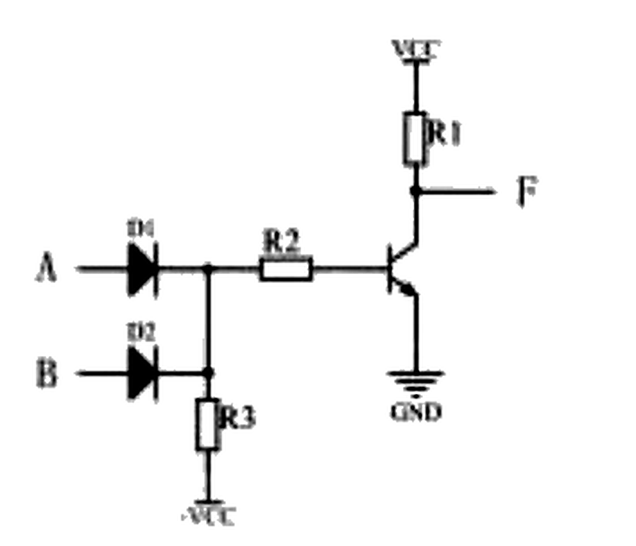
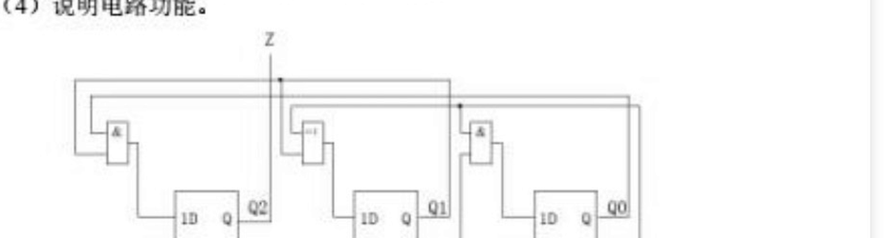
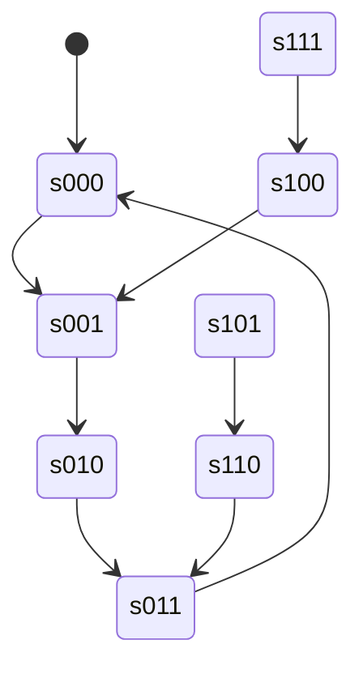
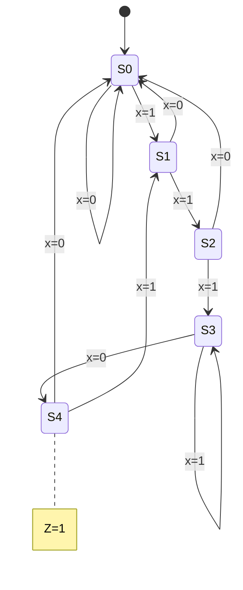
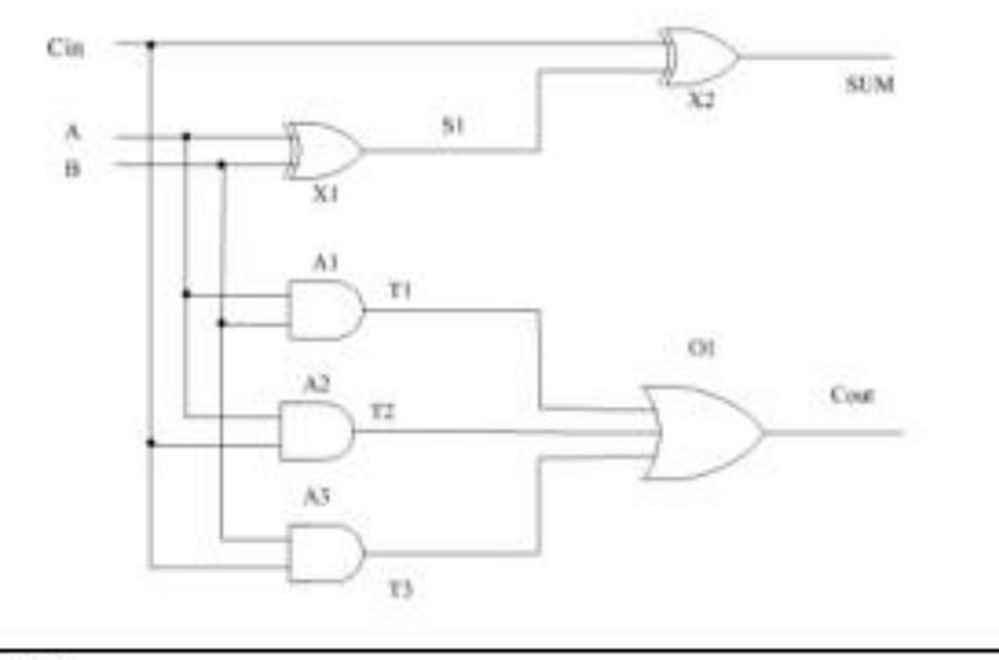
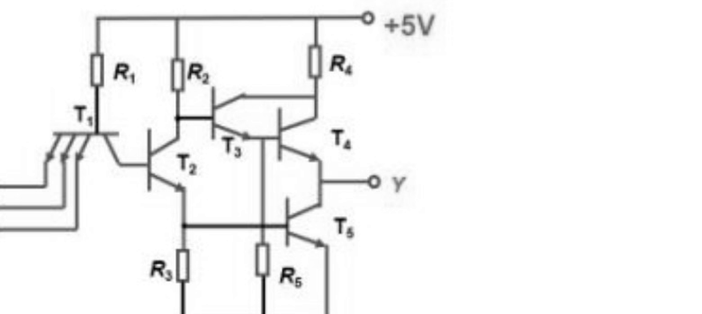
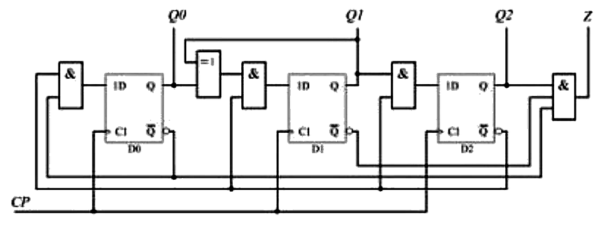
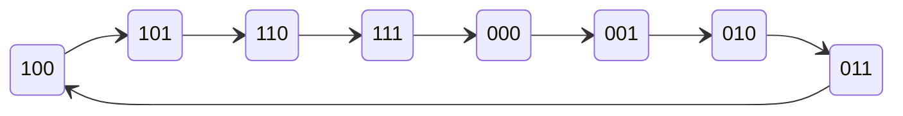
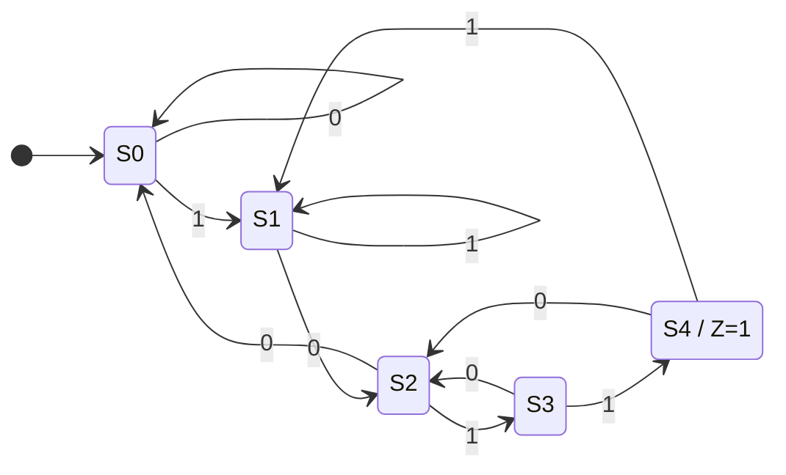
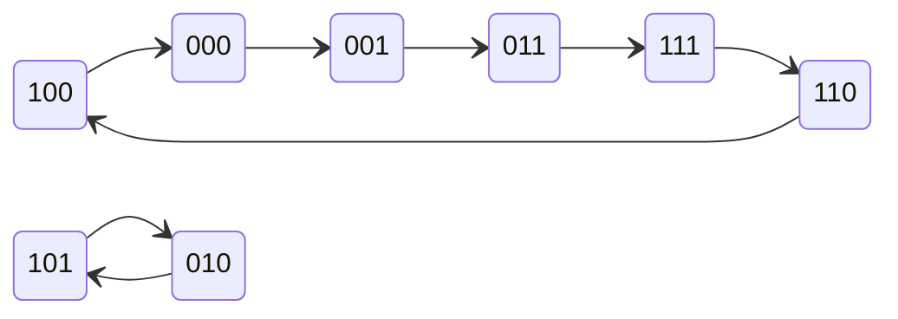

# 数字电路与逻辑 · 期末习题集（含答案与解析）

> 适用：哈尔滨理工大学《数字电路及逻辑》期末复习
> 依据：工作区 `试卷/` 内两份真题 —— **2021–2022 学年第二学期 A 卷**、**2019–2020 学年第二学期 A 卷**（均为 100 分钟、100 分）
> 覆盖：第 1–6 章全部内容

---

## 〇、使用说明与考情分析

### 1. 两份真题的实际结构

| 项目 | 2021–2022 A 卷 | 2019–2020 A 卷 |
|---|---|---|
| 考试时长 / 总分 | 100 分钟 / 100 分 | 100 分钟 / 100 分 |
| 一 | 填空题 10 分（7 题 10 空） | 简答题 32 分（6 问，每问 4 分） |
| 二 | 简答题 30 分（4 题） | TTL 与非门电路分析 8 分 |
| 三 | 时序电路分析 20 分（4 问） | 密码锁设计 20 分 |
| 四 | Moore 型原始状态图与状态表 10 分 | 时序电路分析 20 分（5 问） |
| 五 | 密码锁设计（与非门）15 分 | Verilog 霓虹灯控制器 20 分 |
| 六 | Verilog 1 位全加器 15 分 | — |

**结论**：命题框架高度稳定，永远是这五块——

```
① 基础填空/简答（进制码制、逻辑函数三形式、化简、触发器方程、555、三态门、门电路结构）
② 组合逻辑设计（密码锁类，用与非门实现）
③ 时序逻辑分析（写方程→状态表→状态图→说功能）
④ 状态图/状态表设计（序列检测，Moore 型）
⑤ Verilog 设计（全加器、移位类控制器）
```

### 2. 考点分布与分值权重

| 知识块 | 对应章节 | 真题中出现方式 | 估计分值 |
|---|---|---|---|
| 进制转换、码制、机器数 | 第 2 章 | 填空 / 简答 | 4–8 分 |
| 逻辑代数：反函数、对偶、标准形式 | 第 3 章 | 简答必考 | 8–12 分 |
| 卡诺图化简 | 第 3 章 | 简答必考 | 8–10 分 |
| 门电路内部结构（二极管门、TTL 与非门） | 第 2 章 | 填空 / 分析题 | 8 分 |
| 组合逻辑设计（密码锁） | 第 4 章 | 设计题必考 | 15–20 分 |
| 时序电路分析 | 第 5 章 | 分析题必考 | 20 分 |
| 状态图 / 状态表（序列检测） | 第 5 章 | 设计题 | 10 分 |
| 触发器状态方程 | 第 5 章 | 简答 | 6–10 分 |
| 555 定时器、集成运放（第 6 章新增） | 第 6 章 | 填空 / 简答 | 2–6 分 |
| Verilog HDL | 全课程 | 设计题必考 | 15–20 分 |

> **复习优先级**：时序分析（20 分）＝ 组合设计（15–20 分）＝ Verilog（15–20 分）＞ 化简与函数形式（18 分左右）＞ 基础概念填空。前三块拿下就是 55–60 分。

### 3. 关于本习题集的四点说明

- 全书分三层：**① 真题原文精解**（两套原卷逐题录入，含答案、解析、考点拓展）→ **② 两套模拟卷（各 100 分）** → **③ 第 6 章专项（50 分）**，题型、题量、分值严格对齐真题。
- **真题原文精解**是本次新增的主体部分：题干逐字录入，电路图从原卷直接裁出，两套卷共 **16 道大题 / 42 个小问**全部给出答案与解析。
- **模拟卷里的电路类题目一律用文字把连接关系写全**（如"三个 D 触发器，D₂ = Q₁"），不依赖模糊图片，保证你做题时信息完整、答案唯一可验。
- 每道题后的 **【考点】** 指向对应章节文件，**【拓展】** 是超出本题、但同源可考的相关知识，用来应对变式题。

---

# 真题原文精解（哈理工两套原卷）

> **和后面两套模拟卷的区别**：本部分是**真题原文**——题干逐字录入，电路图从原卷裁出，不是仿编。
> 每题给 **【答案】+【解析】**（思路 / 步骤 / 易错点），关键题另加 **【考点 / 拓展】**。
> **建议用法**：先遮住答案、按真题 100 分钟限时做一遍，再逐题对答案；最后用模拟卷一、卷二练速度和变式。

**两套卷的题号结构**（先记住这张表，进考场就不慌）：

| | 2021–2022 A 卷 | 2019–2020 A 卷 |
|---|---|---|
| 一 | 填空 10 分（7 题 10 空） | 简答 32 分（6 问 × 4 分） |
| 二 | 简答 30 分（4 题） | TTL 与非门分析 8 分 |
| 三 | 时序电路分析 20 分（4 问） | 保密锁设计 20 分 |
| 四 | Moore 型原始状态图与状态表 10 分 | 时序电路分析 20 分（5 问） |
| 五 | 密码锁（与非门）15 分 | Verilog 霓虹灯控制器 20 分 |
| 六 | Verilog 1 位全加器 15 分 | — |

---

## 一、2021–2022 学年第二学期《数字电路及逻辑》A 卷

> 考试时间 100 分钟　试卷总分 100 分　考试班级：计算机　原卷共 2 页（卷末日期 2022-06-15）

### 卷一·一　填空题（每空 1 分，共计 10 分）

#### 1. $(34.5)_{10}=(\quad)_2=(\quad)_{16}$


<details>
<summary>答案与解析（点击展开）</summary>

**答案**：$(100010.1)_2$　$(22.8)_{16}$

**解析**：
- 整数部分用"除 2 取余、倒序读"：$34\div2=17\cdots0$，$17\div2=8\cdots1$，$8\div2=4\cdots0$，$4\div2=2\cdots0$，$2\div2=1\cdots0$，$1\div2=0\cdots1$ → 倒着读得 $100010$。
- 小数部分用"乘 2 取整、顺序读"：$0.5\times2=1.0$ 取整 $1$，余 $0$ → 得 $.1$。
- 合起来 $100010.1$；四位一组：$0010\,0010\,.\,1000$ → $22.8$。

**易错**：小数 0.5 的二进制只有一位 `1`，不要写成 `.10`；十六进制小数部分要**从左往右**四位一组（不足补 0），不能从右往左。

</details>


#### 2. $[X]_{原}=1.1101$，则 $[X]_{补}=(\quad)$，$[X]_{反}=(\quad)$


<details>
<summary>答案与解析（点击展开）</summary>

**答案**：$[X]_{补}=1.0011$，$[X]_{反}=1.0010$

**解析**：原码 `1.1101` 的最高位 `1` 是**符号位**（表示负数），数值位是 `1101`。
- 反码 = 符号位不动、数值位逐位取反 → `1.0010`
- 补码 = 反码末位加 1 → `1.0011`

**易错**：符号位**永远不参与**取反和加 1。另外注意本题是"定点小数"写法，符号位与数值位之间有一点，答题时不要把小数点丢掉。

> **【拓展】** 反过来考（给补码求原码）规则相同："负数再求一次补"。补码的最大优点是 $0$ 只有一种表示，而原码和反码都有 $+0$、$-0$ 两种——这正是计算机内部用补码的原因。

</details>


#### 3. 3-8 译码器将 3 个输入变量变换成＿＿个最小项输出


<details>
<summary>答案与解析（点击展开）</summary>

**答案**：**8**

**解析**：$n$ 位二进制输入有 $2^n$ 种组合，译码器每种组合对应一根输出线有效，故 3-8 译码器有 8 个输出，每个输出恰好对应一个最小项。

**易错**：不要写成"3 个"。另外要记住 74LS138 是**低电平有效**输出：输出为 0 的那一根才代表被选中的最小项。

</details>


#### 4. 三态门是可以控制输出的门电路，控制端无效时，输出是＿＿状态


<details>
<summary>答案与解析（点击展开）</summary>

**答案**：**高阻**（高阻态 / 悬浮态 / Z 态）

**解析**：三态门输出级是两只互补的 MOS 管（或双极型管）串联，控制端无效时两管**同时截止**，输出端与电源、地都断开，等效为开路。

> **【拓展】** 高阻态的真正价值是**总线分时共享**：多个三态门输出并接到同一根总线，任何时刻只让一个门有效（其余高阻），既不冲突也不短路。这也是"总线为什么能一对多"的硬件答案。

</details>


#### 5. 555 定时器有两个阈值，分别是＿＿和＿＿


<details>
<summary>答案与解析（点击展开）</summary>

**答案**：$\dfrac{2}{3}V_{CC}$（高阈值 $V_{T+}$）　$\dfrac{1}{3}V_{CC}$（低阈值 $V_{T-}$）

**解析**：内部三个 $5\,\mathrm{k}\Omega$ 电阻对 $V_{CC}$ 分压，得到 $\frac{1}{3}V_{CC}$ 和 $\frac{2}{3}V_{CC}$ 两个参考电压，分别送给两个比较器。$v_C>\frac23V_{CC}$ 时比较器 A1 输出高、RS 触发器置 0；$v_C<\frac13V_{CC}$ 时 A2 输出高、触发器置 1。

**易错**：是 $\frac13$ 和 $\frac23$，不是 $\frac12$。回差 $\Delta V_T=\frac23V_{CC}-\frac13V_{CC}=\frac13V_{CC}$ 就是施密特触发器回差的来源。

</details>


#### 6. 放大器处于开环工作状态，参考电压 $U_R$ 加在同相输入端，输入信号 $u_I$ 加到反相输入端，当 $u_I<U_R$ 时，$u_o=$＿＿


<details>
<summary>答案与解析（点击展开）</summary>

**答案**：$+U_{om}$（正饱和输出电压，即高电平）

**解析**：$u_I$ 接反相端，所以 $u_-=u_I$；$U_R$ 接同相端，$u_+=U_R$。$u_I<U_R$ 即 $u_-<u_+$，同相端电位高，输出正向饱和到 $+U_{om}$。

**口诀**：**"同相端电位高，输出就高"**。判断这类题只看 $u_+$ 与 $u_-$ 谁高，不要被"信号加在哪一端"绕进去。

> **【拓展】** 这就是**开环比较器**：运放开环增益极大，输入差模电压只要几十微伏就足以把它推到饱和，所以输出只有 $\pm U_{om}$ 两种状态——它已经不是"放大"而是"比较"。若在同相端再引入一点正反馈，就变成**迟滞比较器（施密特触发器）**，两个阈值变成 $V_{T+}$、$V_{T-}$，抗干扰能力大增。

</details>


#### 7. 下面电路属于＿＿逻辑电路门




<details>
<summary>答案与解析（点击展开）</summary>

**答案**：**或非门**（NOR，$F=\overline{A+B}$）

**解析**：分两步看。
1. **二极管网络**：D1、D2 阳极接输入 $A$、$B$，阴极共接于节点 P，P 点经 $R_3$ 接**负电源** $-V_{CC}$。任一输入为高 → 对应二极管导通 → P 点被拉高；两输入全低 → 两管截止 → P 点被 $R_3$ 拉到负电位而呈低电平。即"**有高则高，全低才低**" → 这是**或**的关系。
2. **三极管反相**：P 点高 → 经 $R_2$ 注入基极电流 → T 饱和导通 → 集电极 $F$ 输出低；P 点低 → T 截止 → $F$ 由 $R_1$ 拉到高电平。

两步合起来：$F=\overline{A+B}$，是**或非门**。

**易错（本题最大的坑）**：很多同学一看"二极管 + 三极管"就答"与非门"。**判别只看偏置电阻 $R_3$ 接正电源还是负电源**：
- $R_3$ 接 $-V_{CC}$（负电源）→ 二极管网络是"或"→ 反相后是**或非门**（本题）；
- $R_3$ 接 $+V_{CC}$（正电源）→ 二极管网络变"与"→ 反相后是**与非门**（即经典 DTL 与非门）。

> **【拓展】** 这类"二极管网络 + 三极管反相器"是**分立元件门电路**的标准考法，考的就是"二极管在正/负偏置下实现与还是或"。同理还有"二极管与门 + 二极管或门 + 三极管反相"的组合，答题时**先定二极管网络的逻辑关系，再叠加一级反相**，就不会错。

</details>


---

### 卷一·二　简答题（共 30 分）

#### 1. 已知逻辑函数 $F=A\cdot B+\bar A\cdot\bar B$，写出其反函数的逻辑表达。（5 分）


<details>
<summary>答案与解析（点击展开）</summary>

**答案**：

$$
\bar F=A\bar B+\bar AB=A\oplus B
$$

**解析**：$F$ 就是同或（$A\odot B$）。按德摩根定律，**先把整体求反，再逐项拆开**：

$$
\overline{AB}=\bar A+\bar B,\qquad \overline{\bar A\bar B}=A+B
$$

$$
\bar F=(\bar A+\bar B)(A+B)=\bar AA+\bar AB+\bar BA+\bar BB=\bar AB+A\bar B
$$

即 $\bar F=A\oplus B$。

**验证**：同或的反函数是异或，两者互补 — $A$、$B$ 相同时 $F=1$、$\bar F=0$；不同时 $F=0$、$\bar F=1$ ✔

**易错**：求反函数**必须先加整体横线再用德摩根拆**，不能直接把每一项的变量取反（那是"对偶"或"求反变量"的错误做法）。

</details>


#### 2. 已知逻辑函数 $F=A\cdot\bar C+\bar B\cdot C$，写出其对偶函数的逻辑表达。（5 分）


<details>
<summary>答案与解析（点击展开）</summary>

**答案**：

$$
F^{D}=(A+\bar C)(\bar B+C)
$$

**解析**：**对偶规则**——把式中的"$\cdot$"换成"$+$"、"$+$"换成"$\cdot$"，$0$ 与 $1$ 互换，**变量（含反变量）原样不动**，并用括号保持原来的运算顺序。

$F=A\cdot\bar C+\bar B\cdot C$ → $F^{D}=(A+\bar C)\cdot(\bar B+C)$。

**易错（每年都有人错）**：把对偶当反演，顺手把 $A$ 写成 $\bar A$、$\bar C$ 写成 $C$。**对偶不改变量的极性**，只换运算符和常量。

| 规则 | 运算符 | 常量 | 变量 |
|---|---|---|---|
| 反演（求 $\bar F$） | $\cdot\leftrightarrow+$ | $0\leftrightarrow1$ | **原↔反** |
| 对偶（求 $F^D$） | $\cdot\leftrightarrow+$ | $0\leftrightarrow1$ | **不变** |

</details>


#### 3. 化简下列函数（10 分）

**（1）** $F(A,B,C)=\overline{\bar A\cdot(B+\bar C)}\cdot(A+\bar B+C)\cdot\overline{\bar A\cdot\bar B\cdot\bar C}$


<details>
<summary>答案与解析（点击展开）</summary>

**答案**：

$$
F=A+\bar BC
$$

**解析**：先用德摩根把两个"大横线"拆开。

第一项：$\overline{\bar A(B+\bar C)}=A+\overline{B+\bar C}=A+\bar BC$
第三项：$\overline{\bar A\bar B\bar C}=A+B+C$

于是

$$
F=(A+\bar BC)(A+\bar B+C)(A+B+C)
$$

按 $A$ 分情况讨论最省事：
- $A=1$：三个括号都含 $A$，$F=1$；
- $A=0$：$F=\bar BC\cdot(\bar B+C)\cdot(B+C)=\bar BC\cdot\big[(\bar B+C)(B+C)\big]=\bar BC\cdot(C+\bar BB)=\bar BC\cdot C=\bar BC$。

两种情况合起来：$F=A+\bar BC$。

**易错**：
- 第一个横线是**盖住整个乘积** $\bar A(B+\bar C)$，不是只盖住 $\bar A$；拆的时候按"先与后或"的顺序：$\overline{\bar A\cdot X}=A+\bar X$。
- 第三项同理，是 $\overline{\bar A\bar B\bar C}=A+B+C$（三个变量全取反后求反 = 三个变量相或）。
- 展开后不要急着硬乘，**按某个变量分情况**往往更快，也不容易算错。

**（2）** $F(A,B,C,D)=\sum m(0,5,7,8,9,10,11,14,15)$

**答案**：

$$
F=\bar B\bar C\bar D+\bar ABD+A\bar B+AC
$$

**解析**：画 4 变量卡诺图（行 $AB$、列 $CD$，按格雷码排列）：

| $AB\backslash CD$ | 00 | 01 | 11 | 10 |
|---|---|---|---|---|
| **00** | **1** | 0 | 0 | 0 |
| **01** | 0 | **1** | **1** | 0 |
| **11** | 0 | 0 | **1** | **1** |
| **10** | **1** | **1** | **1** | **1** |

圈组：
- $m_0,m_8$ → 一列两格（$B=0,C=0,D=0$，$A$ 变化）→ $\bar B\bar C\bar D$
- $m_5,m_7$ → 一行相邻（$A=0,B=1,D=1$，$C$ 变化）→ $\bar ABD$
- $m_8,m_9,m_{10},m_{11}$ → 一整行（$A=1,B=0$）→ $A\bar B$
- $m_{10},m_{11},m_{14},m_{15}$ → 两列两行成方块（$A=1,C=1$）→ $AC$

四组都是**必要质蕴含项**（各含一个只被自己覆盖的格），故最简式就是四项相加。

**易错**：
- 卡诺图的行列必须按 **00-01-11-10** 排，写成 00-01-10-11 就圈不出 $m_{10},m_{11}$ 的相邻关系。
- $m_0$ 与 $m_8$ 是**首尾相邻**（上下边界可以卷起来看），这也是常被漏掉的一组。

</details>


#### 4. 分别写出同步 RS 触发器、JK 触发器、T 触发器、T′ 触发器和 D 触发器的状态方程。（10 分）


<details>
<summary>答案与解析（点击展开）</summary>

**答案**：

| 触发器 | 状态方程（特性方程） | 约束条件 |
|---|---|---|
| 同步 RS | $Q^{*}=S+\bar RQ$ | $SR=0$（$S$、$R$ 不能同时为 1） |
| JK | $Q^{*}=J\bar Q+\bar KQ$ | 无约束（$J=K=1$ 时翻转） |
| T | $Q^{*}=T\bar Q+\bar TQ=T\oplus Q$ | — |
| T′ | $Q^{*}=\bar Q$ | 每来一个时钟必翻转 |
| D | $Q^{*}=D$ | — |

**解析**：五个方程要能**互推**：
- JK 的 $J$ 相当于 $S$、$K$ 相当于 $R$，但把 $S=R=1$ 的非法状态改成了"翻转"，于是 $Q^*=J\bar Q+\bar KQ$，没有约束；
- 令 $J=K=T$ 代入 JK 方程即得 $Q^*=T\bar Q+\bar TQ$；
- 令 $T=1$ 即得 T′；
- 令 $J=D$、$K=\bar D$ 代入 JK 方程得 $Q^*=D\bar Q+DQ=D$，即 D 触发器。

**记忆口诀**：**RS 有约束、JK 全能、T 可控翻转、T′ 必翻、D 直通**。

> **【拓展】** 状态方程 = **次态**与**现态、输入**的关系，是"画状态表 → 求状态方程 → 画状态图"整条链的枢纽。做题时先写**驱动方程**（各输入端接什么），再代入对应触发器的**特性方程**，就得到**状态方程**——这两步千万不要混。

</details>


---

### 卷一·三　分析下图所示时序电路（20 分）

**题目原文**：
（1）列出时序电路的驱动方程和输出方程。
（2）求得时序逻辑电路的状态方程。
（3）列出该时序电路的状态表，画出状态图。
（4）说明电路功能。



> **⚠️ 关于这道题的说明（必看）**
> 原卷这张图是用 1 像素细线打印后扫描的，**每一根反馈线连到哪个 Q 端**在扫描件里无法 100% 确认（放大 4 倍仍有交叉线粘连）。为避免给你一个错的驱动方程、进而把整道 20 分题带偏，这里**只给方法、模板和评分点**，不给"猜"出来的方程。
> 你手上有原卷，**把这一页拍清楚（或用手机贴纸补光、正对着拍）发我，我按你的读数把这 20 分补成完整答案**。
> 同时，卷面能确定的部分已写在下面第 0 步，这部分是可以直接拿分的。


<details>
<summary>答案与解析（点击展开）</summary>

**第 0 步：图上能直接确定的信息（可拿 3–5 分）**

- 三个触发器都是**上升沿 D 触发器**（符号上的 `1D` 是数据输入端、`C1` 是时钟输入端），时钟统一由 `CP` 提供 → 是**同步**时序电路。
- 三个状态变量按题目标注为 $Q_2$、$Q_1$、$Q_0$（从左到右），电路应是"最高位在左"的写法。
- 电路**没有外部输入变量**（除 $CP$ 外无其他输入）→ 输出 $Z$ 只与状态有关 → 属 **Moore 型**。
- $Z$ 由最高位 $Q_2$ 的输出端引出 → **输出方程 $Z=Q_2$**（原图中 $Z$ 端与 $Q_2$ 输出线直接相连）。
- 每个 $D$ 端前面都有一个**由与门（或异或门）构成的组合反馈网络**，输入取自各触发器的 $Q$、$\bar Q$。

**第 1–4 步：通用做法（这道题的答题模板）**

| 步骤 | 要写的内容 | 分值估计 | 关键动作 |
|---|---|---|---|
| ① 驱动方程 | $D_2=f_2(Q_2,Q_1,Q_0)$、$D_1=f_1(\cdot)$、$D_0=f_0(\cdot)$；输出方程 $Z=g(\cdot)$ | 5 分 | **从 D 端逆着线往回追**，每遇到一个门就记下它的所有输入，遇到反馈线回到源触发器的 $Q$ 或 $\bar Q$ |
| ② 状态方程 | 把 $D_i$ 直接代入 $Q_i^{*}=D_i$（D 触发器特性方程最简单） | 4 分 | D 触发器**没有化简**：$Q_i^{*}=D_i$，照抄驱动方程即可 |
| ③ 状态表 | 8 行（$Q_2Q_1Q_0$ 从 000 到 111），列出现态、次态、输出 $Z$ | 5 分 | **必须把 8 个状态全列**，不许只列有效循环 |
| ④ 状态图 | 8 个圆圈 + 箭头；标出有效循环、无效状态及其去向 | 4 分 | 顺手判断**能否自启动** |
| ⑤ 功能 | 一句话：模几计数器 / 序列发生器 / 移位型计数器 | 2 分 | 数有效循环里有几个状态就是"模几" |

**关键技巧：怎样从图上把驱动方程"追"出来**

1. 先在最左边（或最上面）找出所有**触发器输出端** $Q_i$、$\bar Q_i$，给每根引出的线在心里起个名（如"线 A = $\bar Q_0$"）。
2. 从每个 $D_i$ 端出发**逆着信号方向**往回走，遇到门就停，把该门的**全部输入**列出来。
3. 遇到分叉点（图上画实心圆点的地方）说明这里是**同一个信号**，可以分给多处使用；**没有圆点的交叉只是跨线，不相连**——这是读这类图最容易看错的地方。
4. 三个 $D$ 方程写完后，**用红笔在图上把每个方程对应的路径描一遍**，能描通就说明读数没错。

**示范：完整的写法长什么样**

下面是**结构完全相同**（三个上升沿 D 触发器，每个 $D$ 端前接一个二输入门，输出取自最高位）的一道同类题的完整解答，你用**自己卷面上的驱动方程**替换第 ① 步的三行，其余格式照抄即可：

> **示范数据**（非原卷读数）：$D_2=Q_2Q_0$，$D_1=Q_1\oplus Q_0$，$D_0=\bar Q_0$，$Z=Q_2$

**① 驱动方程与输出方程**

$$
D_2=Q_2Q_0,\qquad D_1=Q_1\oplus Q_0,\qquad D_0=\bar Q_0,\qquad Z=Q_2
$$

**② 状态方程**（D 触发器 $Q^{*}=D$）

$$
Q_2^{*}=Q_2Q_0,\qquad Q_1^{*}=Q_1\oplus Q_0,\qquad Q_0^{*}=\bar Q_0
$$

**③ 状态表**

| $Q_2$ | $Q_1$ | $Q_0$ | $Q_2^{*}$ | $Q_1^{*}$ | $Q_0^{*}$ | $Z$ |
|:---:|:---:|:---:|:---:|:---:|:---:|:---:|
| 0 | 0 | 0 | 0 | 0 | 1 | 0 |
| 0 | 0 | 1 | 0 | 1 | 0 | 0 |
| 0 | 1 | 0 | 0 | 1 | 1 | 0 |
| 0 | 1 | 1 | 0 | 0 | 0 | 0 |
| 1 | 0 | 0 | 0 | 0 | 1 | 1 |
| 1 | 0 | 1 | 1 | 1 | 0 | 1 |
| 1 | 1 | 0 | 0 | 1 | 1 | 1 |
| 1 | 1 | 1 | 1 | 0 | 0 | 1 |

**④ 状态图**（按上表逐行画箭头，8 个圆圈一个不能少）



**⑤ 功能**：有效循环 $000\to001\to010\to011\to000$ 共 4 个状态 → **模 4 计数器**；$Q_2$ 在循环中始终为 0，$Z=Q_2$ 实际是指示"高位是否为 1"；其余 4 个状态经若干拍都能进入有效循环 → **能自启动**。

**易错清单（这 20 分最容易丢的地方）**

- 把**驱动方程**和**状态方程**混着写：驱动方程是"$D_2=\cdots$"，状态方程是"$Q_2^{*}=\cdots$"，两问分开写、分开给分。
- 状态表**只列有效循环**：题目要求"状态表"，必须 8 行全列，否则扣 3–4 分。
- 状态图**漏画无效状态**的箭头：老师要看的就是"能不能自启动"。
- 忘了写**输出方程**：第（1）问明确要"驱动方程**和**输出方程"，漏一个扣 2 分。
- 判断"模几"时数错：**数有效循环里的状态个数**，不是数箭头个数。

</details>


---

### 卷一·四　Moore 型原始状态图与状态表（10 分）

**题目原文**：假设某同步时序电路输入为 $x$，其输出为 $Z$。$x$ 输入为一组按时间顺序排列的串行二进制代码，当输入序列为 $1110$ 时（高位先输入），输出 $Z$ 为 1，否则 $Z$ 为 0。试作出该电路的 Moore 型原始状态图及状态表。


<details>
<summary>答案与解析（点击展开）</summary>

**答案**：

**① 状态定义**（Moore 型的输出只与状态有关，所以"检测完成"要单独设一个状态）

| 状态 | 含义（已收到的有效前缀） | 输出 $Z$ |
|---|---|:---:|
| $S_0$ | 尚未收到任何有效位（初态） | 0 |
| $S_1$ | 已收到 `1` | 0 |
| $S_2$ | 已收到 `11` | 0 |
| $S_3$ | 已收到 `111` | 0 |
| $S_4$ | 已收到 `1110`（检测成功） | **1** |

**② 状态表**

| 现态 | $x=0$ 次态 | $x=1$ 次态 | 输出 $Z$ |
|:---:|:---:|:---:|:---:|
| $S_0$ | $S_0$ | $S_1$ | 0 |
| $S_1$ | $S_0$ | $S_2$ | 0 |
| $S_2$ | $S_0$ | $S_3$ | 0 |
| $S_3$ | $S_4$ | $S_3$ | 0 |
| $S_4$ | $S_0$ | $S_1$ | **1** |

**③ 状态图**



**解析（为什么这样连）**：

- **串行检测的核心是"记前缀"**：收到 `1` → $S_1$；再来 `1` → 前缀变 `11`，进 $S_2$；再来 `1` → `111`，进 $S_3$；此时来 `0` → 凑齐 `1110`，进 $S_4$ 并输出 1。
- **重叠检测**：在 $S_3$（已收 `111`）若又来 `1`，序列变成 `1111`，末尾仍是 `111`，所以**回到 $S_3$ 自己**，不能回 $S_0$。这一条是本题最容易被扣分的地方。
- **$S_4$ 之后的去向**：$S_4$ 表示"刚刚收完 `1110`"。若下一个来 `0`，序列尾部是 `0`，没有任何有效前缀 → 回 $S_0$；若来 `1`，尾部是 `1` → 进 $S_1$（不是回 $S_0$）。
- **Moore 与 Mealy 的差别**：Moore 的输出挂在**状态**上，所以必须多设一个 $S_4$ 来表示"已经检测到"，输出延迟一拍；Mealy 可以把输出挂在**转移**上（$S_3\xrightarrow{x=0/Z=1}S_0$），只要 4 个状态。题目要"Moore 型原始状态图"，就必须是 5 个状态。

**④ 校验方法（自己检查对不对）**：把输入序列 `1110` 一代一代走一遍——$S_0\xrightarrow{1}S_1\xrightarrow{1}S_2\xrightarrow{1}S_3\xrightarrow{0}S_4$，在 $S_4$ 输出 $Z=1$，与题意一致；再输入 `1110` 一次，应在第 4 位再次出现 $Z=1$（$S_4\xrightarrow{1}S_1\xrightarrow{1}S_2\xrightarrow{1}S_3\xrightarrow{0}S_4$），说明**能重复检测**。

**易错**：
- 少设状态（只设 4 个）→ 那是 Mealy 型，不符题目要求；
- $S_3$ 收到 `1` 时错回 $S_0$（漏掉重叠）；
- 状态图不标初态、不标 $Z$ 在哪几个状态为 1。

> **【拓展】** 若把题目改成"$1110$ **或** $1101$"，状态数会从 5 个增到 6–7 个（两串前缀不能共用）；若改成"检测 $1011$"，$S_1$ 收到 `0` 要进一个新的 $S_{10}$ 而不是回 $S_0$。**通用画法**：每个状态代表"已匹配的最长前缀"，新来一位就找"当前串的最长可匹配后缀"，落到对应状态——这叫"后缀回退"，是序列检测器万能套路。

</details>


---

### 卷一·五　密码锁设计（15 分）

**题目原文**：密码锁有三个按键：$A$、$B$、$C$，当 $A$ 单独按下时，锁既不打开也不报警；只有 $A$、$B$、$C$ 或者 $A$、$B$ 或者 $A$、$C$ 同时按下时，锁才能打开；当不符合上述组合状态时，将发出报警。设 $F$ 为开锁信号，$G$ 为报警信号，用"与非门"实现组合电路。写出设计过程。


<details>
<summary>答案与解析（点击展开）</summary>

**答案（完整设计五步）**：

**第一步：设变量、定逻辑值**

按键按下为 1，未按下为 0；开锁 $F=1$、报警 $G=1$ 为有效。

**第二步：列真值表**（3 个输入共 8 种组合，一种都不能漏）

| $A$ | $B$ | $C$ | 说明 | $F$（开锁） | $G$（报警） |
|:---:|:---:|:---:|---|:---:|:---:|
| 0 | 0 | 0 | 无人按键 | 0 | 1 |
| 0 | 0 | 1 | 只按 $C$ | 0 | 1 |
| 0 | 1 | 0 | 只按 $B$ | 0 | 1 |
| 0 | 1 | 1 | 按 $B$、$C$ | 0 | 1 |
| 1 | 0 | 0 | **只按 $A$（特例：不报警）** | 0 | **0** |
| 1 | 0 | 1 | $A$、$C$ 同时按 | 1 | 0 |
| 1 | 1 | 0 | $A$、$B$ 同时按 | 1 | 0 |
| 1 | 1 | 1 | $A$、$B$、$C$ 同时按 | 1 | 0 |

**第三步：写逻辑式**

$$
F=\sum m(5,6,7)=AB+AC=A(B+C)
$$

$$
G=\sum m(0,1,2,3)=\bar A
$$

**第四步：化成"与非—与非"形式**

$$
F=AB+AC=\overline{\overline{AB}\cdot\overline{AC}},\qquad G=\bar A=\overline{A\cdot A}
$$

**第五步：画电路（文字描述）**

- $G_1=\overline{AB}$：$A$、$B$ 接一个二输入与非门；
- $G_2=\overline{AC}$：$A$、$C$ 接一个二输入与非门；
- $G_3=\overline{G_1\cdot G_2}=F$：$G_1$、$G_2$ 再接一个二输入与非门 → 输出 $F$；
- $G_4=\overline{A\cdot A}=\bar A=G$：$A$ 同时接一个二输入与非门的两个输入 → 输出 $G$。

共 **4 个二输入与非门**（其中 1 个作反相器用）。

**解析（这道题真正的考点）**：

1. **"$A$ 单独按下"是唯一的不报警特例**——它既不满足开锁条件，也不属于"不符合上述组合"，所以 $F=0$、$G=0$。真值表第 5 行必须这样填，填错整题全错。
2. **$G=\bar A$ 不是巧合**：所有需要报警的组合（000、001、010、011）**都满足 $A=0$**，而所有 $A=1$ 的组合（100、101、110、111）都不报警。所以报警信号就是"$A$ 没按"，逻辑式自然化简为 $\bar A$。**先观察、后化简，能省一大半功夫**。
3. **"用与非门实现"的固定套路**：把最简与或式**连取两次反**，再用德摩根把外层的反推到每一项——$\overline{\overline{AB}\cdot\overline{AC}}$ 中，里面的 $\overline{AB}$、$\overline{AC}$ 正好是两级与非门的输出。

**易错**：
- 把"$A$ 单独按下"也算成报警 → $G$ 变成恒等于 1 的一部分，整题崩。
- 只用与门、或门实现（题目明确要求"与非门"）→ 扣实现分。
- 忘了 $C$ 也要参与：$F=AB$ 只覆盖了 $A$、$B$ 的情况，漏掉 $A$、$C$。
- 门数写错：$F$ 要 3 个、$G$ 要 1 个，共 4 个；若把 $G$ 用"非门"算，则要说明"非门可用与非门两输入并联代替"。

> **【拓展】** 这道题的"安全检查"思路可以扩展：若再加一个"连续三次错误则锁定"的要求，就**不能**用纯组合电路了，必须引入**状态记忆**（计数器 + 比较器），这就是组合逻辑与时序逻辑的分界线。真题里"密码锁/保密锁"反复出现（2021–2022 卷第五题 15 分、2019–2020 卷第三题 20 分），**是必拿分的题**。

</details>


---

### 卷一·六　Verilog 设计 1 位全加器（15 分）

**题目原文**：用 Verilog 语言按下图设计一个 1 位全加器，可以采用连续赋值语句、元件例化或过程块设计，工程模块名用考生姓名的汉语拼音，写出完整代码。




<details>
<summary>答案与解析（点击展开）</summary>

**先读图**（把图翻成方程，是得满分的关键）：

- $X_1=A\oplus B$，$X_2=SUM=X_1\oplus C_{in}$ → $SUM=A\oplus B\oplus C_{in}$
- $T_1=A\cdot B$，$T_2=A\cdot C_{in}$，$T_3=B\cdot C_{in}$，$C_{out}=T_1+T_2+T_3$ → $C_{out}=AB+AC_{in}+BC_{in}$

**答案一：连续赋值语句（最简洁，推荐）**

```verilog
// 模块名用考生姓名拼音，此处以"张三"→ zhangsan 为例，考试时换成你自己的
module zhangsan (
    input  A,
    input  B,
    input  Cin,
    output SUM,
    output Co
);
    assign SUM = A ^ B ^ Cin;
    assign Co  = (A & B) | (A & Cin) | (B & Cin);
endmodule
```

**答案二：门级元件例化（与卷面图一一对应）**

```verilog
module zhangsan_gate (
    input  A,
    input  B,
    input  Cin,
    output SUM,
    output Co
);
    wire x1, t1, t2, t3;

    xor u1 (x1,  A, B);        // X1 = A ⊕ B
    xor u2 (SUM, x1, Cin);     // SUM = X1 ⊕ Cin
    and u3 (t1, A, B);         // T1 = A·B
    and u4 (t2, A, Cin);       // T2 = A·Cin
    and u5 (t3, B, Cin);       // T3 = B·Cin
    or  u6 (Co, t1, t2, t3);   // Co = T1 + T2 + T3
endmodule
```

**答案三：过程块（always）写法**

```verilog
module zhangsan_always (
    input  A,
    input  B,
    input  Cin,
    output reg SUM,
    output reg Co
);
    always @(*) begin
        SUM = A ^ B ^ Cin;
        Co  = (A & B) | (A & Cin) | (B & Cin);
    end
endmodule
```

**解析**：

- 全加器的**真值表**就是"三个 1 位二进制数相加"：$A+B+C_{in}$ 的结果是 0–3，用两位表示，低位是 $SUM$、高位是 $C_{o}$。所以 $SUM$ 是**三变量异或**（奇数个 1 时为 1），$C_o$ 是**三取二的多数表决**（至少两个 1 时为 1）。
- 三种写法**等价**，考试任选一种。**连续赋值**最短最不容易错；**门级例化**与卷面图对得上，老师一眼能看出你会读图；**always 块**要记得输出声明成 `reg`。

**易错**：
- 模块名写成中文或 `full_adder`（题目要求"考生姓名拼音"）→ 扣格式分；
- 用了 `always` 但输出仍是 `output SUM`（没加 `reg`）→ 编译报错；
- 把 $C_o$ 写成 `A & B & Cin`（这是"三输入与"，只有 $111$ 才进位，漏了"两个 1 进位"）；
- 漏 `endmodule`、漏分号；
- 门级例化时 `xor u2 (SUM, x1, Cin)` 里的信号顺序写反（Verilog 是 `(输出, 输入1, 输入2)`）。

> **【拓展】** 1 位全加器是**串行进位加法器**的基本单元：把 $C_o$ 接到下一片的 $C_{in}$ 就是 4 位加法器；若把每片改成"先行进位"逻辑（$G_i=A_iB_i$、$P_i=A_i\oplus B_i$），就是**超前进位加法器（CLA）**，延迟从 $4$ 级门降到 $2$ 级门。真题连续两年考"全加器/控制器"的 Verilog，**这类题必须练到能默写**。

</details>


---

## 二、2019–2020 学年第二学期《数字电路及逻辑》A 卷

> 考试时间 100 分钟　试卷总分 100 分　考试班级：计算机 2019 级　原卷共 2 页（卷末日期 2020-07-09）

### 卷二·一　简答题（每问 4 分，共计 32 分）

#### 1. 将十进制数 367 分别转换成二进制数和十六进制数。要写出过程。


<details>
<summary>答案与解析（点击展开）</summary>

**答案**：$(367)_{10}=(101101111)_2=(16F)_{16}$

**解析（必须写过程，这是 4 分里的 2 分）**：

除 2 取余（从下往上读）：

| 除 | 商 | 余 |
|---|---|---|
| $367\div2$ | 183 | **1** |
| $183\div2$ | 91 | **1** |
| $91\div2$ | 45 | **1** |
| $45\div2$ | 22 | **1** |
| $22\div2$ | 11 | **0** |
| $11\div2$ | 5 | **1** |
| $5\div2$ | 2 | **1** |
| $2\div2$ | 1 | **0** |
| $1\div2$ | 0 | **1** |

倒序读：$101101111$。验算：$256+64+32+8+4+2+1=367$ ✔

十六进制：四位一组 $0001\,0110\,1111$ → $16F$。

**快速法（考场省时间）**：$367=256+111=2^8+64+32+8+4+2+1$，直接按位写 1；或先转十六进制（$367\div16=22$ 余 $15(F)$，$22\div16=1$ 余 $6$，$1\div16=0$ 余 $1$ → 从下往上 $16F$）再一位拆四位。

**易错**：余数顺序读反（一定要**倒序**）；十六进制里 $10\sim15$ 写成 $A\sim F$ 不要写 $10$。

</details>


#### 2. 已知逻辑函数 $F(A,B,C)=\bar AC+\bar BC+B\bar CD$，写出其反函数和对偶函数的逻辑表达式。


<details>
<summary>答案与解析（点击展开）</summary>

**答案**：

$$
\bar F=(A+\bar C)(B+\bar C)(\bar B+C+\bar D)
$$

$$
F^{D}=(\bar A+C)(\bar B+C)(B+\bar C+D)
$$

**解析**：

- **反函数**：整体加横线后逐项用德摩根拆开——$\overline{\bar AC}=A+\bar C$，$\overline{\bar BC}=B+\bar C$，$\overline{B\bar CD}=\bar B+C+\bar D$，三相乘。
- **对偶函数**：只换运算符（$\cdot\leftrightarrow+$）与常量，**变量不动**——$(\bar A+C)(\bar B+C)(B+\bar C+D)$。

**注意**：原卷第三项写的是 $B\bar CD$，出现了**第四个变量 $D$**，而函数名写的是 $F(A,B,C)$，属于**卷面笔误**。答题时按卷面照抄即可（阅卷按卷面给的式子对），但你要知道：**按定义 $F$ 只应含 $A$、$B$、$C$**。考场上遇到这种矛盾，正确做法是**照抄题干式子求解**，不要自行改写。

**易错**：求反函数时把"三项相或"写成"三项相乘"（$\overline{X+Y}=\bar X\bar Y$，是先乘后**乘**，不是先乘后加）；对偶时顺手把变量也取反了。

</details>


#### 3. 写出下式的标准积之和表达式：$F(A,B,C)=\bar AB+\bar AC$


<details>
<summary>答案与解析（点击展开）</summary>

**答案**：

$$
F=\bar A\bar BC+\bar AB\bar C+\bar ABC=\sum m(1,2,3)
$$

**解析**："标准积之和"（标准与或式 / 最小项之和）要求**每个乘积项都包含全部变量**。

- $\bar AB$ 缺 $C$ → 乘 $(C+\bar C)$：$\bar AB(C+\bar C)=\bar ABC+\bar AB\bar C$，对应 $m_3$、$m_2$；
- $\bar AC$ 缺 $B$ → 乘 $(B+\bar B)$：$\bar AC(B+\bar B)=\bar ABC+\bar AB\bar C$，对应 $m_3$、$m_1$。

合并去重得 $m_1+m_2+m_3$，即 $\sum m(1,2,3)$。

**验算**：$\bar A=1$ 时 $F=B+C$，$A=0$ 的三个组合 $001,010,011$ 中 $F$ 均为 1，$000$ 时为 0 → 正是 $m_1,m_2,m_3$ ✔

**易错**：**漏乘**导致某一项不是最小项；编号时把 $A$ 当低位（**$A$ 是高位**，权重 $4$、$B$ 是 $2$、$C$ 是 $1$）。

</details>


#### 4. 化简函数：$F(A,B,C,D)=\bar A\bar C+ABC+AC\bar D+CD$


<details>
<summary>答案与解析（点击展开）</summary>

**答案**：

$$
F=\bar A\bar C+AC+CD
$$

（等价写法：$F=\bar A\bar C+AC+\bar AD$，两者是同一个函数的不同最简式）

**解析**：

**代数法**：
$$
AC\bar D+CD=C(A\bar D+D)=C(A+D)=AC+CD
$$
于是 $F=\bar A\bar C+AC+CD+ABC$；其中 $ABC$ 被 $AC$ **吸收**（$AC+ABC=AC$），得 $F=\bar A\bar C+AC+CD$。

**卡诺图法**：$F$ 为 1 的最小项是 $m_0,m_1,m_3,m_4,m_5,m_7,m_{10},m_{11},m_{14},m_{15}$。

| $AB\backslash CD$ | 00 | 01 | 11 | 10 |
|---|---|---|---|---|
| **00** | **1** | **1** | **1** | 0 |
| **01** | **1** | **1** | **1** | 0 |
| **11** | 0 | 0 | **1** | **1** |
| **10** | 0 | 0 | **1** | **1** |

三个圈：$\bar A\bar C$（左上 4 格）、$CD$（$CD=11$ 整列 4 格）、$AC$（右下 4 格）。三者互相不能合并 → 最简式三项。

**易错**：
- 把 $AC\bar D+CD$ 化成 $AC+CD$ 时**漏掉 $C$ 的提取**；
- 忘了 $ABC$ 可被 $AC$ 吸收，多写一项（不扣分但浪费时间，且给老师"没化简干净"的印象）；
- 注意本题 $\bar A\bar C$ 与 $AC$ 是"同或"关系，**不能**再进一步合并成一项（异或/同或无法用与或式合并成单项）。

</details>


#### 5. 简述 555 定时器的组成。


<details>
<summary>答案与解析（点击展开）</summary>

**答案**：555 定时器内部由五部分组成。

1. **分压器**：三个 $5\,\mathrm{k}\Omega$ 电阻串联对 $V_{CC}$ 分压，得到 $\frac13V_{CC}$、$\frac23V_{CC}$ 两个参考电压（"555"这个名字就来自这三个 $5\,\mathrm{k}\Omega$）。
2. **两个电压比较器** $A_1$、$A_2$：$A_1$ 反相端接 $\frac23V_{CC}$、同相端接阈值输入 $v_{I1}$（TH）；$A_2$ 同相端接 $\frac13V_{CC}$、反相端接触发输入 $\bar v_{I2}$（$\overline{TR}$）。
3. **基本 RS 触发器**：接收两个比较器的输出，决定输出端 $v_O$ 的状态。
4. **放电三极管 $T_D$**：集电极接放电端 DIS，由 $Q$ 端经反相驱动，用于外接电容放电。
5. **输出缓冲器**：提高带负载能力，输出高、低电平。

**解析（把"组成"讲成"工作链"更容易拿分）**：外接电容电压 $v_C$ 送进两个比较器 → 与 $\frac13V_{CC}$、$\frac23V_{CC}$ 比较 → 比较结果去置位/复位 RS 触发器 → 触发器输出一方面经缓冲器送 $v_O$、另一方面控制放电管 $T_D$ 通断 → $T_D$ 的通断又改变 $v_C$ 的充放电方向，形成闭环。**这条闭环就是 555 能产生振荡的根本原因**。

**易错**：只说"三个电阻、两个比较器、一个触发器"，漏掉**放电管**和**缓冲器**（各占 1 分）；把阈值写成 $\frac12V_{CC}$。

</details>


#### 6. 简述什么是三态门，其工作原理。


<details>
<summary>答案与解析（点击展开）</summary>

**答案**：

**定义**：三态门是输出端具有**三种状态**的门电路——高电平、低电平、**高阻态**（Z 态）。它在普通门电路的基础上增加了一个**使能端（控制端）** $EN$。

**工作原理**：输出级由两只管子串联（上管接电源、下管接地）。
- $EN$ 有效时，两管按输入信号互补工作，输出正常的高/低电平；
- $EN$ 无效时，**两管同时截止**，输出端与电源和地都断开，呈**高阻态**，相当于从电路上"脱开"。

**用途**：多个三态门输出并接到同一根总线上，任何时刻只让一个门有效、其余全为高阻，实现**总线分时共享**（这也是一对多传输的硬件基础）。

> **【拓展】** 三态门有两种控制极性：高电平有效的（$EN=1$ 工作）和低电平有效的（$\overline{EN}=0$ 工作）。总线上若同时有两个门有效且输出相反，会形成**大电流短路**烧器件——所以总线控制逻辑必须保证"互斥"，这也是"总线仲裁"的必要性来源。

</details>


---

### 卷二·二　分析下图逻辑功能，并说明其工作过程（8 分）




<details>
<summary>答案与解析（点击展开）</summary>

**答案**：

**① 逻辑功能**：这是一个 **TTL 三输入与非门**，$Y=\overline{ABC}$。全高输出低，任一为低输出高。

**② 工作过程**（按输入组合分两种情况说）：

**情况一：任一输入为低（如 $A=0.3\,\mathrm{V}$）**
- $T_1$ 的对应发射结正偏导通，$T_1$ 深饱和，其集电极电位被钳在 $V_{CE(sat)}+0.3\approx1.0\,\mathrm{V}$；
- 这个电压不足以同时驱动 $T_2$、$T_5$ 两个发射结（需 $2\times0.7=1.4\,\mathrm{V}$），故 $T_2$、$T_5$ **截止**；
- $T_5$ 截止 → $T_3$ 基极电位升高 → $T_3$、$T_4$ 导通，输出 $Y$ 被 $R_4$、$T_3$、$T_4$ 拉到**高电平**（约 $3.6\,\mathrm{V}$）。

**情况二：三个输入全为高（$3.6\,\mathrm{V}$）**
- $T_1$ 的三个发射结全部截止，电源经 $R_1$ 的电流全部流入 $T_2$ 基极 → $T_2$ **饱和**；
- $T_2$ 发射极电流驱动 $T_5$ 基极 → $T_5$ **饱和**，输出 $Y$ 被钳在 $V_{CE(sat)}\approx0.3\,\mathrm{V}$，即**低电平**；
- 同时 $T_2$ 集电极电位下降 → $T_3$ 基极被拉低 → $T_3$、$T_4$ **截止**。这一步很关键：$T_4$ 与 $T_5$ 若同时导通，$V_{CC}$ 会经 $R_4$、$T_4$、$T_5$ 直通到地，形成大电流损坏器件。

**③ 结论**：输入"全高出低、有低出高"→ **与非**逻辑。

**解析（读这类图的三个抓手）**：

1. **多发射极三极管 $T_1$** = 输入"与"功能。任何一个发射极接低，$T_1$ 就饱和，把后级"掐断"。
2. **$T_2$ 是分相器**：集电极和发射极输出**相位相反**的两路信号，分别驱动上管（$T_3$、$T_4$）和下管（$T_5$），保证推拉输出**永远只有一边导通**。
3. **$T_3$、$T_4$ 串接成"与非"结构**：$T_2$ 饱和时两管都截止（输出高阻），$T_5$ 饱和把输出拉低——这就是 TTL 反相输出的实现方式。

**易错**：
- 只写"这是一个与非门"就结束（8 分里"工作过程"占 5 分）；
- 说"$T_1$ 起放大作用"（它是**输入与**作用，不是放大）；
- 漏掉"$T_4$ 与 $T_5$ 不会同时导通"这个关键点（这是推拉输出的核心，老师最爱看）。

> **【拓展】** 与 TTL 并列的是 **CMOS 门电路**：CMOS 反相器由一对互补 MOS 管组成，**静态几乎不耗电**（TTL 每门约 $1\,\mathrm{mA}$），且输出摆幅接近满电源；但 CMOS 速度受栅电容限制，TTL 驱动能力强。考试常考的对比点：**功耗、扇出、噪声容限、传输延迟、是否允许输入端悬空**（TTL 悬空相当于高电平，CMOS 悬空会乱动、必须接固定电平）。

</details>


---

### 卷二·三　保密锁设计（20 分）

**题目原文**：保密锁有三个按键：$A$、$B$、$C$，当 $A$ 单独按下时，锁既不打开也不报警；只有 $A$、$B$、$C$ 或者 $A$、$B$ 或者 $A$、$C$ 同时按下时，锁才能打开；当不符合上述组合状态时，将发出报警。设 $F$ 为开锁信号，$G$ 为报警信号，设计该组合电路，写出设计过程。


<details>
<summary>答案与解析（点击展开）</summary>

**答案**：真值表与逻辑式与**卷一第五题完全相同**（见前面那张 8 行真值表）：

$$
F=AB+AC=A(B+C),\qquad G=\bar A
$$

**与卷一第五题的唯一区别**：本题**没有限定用与非门**（20 分，比卷一多 5 分，多的就是"自由度"和"说明"）。

**实现方案一：最简门（与门 + 或门 + 非门，共 3 个门）**

- $F$：$B$、$C$ 进一个**或门**得 $B+C$，再与 $A$ 进一个**与门** → $F=A(B+C)$；
- $G$：$A$ 进一个**非门** → $G=\bar A$。

**实现方案二：全与非门（4 个二输入与非门，与卷一答案一致）**

$$
F=\overline{\overline{AB}\cdot\overline{AC}},\qquad G=\overline{A\cdot A}
$$

**设计过程（答题按这五步写，一步不落）**

1. **设变量**：按键按下为 1，否则为 0；$F=1$ 开锁，$G=1$ 报警。
2. **列真值表**：8 行（见卷一第五题的表），特别标明 $A$ 单独按下（$100$）时 $F=0$、$G=0$。
3. **写逻辑式并化简**：$F=\sum m(5,6,7)=AB+AC$；$G=\sum m(0,1,2,3)=\bar A$。
4. **选定门型并变换**：按题目要求（本题不限门型）选择实现形式。
5. **画电路 + 说明门数**：3 个门（或 4 个与非门），并说明"$A$ 单独按下时两输出均为 0，实现'不动作'"。

**解析（为什么 20 分只考这一件事）**：

这题的难点**不在化简，在"读懂那句特例"**。题干三句话对应三类组合：
- "只有 $A$、$B$、$C$ 或 $A$、$B$ 或 $A$、$C$ 同时按下才开锁" → $F$ 的三个最小项 $m_7,m_6,m_5$；
- "不符合上述组合状态时报警" → 剩下的组合报警，**但**；
- "当 $A$ 单独按下时，锁既不打开也不报警" → 这一句把 $m_4$ 从"报警"里**摘出去**，所以 $G$ 只剩 $m_0\sim m_3$。

**这就是"优先级最高的例外条款"**。考场上先把这句圈出来，真值表就不会填错。

**易错**：
- 忽略"$A$ 单独按下不报警" → $G$ 变成 $\bar A+A\bar B\bar C$，多一个门且逻辑错；
- 只写逻辑式不画电路（20 分的题，"设计该组合电路"必须落到门）；
- 未说明门数或未说明"用什么门实现"（评分表里通常有 2 分给"实现方案说明"）。

</details>


---

### 卷二·四　分析下图所示时序电路（20 分）

**题目原文**：
（1）确定是 Mealy 型还是 Moore 型电路。
（2）列出时序电路的输出方程。
（3）列出各触发器的驱动方程。
（4）求得时序逻辑电路的状态方程。
（5）列出该时序电路的状态表，画出状态图。



> **⚠️ 与卷一第三题同样的说明**：原卷该图同样是 1 像素细线扫描，**各触发器 $Q$、$\bar Q$ 到与门/异或门的具体连线**在图像上无法 100% 确认。下面给出**第（1）问的确定答案**（这一问只靠结构性判断就能拿满）、**第（2）–（5）问的完整答题模板与评分点**，以及**示范写法**。
> 把这一页拍清楚发我，我按你卷面上的读数把 20 分补成完整数值答案。

**第（1）问：确定 Mealy 型还是 Moore 型（可以直接作答，拿满 2–3 分）**


<details>
<summary>答案与解析（点击展开）</summary>

**答案**：**Moore 型**。

**理由（这样写才给分）**：电路中除时钟 $CP$ 外**没有其他外部输入变量**，输出 $Z$ 只由各触发器的现态（$Q_2Q_1Q_0$）经组合网络决定，与"当前输入"无关。而 Mealy 型的定义是"输出同时取决于**现态和输入**"，本题没有输入变量，故只能是 Moore 型。

> **判别口诀**：**"看输出端往回追，能不能追到外部输入 $x$"**——追得到就是 Mealy，追不到（只追到 $Q$、$\bar Q$）就是 Moore。考试时若给了输入 $x$，还要看 $Z$ 的表达式里有没有 $x$。

**第（2）–（5）问：答题模板**

| 问 | 写什么 | 分值 | 关键点 |
|---|---|:---:|---|
| （2）输出方程 | $Z=g(Q_2,Q_1,Q_0)$ | 3 分 | 从 $Z$ 端逆推，只含 $Q$ 不含 $x$ |
| （3）驱动方程 | $D_2=\cdots$、$D_1=\cdots$、$D_0=\cdots$ | 5 分 | 每个 $D$ 端前的门输入要写全 |
| （4）状态方程 | $Q_i^{*}=D_i$（$i=2,1,0$） | 4 分 | D 触发器特性方程最简单，**照抄驱动方程** |
| （5）状态表 + 状态图 | 8 行状态表 + 8 个圆圈的状态图 | 6 分 | 8 行必须全列；状态图要画无效状态去向 |
| （6）功能（题目未明写但应顺手答） | 模几计数器 / 序列发生器 / 能否自启动 | 2 分 | 数有效循环状态数 |

**读图步骤（照这个顺序做，5 分钟内一定读完）**

1. 认出所有触发器，标出 $Q_2$、$Q_1$、$Q_0$（注意题目已给出这三个标注，画在输出线上方）。
2. 找出所有**实心圆点**（连接点）与**无圆点的交叉**（跨线），先把网络拓扑画在草稿上。
3. 从每个 $D_i$ 逆推：先看 $D_i$ 前是什么门（与门 / 或门 / 异或门），再把该门每个输入追到某个 $Q$ 或 $\bar Q$。
4. 从 $Z$ 逆推输出方程。
5. 三个驱动方程写完后，**回图描线复核一遍**。

**示范：完整的写法长什么样**

> **示范数据**（非原卷读数，仅示范格式）：$Z=Q_2Q_0$，$D_2=Q_1$，$D_1=Q_0$，$D_0=\bar Q_2$

**（2）输出方程**

$$
Z=Q_2Q_0
$$

**（3）驱动方程**

$$
D_2=Q_1,\qquad D_1=Q_0,\qquad D_0=\bar Q_2
$$

**（4）状态方程**（D 触发器 $Q^{*}=D$）

$$
Q_2^{*}=Q_1,\qquad Q_1^{*}=Q_0,\qquad Q_0^{*}=\bar Q_2
$$

**（5）状态表**

| $Q_2$ | $Q_1$ | $Q_0$ | $Q_2^{*}$ | $Q_1^{*}$ | $Q_0^{*}$ | $Z$ |
|:---:|:---:|:---:|:---:|:---:|:---:|:---:|
| 0 | 0 | 0 | 0 | 0 | 1 | 0 |
| 0 | 0 | 1 | 0 | 1 | 1 | 0 |
| 0 | 1 | 0 | 1 | 0 | 1 | 0 |
| 0 | 1 | 1 | 1 | 1 | 1 | 0 |
| 1 | 0 | 0 | 0 | 0 | 0 | 0 |
| 1 | 0 | 1 | 0 | 1 | 0 | 1 |
| 1 | 1 | 0 | 1 | 0 | 0 | 0 |
| 1 | 1 | 1 | 1 | 1 | 0 | 1 |

**状态图**：有效循环 $000\to001\to011\to111\to110\to100\to000$（6 个状态，**模 6 扭环形计数器**），无效状态 $010\rightleftarrows101$ 互相转换、**不能自启动**。

**易错**：
- （1）问只写"Moore"不写理由 → 扣 1 分；
- 驱动方程和状态方程写混（题目分两问，就是要你分开写）；
- 状态表只列 6 个有效状态（**必须 8 行**）；
- 状态图漏画无效状态，导致"能否自启动"判断不出；
- 判断"模几"时把 6 个数成 7 个（**数状态，不数箭头**）。

> **【拓展】** 这类"三个触发器 + 反馈网络"的题，结论往往落在四种功能之一：
> ① **二进制计数器**（$Q_2Q_1Q_0$ 按 000→111 顺序，模 8）；
> ② **扭环形（Johnson）计数器**（$D_2=Q_1,D_1=Q_0,D_0=\bar Q_2$，模 $2n=6$，有无效循环）；
> ③ **模 $N$ 计数器**（用与非门检测终态后置零，$N<8$）；
> ④ **序列信号发生器**（输出固定循环码）。
> **一眼判别**：若 $D_i=Q_{i-1}$（逐级直连）+ 最高位反接最低位 → 扭环形；若每级都接前一级的"与/异或" → 二进制计数器；若有一个门专门接"几个 $Q$ 相与后反馈到清零端" → 模 $N$。

</details>


---

### 卷二·五　Verilog 8 位霓虹灯控制器（20 分）

**题目原文**：用 Verilog 语言设计一个 8 位霓虹灯控制器，实现霓虹灯**暗点（低电平）循环左移**位，带异步复位清零（低电平有效），用同步信号 `load`（高电平有效）设定初值为 `8'h7F`，时钟是 `CLK`。工程模块名用名字拼音首字母，写出完整代码。

**读懂题目（四个要求，对应四个考点）**

| 题目要求 | 对应的 Verilog 实现 | 考点 |
|---|---|---|
| 暗点（低电平）循环左移 | `light <= {light[6:0], light[7]};` | 拼接实现循环移位 |
| 异步复位清零，低电平有效 | `always @(posedge CLK or negedge rst_n)` + `if(!rst_n) light <= 8'h00;` | 异步复位写法（敏感表要带 `negedge`） |
| 同步 `load`，高有效，初值 `8'h7F` | `else if (load) light <= 8'h7F;` | 同步置数（放在时钟沿内） |
| 模块名用姓名拼音首字母 | `module zs (...)` | 格式分 |


<details>
<summary>答案与解析（点击展开）</summary>

**答案**：

```verilog
// 模块名用姓名拼音首字母，此处以"张三"→ zs 为例，考试时换成你自己的
module zs (
    input            CLK,     // 时钟
    input            rst_n,   // 异步复位，低电平有效
    input            load,    // 同步置数，高电平有效
    output reg [7:0] light    // 8 位霓虹灯输出，低电平为"暗点"
);

    always @(posedge CLK or negedge rst_n) begin
        if (!rst_n)
            light <= 8'h00;                    // 异步复位：清零
        else if (load)
            light <= 8'h7F;                    // 同步置初值：0111_1111，暗点在最高位
        else
            light <= {light[6:0], light[7]};   // 循环左移：最高位补到最低位
    end

endmodule
```

**解析**：

**① 初值 `8'h7F` 意味着什么**：`8'h7F = 0111_1111`，只有最高位 $Q_7$ 是 0，其余 7 位是 1。因为"**低电平 = 暗点**"，所以此刻**暗点在最高位**，其余 7 个灯全亮。

**② 循环左移的过程**（`{light[6:0], light[7]}` 的含义：低 7 位整体左移一位，最高位补到最低位）：

| 时钟拍 | `light`（二进制） | 暗点位置 |
|:---:|---|---|
| 置数 | `0111_1111` | $Q_7$ |
| 1 | `1111_1110` | $Q_0$ |
| 2 | `1111_1101` | $Q_1$ |
| 3 | `1111_1011` | $Q_2$ |
| … | … | … |
| 8 | 回到 `0111_1111` | $Q_7$（周期 8 拍） |

**③ 为什么复位要写异步、置数要写同步**：
- **异步复位**：`rst_n` 一拉低立刻清零，不必等时钟沿 → 敏感表里必须写 `or negedge rst_n`；
- **同步置数**：`load` 只在**时钟上升沿**被采样 → 放在 `always` 块内部用 `if` 判断，**不能**写进敏感表。

**④ 复位值取 `8'h00` 还是 `8'hFF`**：
- 题目说"**异步复位清零**"，按字面就是输出清零 `8'h00`（本题答案采用）；
- 若老师的意思是"复位时**灯全灭**"，由于是低电平点亮，应写 `light <= 8'hFF;`。
- **两种都写在卷面上并加一句说明**最保险：`// 若要求复位时全灭，改为 8'hFF`。

**易错**：
- 敏感表只写 `posedge CLK`，漏 `negedge rst_n` → 异步复位失效，直接扣大分；
- 把 `load` 写进敏感表（变成异步置数）→ 与"同步信号"矛盾；
- 移位写成 `light <= light << 1;` → 这是**移入 0**，不是循环移位，几拍后灯全亮（暗点消失）；
- `output [7:0] light` 没加 `reg` → 在 `always` 里赋值会报错；
- 初值写成 `8'h7F` 却按"高电平点亮"理解 → 暗点位置讲反。

> **【拓展】** 循环移位的三种写法都要会：
> ① **拼接**：`{light[6:0], light[7]}`（最直观，综合结果最好）；
> ② **位选 + 条件**：`light <= {light[6:0], light[7]};` 与上式等价；
> ③ **移位 + 补位**：`light <= (light << 1) | (light[7]);`（要先把移出的最高位存下来）。
> 若改成"亮点循环"，初值用 `8'h80`、移位方向不变；若改成"两边向中间聚"，则要引入**双向移位寄存器**（74194）的思路。

</details>


---

## 三、两卷对照：命题规律与复习启示

### 1. 同一个考点，两年重复出现（这就是复习重点）

| 考点 | 2021–2022 卷 | 2019–2020 卷 | 说明 |
|---|---|---|---|
| 进制转换 | 填空 1（34.5） | 简答 1（367）**要写过程** | 年年必考，**必须会写竖式** |
| 反函数 / 对偶 | 简答 1、2 | 简答 2 | 年年必考，陷阱在"对偶不换变量" |
| 卡诺图化简 | 简答 3（两小题 10 分） | 简答 4 | 年年必考，分值最大的一块基础题 |
| 标准积之和 | — | 简答 3 | 与卡诺图互逆，一起练 |
| 触发器状态方程 | 简答 4（五个全考） | — | 背熟五个方程 + 约束条件 |
| 门电路结构 | 填空 7（二极管门） | 简答二（TTL 与非门） | 一年考分立、一年考集成 |
| 555 / 三态门 | 填空 4、5 | 简答 5、6 | 概念题，背了就有分 |
| 密码锁 / 保密锁 | 第五题 15 分 | 第三题 20 分 | **原题重复**，答案完全一致 |
| 时序电路分析 | 第三题 20 分 | 第四题 20 分 | 两年都是"三 D 触发器 + 组合反馈" |
| Verilog | 全加器 15 分 | 霓虹灯控制器 20 分 | 一年组合、一年时序 |

### 2. 分值结构（按 100 分算）

| 板块 | 分值 | 拿分难度 | 策略 |
|---|:---:|:---:|---|
| 基础填空/简答（进制、函数形式、化简、触发器方程、555、三态门、门电路） | 40–42 分 | ★☆☆ | **必须全拿**，性价比最高 |
| 组合电路设计（密码锁） | 15–20 分 | ★★☆ | 真值表 → 化简 → 门级实现，套路固定 |
| 时序电路分析 | 20 分 | ★★★ | 会读图就能拿，读图是本卷最大门槛 |
| 状态图/状态表设计（序列检测） | 10 分 | ★★☆ | 记"最长前缀 + 后缀回退" |
| Verilog | 15–20 分 | ★★☆ | 背 2 个模板（全加器、移位控制器） |

**结论**：把**基础 40 分 + 组合设计 20 分 + Verilog 20 分**吃透，就有 80 分的底；剩下 20 分时序分析，练的是"读图 + 状态表"的手感。

### 3. 一句话总结

> **这两份卷子考的不是"会不会"，而是"熟不熟"。** 题型两年不变、考点高度重叠，所以复习的正确顺序是：先把基础填空简答（进制、反函数/对偶、卡诺图、五个触发器方程、555、三态门）练到**不假思索**，再把密码锁与 Verilog 两个模板**默写到能背**，最后专攻时序电路分析的**读图**——那 20 分是唯一需要"现场发挥"的。

---


# 模拟卷一（100 分）

> 题型对齐 2021–2022 A 卷

## 试题部分

### 一、填空题（每空 1 分，共 10 分）

1. $(34.5)_{10}=(\quad)_2=(\quad)_{16}$
2. 已知 $[X]_{原}=1.1101$，则 $[X]_{反}=(\quad)$，$[X]_{补}=(\quad)$。
3. 3-8 线译码器将 3 个输入变量变换成 ______ 个最小项输出。
4. 三态门是可以控制输出的门电路，控制端无效时，输出是 ______ 状态。
5. 555 定时器有两个阈值，分别是 ______ 和 ______。
6. 放大器处于开环工作状态，参考电压 $U_R$ 加在同相输入端，输入信号 $u_i$ 加到反相输入端，当 $u_i<U_R$ 时，$u_o=$ ______。
7. 下图中二极管阳极接输入 A、B，阴极共接后经电阻 $R_3$ 接 **负电源** $(-V_{CC})$，再经 $R_2$ 驱动 NPN 三极管，集电极经 $R_1$ 接 $+V_{CC}$ 并作为输出 F。该电路属于 ______ 逻辑门。

### 二、简答题（共 30 分）

1. （5 分）已知逻辑函数 $F=A\bar B+\bar AB$，写出其反函数 $\bar F$ 的逻辑表达。
2. （5 分）已知逻辑函数 $F=A\bar C+\bar BC$，写出其对偶函数 $F^D$ 的逻辑表达。
3. 化简下列函数（10 分）
   - （1）$F(A,B,C)=\sum m(0,1,2,3,4,5)$
   - （2）$F(A,B,C,D)=\sum m(0,2,4,6,8,10,12,14)$
4. （10 分）分别写出同步 RS 触发器、JK 触发器、T 触发器、T′ 触发器、D 触发器的状态方程（并注明 RS 的约束条件）。

### 三、分析下图所示时序电路（20 分）

**电路说明**：三个下降沿触发的 D 触发器 $FF_2、FF_1、FF_0$，输出为 $Q_2Q_1Q_0$，共用同一时钟 CP（同步电路）。各触发器输入：

$$
D_0=\bar Q_0,\qquad D_1=Q_1\oplus Q_0,\qquad D_2=Q_2\oplus(Q_1Q_0)
$$

输出 $Z=Q_2Q_1Q_0$。

（1）列出驱动方程和输出方程；
（2）求状态方程；
（3）列状态表，画状态图；
（4）说明电路功能。

### 四、（10 分）Moore 型原始状态图与状态表

设某同步时序电路输入为 $x$，输出为 $Z$。$x$ 为一组按时间顺序排列的串行二进制代码，当输入序列中出现 **1011** 时（高位先输入，允许重叠检测），输出 $Z$ 为 1，否则 $Z$ 为 0。试作出该电路的 **Moore 型原始状态图及状态表**。

### 五、（15 分）密码锁设计

保密锁有三个按键 A、B、C。**恰好两个键同时按下时开锁**；**只按下 A 一个键时，锁既不打开也不报警**；**其余情况一律报警**。设 F 为开锁信号（F=1 开锁），G 为报警信号（G=1 报警），要求用**与非门**实现，写出完整设计过程（逻辑抽象、真值表、化简、逻辑图）。

### 六、（15 分）Verilog 设计 1 位全加器

用 Verilog HDL 设计一个 1 位全加器，输入 $A$、$B$、$C_{in}$，输出 $S$（和）、$C_{out}$（进位）。要求分别用**连续赋值语句（数据流）**、**门级元件例化（结构化）**、**过程块（行为级）** 三种方式各写一个完整模块。

---

## 参考答案与解析

<details>
<summary>模拟卷一（100 分） · 参考答案与解析（点击展开）</summary>


### 一、填空题

| 题号 | 答案 |
|---|---|
| 1 | $(100010.1)_2$ ； $(22.8)_{16}$ |
| 2 | $1.0010$ ； $1.0011$ |
| 3 | **8** |
| 4 | **高阻**（高阻态 / 悬浮态，Z 态） |
| 5 | $\dfrac{1}{3}V_{CC}$ ； $\dfrac{2}{3}V_{CC}$ |
| 6 | $+U_{om}$（正饱和输出电压） |
| 7 | **或非**（NOR） |

**第 1 题解析**：整数部分 34 = 32+2 = `100010`；小数部分 0.5 × 2 = 1.0，取整得 `1`，故二进制为 `100010.1`。十六进制按 4 位分组：`0010 0010 . 1000` → `22.8`。

**第 2 题解析**：原码 `1.1101` 表示负数，数值位为 `1101`。
- 反码：符号位不变，数值位逐位取反 → `1.0010`
- 补码：反码末位加 1 → `1.0011`

> **【拓展】** 若题目给的是补码求原码，规则相同（对负数：除符号位外取反加一，即"再求补"）。补码的 0 表示唯一（`0.0000`），原码和反码都有 +0 与 −0 两种，这是补码被计算机采用的根本原因。

**第 4 题解析**：三态门的输出有三种状态：高电平、低电平、高阻态。控制端（使能端 EN）无效时，输出级的两只管子同时截止，输出端呈高阻，相当于与负载断开。

> **【拓展】** 三态门最重要的用途是**总线结构**：多个三态门输出并接到同一根总线上，任何时刻只允许一个门处于工作态，其余全为高阻，从而避免输出短路冲突。这是"分时共享总线"的硬件基础。

**第 6 题解析**：$u_i$ 接反相端（$u_-$）、$U_R$ 接同相端（$u_+$）。$u_i<U_R$ 即 $u_-<u_+$，故 $u_+>u_-$，运放输出正向饱和 $+U_{om}$。

> **【拓展】** 若信号改从同相端输入，逻辑正好相反：$u_i>U_R$ 时输出 $+U_{om}$。判断口诀——**"同相端电位高，输出就高"**，与信号加在哪一端无关。

**第 7 题解析**：关键看两点。
1. **二极管极性**：阳极接输入、阴极共接，公共点经电阻接**负电源**。任一输入为高时，对应二极管导通，把公共点拉高；全为低时二极管截止，公共点被拉向负电源而呈低电平。即"任一高则高、全低才低" → 这是**或**的关系。
2. **三极管反相**：公共点高 → 基极电流大 → 三极管饱和导通 → 集电极输出低。所以最终 $F=\overline{A+B}$。

故为**或非门**。

> **【拓展·极重要的对照】** 若把 $R_3$ 改接**正电源** $+V_{CC}$，则二极管网络变成"全高才高、任一低则低"的**与**关系，再经三极管反相就是**与非门**。这就是经典的 **DTL 与非门**。**判断这类题的唯一要点是看偏置电阻接正电源还是负电源**，不要凭"看起来像"去猜。

---

### 二、简答题

#### 1. $F=A\bar B+\bar AB$，求 $\bar F$

**答案**：

$$
\bar F = AB+\bar A\bar B
$$

**解析**：$F$ 正是异或 $F=A\oplus B$。按德摩根定律展开：

$$
\bar F=\overline{A\bar B+\bar AB}=\overline{(A\bar B)}\cdot\overline{(\bar AB)}=(\bar A+B)(A+\bar B)
$$

展开：$\bar AA+\bar A\bar B+BA+B\bar B=\bar A\bar B+AB$。

**考点**：第 3 章 逻辑代数基础 —— 反演规则 / 德摩根定律。

> **【拓展】** 注意区分两个规则：
> - **反演规则**（求 $\bar F$）：与↔或、0↔1、**原变量↔反变量**、保持运算顺序。
> - **对偶规则**（求 $F^D$）：与↔或、0↔1、**变量保持不变**。
> 本题若改成"求对偶"，答案是 $F^D=(A+\bar B)(\bar A+B)$，与反函数形式恰好相同——因为 $A\oplus B$ 是"自对偶"函数。这正是考试爱考的陷阱。

#### 2. $F=A\bar C+\bar BC$，求 $F^D$

**答案**：

$$
F^D=(A+\bar C)(\bar B+C)
$$

**解析**：对偶规则——把式中所有"·"换成"+"、"+"换成"·"，0 和 1 互换，**变量（含反变量）原样不动**，运算先后顺序用括号保持。

$F=A\cdot\bar C+\bar B\cdot C$ → $F^D=(A+\bar C)\cdot(\bar B+C)$。

**考点**：第 3 章 —— 对偶规则。

> **【拓展】** 对偶规则的价值在于"公式成对出现"：若某等式成立，其对偶式必然也成立。例如 $A+AB=A$ 成立，对偶式 $A(A+B)=A$ 也成立。记公式时只需记一半，另一半用对偶推出来即可，能省大量记忆量。

#### 3. 卡诺图化简

**（1）$F(A,B,C)=\sum m(0,1,2,3,4,5)$**

**答案**：

$$
F=\bar A+\bar B
$$

**解析**：三变量卡诺图，$m_0\sim m_3$ 是 $A=0$ 的整行（4 格），$m_4、m_5$ 是 $A=1,B=0$ 的两格。

- 圈 1：整行 $A=0$（$m_0,m_1,m_2,m_3$）→ 化简为 $\bar A$
- 圈 2：$m_4,m_5$（$A=1,B=0$）→ 化简为 $A\bar B$

合并：$\bar A+A\bar B=\bar A+\bar B$（吸收律 $X+\bar XY=X+Y$）。

**（2）$F(A,B,C,D)=\sum m(0,2,4,6,8,10,12,14)$**

**答案**：

$$
F=\bar D
$$

**解析**：这 8 个最小项的二进制中 $D$ 位恒为 0（全是偶数），而 $A、B、C$ 取遍所有组合 → 卡诺图上正好是"$D=0$"的整个半区（8 格），化简为 $\bar D$。

**考点**：第 3 章 —— 卡诺图化简（格雷码排列、循环相邻、每圈须含新 1）。

> **【拓展】** 快速判断技巧：
> - 最小项全为**偶数** → 结果含 $\bar D$；全为**奇数** → 含 $D$。
> - $\sum m$ 覆盖"连续一半"的编号段 → 往往只剩一个变量。
> 另外，**无关项（d）** 可以圈也可以不圈，目的是让圈更大。真题若给 $\sum m(\cdots)+\sum d(\cdots)$，记得把 d 当"万能牌"用。

#### 4. 五种触发器的状态方程

| 触发器 | 状态方程 | 约束 / 说明 |
|---|---|---|
| 同步 RS | $Q^{n+1}=S+\bar RQ^n$ | $SR=0$（不能同时为 1） |
| JK | $Q^{n+1}=J\bar Q^n+\bar KQ^n$ | 无约束，$J=K=1$ 时翻转 |
| T | $Q^{n+1}=T\oplus Q^n$ | $T=1$ 翻转，$T=0$ 保持 |
| T′ | $Q^{n+1}=\bar Q^n$ | 每来一个 CP 必翻转（$T\equiv1$） |
| D | $Q^{n+1}=D$ | 次态直接等于输入 |

**考点**：第 5 章 时序逻辑电路 —— 触发器特性方程。

> **【拓展】** 三者关系：
> - **T′ = T 触发器在 T≡1 时的特例**，所以 T′ 也叫"翻转触发器"，计数器里每位都用它。
> - **JK 接成 T**：$J=K=T$ 时 $Q^{n+1}=T\bar Q^n+\bar TQ^n=T\oplus Q^n$。
> - **JK 接成 D**：$J=D,\ K=\bar D$ 时 $Q^{n+1}=D\bar Q+\bar{\bar D}Q=D(\bar Q+Q)=D$。
> 这三种互转是设计题里"用一种触发器实现另一种"的标准手法。

---

### 三、时序电路分析（20 分）

#### （1）驱动方程与输出方程

$$
\begin{cases}
D_0=\bar Q_0\\
D_1=Q_1\oplus Q_0\\
D_2=Q_2\oplus(Q_1Q_0)
\end{cases}
\qquad Z=Q_2Q_1Q_0
$$

时钟方程：$CP_0=CP_1=CP_2=CP$（同步电路，故时钟方程可省略，但**异步电路必须写**）。

#### （2）状态方程

D 触发器的特性方程是 $Q^{n+1}=D$，把驱动方程直接代入：

$$
\begin{cases}
Q_0^{n+1}=\bar Q_0^n\\
Q_1^{n+1}=Q_1^n\oplus Q_0^n\\
Q_2^{n+1}=Q_2^n\oplus(Q_1^nQ_0^n)
\end{cases}
$$

#### （3）状态表

| 现态 $Q_2^nQ_1^nQ_0^n$ | 次态 $Q_2^{n+1}Q_1^{n+1}Q_0^{n+1}$ | $Z$ |
|---|---|---|
| 000 | 001 | 0 |
| 001 | 010 | 0 |
| 010 | 011 | 0 |
| 011 | 100 | 0 |
| 100 | 101 | 0 |
| 101 | 110 | 0 |
| 110 | 111 | 0 |
| 111 | 000 | **1** |

**逐状态验算**（考试时列成这样最不容易错）：

| 现态 | $Q_0^{n+1}=\bar Q_0$ | $Q_1^{n+1}=Q_1\oplus Q_0$ | $Q_2^{n+1}=Q_2\oplus Q_1Q_0$ | 次态 |
|---|---|---|---|
| 000 | 1 | 0⊕0=0 | 0⊕0=0 | 001 |
| 001 | 0 | 0⊕1=1 | 0⊕(0·1)=0 | 010 |
| 010 | 1 | 1⊕0=1 | 0⊕(1·0)=0 | 011 |
| 011 | 0 | 1⊕1=0 | 0⊕(1·1)=1 | 100 |
| 100 | 1 | 0⊕0=0 | 1⊕(0·0)=1 | 101 |
| 101 | 0 | 0⊕1=1 | 1⊕(0·1)=1 | 110 |
| 110 | 1 | 1⊕0=1 | 1⊕(1·0)=1 | 111 |
| 111 | 0 | 1⊕1=0 | 1⊕(1·1)=0 | 000 |

**状态图**：



（$Z=1$ 只在状态 111 时成立）

#### （4）电路功能

八个状态 `000→001→010→011→100→101→110→111→000` 构成**唯一的一个完整循环**，全部 8 个状态都被用上，因此：

**该电路是一个 3 位同步二进制加法计数器，模为 8（八进制计数器），且能自启动。**

输出 $Z=Q_2Q_1Q_0$ 仅在状态 `111` 时为 1，即计满时给出一个高电平——这正是**进位输出**（相当于集成计数器 74161 的 RCO 端）。所以 $Z$ 也可以理解为"**模 8 进位/溢出标志**"，同时它还是 $CP$ 的 **8 分频**信号。

**考点**：第 5 章 —— 5.2 时序逻辑电路的分析方法。

> **【拓展·为什么这道题值得反复做】**
> - 三个驱动方程 $\bar Q_0$、$Q_1\oplus Q_0$、$Q_2\oplus Q_1Q_0$ 就是**二进制计数的"逐级进位"逻辑**：最低位每拍必翻，第 1 位在低 1 位为 1 时翻转，第 2 位在低 2 位全 1 时翻转。看懂这个结构可以**直接判定它是二进制计数器**，不必逐状态算。
> - **自启动的判据是"所有状态都在有效循环内"**。本题 8 个状态一个不落，天然自启动；若某个状态指向循环之外，就必须修改设计。
> - 分析题的答题顺序固定为：**驱动方程 → 状态方程 → 状态表 → 状态图 → 功能**，五步缺一扣分。题目若给的是异步电路，还要在第一步补上**时钟方程**。

---


### 四、Moore 型原始状态图与状态表（10 分）

#### 解题思路

Moore 型的特点：**输出只与现态有关，与当前输入无关**。所以输出写在"状态圈内"，不写在转移箭头上；这也意味着——**检测到目标序列的那个状态本身就带输出 1**。

状态定义（表示"目前已匹配到目标序列的哪个前缀"）：

| 状态 | 含义 |
|---|---|
| $S_0$ | 尚未匹配任何有效前缀（初态） |
| $S_1$ | 已收到 `1` |
| $S_2$ | 已收到 `10` |
| $S_3$ | 已收到 `101` |
| $S_4$ | 已收到 `1011`（**输出 Z=1**） |

#### 状态表

| 现态 | $x=0$ 次态 | $x=1$ 次态 | 输出 $Z$ |
|---|---|---|---|
| $S_0$ | $S_0$ | $S_1$ | 0 |
| $S_1$ | $S_2$ | $S_1$ | 0 |
| $S_2$ | $S_0$ | $S_3$ | 0 |
| $S_3$ | $S_2$ | $S_4$ | 0 |
| $S_4$ | $S_2$ | $S_1$ | **1** |

#### 状态图



#### 关键转移的推导（易错处）

- $S_1 \xrightarrow{1} S_1$：已收 `1`，再来 `1`，串为 `11`，最长有效后缀仍是 `1` → 回到 $S_1$（**不能回到 $S_0$**）。
- $S_2 \xrightarrow{0} S_0$：已收 `10`，再来 `0`，串为 `100`，后缀 `0`、`00` 都不是 `1011` 的前缀 → $S_0$。
- $S_3 \xrightarrow{0} S_2$：串为 `1010`，后缀 `10` 是目标前缀 → $S_2$（**不是 $S_0$**，这是最容易错的一步）。
- $S_4 \xrightarrow{0} S_2$：串为 `10110`，后缀 `10` 是前缀 → $S_2$。
- $S_4 \xrightarrow{1} S_1$：串为 `10111`，后缀 `1` 是前缀 → $S_1$。

**考点**：第 5 章 —— 5.3 同步时序逻辑电路的设计（状态图的建立）。

> **【拓展】** 三个必须分清的概念：
> - **Moore 型**：输出仅与状态有关，状态数一般比 Mealy 多 1 个，输出与输入"错开一拍"。
> - **Mealy 型**：输出与状态和输入都有关，输出画在箭头上，状态数更少。
> - **允许重叠 / 不允许重叠**：本题允许重叠（`1011011` 中能检出两次）。若题目说"检测到后重新开始"，则 $S_4$ 的所有转移都回 $S_0$。
>
> 另外，**原始状态图不必最小化**。题目说"原始"，就是让你按"已匹配前缀长度"直觉地画，后面才做状态化简。

---

### 五、密码锁设计（15 分）

#### 1. 逻辑抽象

三个输入 A、B、C（按下为 1），两个输出 F（开锁）、G（报警）。

#### 2. 真值表

| A | B | C | 含义 | F | G |
|---|---|---|---|---|---|
| 0 | 0 | 0 | 无键按下 | 0 | 1 |
| 0 | 0 | 1 | 仅 C | 0 | 1 |
| 0 | 1 | 0 | 仅 B | 0 | 1 |
| 0 | 1 | 1 | 按 B、C（恰好两个） | **1** | 0 |
| 1 | 0 | 0 | **仅 A** | **0** | **0** |
| 1 | 0 | 1 | 按 A、C（恰好两个） | **1** | 0 |
| 1 | 1 | 0 | 按 A、B（恰好两个） | **1** | 0 |
| 1 | 1 | 1 | 三个全按 | 0 | 1 |

由表得：

$$
F=\sum m(3,5,6),\qquad G=\sum m(0,1,2,7)
$$

#### 3. 化简

**F 的卡诺图**：$m_3=011,\ m_5=101,\ m_6=110$ 三者互不相邻，**无法合并**，故

$$
F=\bar ABC+A\bar BC+AB\bar C
$$

**G 的卡诺图**：$m_0=000,\ m_1=001,\ m_2=010$ 可两两合并，$m_7=111$ 孤立。

- $m_0+m_1$：$A=0,B=0$ → $\bar A\bar B$
- $m_0+m_2$：$A=0,C=0$ → $\bar A\bar C$
- $m_7$：$ABC$

$$
G=\bar A\bar B+\bar A\bar C+ABC
$$

**校验**：$\bar A\bar B$ 覆盖 {0,1}，$\bar A\bar C$ 覆盖 {0,2}，$ABC$ 覆盖 {7}，并集恰为 {0,1,2,7} ✓

#### 4. 用与非门实现

把每个与项和整体都化成"与非—与非"形式（两次取反）：

$$
F=\overline{\overline{\bar ABC}\cdot\overline{A\bar BC}\cdot\overline{AB\bar C}}
$$

$$
G=\overline{\overline{\bar A\bar B}\cdot\overline{\bar A\bar C}\cdot\overline{ABC}}
$$

**逻辑图文字描述**：

```
F 支路：
  非门 ×3 产生 Ā、B̄、C̄
  与非门 N1(Ā,B,C)  N2(A,B̄,C)  N3(A,B,C̄)
  与非门 N4(N1,N2,N3) → F

G 支路：
  与非门 N5(Ā,B̄)  N6(Ā,C̄)  N7(A,B,C)
  与非门 N8(N5,N6,N7) → G
```

共需：非门 3 个、三输入与非门 3 个（N1、N2、N3）、二/三输入与非门 3 个（N5、N6、N7）、二输入和大与非门 2 个（N4、N8）。

#### 5. 设计过程小结（答题模板）

```
① 逻辑抽象：定义输入输出变量含义
② 列真值表：穷举 2^n 种输入组合
③ 写最小项之和：从真值表读出 F=Σm(...)
④ 卡诺图化简：得最简与或式
⑤ 变换形式：与非—与非式（两次取反）
⑥ 画逻辑图：按式子连线，标注器件型号
```

**考点**：第 4 章 —— 组合逻辑电路的分析与设计。

> **【拓展】** 三个得分细节：
> - **"恰好两个"是异或家族的典型特征**。$\sum m(3,5,6)$ 也叫"三变量多数函数的补"，它的化简结果必须保持三项，不能消项——如果化简后只剩两项，一定是圈错了。
> - **"仅按 A 不报警"这类特殊约定必须体现在真值表里**（第 5 行 F=0、G=0），不能漏，否则 G 的化简会多出一项。
> - 题目要求"用与非门"，就**必须最后化成与非—与非式**，只写与或式要扣分。

---

### 六、Verilog 1 位全加器（15 分）

#### 基本关系

$$
S=A\oplus B\oplus C_{in},\qquad C_{out}=AB+AC_{in}+BC_{in}
$$

#### 写法一：数据流（连续赋值）

```verilog
module full_adder_df (
    input  A,
    input  B,
    input  Cin,
    output S,
    output Cout
);
    // 和：三个输入异或
    assign S    = A ^ B ^ Cin;
    // 进位：三个"两两相与"项相或，即多数表决
    assign Cout = (A & B) | (A & Cin) | (B & Cin);
endmodule
```

#### 写法二：结构化（门级元件例化）

```verilog
module full_adder_gate (
    input  A,
    input  B,
    input  Cin,
    output S,
    output Cout
);
    wire s1, c1, c2, c3;

    // 第一级：半个加法的雏形
    xor u_x1 (s1, A, B);        // s1 = A ⊕ B
    and u_a1 (c1, A, B);        // c1 = A · B

    // 第二级：把 Cin 并入
    xor u_x2 (S,  s1, Cin);     // S  = s1 ⊕ Cin
    and u_a2 (c2, s1, Cin);     // c2 = s1 · Cin

    // 进位汇合
    or  u_o1 (Cout, c1, c2);    // Cout = c1 + c2
endmodule
```

#### 写法三：行为级（过程块）

```verilog
module full_adder_bh (
    input  A,
    input  B,
    input  Cin,
    output reg S,
    output reg Cout
);
    // 组合逻辑用 always @(*)，敏感表包含全部输入
    always @(*) begin
        case ({A, B, Cin})
            3'b000: begin S = 1'b0; Cout = 1'b0; end
            3'b001: begin S = 1'b1; Cout = 1'b0; end
            3'b010: begin S = 1'b1; Cout = 1'b0; end
            3'b011: begin S = 1'b0; Cout = 1'b1; end
            3'b100: begin S = 1'b1; Cout = 1'b0; end
            3'b101: begin S = 1'b0; Cout = 1'b1; end
            3'b110: begin S = 1'b0; Cout = 1'b1; end
            3'b111: begin S = 1'b1; Cout = 1'b1; end
        endcase
    end
endmodule
```

#### 写法四：超前进位（加分项）

```verilog
module full_adder_cla (
    input  A, B, Cin,
    output S, Cout
);
    wire p, g;                  // p=传播, g=生成
    assign p    = A ^ B;
    assign g    = A & B;
    assign S    = p ^ Cin;
    assign Cout = g | (p & Cin); // 与上面等价，但层级更浅
endmodule
```

**考点**：第 4 章 —— 加法器；Verilog HDL 基础语法。

> **【拓展】** 考试常问的四个点：
> - **`assign` 是并行语句**，多条之间无先后之分；`always @(*)` 是过程块，内部语句按顺序执行，因此组合逻辑里要用 **阻塞赋值 `=`**（若用 `<=` 会综合出锁存器）。
> - **`output reg`**：过程块中赋值的输出必须声明为 `reg`，用 `assign` 的则声明为 `wire`。
> - **1 位全加器级联**可构成 4 位行波进位加法器，但进位要逐级传递，**延迟随位数线性增长**；改用超前进位（CLA）后延迟只与级数对数相关。
> - 判分点通常是：端口声明对不对、`S` 和 `Cout` 表达式是否正确、模块名与文件名是否一致。

</details>


---

# 模拟卷二（100 分）

> 题型对齐 2019–2020 A 卷

## 试题部分

### 一、简答题（每问 4 分，共 32 分）

1. 将十进制数 367 分别转换成二进制数和十六进制数，要写出过程。
2. 已知逻辑函数 $F(A,B,C)=A\bar B+\bar AC+BC$，写出其反函数和对偶函数的逻辑表达式。
3. 写出下式的标准积之和（最小项之和）表达式：$F(A,B,C)=AB+AC$。
4. 化简函数：$F(A,B,C)=A\bar C+AB\bar C+\bar ABC+BC$。
5. 简述 555 定时器的组成。
6. 简述什么是三态门，及其工作原理。

### 二、分析下图逻辑功能，并说明其工作过程（8 分）

**电路说明**：标准 5 管 TTL 与非门。输入级为多发射极三极管 $T_1$（发射极分别接 A、B），中间级为 $T_2$（分相），输出级由 $T_3$、$T_4$ 组成的推拉式电路与 $T_5$ 反相器构成，$R_1\sim R_4$ 为各管偏置电阻。输出为 $Y$。

### 三、保密锁设计（20 分）

保密锁有三个按键 A、B、C。**只有 A 单独按下时，锁既不打开也不报警**；**A、B、C 同时按下，或 A 与 B、A 与 C 同时按下时，锁才能打开**；**不符合上述组合状态时发出报警**。设 F 为开锁信号，G 为报警信号，设计该组合电路并写出设计过程（不限定器件）。

### 四、分析下图所示时序电路（20 分）

**电路说明**：三个下降沿触发的 D 触发器 $FF_2、FF_1、FF_0$，输出 $Q_2Q_1Q_0$，共用同一 CP。各触发器的 D 端**直接取自其他触发器的输出**（中间无门电路）：

$$
D_2=Q_1,\qquad D_1=Q_0,\qquad D_0=\bar Q_2
$$

输出 $Z=Q_2Q_1Q_0$。

（1）确定是 Mealy 型还是 Moore 型电路；
（2）列出输出方程；
（3）列出各触发器的驱动方程；
（4）求状态方程；
（5）列状态表，画状态图，并判断电路能否自启动。

### 五、Verilog 设计（20 分）

用 Verilog HDL 设计一个 **8 位霓虹灯控制器**，实现霓虹灯**暗点（低电平）循环左移**，带**异步复位清零**（低电平有效），用**同步信号 load**（高电平有效）设定初始值为 `8'h7F`，时钟为 `CLK`。工程模块名用**你名字的拼音首字母**，写出完整代码。

---

## 参考答案与解析

<details>
<summary>模拟卷二（100 分） · 参考答案与解析（点击展开）</summary>


### 一、简答题

#### 1. 367 转二进制与十六进制

**答案**：

$$
(367)_{10}=(101101111)_2=(16F)_{16}
$$

**过程（除 2 取余，逆序排列）**：

| 除数 | 商 | 余数 |
|---|---|---|
| 367÷2 | 183 | **1** |
| 183÷2 | 91 | **1** |
| 91÷2 | 45 | **1** |
| 45÷2 | 22 | **1** |
| 22÷2 | 11 | **0** |
| 11÷2 | 5 | **1** |
| 5÷2 | 2 | **1** |
| 2÷2 | 1 | **0** |
| 1÷2 | 0 | **1** |

自下而上读余数：`101101111`。

转十六进制：补足 4 位一组 → `0001 0110 1111` → `1 6 F` → `(16F)₁₆`。

**校验**：$1\times256+6\times16+15=256+96+15=367$ ✓

**考点**：第 2 章 —— 数制转换。

> **【拓展】** 二进制↔十六进制是"4 位一组"，二进制↔八进制是"3 位一组"。若题目要求"写出过程"，**除 2 取余的竖式必须写出来**，只写结果要扣分。反过来，十进制小数用"乘 2 取整，顺序排列"。

#### 2. 反函数与对偶函数

$F=A\bar B+\bar AC+BC$

**反函数**：

$$
\bar F=(\bar A+B)(A+\bar C)(\bar B+\bar C)
$$

**对偶函数**：

$$
F^D=(A+\bar B)(\bar A+C)(B+C)
$$

**解析**：
- 求反函数用**德摩根定律**：$\overline{X+Y}=\bar X\bar Y$，$\overline{XY}=\bar X+\bar Y$。逐项取反再乘：
  $\overline{A\bar B}=\bar A+B$，$\overline{\bar AC}=A+\bar C$，$\overline{BC}=\bar B+\bar C$
- 求对偶函数用**对偶规则**：与↔或、0↔1，**变量不动**：
  $A\bar B+\bar AC+BC \Rightarrow (A+\bar B)(\bar A+C)(B+C)$

**考点**：第 3 章 —— 反演规则与对偶规则。

> **【拓展】** 这两个结果形式相同，但**推导依据完全不同**，是经典易错点。判断方法：若题目只把"·"变"+"、变量原样保留，那是**对偶**；若同时把变量取反，那是**反演**。可以自查：$\bar F$ 与 $F^D$ 在本题恰好同形，是因为 $F$ 中每个变量在各乘积项里出现的极性组合比较"对称"，并非规律。

#### 3. 标准积之和

**答案**：

$$
F(A,B,C)=AB+AC=\sum m(5,6,7)
$$

**解析**：标准积之和要求**每个乘积项都包含全部变量**。补缺失变量（$X=X(Y+\bar Y)$）：

- $AB=AB(C+\bar C)=ABC+AB\bar C$
- $AC=AC(B+\bar B)=ABC+A\bar BC$

合并同类项：

$$
F=ABC+AB\bar C+A\bar BC
$$

对应最小项：$ABC\to111\to m_7$；$AB\bar C\to110\to m_6$；$A\bar BC\to101\to m_5$。

**考点**：第 3 章 —— 逻辑函数的标准形式。

> **【拓展】** 标准与或式（最小项之和）与标准或与式（最大项之积）互为补：若 $F=\sum m_i$，则 $F=\prod M_j$（$j$ 为未出现的编号）。例如本题 $F=\sum m(5,6,7)=\prod M(0,1,2,3,4)$。这个转换在"用译码器+与非门实现"的题目里极其常用。

#### 4. 化简 $F=A\bar C+AB\bar C+\bar ABC+BC$

**答案**：

$$
F=A\bar C+BC
$$

**解析**：逐步用吸收律与并项法。

$$
\begin{aligned}
F&=A\bar C+AB\bar C+\bar ABC+BC\\
&=A\bar C(1+B)+\bar ABC+BC &&\text{（提取 }A\bar C\text{）}\\
&=A\bar C+\bar ABC+BC &&\text{（}1+B=1\text{）}\\
&=A\bar C+BC(\bar A+1) &&\text{（}\bar ABC+BC=BC(\bar A+1)\text{）}\\
&=A\bar C+BC &&\text{（}\bar A+1=1\text{）}
\end{aligned}
$$

结果 $A\bar C+BC$ 已是最简与或式（两项分别为 2 变量，且不存在可消去的共识项）。

**考点**：第 3 章 —— 公式化简法（吸收律 $X+XY=X$、并项 $X+\bar XY=X+Y$）。

> **【拓展】** 常用化简公式清单：
> - 吸收：$A+AB=A$，$A(A+B)=A$
> - 消去：$A+\bar AB=A+B$，$A(\bar A+B)=AB$
> - 并项：$AB+A\bar B=A$，$(A+B)(A+\bar B)=A$
> - 冗余（共识）：$AB+\bar AC+BC=AB+\bar AC$（$BC$ 为冗余项）
> 最后这条正是第 4 章"竞争冒险"中"加冗余项消除冒险"的理论依据。

#### 5. 555 定时器的组成

**答案要点**（答全给满分）：

555 定时器内部由五部分构成：

1. **电阻分压器**：三个 5 kΩ 电阻串联在 $V_{CC}$ 与地之间（"555"之名由此而来），得到 $\frac{1}{3}V_{CC}$ 与 $\frac{2}{3}V_{CC}$ 两个基准电压。
2. **两个电压比较器**：$A_1$ 反相端接 $\frac{2}{3}V_{CC}$、同相端接高触发端 TH（6 脚）；$A_2$ 同相端接 $\frac{1}{3}V_{CC}$、反相端接低触发端 TL（2 脚）。
3. **基本 RS 触发器**：接收两比较器输出，决定电路状态，并控制放电管。
4. **放电开关（放电三极管 TD）**：接在放电端 DIS（7 脚）与地之间，输出为低时导通、为高时截止。
5. **输出缓冲级**：提高带负载能力，输出端为 3 脚。

**考点**：第 6 章 —— 6.3 集成 555 定时器。

> **【拓展】** 顺着"组成"往下问，通常会考三件事：
> - **两个阈值**：$\frac{1}{3}V_{CC}$（2 脚低于此值置位，输出高）、$\frac{2}{3}V_{CC}$（6 脚高于此值复位，输出低）。
> - **5 脚（CV）的作用**：外接电压可同时改变两个阈值，用于调频或做压控振荡器。
> - **三种典型接法**：2、6 并接于电容+7 脚接两电阻之间 → 多谐振荡器；2、6 并接于输入+7 脚悬空 → 施密特触发器；2 脚接触发+6、7 接电容 → 单稳态触发器。

#### 6. 三态门及其工作原理

**答案**：

**定义**：三态门（Three-State Gate）是输出具有**高电平、低电平、高阻态**三种状态的逻辑门。它比普通门多一个**使能端（EN）**。

**工作原理**：
- EN 有效时，门电路正常工作，输出按逻辑关系为高或低；
- EN 无效时，输出级的**上拉管与下拉管同时截止**，输出端与电源和地都断开，呈**高阻态**（相当于悬空）。

**主要用途**：构成**总线结构**——多个三态门的输出并接到同一根数据总线上，任何时刻只允许一个门使能，其余全部处于高阻，避免输出端直接相连造成短路。

**考点**：第 2 章 —— 数字电路基础 / 门电路。

> **【拓展】** 常见三态门有两种控制极性：**高电平有效**（EN=1 工作）和**低电平有效**（$\overline{EN}=0$ 工作）。总线应用时必须保证**同一时刻至多一个使能**，否则会出现"两个门一个输出高、一个输出低"的短路状态，可能烧毁器件。工程上这叫"总线竞争"，是硬件调试的经典故障。

---

### 二、TTL 与非门逻辑功能分析（8 分）

#### 逻辑功能

$$
Y=\overline{AB}
$$

即**二输入与非门**。

#### 工作过程分析

**① 输入端有一个为低电平（如 A=0.3 V）**

- $T_1$ 的 A 发射结正偏导通，把 $T_2$ 基极电位钳在约 **0.7 V**（$0.3+0.7$）；
- $T_2$ 要导通需要基极约 1.4 V，故 $T_2$ **截止**；
- $T_2$ 截止 → $T_5$ 基极为低 → $T_5$ **截止**（相当于输出端下拉通路断开）；
- 同时 $T_2$ 集电极电位升高 → $T_3$、$T_4$ 导通 → 输出 $Y$ 被上拉到高电平 $Y\approx 3.6\,\mathrm{V}$（扣除两个 PN 结压降）。

**结论**：输入有低 → 输出高。

**② 输入端全为高电平（A=B=3.6 V）**

- $T_1$ 的两个发射结都反偏（或电流极小），$T_1$ 的集电结**正偏**，电流经 $T_1$ 集电结灌入 $T_2$ 基极；
- $T_2$ 饱和导通 → $T_5$ 基极获得电流 → $T_5$ 饱和导通 → 输出被拉到低电平 $Y\approx 0.3\,\mathrm{V}$；
- 同时 $T_2$ 集电极电位降低 → $T_3$ 微导通、$T_4$ 截止（$T_4$ 基极被 $T_2$ 集电极拉低），上拉通路断开。

**结论**：输入全高 → 输出低。

**③ 综上**：只有 A、B 全为 1 时输出才为 0，故 $Y=\overline{AB}$，为**与非门**。

**考点**：第 2 章 —— TTL 集成门电路。

> **【拓展】** 三个容易被追问的点：
> - **为什么用多发射极三极管？** 它等效于多个二极管的"与"功能，把输入端的"与"和反相合并，节省器件、提高速度。
> - **推拉式输出（$T_3$、$T_4$ 与 $T_5$）的优点**：无论输出高还是低，都只有一个管子导通，静态功耗小、带负载能力强、开关速度快。
> - **为什么 TTL 不能"线与"？** 推拉输出直接并接时，一个输出高、一个输出低会形成大电流通路烧管。要"线与"必须用 **OC 门（集电极开路）** 或 **三态门**，外接上拉电阻。

---

### 三、保密锁设计（20 分）

#### 1. 逻辑抽象

输入：A、B、C（1 表示按下）；输出：F（1 开锁）、G（1 报警）。

#### 2. 真值表

题意拆解：
- **开锁**：ABC 全按（111）、AB 同按（110）、AC 同按（101）→ 注意 110 与 101 都属于"含 A 且另有一个"
- **仅按 A**（100）：不报警也不开锁
- **其余**：报警

| A | B | C | 含义 | F | G |
|---|---|---|---|---|---|
| 0 | 0 | 0 | 无 | 0 | 1 |
| 0 | 0 | 1 | 仅 C | 0 | 1 |
| 0 | 1 | 0 | 仅 B | 0 | 1 |
| 0 | 1 | 1 | B、C（无 A） | 0 | 1 |
| 1 | 0 | 0 | **仅 A** | **0** | **0** |
| 1 | 0 | 1 | A、C | **1** | 0 |
| 1 | 1 | 0 | A、B | **1** | 0 |
| 1 | 1 | 1 | A、B、C | **1** | 0 |

$$
F=\sum m(5,6,7),\qquad G=\sum m(0,1,2,3)
$$

#### 3. 卡诺图化简

**F**：$m_5(101)+m_7(111)$ 相邻（$B$ 变化）→ $A C$；$m_6(110)+m_7(111)$ 相邻（$C$ 变化）→ $AB$。

$$
F=AC+AB=A(B+C)
$$

**G**：$m_0\sim m_3$ 是 $A=0$ 的整行（4 格）→

$$
G=\bar A
$$

**非常漂亮的结论**：只要 A 没按下（且不属于例外），就报警。注意 $m_4$（仅 A）被排除在外，而 $m_4$ 有 $A=1$，所以 $G=\bar A$ 恰好不影响 $m_4$ ✓

**校验**：$G=\bar A$ 覆盖 {0,1,2,3}，与 $\sum m(0,1,2,3)$ 完全一致 ✓

#### 4. 逻辑图

```
F = A(B + C)   →  与门/或门实现：
    B、C 接或门 → 输出接与门一端
    A 接与门另一端 → F

G = Ā          →  非门：A 经非门 → G
```

若不限定器件，用 **1 个二输入或门 + 1 个二输入与门 + 1 个非门** 即可，共 3 个门。

#### 5. 设计过程（答题顺序）

```
逻辑抽象 → 真值表 → 最小项之和 → 卡诺图化简 → 表达式 → 逻辑图
```

**考点**：第 4 章 —— 组合逻辑电路的设计。

> **【拓展】** 对比 2021–2022 卷第 5 题（同样三键密码锁），可以看出命题者的套路：**改变"开锁组合"和"例外条件"，但设计流程完全不变**。掌握"先列全 8 行真值表、再圈卡诺图"这条主线，这类题无论怎么变都能拿下。
>
> 另外注意：本题 $G=\bar A$ 只用一个非门，是命题者刻意设计的"化简收益极大"的情况。**化简做对了会大幅减少器件数**，这也是评分点。

---

### 四、时序电路分析（20 分）

#### （1）Mealy 型还是 Moore 型

输出 $Z=Q_2Q_1Q_0$ **只取决于触发器状态，与输入无关**，故为 **Moore 型** 电路。

#### （2）输出方程

$$
Z=Q_2Q_1Q_0
$$

#### （3）驱动方程

$$
D_2=Q_1,\qquad D_1=Q_0,\qquad D_0=\bar Q_2
$$

时钟方程：$CP_0=CP_1=CP_2=CP$（同步电路）。

#### （4）状态方程

D 触发器 $Q^{n+1}=D$：

$$
\begin{cases}
Q_2^{n+1}=Q_1^n\\
Q_1^{n+1}=Q_0^n\\
Q_0^{n+1}=\bar Q_2^n
\end{cases}
$$

#### （5）状态表

| 现态 $Q_2^nQ_1^nQ_0^n$ | $Q_2^{n+1}=Q_1$ | $Q_1^{n+1}=Q_0$ | $Q_0^{n+1}=\bar Q_2$ | 次态 | $Z$ |
|---|---|---|---|---|---|
| 000 | 0 | 0 | 1 | 001 | 0 |
| 001 | 0 | 1 | 1 | 011 | 0 |
| 010 | 1 | 0 | 1 | 101 | 0 |
| 011 | 1 | 1 | 1 | 111 | 0 |
| 100 | 0 | 0 | 0 | 000 | 0 |
| 101 | 0 | 1 | 0 | 010 | 0 |
| 110 | 1 | 0 | 0 | 100 | 0 |
| 111 | 1 | 1 | 0 | 110 | **1** |

**状态表**：

| 现态 | 次态 | $Z$ |
|---|---|---|
| 000 | 001 | 0 |
| 001 | 011 | 0 |
| 011 | 111 | 0 |
| 111 | 110 | **1** |
| 110 | 100 | 0 |
| 100 | 000 | 0 |
| 010 | 101 | 0 |
| 101 | 010 | 0 |

**状态图**：



#### 电路功能与自启动判断

- **有效循环**：`000→001→011→111→110→100→000`，共 **6 个状态** → 这是一个 **模 6 的扭环形（Johnson）计数器**。
- **无效循环**：`010⇄101` 自成一对，**无法回到有效循环** → **不能自启动**。
- 上电后若触发器落入 `010` 或 `101`，电路将在这两个状态间反复振荡，永远进不了计数主循环。

**改进办法**（任选其一）：

1. **置数法**：检测到 `010` 或 `101` 时，把触发器置为 `000`。检测条件为 $\bar Q_2Q_1\bar Q_0+\bar Q_2\bar Q_1Q_0=\bar Q_2(Q_1\oplus Q_0)$。
2. **改写 $D_0$**：令 $D_0=\bar Q_2+Q_1\bar Q_0$，使无效态指向有效循环，不增加器件。

**考点**：第 5 章 —— 时序逻辑电路分析（Mealy/Moore 判别、方程 → 表 → 图 → 功能 → 自启动）。

> **【拓展·与卷一那道题的对照】** 两套卷故意放了两种典型结构：
> - **卷一**：$D_0=\bar Q_0,\ D_1=Q_1\oplus Q_0,\ D_2=Q_2\oplus Q_1Q_0$ —— 二进制"逐级进位"，**8 态全用、天然自启动**。
> - **卷二**：$D_2=Q_1,\ D_1=Q_0,\ D_0=\bar Q_2$ —— 移位型"首尾反接"，构成**扭环形计数器**，6 态成环、2 态游离，**必须检查自启动**。
>
> 判别的经验：**驱动方程里出现"Q 右移 + 首尾取反"就是扭环形**（模 $2n$，此处 $2\times3=6$）；**出现"异或 + 与"的进位链就是二进制计数器**（模 $2^n$）。

---

### 五、Verilog 8 位霓虹灯控制器（20 分）

**题意拆解**：
- 输出 8 位，**暗点=低电平**，其余为高 → 初值 `8'h7F`（`0111_1111`，最低位为 0，即最低位是"暗点"）
- **循环左移**：`0111_1111 → 1111_1110 → 1111_1101 → ...`（0 从低位向高位移动）
- **异步复位清零**：`rst_n` 低电平有效，立即清零
- **同步 load**：`load` 高电平有效，在时钟沿把初值装入
- 模块名用姓名拼音首字母

```verilog
// 模块名示例：张三 → zs_led_ctrl（请按自己姓名首字母修改）
module zs_led_ctrl (
    input        CLK,      // 时钟
    input        rst_n,    // 异步复位，低电平有效
    input        load,     // 同步置初值，高电平有效
    output reg [7:0] led   // 8 位输出，低电平为暗点
);

    // 初值：最低位为暗点，其余全亮
    localparam [7:0] INIT = 8'h7F;

    // 异步复位：敏感表中要包含 rst_n，且为低电平触发
    always @(posedge CLK or negedge rst_n) begin
        if (!rst_n) begin
            led <= 8'hFF;          // 复位清零 → 全灭（低电平为暗点，故全 1 为全灭）
        end
        else if (load) begin
            led <= INIT;           // 同步装入初值
        end
        else begin
            // 循环左移：最高位移入最低位
            led <= {led[6:0], led[7]};
        end
    end

endmodule
```

**若"复位清零"理解为"输出全 0（全亮）"**，把 `led <= 8'hFF` 改成 `led <= 8'h00` 即可；**答题时把两种理解都写上更稳妥**，并说明取哪种。

**关键得分点**：

1. `always @(posedge CLK or negedge rst_n)` —— 异步复位必须出现在敏感表里；
2. `if (!rst_n)` 放在 `else if (load)` 之前 —— **复位优先级最高**；
3. `load` 是同步信号，所以放在 `else if` 里，**不进敏感表**；
4. 循环左移写法 `{led[6:0], led[7]}` —— 拼接运算符实现移位；
5. 时序逻辑用**非阻塞赋值 `<=`**。

**考点**：第 5 章 —— 寄存器与移位寄存器；Verilog 时序逻辑建模。

> **【拓展】** 三个高频追问：
> - **同步复位 vs 异步复位**：同步复位写在 `always @(posedge CLK)` 内、只在时钟沿生效，抗干扰好但需要时钟；异步复位加入敏感表、立即生效，但要考虑释放时的亚稳态。工业设计常采用"异步复位、同步释放"。
> - **左移 vs 右移**：`{led[6:0], led[7]}` 是**循环左移**（左移并回卷）；若要非循环左移，用 `{led[6:0], 1'b0}`。
> - **暗点循环的本质**：`0111_1111` 左移一位得 `1111_1110`，0 的位置从 bit0 走到 bit7，再回卷——这就是**扭环形/循环移位**的思路，与 74LS194 的环形计数器同源。

</details>


---

# 第 6 章专项练习（50 分）

> 第 6 章是新课（集成运放与脉冲波形），真题里只出现过 1–2 空，但从"覆盖全面"的角度必须练。题型按该章考试最可能的形态设计。

## 一、填空题（每空 2 分，共 12 分）

1. 理想集成运放应满足：开环电压放大倍数 $A_{uo}\to$ ______，差模输入电阻 $r_{id}\to$ ______，开环输出电阻 $r_o\to$ ______。
2. 运放工作在线性区时，两个输入端电位近似相等，称为 ______；流入两输入端的电流近似为零，称为 ______。
3. 555 定时器构成的多谐振荡器，其振荡周期 $T\approx$ ______（用 $R_A$、$R_B$、$C$ 表示）。

## 二、简答题（共 14 分）

1. （6 分）运放工作在非线性区时，"虚短"和"虚断"是否成立？为什么？
2. （8 分）比较器与施密特触发器在电压传输特性上有何本质区别？各举一个典型应用。

## 三、计算题（共 24 分）

1. （8 分）555 多谐振荡器中 $R_A=15\,\mathrm{k\Omega}$，$R_B=30\,\mathrm{k\Omega}$，$C=0.1\,\mu\mathrm{F}$。求充电时间 $t_{w1}$、放电时间 $t_{w2}$、振荡周期 $T$、频率 $f$ 与占空比 $q$。

2. （8 分）555 接成施密特触发器，$V_{CC}=12\,\mathrm{V}$。求两个阈值电压与回差电压。若输入信号叠加了 2 V 的噪声，能否可靠整形？

3. （8 分）555 单稳态触发器 $R=330\,\mathrm{k\Omega}$，$C=4.7\,\mu\mathrm{F}$。求输出脉宽 $t_w$。若触发脉冲宽度为 20 μs，是否满足要求？

---

## 参考答案与解析

<details>
<summary>第 6 章专项练习（50 分） · 参考答案与解析（点击展开）</summary>


### 一、填空题

| 题号 | 答案 |
|---|---|
| 1 | $\infty$ ； $\infty$ ； $0$ |
| 2 | 虚短 ； 虚断 |
| 3 | $0.7(R_A+2R_B)C$（精确式 $0.693(R_A+2R_B)C$） |

**第 1 题拓展**：理想运放还有两个条件——共模抑制比 $K_{CMR}\to\infty$、无失调（$U_{IO}=0$、$I_{IO}=0$）。这五个条件合起来，才使得"虚短 + 虚断"成立。

**第 3 题拓展**：$T=t_{w1}+t_{w2}=0.7(R_A+R_B)C+0.7R_BC=0.7(R_A+2R_B)C$。**注意放电时 $R_A$ 被 7 脚短路，不参与**，这是最高频的错误点。

### 二、简答题

#### 1. 非线性区时虚短、虚断是否成立

**答案**：

- **虚短不成立**。虚短的推导前提是 $A_{uo}\to\infty$ 且输出为有限值，从而 $u_+-u_-=u_o/A_{uo}\to0$。但在非线性区，运放输出已经饱和在 $\pm U_{o(sat)}$，$u_+$ 与 $u_-$ 之间必然存在差值（正是这个差值把输出推到饱和），所以 $u_+\neq u_-$。
- **虚断仍然成立**。虚断源于输入电阻 $r_{id}\to\infty$，这是器件参数决定的，与工作区无关。无论线性还是饱和，流入两输入端的电流都近似为零。

**考点**：第 6 章 —— 6.1 放大器与集成运放基础。

> **【拓展】** 判断口诀：**"虚短靠反馈，虚断靠器件"**。看到电路就问一句"有没有负反馈"——有则虚短可用；开环或正反馈则只剩虚断。这条判断能解决本章 80% 的选择题。

#### 2. 比较器与施密特触发器的本质区别

**答案**：

| 对比项 | 开环比较器 | 施密特触发器 |
|---|---|---|
| 阈值个数 | **1 个** | **2 个**（$V_{T+}$、$V_{T-}$） |
| 传输特性 | 单一跳变点，无回差 | 滞回形状，有回差 |
| 反馈 | 无反馈（开环） | 有**正反馈** |
| 抗干扰能力 | 差，输入在阈值附近抖动会反复翻转 | 好，噪声小于回差即不误翻 |
| 典型应用 | 电平判别、正弦波转方波、过零检测 | **波形整形**、**脉冲幅度鉴别**、光控开关 |

**本质区别**：**施密特触发器有两个阈值，比比较器多一个"回差"**。回差由正反馈产生，是它抗干扰能力的来源。

**考点**：第 6 章 —— 6.1.3 开环工作的比较器、6.5 555 构成的施密特触发器。

> **【拓展】** 555 构成的施密特触发器，回差固定为 $\frac{1}{3}V_{CC}$（$\frac{2}{3}V_{CC}-\frac{1}{3}V_{CC}$）。若在 5 脚（CV）外加电压 $U_{CV}$，则两个阈值变为 $U_{CV}$ 与 $U_{CV}/2$，回差随之改变——这是调节回差的唯一手段。

### 三、计算题

#### 1. 555 多谐振荡器参数

**已知**：$R_A=15\,\mathrm{k\Omega}$，$R_B=30\,\mathrm{k\Omega}$，$C=0.1\,\mu\mathrm{F}$

**解答**：

$$
\begin{aligned}
t_{w1}&=0.7(R_A+R_B)C=0.7\times(15+30)\times10^3\times0.1\times10^{-6}\\
&=0.7\times45\times10^{-3}=3.15\ \mathrm{ms}\\[4pt]
t_{w2}&=0.7R_BC=0.7\times30\times10^3\times0.1\times10^{-6}=2.1\ \mathrm{ms}\\[4pt]
T&=t_{w1}+t_{w2}=5.25\ \mathrm{ms}\\[4pt]
f&=\frac{1}{T}=\frac{1}{5.25\times10^{-3}}\approx190.5\ \mathrm{Hz}\\[4pt]
q&=\frac{t_{w1}}{T}=\frac{3.15}{5.25}\times100\%=60\%
\end{aligned}
$$

**答案**：$t_{w1}=3.15\,\mathrm{ms}$，$t_{w2}=2.1\,\mathrm{ms}$，$T=5.25\,\mathrm{ms}$，$f\approx190\,\mathrm{Hz}$，$q=60\%$。

**易错**：把 $t_{w2}$ 也算成 $0.7(R_A+R_B)C$。放电时 7 脚导通把 $R_A$ 下端接地，**只有 $R_B$ 参与放电**。

> **【拓展】** 由 $q=\frac{R_A+R_B}{R_A+2R_B}$ 可见，只要 $R_A>0$，$q$ 恒大于 50%。要得到 50% 方波，必须在 $R_A$、$R_B$ 上反并联二极管把充放电路径分开，此时 $q=\frac{R_A}{R_A+R_B}$，取 $R_A=R_B$ 即得 50%。

#### 2. 555 施密特触发器阈值

**已知**：$V_{CC}=12\,\mathrm{V}$

**解答**：

$$
V_{T+}=\frac{2}{3}V_{CC}=\frac{2}{3}\times12=8\ \mathrm{V}
$$

$$
V_{T-}=\frac{1}{3}V_{CC}=\frac{1}{3}\times12=4\ \mathrm{V}
$$

$$
\Delta V_T=V_{T+}-V_{T-}=8-4=4\ \mathrm{V}
$$

噪声 2 V **小于回差 4 V**，因此不会引起误翻转，可以可靠整形。

**答案**：$V_{T+}=8\,\mathrm{V}$，$V_{T-}=4\,\mathrm{V}$，$\Delta V_T=4\,\mathrm{V}$；噪声 2 V < 回差 4 V，**能可靠整形**。

**易错**：把噪声与输入幅度比较。判据是**噪声幅度小于回差**，与输入信号幅度无关。

> **【拓展】** 若要提高抗干扰能力，需增大回差；若要提高灵敏度，需减小回差——二者矛盾，工程上按实际噪声水平折中。这也是施密特触发器设计时"回差不能太大也不能太小"的原因。

#### 3. 555 单稳态触发器脉宽

**已知**：$R=330\,\mathrm{k\Omega}$，$C=4.7\,\mu\mathrm{F}$

**解答**：

$$
t_w\approx1.1RC=1.1\times330\times10^3\times4.7\times10^{-6}=1.1\times1.551=1.706\ \mathrm{s}
$$

触发脉冲宽度 20 μs **远小于** $t_w$（1.706 s），满足"触发脉冲应窄于 $t_w$"的要求，电路工作正常。

**答案**：$t_w\approx1.71\,\mathrm{s}$；触发脉宽 20 μs ≪ $t_w$，**满足要求**。

**易错**：
- 写成 $t_w=RC$（漏掉 1.1，这个系数来自 $\ln3$）；
- 忽略 $R$ 的上限。$R$ 不宜超过 $1\,\mathrm{M\Omega}$，否则漏电流影响精度；$R$ 也不能太小，否则稳态时放电管电流过大会损坏器件。

> **【拓展】** $t_w=RC\ln3\approx1.1RC$ 的来历：电容从 0 充到 $\frac{2}{3}V_{CC}$，
> $u_C(t)=V_{CC}(1-e^{-t/RC})$，令 $u_C=\frac{2}{3}V_{CC}$ 得 $e^{-t/RC}=\frac{1}{3}$，即 $t=RC\ln3$。

</details>


---

# 附录 A　知识点覆盖矩阵

| 章节 | 知识点 | 卷一 | 卷二 | 专项 |
|---|---|:---:|:---:|:---:|
| 第2章 | 数制转换 | 一.1 | 一.1 | — |
| 第2章 | 原码/反码/补码 | 一.2 | — | — |
| 第2章 | 二极管门电路 | 一.7 | — | — |
| 第2章 | TTL 与非门结构 | — | 二 | — |
| 第2章 | 三态门 | 一.4 | 一.6 | — |
| 第3章 | 反函数（德摩根） | 二.1 | 一.2 | — |
| 第3章 | 对偶函数 | 二.2 | 一.2 | — |
| 第3章 | 标准积之和 | — | 一.3 | — |
| 第3章 | 卡诺图化简 | 二.3 | 一.4 | — |
| 第4章 | 译码器 | 一.3 | — | — |
| 第4章 | 组合电路设计 | 五 | 三 | — |
| 第4章 | 加法器 | 六 | — | — |
| 第5章 | 五种触发器方程 | 二.4 | — | — |
| 第5章 | 时序电路分析 | 三 | 四 | — |
| 第5章 | Mealy/Moore 判别 | 四 | 四(1) | — |
| 第5章 | 状态图/状态表设计 | 四 | — | — |
| 第5章 | 移位寄存器（Verilog） | — | 五 | — |
| 第6章 | 555 阈值 | 一.5 | 一.5 | 一.3、三.1 |
| 第6章 | 运放比较器 | 一.6 | — | 二.2 |
| 第6章 | 虚短虚断 | — | — | 二.1 |
| 第6章 | 555 多谐振荡器 | — | — | 三.1 |
| 第6章 | 555 施密特触发器 | — | — | 三.2 |
| 第6章 | 555 单稳态触发器 | — | — | 三.3 |

**覆盖率**：两套模拟卷 + 专项，共覆盖 **23 个考点**，横跨第 2–6 章，无遗漏知识块。

> **真题侧对照**：上表这 23 个考点，在「真题原文精解」的两套原卷里**都实际考过**（16 道大题、42 个小问，每题后都标了【考点】）。也就是说：**这张表不是凭想象列的，是从两套真题里逐题反推出来的。** 复习时按"考点"过一遍，比按"课本目录"过一遍更贴近考试。

---

# 附录 B　考前速查与易错清单

## B1　必背公式（一页版）

| 项目 | 公式 |
|---|---|
| 补码 | 负数：原码数值位取反加 1；$[X\pm Y]_补=[X]_补\pm[Y]_补$，进位舍弃 |
| 德摩根 | $\overline{A+B}=\bar A\bar B$，$\overline{AB}=\bar A+\bar B$ |
| 反演 vs 对偶 | 反演换变量极性；**对偶不换变量** |
| 最小项 | $\sum m_i$；$F=\sum m \Leftrightarrow F=\prod M$（编号互补） |
| 吸收律 | $A+AB=A$；$A+\bar AB=A+B$；$AB+\bar AC+BC=AB+\bar AC$ |
| 触发器 | RS：$S+\bar RQ$（$SR=0$）；JK：$J\bar Q+\bar KQ$；T：$T\oplus Q$；D：$D$ |
| 译码器 | $\bar Y_i=\overline{m_i}$ 低有效；用**与非门**实现最小项之和 |
| 数据选择器 | $F=\sum m_iD_i$ |
| 全加器 | $S=A\oplus B\oplus C_{in}$；$C_{out}=AB+AC_{in}+BC_{in}$ |
| 运放 | 虚短 $u_+=u_-$（仅线性区）；虚断 $i_+=i_-=0$（恒成立） |
| 555 阈值 | $\frac{1}{3}V_{CC}$（2 脚置位）、$\frac{2}{3}V_{CC}$（6 脚复位） |
| 555 多谐 | $t_{w1}=0.7(R_A+R_B)C$，$t_{w2}=0.7R_BC$，$T=0.7(R_A+2R_B)C$ |
| 555 施密特 | $V_{T+}=\frac{2}{3}V_{CC}$，$V_{T-}=\frac{1}{3}V_{CC}$，$\Delta V_T=\frac{1}{3}V_{CC}$ |
| 555 单稳态 | $t_w\approx1.1RC$ |

## B2　十大易错点

1. **异步清零 / 同步清零差 1**：译码状态取 $M$ 还是 $M-1$。
2. **计数器的 ENP 与 ENT 必须同时为 1** 才计数，只置一个会保持。
3. **卡诺图每圈必须含新 1**，否则是多余圈。
4. **求对偶时把变量取反**——这是最常见的低级错误。
5. **分析题忘查无效状态**：即使题目没问，也要说明能否自启动。
6. **Mealy 与 Moore 输出位置**：Mealy 画在箭头上，Moore 写在状态圈内。
7. **555 放电路径不含 $R_A$**，占空比恒 > 50%。
8. **$t_w=1.1RC$ 的 1.1 来自 $\ln3$**，不是 $RC$。
9. **虚短只在负反馈时成立**，虚断任何时候都成立。
10. **Verilog 组合逻辑用阻塞赋值 `=`，时序逻辑用非阻塞 `<=`**，混用会综合出锁存器。

## B3　答题时间建议（100 分钟）

| 题型 | 建议用时 | 说明 |
|---|---|---|
| 填空 / 简答 | 25 分钟 | 会就写，不会先跳过 |
| 卡诺图化简 | 12 分钟 | 画图要规范，圈要标清 |
| 组合设计 | 20 分钟 | 真值表不能错，一步错步步错 |
| 时序分析 | 25 分钟 | 逐状态验算，留 3 分钟查无效状态 |
| Verilog | 15 分钟 | 先写端口，再写逻辑，最后自查敏感表 |
| 检查 | 3 分钟 | 重点看真值表行数、敏感表、约束条件 |

---

# 附录 C　关于两份真题的使用说明

## C1　真题的价值在哪

两套真题的结构几乎完全一致，说明命题风格稳定。**把这两套的题干吃透，等于把考试范围框住了**：

- 2021–2022 卷的 **第 5 题（密码锁用与非门）** 与 2019–2020 卷的 **第 3 题（密码锁）** 是同一考点的两次出现，只是开锁条件不同；
- 两卷的 **时序电路分析** 都是"三个 D 触发器 + 组合反馈 + 输出 Z"，问法都是"驱动方程→状态方程→状态表→状态图→功能"；
- 两卷的 **Verilog 题** 都要求"完整代码 + 模块名用拼音"，一个考全加器、一个考移位控制器——正好覆盖组合与时序两类建模。

## C2　已完成与待补（两处电路图的处理）

**已完成**：前面「真题原文精解」一章里，两份真题的**全部 16 道大题、42 个小问**都已逐题录入并给出答案与解析，包括：

| 卷 | 题目 | 状态 |
|---|---|---|
| 2021–2022 | 一 填空 7 小题 / 二 简答 4 题 / 三 时序分析 / 四 Moore 状态图 / 五 密码锁 / 六 Verilog | 全部有答案 |
| 2019–2020 | 一 简答 6 问 / 二 TTL 与非门 / 三 保密锁 / 四 时序分析 / 五 Verilog | 全部有答案 |

**唯一留了口子的是两道时序电路的"驱动方程读图"**（2021–2022 卷第三题、2019–2020 卷第四题，各 20 分）：

- 这两张图是**1 像素细线打印后扫描**的，多个门之间的交叉线在图像上粘连，**具体哪根线接到哪个 $Q$ 或 $\bar Q$** 放大 4 倍仍无法 100% 确认；
- 与其给一个"猜"出来的驱动方程，把整道 20 分题连带做错，不如把**能确定的部分**（Moore/Mealy 判别、输出方程 $Z=Q_2$、五步法、评分点、8 行状态表的写法）先给足，把"读数"这一步交给你手上的原卷；
- 这两道题的**同类题**已在模拟卷一第三题、模拟卷二第四题中用**文字完整写明连接关系**的方式给出，可以拿它练"状态表 + 状态图"的完整书写。

**怎么补全**：把这两页**拍照发我**（正对、光线均匀、不要用扫描 App 的自动裁边），我按你卷面上的读数把驱动方程、状态表、状态图、功能判断补齐，10 分钟内给你。

## C3　后续可以补的内容

- **更多真题**：工作区 `试卷/数电_20261017_202733.pdf` 里还有 37 页扫描卷（含 2023 年 6 月、2024–2025 学年《电子技术（数字）》A 卷等 5–6 套），如果你需要，我可以按同样的格式再整理几套；
- 若老师给了**期末复习提纲或重点章节**，可以按提纲调整三套卷的权重；
- 若需要**Verilog 上机练习**（含 testbench 与仿真波形），可以单独出一份；
- 若需要**分章专项卷**（每章一份小卷，各 30–50 分），可以按第 2–6 章各出一份。
