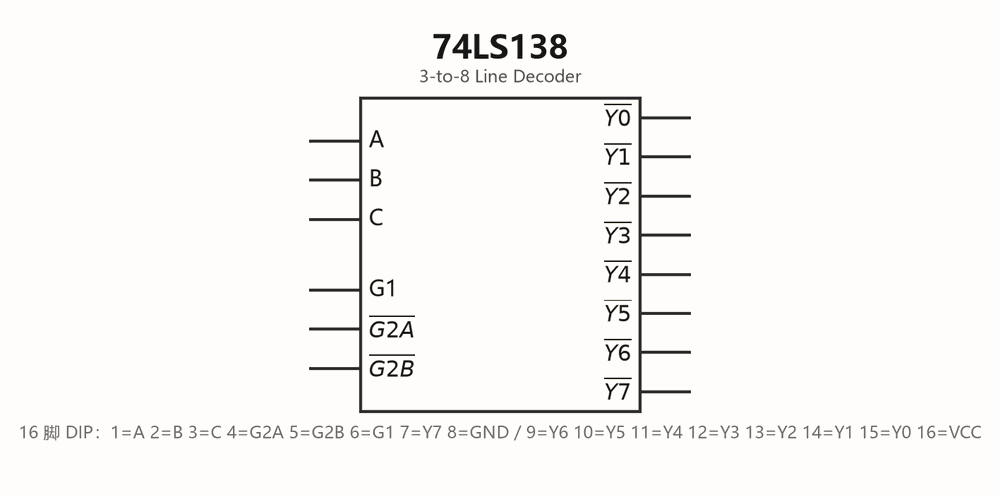
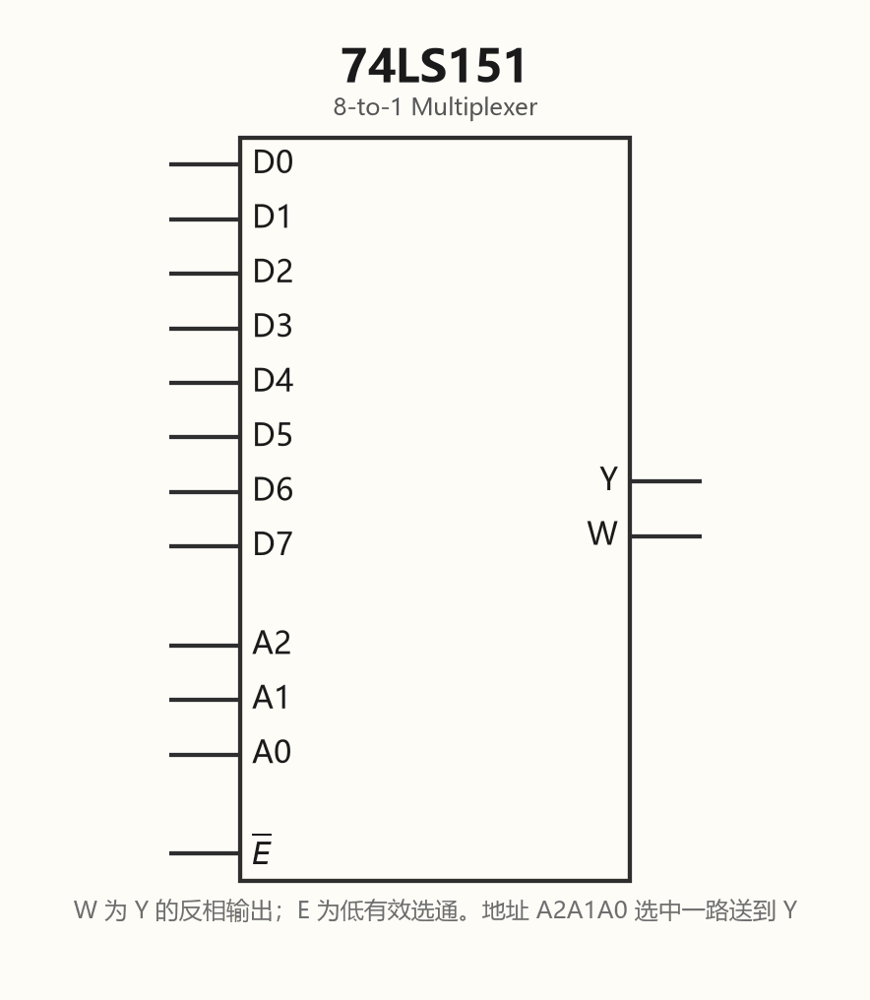
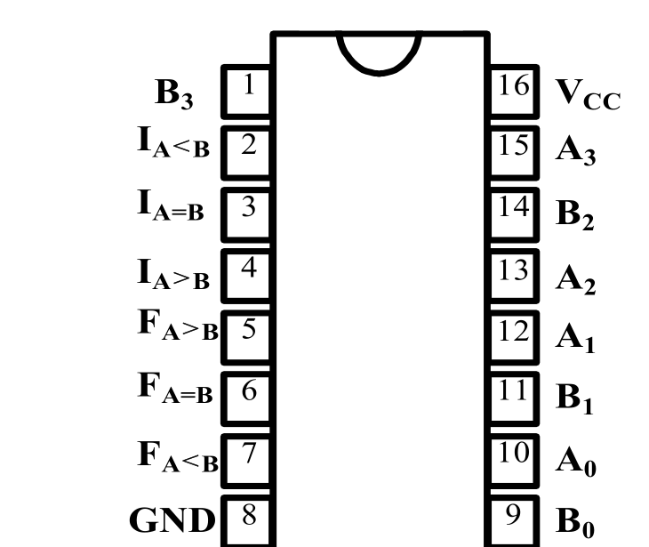
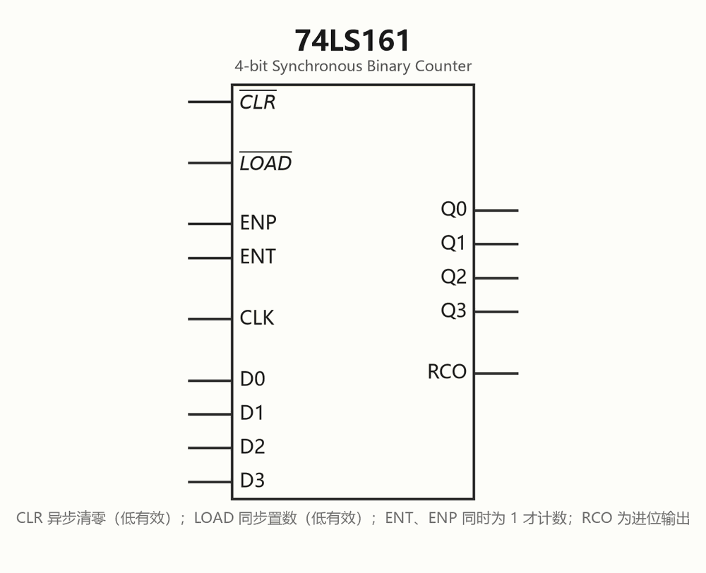
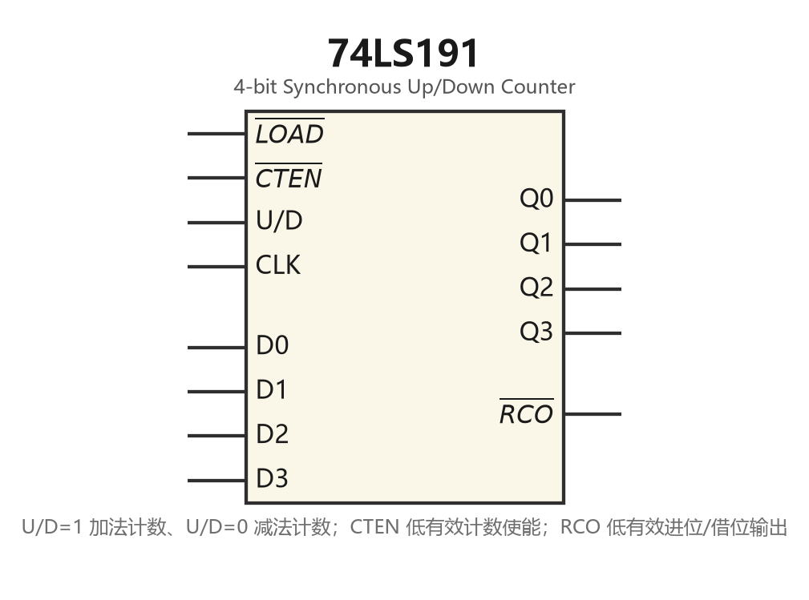
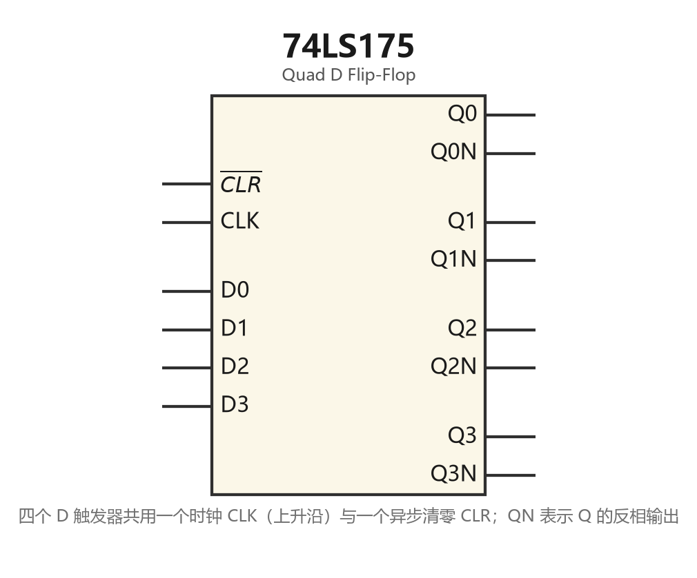
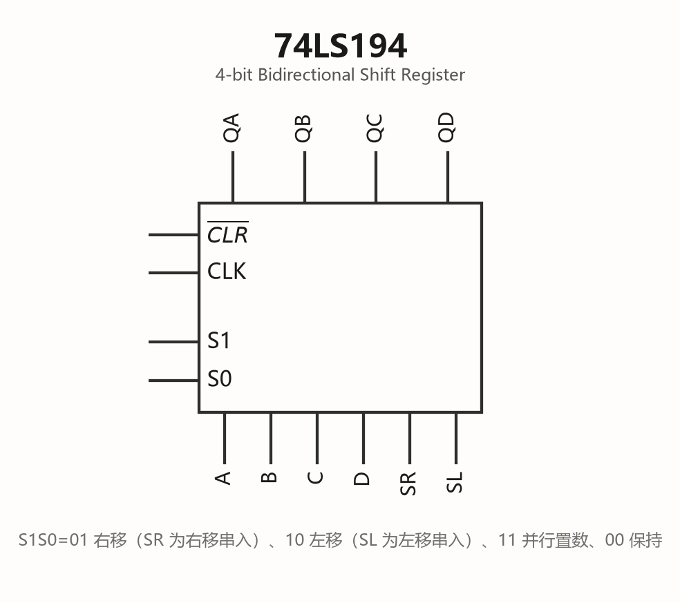

# 集成器件引脚与考法速查

> **定位**：把课上出现的**全部常用集成器件**汇成一册——认得出型号、画得出引脚、接得对电路、答得中考点。
> **配套**：`第4章_组合逻辑电路/`、`第5章_触发器/`、`第6章_时序逻辑电路/`、`第7章_…/` 四章讲义；`试卷/练习题集_逐题精析.md`、`试卷/真题精解/` 六套原卷。
> **题源标注约定**：【练】= 四套练习卷，【真 xx】= 真题精解第 xx 卷，【期末】= 期末习题集。
> **图示说明**：本册器件符号图统一按"**逻辑符号（框图）**"绘制——考场上要画的是这个，不是封装外形；需要实物脚号时查第七节脚号表或课件原图。
> **连线实例**：每个器件下面都有一个或多个 **【连线实例】** 小节，格式统一为"**原题 → 连线表（引脚 / 接到 / 为什么）→ 为什么这样接就成立 → 易错**"。连线表里的"为什么"是这册最该看的部分——**会背功能表不等于会连线，题目的分都在"这根线为什么接这儿"上**。
> 凡有确切脚号的器件（138、85、194、160/161、555），连线表**直接给脚号**；其余器件教材未给脚号，只给引脚名——考试若给实物图，按图认，别凭记忆写脚号。

---

## 一、先认全：12 个器件与它们的家族


按功能分成三个家族。**同一个家族的器件，考题套路几乎一模一样**，所以先按家族记，再记各自差异。

| 家族 | 器件 | 一句话职能 | 章节 | 出镜率 |
|---|---|---|---|---|
| **组合逻辑** | 74LS148 | 8 个输入压成 3 位代码，**高号优先** | §4.3 编码器 | ★★ |
| | 74LS138 | 3 位地址译出 8 根线，**只有一根低** | §4.4 译码器 | ★★★ |
| | 74LS151 | 8 路里挑 1 路送到输出 | §4.5 数据选择器 | ★★★ |
| | 74LS153 | 双 4 选 1，两组共用地址 | §4.5 数据选择器 | ★★ |
| | 74LS85 | 两个 4 位数比大小 | §4.6 数值比较器 | ★ |
| | 74LS283 | 4 位数相加，带超前进位 | §4.7 加法器 | ★ |
| **时序逻辑** | 74LS161 | 二进制加法计数 0→15 | §6.5 计数器 | ★★★ |
| | 74LS160 | 十进制加法计数 0→9 | §6.5 计数器 | ★★ |
| | 74LS191 | 单时钟可加可减 | §6.5 计数器 | ★ |
| | 74LS175 | 四个 D 触发器打包 | §5.5 集成触发器 | ★ |
| | 74LS194 | 数据能左移、右移、并行装入 | §6.6 移位寄存器 | ★★ |
| **脉冲与定时** | NE555 | 定时、整形、振荡三合一 | §7.3～7.6 | ★★★ |

> **一眼分辨口诀**：**1 开头多半是组合（138/148/151/153），1 后面带 6 的是计数器（160/161/191），带 9 的是移位（194），5 开头是 555。** 型号不是乱编的，记住家族编号段就够应付选择题。

---

## 二、组合逻辑器件

### 2.1 74LS138　3 线-8 线译码器



**引脚画法要点**：左边三根地址线 **C B A**（C 是最高位，别写反），三根使能 **G1（高有效）、G2A、G2B（低有效）**；右边八根输出 **Ȳ0～Ȳ7 全部低有效**。图上每根输出名上那道横线就是"低有效"，**画图时必须画**，漏画扣分。

**课件原版封装图**（左右两列脚号看清楚，考试给实物图时按这个认）：


**功能表（精简版）**：

| G1 | G2A | G2B | 输出 |
|---|---|---|---|
| 0 | × | × | 全为 1（禁止） |
| × | 1 | × | 全为 1（禁止） |
| × | × | 1 | 全为 1（禁止） |
| **1** | **0** | **0** | 按 CBA 译码，**被选中那根为 0**，其余为 1 |

**真值关系**：$\overline{Y_i}=\overline{m_i}$，即 $\overline{Y_i}$ 恰好是第 $i$ 个最小项的**反**。这一条是全部用法的根。

**对应题库**

| 维度 | 内容 |
|---|---|
| **(a) 章节** | 第 4 章 §4.4 译码器 |
| **(b) 题型** | 设计题（实现逻辑函数）、读图题（给电路反写函数）、填空题（最小项个数） |
| **(c) 考法** | ①**用 138 + 与非门实现组合函数**（最高频）；②**读图写函数**；③使能端接法（单片/级联）；④"3-8 译码器把 3 个输入变成几个最小项输出"→ **8 个** |
| **(d) 知识点** | 最小项与 $\overline{Y_i}$ 的对应、与非门"取反再相与"、低有效输出的极性 |
| **(e) 使用过程** | 见下方四步 |

**怎么用（四步，背下来就够）**

1. 把要实现的函数化成**最小项之和**：$F=\sum m(i_1,i_2,\dots)$；
2. 找出这些最小项对应的输出脚 $\overline{Y_{i_1}},\overline{Y_{i_2}},\dots$——**注意取的是同号，不需要反**；
3. 把这些脚接到一个**与非门**的输入端；
4. 单只与非门不够（输入数不足）时，先两两与非再合并；使能端固定接 $G1=1$、$G2A=G2B=0$。

> **为什么是与非门而不是与门？** 因为 $\overline{Y_i}$ 是 $m_i$ 的反，先与非一次正好把极性翻回来：$\overline{\overline{m_{i_1}}\cdot\overline{m_{i_2}}}=m_{i_1}+m_{i_2}=F$。

#### 连线实例 ①　【练 第一套 第四大题】$Y=AB\bar C+A\bar BC+BC$

**原题**：试用 74LS138 实现逻辑函数 $Y=AB\bar C+A\bar BC+BC$，先化最小项，再画电路。

**第一步　补成全最小项**（这一步决定连线对不对）

$BC$ 只有两个变量，缺 $A$，必须补齐：$BC=BC(A+\bar A)=ABC+\bar ABC$。

$$Y=\bar ABC+A\bar BC+AB\bar C+ABC=\sum m(3,5,6,7)$$

**为什么要先补齐**：138 的每根输出只对应**一个**最小项，"$BC$ 这种半截项"在芯片上找不到对应脚。补不齐就少接一根线，这是本题第一大失分点（漏 $m_3$）。

**第二步　连线表（照这张接）**

| 74LS138 引脚 | 接到 | 为什么这么接 |
|---|---|---|
| 脚 3（C＝$A_2$，最高位） | 函数变量 **A** | 芯片内部按 $A_2A_1A_0$ 编址，$m_i=4A_2+2A_1+A_0$。函数习惯把 A 当最高位，所以 A 必须进最高位脚 |
| 脚 2（B＝$A_1$） | 函数变量 **B** | 中间位对中间位 |
| 脚 1（A＝$A_0$，最低位） | 函数变量 **C** | 函数的 C 是最低位，进最低位脚 |
| 脚 12（$\bar Y_3$） | 四输入与非门 输入 1 | 对应 $m_3$ |
| 脚 10（$\bar Y_5$） | 四输入与非门 输入 2 | 对应 $m_5$ |
| 脚 9（$\bar Y_6$） | 四输入与非门 输入 3 | 对应 $m_6$ |
| 脚 7（$\bar Y_7$） | 四输入与非门 输入 4 | 对应 $m_7$ |
| 脚 6（G1＝$S_1$） | **+5 V（1）** | 高有效使能，接 0 整片禁用 |
| 脚 4（G2A＝$\bar S_2$） | **GND（0）** | 低有效使能，必须拉低 |
| 脚 5（G2B＝$\bar S_3$） | **GND（0）** | 同上，三者缺一不译码 |
| 脚 8 / 脚 16 | GND / +5 V | 供电 |
| 其余 $\bar Y_0,\bar Y_1,\bar Y_2,\bar Y_4$ | **悬空** | 138 输出是内部驱动的，不用外接，不用的空着即可 |

**第三步　为什么这样接就"刚好"对**

四根输出脚进与非门：

$$\overline{\bar Y_3\cdot\bar Y_5\cdot\bar Y_6\cdot\bar Y_7}=\overline{\overline{m_3}\cdot\overline{m_5}\cdot\overline{m_6}\cdot\overline{m_7}}=m_3+m_5+m_6+m_7=Y$$

**两次取反正好抵消**——138 先反一次（低有效输出），与非门再反一次，就还原成"最小项之和"。这就是"必须用与非门"的全部理由。

**信号流**

```
 A ──► C (3) ┐                   ┌─ Ȳ3 (12) ┐
 B ──► B (2) ├── 74LS138 ────────┤  Ȳ5 (10) ├──► 四输入 ──► Y
 C ──► A (1) ┘                   │  Ȳ6 ( 9) │    与非门
                                 └─ Ȳ7 ( 7) ┘
 G1(6)=1   G2A(4)=G2B(5)=0
```

**三处必错点**

1. **地址接反**：把函数 A 接到脚 1（芯片最低位）→ 编号全乱，取到的脚全错。记一句话：**"符号最左边的 C 脚，接函数的 A"**。
2. **用与门代替与非门**：极性只反一次，答案整体取反。
3. **使能悬空**：TTL 悬空当 1，脚 4/5 悬空即 G2A=G2B=1 → 整片禁用 → 八根输出全 1 → 与非门恒输出 0。

#### 连线实例 ②　【真 02 第四大题】$F_1=AB+AC$（同一接法，换函数）

$F_1=AB+AC=A(B+C)=\sum m(5,6,7)$。

接线只改两处：**只引三根输出**——脚 10（$\bar Y_5$）、脚 9（$\bar Y_6$）、脚 7（$\bar Y_7$）→ **三**输入与非门；其余完全相同。

> **规律**：138 的连线**永远只有两个变量**——① 地址怎么接（A→C 脚、B→B 脚、C→A 脚）；② 引哪几根输出。函数一变，只改第 ② 项，地址那三根永不变。
> **门数怎么定**：要几个最小项，就用几输入的与非门。超过 8 个（不可能，最多 8 个）或门不够用时才两级：先两两与非，再与非合并。


**题目里怎么出**

- 【练 第一套 四大题】"用 74LS138 和与非门实现 $F$"——给了函数式，要画连线，**8 分里 4 分在连线、4 分在写最小项**。
- 【练 第二套（=第三套）四大题】"读图写 $Y$、$Z$"——给一张已接好的图，要求反推表达式并化简到最简与或式。
- 【真 01 四】【真 02 四】【真 03 七】【真 04 四】【真 05 七】【真 06 三】六套卷里有五套都考它，形式在"实现"和"读图"之间轮换。
- 【期末 填空】"3-8 译码器将 3 个输入变量变换成 ＿＿ 个最小项输出"→ **8**。

**易错**：① 地址线顺序写成 A B C（应为 **C 最高**）；② 输出漏画横线；③ 误用与门（极性反了，答案整体取反）；④ 只接一个与非门却要求实现 4 个最小项（门输入数不够，须两级）。

---

### 2.2 74LS148　8 线-3 线优先编码器


**引脚画法要点**：左边 8 根输入 **Ī7～Ī0 低有效**，且 **I7 优先级最高**（号码大者优先，这和"低位优先"的直觉相反，务必记牢）；右边 3 根输出 **Ȳ2 Ȳ1 Ȳ0 是反码输出**，另有两根扩展用：**ȲEN 选通输出、ȲEX 扩展输出**。使能 **ĒI 低有效**。

**关键功能关系**（教材写法）：

| 条件 | 结果 |
|---|---|
| $\overline{EI}=1$ | 芯片不工作，$\overline{Y_2}\overline{Y_1}\overline{Y_0}=111$，$\overline{Y_{EN}}=1$、$\overline{Y_{EX}}=1$ |
| $\overline{EI}=0$，有输入为 0 | 对**号码最高**的那个输入编码，$\overline{Y_{EN}}=1$、$\overline{Y_{EX}}=0$ |
| $\overline{EI}=0$，无输入为 0 | $\overline{Y_2}\overline{Y_1}\overline{Y_0}=111$，$\overline{Y_{EN}}=0$、$\overline{Y_{EX}}=1$ |

> **记忆钩子**：输出是**反码**——输入 I7 有效时输出是 $\overline{Y_2}\overline{Y_1}\overline{Y_0}=000$（二进制 7 的反码 000），输入 I0 有效时是 111（0 的反码）。**"7 通给 000、0 通给 111"**，一句话记住整张表。

**对应题库**

| 维度 | 内容 |
|---|---|
| **(a) 章节** | 第 4 章 §4.3 编码器 |
| **(b) 题型** | 填空题（编码位数）、简答题（优先的含义）、选择题（147/148 与数码管搭配） |
| **(c) 考法** | ①**"50 个编码对象至少需要几位代码"**（$2^5=32<50\le64=2^6$，答 **6 位**）；②优先级判断（多路同时有效时编哪个）；③反码输出的读法；④与七段译码器 74LS48 / 74LS147 的搭配识别 |
| **(d) 知识点** | 优先编码的定义、反码输出、$2^n\ge N$ 的位数估算 |
| **(e) 使用过程** | 见下 |

**怎么用**

1. 先看**有没有多路同时有效**：有就按"号码最大者"编码，其余忽略；
2. 读输出时**先取反再当二进制数**：$\overline{Y_2}\overline{Y_1}\overline{Y_0}=011$ → 反码 011 → 原码 100 = 4，即 I4 有效；
3. 级联扩位数时，高位片的 $\overline{Y_{EX}}$ 接低位片的 $\overline{EI}$，$\overline{Y_{EN}}$ 汇总做总选通。

> ⚠️ **名称对不上是正常的**：芯片手册叫 $\bar{EI}$（使能输入）、$\bar{EO}$（选通输出）、$\bar{GS}$（组信号）；教材 4.3 节叫 $\bar S$、$\bar Y_S$、$\bar Y_{EX}$。**三种写法指同一根线**。本册下文按教材写法（$\bar S$ / $\bar Y_S$ / $\bar Y_{EX}$），因为考试按教材答。

#### 连线实例　【两片级联 → 16 线-4 线】教材 P47 例

**要解决的问题**：单片 148 只有 8 根输入、3 位输出。16 个对象怎么办？→ 两片并联，用"谁有请求"来决定最高位。

**连线表**

| 引脚 | 接到 | 为什么这么接 |
|---|---|---|
| 高位片 $\bar S$ | **GND（0）** | 常使能。高位片必须先判，不能受别人控制 |
| 高位片 $\bar I_7\sim\bar I_0$ | 输入 $\bar A_{15}\sim\bar A_8$ | 高位片管高 8 个对象 |
| 高位片 $\bar Y_S$ | **低位片 $\bar S$** | 关键的一根线：高位有请求时 $\bar Y_S=1$ → **封锁**低位片；高位无请求时 $\bar Y_S=0$ → **放行**低位片。优先权就靠它传递 |
| 高位片 $\bar Y_{EX}$ | **输出 $Z_3$（第 4 位）** | 高位有请求时 $\bar Y_{EX}=0$。输出是低有效，$Z_3=0$ 正好表示"编号 $\ge 8$" |
| 低位片 $\bar S$ | 来自高位片 $\bar Y_S$ | 被动，不自己决定 |
| 低位片 $\bar I_7\sim\bar I_0$ | 输入 $\bar A_7\sim\bar A_0$ | 低位片管低 8 个对象 |
| 两片的 $\bar Y_2\bar Y_1\bar Y_0$ | 对应位进**与门**，输出 $Z_2Z_1Z_0$ | 见下方"为什么是与门" |

**为什么低 3 位要"相与"而不是直接取一片**

两片输出都是**低有效**：没干活的那片输出恒为 111。

- 若直接把两片同名端**短接**：一片输出 0、一片输出 1，就是短路，逻辑上也不成立；
- 用**与门**：$111\ \text{与}\ x = x$——"没干活的片全 1，与起来不干扰"，干活的片说的话原样传出去。

这就是"低有效逻辑级联必须与、高有效逻辑级联必须或"的那条通则。

**信号流**

```
  Ā15~Ā8 ──► ┌──────────┐  ȲS ──────────► S̄ ┌──────────┐ ◄── Ā7~Ā0
  S̄=0  ─────► │ 高 位片  │                    │ 低 位片  │
             │ (编号8~15)│  ȲEX ──► Z3         │ (编号0~7)│
             └────┬─────┘                    └────┬─────┘
                  │ Ȳ2 Ȳ1 Ȳ0                     │ Ȳ2 Ȳ1 Ȳ0
                  └───────────┬──────────────────┘
                              ▼
                         与门 ×3 ──► Z2 Z1 Z0
```

读图顺序：**先看高位片有没有请求 → ȲS 决定低位片让不让说话 → 低 3 位在与门处汇合**。

**易错对照**

| 错法 | 后果 |
|---|---|
| 高位片 $\bar Y_{EX}$ 接低位片 $\bar S$ | 极性反了：高位**有**请求时反而放行低位 → 两片同时输出，编码错乱 |
| 低 3 位直接短接（不用与门） | 逻辑上"线与"变成硬碰硬，一片出 0 一片出 1 |
| 两片 $\bar S$ 都接 0 | 低位片永远不会被封锁，优先权完全失效 |

**题目里怎么出**

- 【真 06 第 13 题】"若在编码器中有 50 个编码对象，则要求输出二进制代码位数为（　）位"——选择题，答案 6。
- 【真 03 第 3 题】"优先编码器 74LS147、七段字符译码驱动器 74LS48 和七段数码管构成的电路…"——考**器件搭配**，不是单独考 148。
- 判断题常考"优先编码器要求输入互斥"→ **错**，优先编码器的意义恰恰是允许同时有效。

**易错**：① 把"优先"理解成"低位优先"；② 忘记输出是反码，直接把 111 当成 7；③ 算位数时把 $2^n\ge N$ 写成 $2^n>N$。

---

### 2.3 74LS151　8 选 1 数据选择器



**引脚画法要点**：左边 8 根数据 **D0～D7**（**高有效，无横线**，这点和 138/148 相反，最容易画错）；3 根地址 **A2 A1 A0**；使能 **Ē 低有效**；右边两根输出 **Y 与 W**，其中 $W=\overline{Y}$。

**基本关系**：$Y=\sum_{i=0}^{7}D_i m_i$，即"地址选中谁，就把谁送到 Y"。**它本质上就是一台"用地址选最小项"的机器**，所以能用它实现任意三变量函数。

**对应题库**

| 维度 | 内容 |
|---|---|
| **(a) 章节** | 第 4 章 §4.5 数据选择器与数据分配器 |
| **(b) 题型** | 设计题（用 151 实现函数）、读图题（给图求 L）、选择题（153/151 的区分） |
| **(c) 考法** | ①**用 151 实现三变量函数**（地址接 A2A1A0，数据端接 0/1 或单个变量）；②**读图求表达式**；③151 与 153 的引脚/地址端对比 |
| **(d) 知识点** | $Y=\sum D_im_i$、数据端接变量的降维技巧、使能端低有效 |
| **(e) 使用过程** | 见下三步 |

**怎么用（三步）**

1. **地址端接变量**：把函数的 3 个变量接到 A2 A1 A0（顺序按题目给的变量顺序，别自己调）；
2. **数据端对着真值表填**：函数在该最小项为 1 → $D_i=1$；为 0 → $D_i=0$；
3. 使能端接 $\overline{E}=0$。

> 若函数是**四变量**，只接 3 个做地址，剩下那一个变量会出现在数据端：$D_i$ 写成 $x$ 或 $\overline{x}$。这是 151 的进阶考法，也是 138 做不到、151 做得到的差别。

#### 连线实例 ①　【练 第四套 第四大题】$F=A\bar B+C$

**原题**：试用 74LS151 实现 $F=A\bar B+C$，先化最小项，再画电路结构图。

**第一步　化成最小项之和**

$$F=A\bar B(C+\bar C)+(A+\bar A)(B+\bar B)C=AB\bar C+A\bar B\bar C+ABC+A\bar BC+\bar ABC+\bar A\bar BC$$

去重（$A\bar BC$ 出现两次）→ $F=\bar A\bar BC+\bar ABC+A\bar B\bar C+AB\bar C+ABC=\sum m(1,3,4,5,7)$。

**第二步　连线表**

| 74LS151 的端 | 接到 | 为什么这么接 |
|---|---|---|
| $A_2$ | 函数变量 **A** | 地址选中第 $i$ 个最小项，$i=4A_2+2A_1+A_0$ |
| $A_1$ | 函数变量 **B** | 同上，中间位 |
| $A_0$ | 函数变量 **C** | 同上，最低位 |
| $D_1,D_3,D_4,D_5,D_7$ | **+5 V（1）** | 这 5 个最小项函数值为 1，选中时把 1 送到输出 |
| $D_0,D_2,D_6$ | **GND（0）** | 这 3 个最小项为 0 |
| $\bar E$（使能） | **GND** | 低有效；接 1 则 $Y$ 恒为 0，整题白做 |
| $Y$ | 输出 $F$ | 原码输出，就是函数值 |
| $W$ | **悬空** | $W=\bar Y$ 是反码输出，本题不用 |

**第三步　为什么这次不用与非门了**

对比着记这一句：**138 是"生成最小项"，151 是"挑选最小项"**。

- 138 每根输出是 $\overline{m_i}$（反着的），必须靠与非门把极性翻回来；
- 151 的数据端本身就是 1 或 0，地址一选中就原样送到 $Y$，**不需要任何附加门**。

所以一片 151 ＋ 八根数据端接线就是一个三变量函数，比 138 方案少一个与非门——这就是"单输出函数优先选 151"的理由。

**信号流**

```
          ┌──── 74LS151 ────┐
 A ──► A2 │                 │
 B ──► A1 │            Y ───┼──► F
 C ──► A0 │                 │
 1 ──► D1 D3 D4 D5 D7       │
 0 ──► D0 D2 D6             │
 0 ──► Ē                    │
          └─────────────────┘
```

#### 连线实例 ②　四变量降维：$F=AB+CD$（151 独有的本事）

**问题**：151 只有 3 根地址，函数却 4 个变量，怎么接？

**办法**：A、B、C 接地址，**D 留在数据端**——把真值表按 $ABC$ 分组，看同一组里 $F$ 随 D 怎么变。

| 地址 $ABC$ | $F=AB+CD$ 随 D 的变化 | 该组的数据端取什么 |
|---|---|---|
| 000（$m_0m_1$） | $AB=0$、$C=0$ → $F=0$，与 D 无关 | $D_0=0$ |
| 001（$m_2m_3$） | $AB=0$、$C=1$ → $F=D$ | $D_1=D$ |
| 010（$m_4m_5$） | $A=0$ 故 $AB=0$、$C=0$ → $F=0$ | $D_2=0$ |
| 011（$m_6m_7$） | $AB=0$、$C=1$ → $F=D$ | $D_3=D$ |
| 100～111 | $A=1$ 故 $AB=1$ → $F=1$，与一切无关 | $D_4=D_5=D_6=D_7=1$ |

**结论**：$D_0=D_2=0$、$D_1=D_3=D$、$D_4\sim D_7=1$。

**为什么这样能省器件**：3 根地址已经把前三个变量的组合穷举完了，剩下的那一个变量只有 0/1 两种走向，把它当"数据"喂进去即可——**地址管穷举、数据管剩下的变量**。138 做不到（输出极性固定，装不下变量）。

**题目里怎么出**

- 【练 第四套 四大题】"用 74LS151 实现 $F=A\bar B+C$（$=\sum m(1,3,4,5,7)$）"——10 分，要画连线，**五个数据端接 1、三个接 0**（$D_1D_3D_4D_5D_7=1$、$D_0D_2D_6=0$）。
- 【真 03 第 9 题】"如图所示是由 8 选 1 数据选择器 74LS151 实现的某组合逻辑函数，该函数…"——选择题，考读图反推。
- 【真 05】"（1）求 $L$ 的表达式并化简"——151 读图 + 化简，两步走。

**易错**：① 地址端顺序接反（A0 接到 A2 位置）；② 数据端该接变量却接成 1；③ 把 W 当 Y 用（W 是反相输出）。

---

### 2.4 74LS153　双 4 选 1 数据选择器


**引脚画法要点**：**两组各 4 个数据端（1D0～1D3、2D0～2D3）、各一个输出（1Y、2Y）、各一个低有效使能（1Ē、2Ē）**，而**地址端 S1 S0 是两组共用的**——"共用地址"是 153 的标志性特征，也是最常考的一句话。

**对应题库**

| 维度 | 内容 |
|---|---|
| **(a) 章节** | 第 4 章 §4.5 数据选择器 |
| **(b) 题型** | 选择题（识别器件）、设计题（低配版 151） |
| **(c) 考法** | ①"双 4 选 1"与"8 选 1"的区分；②两组共用地址时的同步选择；③用 153 实现两输出函数 |
| **(d) 知识点** | 共用地址、双输出、使能低有效 |
| **(e) 使用过程** | 与 151 同理，只是数据端只有 4 个、地址只有 2 位 |

**怎么用**：两个函数共享同一组地址 → 一次选中，**两个输出同时给出两位结果**。这正是"用一片 153 同时实现两个二变量函数"的原理。

#### 连线实例　一片 153 同时实现 $F_1=A\oplus B$ 与 $F_2=A+B$

**为什么这题该用 153 而不是两片 151**：两个函数用的是**同一组变量 A、B**。153 的地址端是共用的，A、B 接一次就同时喂给两组，两组的 4 个数据端各填各的，一次选中输出两位结果——**省一半器件、省一半地址线**。这就是"共用地址"这个设计的全部意义。

**连线表**

| 74LS153 的端 | 接到 | 为什么这么接 |
|---|---|---|
| $S_1$ | 函数变量 **A** | 两组共用，A 是高位 |
| $S_0$ | 函数变量 **B** | 两组共用，B 是低位 |
| $1D_0$ | **0** | $AB=00$ 时 $F_1=0\oplus0=0$ |
| $1D_1$ | **1** | $AB=01$ 时 $F_1=0\oplus1=1$ |
| $1D_2$ | **1** | $AB=10$ 时 $F_1=1\oplus0=1$ |
| $1D_3$ | **0** | $AB=11$ 时 $F_1=1\oplus1=0$ |
| $2D_0$ | **0** | $AB=00$ 时 $F_2=0+0=0$ |
| $2D_1,2D_2,2D_3$ | **1** | 只要有一个 1，或的结果就是 1 |
| $1\bar E$、$2\bar E$ | **GND（0）** | 两组各自独立，**都要单独拉低**，漏一个那一路就恒为 0 |
| $1Y$、$2Y$ | $F_1$、$F_2$ | 两组各自的输出 |

**为什么不接成"两片 4 选 1 各管一个函数"**：也能做，但要两组地址线，且两片各有一套使能——153 把这两件事合并了。**判断什么时候该用 153**：题目里两个函数**变量相同**、只是逻辑不同。

**易错**：① 以为两组地址各自独立（实际共用，这是 153 的标志）；② 只把 $1\bar E$ 接地、$2\bar E$ 悬空（第二路死掉）。

**题目里怎么出**：多出现在选择题与读图题里（"图中 74LS153 的地址端接法说明什么"），单独出大题较少。

**易错**：① 以为两组地址各自独立；② 忘记每组都要单独使能（1Ē、2Ē 都要接 0）。

---

### 2.5 74LS85　4 位数值比较器


**引脚画法要点**：左侧 **A3～A0、B3～B0** 两组被比较数（**A3、B3 是最高位**）；另有 **3 根级联输入 I(A>B)、I(A=B)、I(A<B)**；右侧 3 根输出 **F(A>B)、F(A=B)、F(A<B)**。



**课件原图给出的脚号**：1=B3、2=I(A<B)、3=I(A=B)、4=I(A>B)、5=F(A>B)、6=F(A=B)、7=F(A<B)、8=GND、9=B0、10=A0、11=B1、12=A1、13=A2、14=B2、15=A3、16=VCC。**注意左右不是简单镜像：左侧第一个脚是 B3 而不是 A3。**

**对应题库**

| 维度 | 内容 |
|---|---|
| **(a) 章节** | 第 4 章 §4.6 数值比较器 |
| **(b) 题型** | 选择题、简答题（级联接法） |
| **(c) 考法** | ①**单片使用时级联输入怎么接**（必考）：$I(A>B)=I(A<B)=0$、$I(A=B)=1$；②多位比较的级联方向（低位输出接高位输入）；③输出唯一定理：三个输出**有且只有一个为 1** |
| **(d) 知识点** | 比较器的级联、高位优先裁决、级联输入的电平规定 |
| **(e) 使用过程** | 见下 |

**怎么用（级联）**

1. 低位片的 $F(A>B)、F(A=B)、F(A<B)$ 分别接到高位片的 $I(A>B)、I(A=B)、I(A<B)$；
2. 最低位的级联输入按上面那条固定接法；
3. 最高片的三个输出就是总结果。

> **为什么最低位要那样接？** 因为"没有更低位可比"时，必须认为低位**相等**，所以 $I(A=B)=1$，比较才从本位开始裁决。

#### 连线实例 ①　单片比较两个 4 位数

**连线表**

| 74LS85 引脚 | 接到 | 为什么这么接 |
|---|---|---|
| 脚 15、13、12、10（A3～A0） | 被比较数 **A** 的 4 位 | A3 是最高位，接错位就变成"比较别的数" |
| 脚 1、14、11、9（B3～B0） | 被比较数 **B** 的 4 位 | **注意脚 1 是 B3 不是 A3**，左右不是镜像，这是本器件最容易接错的地方 |
| 脚 4（I(A>B)） | **GND（0）** | 没有更低位 → 低位不可能"大于" |
| 脚 3（I(A=B)） | **+5 V（1）** | 没有更低位 → 视为**相等**，让本位开始裁决 |
| 脚 2（I(A<B)） | **GND（0）** | 没有更低位 → 低位不可能"小于" |
| 脚 5、6、7（F(A>B)、F(A=B)、F(A<B)） | 输出 | 三个输出**有且只有一个为 1** |

**为什么脚 4 和脚 2 必须接 0、脚 3 必须接 1**

这三根叫"级联输入"，是给"更低位"留的口子。设成"低位相等"是唯一合乎逻辑的初值：如果设成 $I(A>B)=1$，那无论本片怎么比，输出都会告诉你有更高位"大于"——荒谬。**悬空更糟**：TTL 悬空当 1，等于强行宣布"低位 A>B"，全盘皆错。

#### 连线实例 ②　两片级联 → 比较两个 8 位数

| 连接 | 从 | 到 | 为什么 |
|---|---|---|---|
| 数据 | $A_7\sim A_4$、$B_7\sim B_4$ | **高位片** A3～A0、B3～B0 | 高 4 位给高位片 |
| 数据 | $A_3\sim A_0$、$B_3\sim B_0$ | **低位片** A3～A0、B3～B0 | 低 4 位给低位片 |
| 级联 | 低位片的脚 5、6、7（三个 F） | **高位片的脚 4、3、2**（三个 I） | 低位比完的结论要**交给高位参考** |
| 初值 | 低位片脚 4=0、3=1、2=0 | — | 最低位那一片没有更低位可看 |

**为什么是"低位输出 → 高位输入"而不是反过来**

比较的规则是**高位优先**：高位一出现差异，低位怎么比都没意义了。所以高位的裁决必须在最后一步做，它的"级联输入"要等低位先给出结论——**低位当输入、高位当裁判**，方向不能反。

反了会怎样：高位先拿自己的结论当"低位结论"去比，等于把两个 4 位数的比较结果重复用了一遍，8 位比较直接退化成"只看高 4 位"。

**易错**：① 单片时级联输入悬空（结果不定，考试必错）；② 级联方向接反（高位输出接低位输入）；③ 把脚 1 当 A3（实际是 B3）。

---

### 2.6 74LS283　4 位超前进位加法器


**引脚画法要点**：左侧 8 根加数 **A3～A0、B3～B0**，加低位进位 **C0**；右侧 4 位和 **S3～S0** 与进位输出 **C4**。

**基本关系**：$\{C_4,S_3S_2S_1S_0\}=A+B+C_0$，**注意 C4 是第 5 位**，别只写 4 位和。

**对应题库**

| 维度 | 内容 |
|---|---|
| **(a) 章节** | 第 4 章 §4.7 加法器 |
| **(b) 题型** | 计算题（补码运算）、设计题（用 283 做减法/码制转换） |
| **(c) 考法** | ①**补码加法求 $A-B$**：$A-B=A+\overline{B}+1$，把 $\overline{B}$ 接 B 端、$C_0$ 接 1；②级联成 8 位；③"超前进位"与串行进位的速度差别 |
| **(d) 知识点** | 补码减法、进位链、超前进位（CLA）为什么快 |
| **(e) 使用过程** | 见下 |

**怎么用（做减法）**：$B$ 的每根线**先经反相器**再接 283 的 B 端，同时把 $C_0$ 接 **1**（加 1 完成取补），输出就是 $A-B$ 的补码形式。

#### 连线实例　用 283 做 $A-B$：$9-3=6$

**先讲为什么能这么做**

补码里 $-B=\bar B+1$，所以

$$A-B=A+\bar B+1$$

式子里只有两件事要做：**把 B 取反**、**再补一个 1**。283 是纯加法器，它不会减法，但这两件事一个非门组、一根 $C_0$ 就能骗过去——这就是"加法器做减法"的全部原理。

**连线表**

| 74LS283 的端 | 接到 | 为什么这么接 |
|---|---|---|
| $A_3\sim A_0$ | 被减数 $A$ 的 4 位（原样） | 被减数不取反 |
| $B_3\sim B_0$ | 减数 $B$ 的 4 位**各经一个非门** | 补码减法需要 $\bar B$；4 位就 4 个非门 |
| $C_0$ | **+5 V（1）** | 这是"取反加一"里的那个 **+1**，漏接就差 1，结果永远少 1 |
| $S_3\sim S_0$ | 差（补码形式） | 无借位时就是真值 |
| $C_4$ | **借位标志** | $C_4=1$ → 无借位（$A\ge B$）；$C_4=0$ → 有借位，结果要按补码解读为负数 |

**验算一遍（考场上就该这样自查）**

$A=1001_2=9$，$B=0011_2=3$，则 $\bar B=1100_2$。

$$A+\bar B+C_0=1001+1100+1=1\,0110_2$$

取低 4 位 $\Rightarrow S_3S_2S_1S_0=0110_2=6$，$C_4=1$ 表示无借位。$9-3=6$ ✓

**再验一个负数**：$A=0011=3$、$B=1001=9$，$\bar B=0110$：

$$0011+0110+1=0\,1010_2\Rightarrow S=1010,\ C_4=0$$

$C_4=0$ 说明有借位，$1010$ 是补码：取反加一得 $0110=6$，带负号即 $-6$。$3-9=-6$ ✓

**两片级联做 8 位**：低位片的 $C_4$ 接**高位片的 $C_0$**——进位必须一级一级往上传，这和手算竖式完全一样。别接反（高位进位接低位），否则 8 位加法变成两个独立的 4 位加法。

**易错**：① 做减法时忘了 $C_0=1$；② 只取 4 位和而漏掉 $C_4$（借位/溢出判断全靠它）；③ 把 $\bar B$ 的 4 个非门接到 $A$ 端上（取反了被减数）。

---

## 三、时序逻辑器件

### 3.1 74LS161　4 位同步二进制计数器



**引脚画法要点**：左侧 **C̄LR 异步清零（低有效）、L̄OAD 同步置数（低有效）、ENP、ENT（都高才计数）、CLK（上升沿）**，再有 4 根并行数据 **D0～D3**；右侧 **Q0～Q3** 与进位输出 **RCO**。

> **"异步清零、同步置数"八个字是本章最贵的一句话**：C̄LR 一拉低**立刻**清零（不等时钟）；L̄OAD 拉低后要**等下一个上升沿**才装入。判断题、改错题、设计题全从这里出。

**对应题库**

| 维度 | 内容 |
|---|---|
| **(a) 章节** | 第 6 章 §6.5 计数器 |
| **(b) 题型** | 设计题（构成任意进制计数器）、读图题、填空/选择题 |
| **(c) 考法** | ①**用 161 构成 $N$ 进制计数器**（清零法 / 置数法）；②**置数值怎么算**：置数法 $D=16-N$；③清零法与置数法的毛刺差别；④级联成 256 进制 |
| **(d) 知识点** | 同步/异步的区别、反馈清零、反馈置数、进位输出 RCO 的作用 |
| **(e) 使用过程** | 见下两种方法 |

**方法一：异步清零法**（用 $\overline{CR}$）

1. 让计数器从 0 开始数；
2. 用**与非门**把"第 $N$ 个状态"的 Q 端译出来，接到 $\overline{CR}$；
3. 数到第 $N$ 个状态时立刻清零，实际稳定状态是 $0\sim N-1$，共 $N$ 个。
   ⚠️ 缺点：第 $N$ 个状态只闪现一下（**毛刺状态**），严格说状态表里多了一行。

**方法二：同步置数法**（用 $\overline{LOAD}$，**工程首选**）

1. 算置数值：$D=16-N$（因为从 $D$ 数到 15 恰好 $N$ 个状态）；
2. 把 $D$ 接到 $D_3D_2D_1D_0$；
3. 反馈信号取 **RCO**（进位输出），反相后接 $\overline{LOAD}$；
4. 数满 $N$ 个状态时 RCO 有效 → 下一拍同步装入 $D$，循环往复，**无毛刺**。

> **为什么是 $16-N$ 而不是 $16-N+1$？** 从 $D$ 开始数：$D, D+1, \dots, 15$ 一共 $16-D$ 个状态，令 $16-D=N$，得 $D=16-N$。这是本题型最常错的数。

#### 连线实例 ①　【真 01 第七大题 方法一】异步清零法接六进制

**原题**：用 74LS161 设计六进制计数器，方法一用异步清零法。

**要接的就一根线**：让"计到 6"这件事被译出来，送到 $\overline{CR}$。

6 的编码是 $Q_3Q_2Q_1Q_0=0110$，**只有 $Q_2$、$Q_1$ 是 1**，所以直接取这两位。

| 74LS161 引脚 | 接到 | 为什么这么接 |
|---|---|---|
| 脚 12（$Q_2$） | 二输入与非门 输入 1 | 6 = 0110，这两位为 1，识别它们就等于识别 6 |
| 脚 13（$Q_1$） | 二输入与非门 输入 2 | 同上 |
| 与非门输出 | **脚 1（$\overline{CR}$）** | 清零端低有效，计到 6 时输出 0 → **立即**清零 |
| 脚 10（$\overline{LOAD}$） | **+5 V（1）** | 本方法不用置数，必须拉高，否则会乱置数 |
| 脚 7（ENP）、脚 9（ENT） | **都为 1** | 两个使能**同时为 1** 才计数，只接一个不计数 |
| 脚 3～6（$D_0\sim D_3$） | 任意（一般接 0） | 不置数，这四根是"摆设" |
| 脚 2（CLK） | 计数脉冲 | 上升沿计数 |

**为什么用与非门而不是与门**

$\overline{CR}$ 是**低电平有效**：要它清零，就得在"计到 6"时给它一个 **0**。与门在条件成立时输出 1（正好相反），只有与非门能做到"全 1 进、出 0"。

**为什么有效状态是 0～5 而不是 0～6**

$\overline{CR}$ 是**异步**的——电平一到立刻清，不等时钟。所以 0110 这个状态只存在纳秒级就被抹掉，**不构成稳定状态**，状态表里数不到它。这正是"异步清零译码 $N$、同步置数译码 $N-1$"那条规律的来源。

```
 Q2(12) ──┐
          ├─ 与非 ──► CR̅(1)
 Q1(13) ──┘
            LD̅(10)=1   ENP(7)=ENT(9)=1
            状态：0→1→2→3→4→5→(6闪现)→0
```

#### 连线实例 ②　【练 第四套 第六大题】RCO 置数法接十进制

**原题**：用 74LS161 的**进位输出置数法**构成十进制计数器。

**置数值**：$D=16-N=16-10=6$，即 $D_3D_2D_1D_0=0110$。

| 74LS161 引脚 | 接到 | 为什么这么接 |
|---|---|---|
| 脚 15（RCO） | **经反相器** → 脚 10（$\overline{LOAD}$） | RCO 只在 $Q_3Q_2Q_1Q_0=1111$ 时为 1；$\overline{LOAD}$ 低有效，所以要反相才对得上 |
| 脚 6（$D_3$） | **0** | 置数 0110 的最高位 |
| 脚 5（$D_2$） | **1** | |
| 脚 4（$D_1$） | **1** | |
| 脚 3（$D_0$） | **0** | 置数 $=0110_2=6$ |
| 脚 1（$\overline{CR}$） | **+5 V（1）** | 不清零，否则一上电就被按住 |
| 脚 7（ENP）、脚 9（ENT） | **都为 1** | 不计数的话 RCO 也不动，整条反馈链失效 |

**为什么这里不用非门组去译状态，直接用 RCO 就行**

RCO（$=Q_3Q_2Q_1Q_0\cdot ENT$）**本身就是"计满 1111"的现成信号**。要"计到 15 就重装"，何必再拿四个 Q 去搭一个四输入与非门？——**能用 RCO 就别译码**，这是省门的第一选择。

**为什么置 6 而不是置 0**

从 6 数到 15：6,7,8,…,15 正好 **10 个**状态。若置 0 再靠清零，那是"清零法"，两回事。

```
 RCO(15) ──[反相]──► LD̅(10)
 D3D2D1D0 = 0 1 1 0   (脚 6,5,4,3)
 CR̅(1)=1   ENP(7)=ENT(9)=1
 状态：6→7→8→9→10→11→12→13→14→15→6（共 10 个，无毛刺）
```

**为什么置数法比清零法"干净"**

置数发生在**时钟沿**上，状态序列里不会冒出非法码；异步清零是"译码信号一出现就清"，那个瞬时状态会在输出上留一个窄脉冲（毛刺），后级电路可能误触发。所以工程上首选置数法。

#### 连线实例 ③　【真 01 第七大题 方法二】状态译码置数法接 3→8 六进制

**原题**：用同步置数法，从 3（0011）到 8（1000）循环。

**这一问最容易卡住的地方**：反馈条件要识别的是 **8**，而不是 6。

| 74LS161 引脚 | 接到 | 为什么这么接 |
|---|---|---|
| 脚 11（$Q_3$） | 四输入与非门 输入 1 | 8 = 1000，$Q_3$ 为 1，直连 |
| 脚 12（$Q_2$） | **经非门** → 与非门 输入 2 | 8 的 $Q_2=0$，要"0 成立"，取反成 1 才能用与非门 |
| 脚 13（$Q_1$） | **经非门** → 与非门 输入 3 | 同上 |
| 脚 14（$Q_0$） | **经非门** → 与非门 输入 4 | 同上 |
| 与非门输出 | **脚 10（$\overline{LOAD}$）** | 计到 8 时输出 0，**下一个上升沿**同步装入 |
| 脚 6、5（$D_3D_2$） | **0、0** | 置数 0011 |
| 脚 4、3（$D_1D_0$） | **1、1** | 置数 $=0011_2=3$ |
| 脚 1（$\overline{CR}$） | **+5 V（1）** | 不用异步清零 |

**为什么这一问要三个非门，而清零法一个都不要**

因为要识别的状态不同：

- 清零法识别 6（0110）→ 挑出**为 1** 的位直接进与非门，不用取反；
- 置数法识别 8（1000）→ 要挑出**三个为 0** 的位，0 不能直接进与非门（与非门要"全 1"才出 0），必须先取反。

一句话：**译码"某些位为 1"用与非门直连；译码"某些位为 0"先进非门**。

**为什么同一个六进制，清零法译 6、置数法译 8**

- 清零法：6 是**不该出现的第一个状态**，一到就清 → 有效状态 0～5；
- 置数法：8 是**循环里的最后一个稳定状态**，下一拍才装 3 → 有效状态 3～8。

同一个 $N$，两种方法译码的数值差 1，根源就在"异步立刻动作 / 同步等时钟"。


**题目里怎么出**

- 【练 第四套 六大题】"74LS161 进位输出置数法构成 $N$ 进制"——10 分，答案 $D=16-N$，并要画出 RCO 反相接 L̄OAD 的连线。
- 【真 01 七】【真 04 六】"74LS161 构成的计数器"——读图判断进制数。
- 【真 05 五】电路设计题，用 161 设计指定进制。

**易错**：① 置数值算成 $16-N+1$；② RCO 不反相就接 L̄OAD（极性反，永远不置数）；③ 把 $\overline{CR}$ 当成同步、$\overline{LOAD}$ 当成异步（正好说反）；④ ENT/ENP 只接一个为 1（不计数）。

---

### 3.2 74LS160　4 位同步十进制计数器


**引脚与 161 完全相同**，唯一区别在计数范围：**160 数到 9 就回 0（0000～1001，10 个状态）**，161 数到 15（16 个状态）。

- 构成 $N$ 进制时：160 用**置数法**算 $D=10-N$；161 算 $D=16-N$。
- 判断"几进制"时：先看型号定模，再看反馈取的是哪个状态。

#### 连线实例 ①　【真 02 第八大题】两片 74LS160 接 29 进制（整体置数法）

**原题**：试用门电路采用整体置数法，把两片 74160 连成 29 进制计数器。

**思路一句话**：**把两片当成一个 0～99 的整体，从中截取连续 29 个状态。**

**第一步　级联**（先让它能数到 99）

| 连接 | 从 | 到 | 为什么 |
|---|---|---|---|
| 进位 | 低位片 **RCO** | 高位片 **ENP 与 ENT** | 低位计满 9（RCO 有效）时，高位才 +1，这就是"逢十进一" |
| 时钟 | 外部 CLK | **两片 CLK 并联** | 两片同步工作，同一沿同时动作 |
| 使能 | 低位片 ENP、ENT | 都为 1 | 个位永远要计 |
| 清零 | 两片 $\overline{CR}$ | 都为 1 | 本方法不用异步清零 |

> **串行还是并行进位？** 判据只有一句：**看高位片的 CP 是谁给的**。外部时钟给 → 并行（同步）进位；低位进位给 → 串行（异步）进位。本题两片共用 CLK，属**并行进位**，速度快、无级联毛刺。

**第二步　算置数值**

要求 29 进制，取**后 29 个状态**：从 $100-29=71$ 数到 99，共 $99-71+1=29$ 个 ✓

$71=0111\,0001_2$ →

| 片 | $D_3D_2D_1D_0$ | 接到 |
|---|---|---|
| 高位片（十位） | $0111$（=7） | $D_3=0,D_2=1,D_1=1,D_0=1$ |
| 低位片（个位） | $0001$（=1） | $D_3=0,D_2=0,D_1=0,D_0=1$ |

**第三步　反馈条件（最考脑子的一步）**

计到 99 时置数。$99=1001\,1001_2$，两片各自都是 9，而 $9=1001$ 只有 $Q_3$、$Q_0$ 为 1：

$$\overline{LD}=\overline{Q_{高3}\cdot Q_{高0}\cdot Q_{低3}\cdot Q_{低0}}$$

四根线进一个四输入与非门，输出**同时接两片的 $\overline{LOAD}$**。

| 为什么 | 说明 |
|---|---|
| 为什么取 $Q_3$、$Q_0$ | 9 的编码 $1001$ 中只有这两位是 1，取两位就足以唯一识别 9，省门 |
| 为什么**两片 $\overline{LOAD}$ 必须并联** | 整体置数要求两片**同一时刻**装入，只置一片的话另一片还停在 99，状态立刻错乱 |
| 为什么译 99 而不是 71 | 置数法译码的是"循环里最后一个稳定状态"，下一个时钟沿才把 71 装进去 |

**有效状态**：$71\to72\to\cdots\to99\to71$，共 29 个。

#### 连线实例 ②　【真 05 第九题】读图判进制：只能靠"反馈接哪、门取哪几位"

**题目类型**：给一张已经接好的两片级联图，问"是几进制"、"两片之间是并行还是串行进位"。

**四步读图法**（任何接法都能读对）

| 步骤 | 看清什么 | 为什么必须先看这个 |
|---|---|---|
| 1 | 反馈接的是 $\overline{CR}$ 还是 $\overline{LOAD}$ | 决定"异步立刻动作"还是"同步等时钟"，差 1 就差在这 |
| 2 | 与非门的每个输入取自**哪一片的哪一位** | 把这几位翻译成一个具体数值，就是反馈状态 |
| 3 | 各片的模（160 是 10、161 是 16） | 权值算错，后面全错 |
| 4 | 高位片 CP 谁给的 | 判并行/串行进位 |

**本题实例**：与非门三个输入取"低位 $Q_3$、低位 $Q_0$、高位 $Q_3$"→ 条件是"十位 $\ge8$ 且个位 $=9$"→ 首次出现在十位 8、个位 9，即 $10\times8+9=89$。又因为接的是 $\overline{CR}$（异步清零），89 只闪现不计入 → **89 进制**。

**为什么"异步清零 = 该数值本身、同步置数 = 该数值 + 1"**

异步清零一到就清，那个状态不算数；同步置数要等下一个沿，那个状态是**稳定的、算一个**。这条差 1 的规律，是这类题唯一的坑。


**对应题库**

| 维度 | 内容 |
|---|---|
| **(a) 章节** | 第 6 章 §6.5 计数器 |
| **(b) 题型** | 选择题（几进制）、读图题 |
| **(c) 考法** | ①**160 级联的进制数计算**（两片 160 级联 = 100 进制）；②与 161 的对比选择；③置数法算 $10-N$ |
| **(d) 知识点** | 十进制计数器的模、级联乘法关系 |
| **(e) 使用过程** | 与 161 同，只把"16"换成"10" |

**题目里怎么出**

- 【真 05 第 9 题】"用 74LS160 及少量与非门组成的电路是（　）进制计数器，两片之间的连接方式…"——两问，考级联方式（**并行进位 / 串行进位**）。
- 【真 06 七】"图 1：74LS160 构成的计数器"——读图判进制。

**易错**：把 160 当 161 算 $16-N$（差 6，直接错）。

---

### 3.3 74LS191　单时钟 4 位可逆计数器



**引脚画法要点**：**只有一个 CLK（单时钟）**，加减由 **U/D̄** 电平决定：**U/D=1 加法、U/D=0 减法**；另有 **C̄TEN 计数使能（低有效）**、**L̄OAD 异步置数**、**R̄CO 进位/借位输出（低有效）**。

> 与"双时钟"的可逆计数器（如 74193，有 CPU、CPD 两个时钟）区分：**191 是单时钟、靠电平换向**，这是选择题的经典陷阱。

**对应题库**

| 维度 | 内容 |
|---|---|
| **(a) 章节** | 第 6 章 §6.5 计数器 |
| **(b) 题型** | 选择题、读图题 |
| **(c) 考法** | ①U/D̄ 电平与加减方向；②单时钟 vs 双时钟；③R̄CO 在加法/减法下的含义（进位/借位） |
| **(d) 知识点** | 可逆计数、单时钟换向、借位输出 |
| **(e) 使用过程** | 定方向（U/D̄）→ 给使能（C̄TEN=0）→ 打时钟 |

#### 连线实例　74LS191 做 0→15 加计数、15→0 减计数

**先解决一个常见困惑**：191 只有一根 CLK，那"加"和"减"靠什么区分？——靠 **U/D̄ 这根电平线**，不靠脉冲走哪根线。这也是它和 74193（双时钟：CPU 加、CPD 减）最本质的区别。

| 74LS191 的端 | 加计数时接 | 减计数时接 | 为什么 |
|---|---|---|---|
| $U/\bar D$ | **1** | **0** | 高电平走加法、低电平走减法。记"**一加零减**" |
| $\bar{C}TEN$（计数使能） | **0** | **0** | 低有效；接 1 则时钟来了也不动 |
| $\bar{LOAD}$（异步置数） | **1** | **1** | 不做置数时必须拉高，否则一直往回装数 |
| CLK | 计数脉冲 | 计数脉冲 | 只在**上升沿**动作 |
| $\bar{R}CO$ | 进位输出 | **借位输出** | 加法计到 1111 时出进位、减法到 0000 时出借位，同一根线两种含义 |

**为什么 $\bar{R}CO$ 在两种方向下含义不同**

它就是"这一片已经到头了"的信号。加法的"到头"是 15（该向上进位），减法的"到头"是 0（该向下借位）。**同一根线、同一个有效电平，只是方向变了、物理含义跟着变**——考选择题时爱在这里设陷阱。

**级联成 8 位**

| 连接 | 从 | 到 | 为什么 |
|---|---|---|---|
| 数据 | 低 4 位 | 低位片 | 低位片管 $Q_3\sim Q_0$ |
| 数据 | 高 4 位 | 高位片 | 高位片管 $Q_7\sim Q_4$ |
| 进位/借位 | 低位片 $\bar{R}CO$ | **高位片 $\bar{C}TEN$** | 低位到头的那个电平，正好当高位的"允许计数"——加法时是进位、减法时是借位，一根线通吃 |
| 方向 | 外部控制 | **两片 $U/\bar D$ 并联** | 可逆计数器必须两片同向，否则一个加一个减 |
| 时钟 | 外部 CLK | 两片 CLK 并联 | 同步工作 |

**为什么这里接的是 $\bar{C}TEN$ 而不是像 160/161 那样接 ENT**

因为 191 的 $\bar{C}TEN$ 是**低有效**的计数使能，而 $\bar{R}CO$ 也是**低有效**——"低位到头时拉低，正好让高位开始数"。极性天然对得上，中间不用加非门。**接不同器件前先看有效电平，这是级联题的第一件事。**

**易错**：把 $U/\bar D$ 的高低与加减记反（**1 加 0 减**：可以记"一加零减"）。

---

### 3.4 74LS175　四 D 触发器



**引脚画法要点**：**四个独立的 D 触发器装在一个壳里**，共用一根 **CLK（上升沿触发）** 和一根 **C̄LR（异步清零，低有效）**；每个触发器各有 $D$、$Q$、$\overline{Q}$。

**对应题库**

| 维度 | 内容 |
|---|---|
| **(a) 章节** | 第 5 章 §5.5 集成触发器；第 6 章 §6.6 数码寄存器 |
| **(b) 题型** | 选择题、读图题 |
| **(c) 考法** | ①"四 D 共用时钟"的含义（**同时存入 4 位**）；②作为**数码寄存器**使用；③与 74LS374（三态输出）的区别 |
| **(d) 知识点** | 并行输入并行输出寄存器、公共时钟、异步清零 |
| **(e) 使用过程** | 数据送到 D0～D3 → 打一个上升沿 → 4 位同时锁存到 Q0～Q3 |

#### 连线实例　四 D 做 4 位数码寄存器

**题目形态**："用 74LS175 构成 4 位并行输入、并行输出的数码寄存器，画出连线"。

| 74LS175 的端 | 接到 | 为什么这么接 |
|---|---|---|
| $D_0\sim D_3$ | 4 位数据 $X_3\sim X_0$ | 并行输入，四位各走各的 |
| CLK | **公共时钟脉冲**（脚 9） | 四只 D 共用一根时钟，**一个上升沿同时锁存四位**——这才是"并行"的含义 |
| $\overline{CLR}$（脚 1） | **+5 V（1）** | 低有效异步清零；接 0 会一上电就被按住，永远存不进数 |
| $Q_0\sim Q_3$ | 4 位输出 | 原码输出 |
| $\overline{Q_0}\sim\overline{Q_3}$ | 一般悬空 | 需要反码时才引出来 |

**为什么 175 能做到"同时锁存"**

四只 D 触发器做在同一个芯片里，**时钟端在内部并联**。外部只送一个沿，内部四只同时动作——不存在"第一位先存、第四位后存"的错位。分立元件搭四个 D 触发器也能实现，但四根时钟线稍有延迟差，就会产生中间态。

**为什么它不能移位**

四个 D 的 $D$ 端是各自独立引出的，**内部没有 $Q_i\to D_{i+1}$ 的连接**。要移位，得在芯片外部把 $Q_0$ 接到 $D_1$、$Q_1$ 接到 $D_2$……**外部手工交叉**——那已经是"用 175 搭移位寄存器"，不是 175 本身的功能。真正带移位的是 194。

**与 74LS374 的区别**（选择题常考）：374 的输出是**三态**（可挂总线），175 是普通输出；175 有 $\overline{CLR}$，374 没有。

**易错**：把 175 当移位寄存器（它不能移位，只能并行进并行出）。

---

### 3.5 74LS194　4 位双向移位寄存器



**引脚画法要点**：**S1 S0 是模式控制**（这是全器件的关键）；**SR 右移串入、SL 左移串入**；**A B C D 并行数据输入**；**QA QB QC QD 输出**；**C̄LR 异步清零、CLK 上升沿**。

**四种模式表（必背）**：

| S1 | S0 | 功能 |
|---|---|---|
| 0 | 0 | **保持** |
| 0 | 1 | **右移**（QA→QB→QC→QD，SR 进 QA） |
| 1 | 0 | **左移**（QD→QC→QB→QA，SL 进 QD） |
| 1 | 1 | **并行置数**（A B C D 同时进） |

> **记忆钩子**：**01 右移、10 左移**——"0 在前就是往低位走"；11 是"全开"所以并行装入。

**对应题库**

| 维度 | 内容 |
|---|---|
| **(a) 章节** | 第 6 章 §6.6 数码寄存器与移位寄存器 |
| **(b) 题型** | 设计题（环形/扭环形计数器）、读图题、选择题（模式判断） |
| **(c) 考法** | ①**给 S1S0 判断功能**（最高频）；②**构成环形/扭环形计数器**并判断模值（$n$ 位环形 = $n$ 进制，扭环形 = $2n$ 进制）；③移位方向与初值推演 |
| **(d) 知识点** | 移位寄存器模式、环形/扭环形、自启动 |
| **(e) 使用过程** | 见下 |

**怎么用（做扭环形计数器）**：取 $\overline{Q_D}$ 接 SR（右移模式 S1S0=01），循环一次经过 $2n$ 个状态；取 $Q_D$ 接 SR 则是环形，只有 $n$ 个状态。

#### 连线实例 ①　环形 / 扭环形：只差一根线接法，模值差一倍

**四位的两种接法对比**（S1S0 固定 01 右移，初值先置 $1000$）

| 接法 | 串入端 SR 接谁 | 状态序列（QA QB QC QD） | 模值 |
|---|---|---|---|
| **环形计数器** | $Q_D$（末位直接回灌） | 1000→0100→0010→0001→1000 | **4**（= $n$） |
| **扭环形计数器** | $\overline{Q_D}$（末位取反回灌） | 1000→1100→1110→1111→0111→0011→0001→0000→1000 | **8**（= $2n$） |

**为什么取反就多一倍**：不移位时，$1000$ 里那个"1"只能绕一圈（4 个位置）；取反后，"1"移出去时补进来的是 0，于是序列里同时出现"一段连续的 1 逐渐填满"和"一段连续的 0 逐渐填满"两段行程——状态数正好翻倍。

**为什么表里 $n$ 位环形只有 $n$ 个状态，而不是 $2^n$**：环形只用到"单个 1 在绕圈"这一族状态，$2^4=16$ 个状态里其余 12 个都是无效状态。**这就带来自启动问题**：上电若落进 $0000$，环形会永远卡死在 $0000$（一直移 0）；扭环形落进 $1010$ 这类状态也会自成死循环。所以工程上要加引导项，把无效状态拉回有效循环。

#### 连线实例 ②　【真 05 第七大题】74LS194 + 74LS138 做序列发生器

**原题**：$S_1$ 给启动信号后，画 74LS194 的状态转换图，写出 $F_1$、$F_2$ 的输出序列。

**连线表**

| 74LS194 的端 | 接到 | 为什么这么接 |
|---|---|---|
| $S_1$ | **启动信号** | 启动瞬间 $S_1S_0=11$ → 并行置数，把初值装进去 |
| $S_0$ | **+5 V（1）** | 与 $S_1$ 组合：启动后 $S_1$ 回 0，$S_1S_0=01$ → 常态右移 |
| $A,B,C,D$（并行数据） | **全接 1** | 启动时装入 $1111$，这就是序列的起点 |
| $SR$（右移串入） | **异或门输出** $Q_1\oplus Q_2$ | 反馈决定"下一个移进来的是 0 还是 1"，也就决定了整个序列 |
| $\overline{CLR}$ | **+5 V（1）** | 低有效，接 0 会一直清零，什么也移不动 |
| CLK | 时钟脉冲 | 上升沿移位 |
| $Q_A\sim Q_D$ | 送 74LS138 的地址端 | 移位寄存器产生"状态"，译码器产生"输出" |

**为什么 $S_1$ 要接启动信号而不是固定接 1**

$S_1S_0=11$ 是"并行置数"，如果固定接 1，芯片永远在置数、永远不移位。**只在启动那一拍给 1**，装完初值立刻回 0，芯片才进入右移模式。这是"用模式端做初始化"的标准手法。

**为什么反馈用异或而不是直接回灌 $Q_D$**

直接回灌 $Q_D$ 只能得到环形/扭环形那两种固定序列。异或反馈能把序列"编程"成更长的伪随机序列——本题 $Q_1\oplus Q_2$ 属于**线性反馈**，与 LFSR（线性反馈移位寄存器）同源。理论上 4 位最大长度是 $2^4-1=15$ 个状态，本题只取两位异或，故只有 **7 个状态的循环**（$1111\to0111\to0011\to1001\to0100\to1010\to1101\to1110\to0111$）。

**结构一句话**：**移位寄存器产生状态、译码器产生输出**——改变 138 到与非门的接线，就能"编程"出任意序列。这是序列发生器题的通式。

**易错**：① S1S0 与左右移记反；② 环形当扭环形（模值差一倍）；③ 忘记 $\overline{CLR}$ 要接高（否则一直清零）；④ 启动信号当常高（永远置数、不移位）。

**题目里怎么出**

- 【真 05 七】综合应用题——194 构成指定序列。
- 【期末】"Verilog 8 位霓虹灯控制器"——底层就是 194 的移位思路。
- 【真 06 六】"$J_0=K_0=\overline{A\cdot \overline{Q_1}}$、$J_1=Q_0$、$K_1=1$、$Z=AQ_0Q_1$"这类题虽用 JK，但状态推演方法与 194 完全一致。

---

## 四、脉冲与定时：NE555


**引脚画法要点（8 脚，最常考）**：**2 脚 TRI 触发（低有效）、6 脚 THR 阈值（高有效）、5 脚 CONT 电压控制、4 脚 RESET 复位（低有效）、3 脚 OUT 输出、7 脚 DIS 放电、8 脚 VCC、1 脚 GND**。

> **三个 5 kΩ 电阻分压**给出两个阈值：$V_{T+}=\frac{2}{3}V_{CC}$、$V_{T-}=\frac{1}{3}V_{CC}$。555 的一切功能都从这两个阈值长出来。

**三种典型接法与公式（必背）**：

| 电路 | 关键接法 | 输出参数 |
|---|---|---|
| **多谐振荡器**（自激） | 2、6 脚并接电容，7 脚接在两电阻之间 | $T=0.7(R_1+2R_2)C$，$q=\dfrac{R_1+R_2}{R_1+2R_2}>50\%$ |
| **单稳态**（一次触发一个宽脉冲） | 2 脚接触发输入，6、7 脚并接 RC | $t_w=1.1RC$ |
| **施密特触发器**（整形） | 2、6 脚并接输入 | $V_{T+}=\frac{2}{3}V_{CC}$、$V_{T-}=\frac{1}{3}V_{CC}$、$\Delta V_T=\frac{1}{3}V_{CC}$ |

**对应题库**

| 维度 | 内容 |
|---|---|
| **(a) 章节** | 第 7 章 §7.3 集成 555 定时器、§7.4 多谐、§7.5 施密特、§7.6 单稳态 |
| **(b) 题型** | 填空（两个阈值）、简答（组成/工作过程）、选择（回差电压、暂稳态时间）、计算（$f$、占空比、$t_w$） |
| **(c) 考法** | ①**两个阈值与回差电压**；②**给 R、C 算频率/占空比/脉宽**；③**光敏电阻 + 555 的工作过程**（简答常客）；④判断电路属于三种接法中的哪一种 |
| **(d) 知识点** | 比较器+RS 触发器结构、阈值、回差、RC 充放电三要素 |
| **(e) 使用过程** | 见下 |

**怎么用（读一道 555 题的顺序）**

1. **先认接法**：2、6 是否并接？7 脚接在哪？→ 判断是多谐 / 单稳 / 施密特；
2. **再定阈值**：全部阈值只有 $\frac{1}{3}V_{CC}$ 和 $\frac{2}{3}V_{CC}$ 两个；
3. **后算时间**：查上表套公式（多谐用 $0.7$、单稳用 $1.1$）；
4. **最后说过程**：充电到 $\frac{2}{3}$ 翻转、放电到 $\frac{1}{3}$ 再翻转——**两句话讲完就是满分简答**。

#### 连线实例 ①　【真 01 第八大题】多谐振荡器（$R_1=10\,\text{k}\Omega$、$R_2=9.3\,\text{k}\Omega$、$C=0.1\,\mu\text{F}$）

| NE555 引脚 | 接到 | 为什么必须这么接 |
|---|---|---|
| 脚 8（VCC）、脚 1（GND） | $+V_{CC}$、地 | 供电 |
| 脚 4（RESET） | **+VCC** | 低有效复位；接 0 会把输出按死在 0，振荡不起来 |
| 脚 2（TRI）**与** 脚 6（THR） | **并接后接电容 $C$ 上端** | 关键的一根线，见下 |
| 脚 7（DIS） | **接在 $R_1$ 与 $R_2$ 之间** | 关键的第二根线，见下 |
| $R_1$ 上端 | $+V_{CC}$ | 充电电源 |
| $R_2$ 下端 | 脚 2/6 与 $C$ 的节点 | 完成充放电回路 |
| $C$ 下端 | 地 | |
| 脚 5（CONT） | **0.01 μF 电容到地** | 5 脚是内部 $\frac{2}{3}V_{CC}$ 基准点，接电容滤掉干扰；悬空也能工作，但阈值会抖 |

**为什么脚 2 和脚 6 必须并接**

555 内部有两个比较器：脚 6 接**上**比较器（阈值 $\frac{2}{3}V_{CC}$），脚 2 接**下**比较器（阈值 $\frac{1}{3}V_{CC}$）。把电容电压 $u_C$ **同时**送给这两个比较器，才能做到"充到 $\frac{2}{3}$ 就翻转、放到 $\frac{1}{3}$ 又翻转"——一个电压自己管自己的上下限，这就是自激。

**为什么脚 7 必须夹在两个电阻之间**

这是全题最值钱的一根线，决定充、放电走不同的路：

- **充电**：$V_{CC}\to R_1\to R_2\to C$，时间 $t_{W1}=0.7(R_1+R_2)C$，输出**高**；
- **放电**：$C\to R_2\to$ 脚 7 内部放电管 → 地，时间 $t_{W2}=0.7R_2C$，输出**低**。

放电**不经过 $R_1$**，因为 $R_1$ 被脚 7 这条捷径旁路了。所以 $T=0.7(R_1+2R_2)C$，$q=\dfrac{R_1+R_2}{R_1+2R_2}>50\%$。

**若把脚 7 接到 $R_2$ 下端（=电容节点）**：充放电都经 $R_1+R_2$，两段相等、占空比恒 50%，但**再也调不到别的占空比**——这正是要加两个二极管做"占空比可调"的原因（【真 03 五】【真 04 七】）。

**代入本题**

$$T=0.7\times(10+2\times9.3)\times10^3\times0.1\times10^{-6}=0.7\times2.86\times10^{-3}\approx2.0\ \text{ms}\Rightarrow f\approx500\ \text{Hz}$$

**若后级接一个 $D=\bar Q$ 的 D 触发器**（本题就是这样）：每个 $u_{O1}$ 周期翻转一次 → **二分频**，$f_2=250$ Hz。判断依据只有一句：**$D$ 接 $\bar Q$ 就是 T′ 触发器，来一个沿翻一次**。

#### 连线实例 ②　【真 01 第八大题 变体 / 练 第二套 简答 11】单稳态（延时）

| NE555 引脚 | 接到 | 为什么 |
|---|---|---|
| 脚 2（TRI） | **触发输入**（经 RC 微分或直接给负脉冲） | 2 脚低有效，来一个负脉冲就启动一次 |
| 脚 6（THR）**与** 脚 7（DIS） | **并接后接 $R$、$C$ 节点** | 见下 |
| $R$ 上端 | $+V_{CC}$ | 给 $C$ 充电 |
| 脚 4（RESET） | $+V_{CC}$ | 不用复位 |
| 脚 5（CONT） | 0.01 μF 到地 | 稳定阈值 |

**为什么单稳态里 6、7 要并接，而多谐里 7 要单独夹在电阻中间**

- 单稳态只需要"**一个** RC 回路定时"，所以 $R$、$C$ 串成一条，6 脚监测电容电压，7 脚负责**定时结束后把电容放空**——两脚都挂在同一个节点上，功能互补。
- 多谐需要"充电走一条路、放电走另一条路"，所以 7 脚必须插在两个电阻中间，才能把放电路径和充电路径分开。

**为什么 $t_W=1.1RC$ 与触发脉冲宽窄无关**

一旦被触发，输出变高、7 脚内部放电管关断，$C$ 开始经 $R$ 充电；充到 $\frac{2}{3}V_{CC}$ 时 6 脚动作、输出回低。整个过程由 $R$、$C$ 独立走完，**触发信号早了晚了都不影响**（只要够窄）。这就是【真 06 第 18 题】"暂稳态时间取决于什么"答 **R 和 C** 的理由。

#### 连线实例 ③　【真 05 第八题】施密特触发器（含 5 脚外接的坑）

| NE555 引脚 | 接到 | 为什么 |
|---|---|---|
| 脚 2（TRI）**与** 脚 6（THR） | **并接后接输入 $u_i$** | 同一输入同时喂两个比较器 → 上升用 $\frac{2}{3}$、下降用 $\frac{1}{3}$ → 产生**回差** |
| 脚 7（DIS） | **悬空** | 施密特不做放电，7 脚不用 |
| 脚 4、8 | $+V_{CC}$ | |
| 脚 5（CONT） | **悬空 / 外接 $V_{CO}$ / 0.01 μF 到地** | 三种接法对应三种阈值，见下 |

**5 脚为什么是"调节旋钮"**：5 脚就是上比较器的基准点。

$$V_{T+}=V_{CO},\qquad V_{T-}=\tfrac{1}{2}V_{CO}$$

- 5 脚**悬空** → 内部 $V_{CO}=\frac{2}{3}V_{CC}$ → 得常用的 $V_{T+}=\frac{2}{3}V_{CC}$、$V_{T-}=\frac{1}{3}V_{CC}$，回差 $\frac{1}{3}V_{CC}$；
- 5 脚**外接固定电压** → 阈值整体改变。真题就是这种：$V_{CC}=5$ V、5 脚接 4 V → $V_{T+}=4$ V、$V_{T-}=2$ V，**回差 2 V**（不是 1.67 V！）；
- 5 脚**接 0.01 μF 到地** → 阈值不变，只是滤干扰，最常用。

**判断接法只需看两处**：2、6 是否并接（并 → 施密特或多谐，看 7 脚）、7 脚接哪（接 RC 中间 → 多谐；接 RC 节点 → 单稳；悬空 → 施密特）。

> **写简答题的万能四句**：① 输入变化 → ② 与 $\frac{1}{3}$、$\frac{2}{3}$（或 $V_{CO}$、$\frac{1}{2}V_{CO}$）比较 → ③ 比较器翻转、RS 触发器置位/复位 → ④ 输出高低跳变。任何 555 简答都按这四步写。


**题目里怎么出**

- 【练 第一套 简答 6】"叙述施密特触发器的电压传输特性及工作特点"——回差是关键词。
- 【练 第二套（=第三套）简答 11】"555 + 光敏电阻电路的工作过程"——光弱→6 脚高→复位→继电器动作。
- 【真 01 第 8 题】开机延时电路，给 $C=25\,\mu F$、$R=91\,k\Omega$ 算延时 → **单稳** $t_w=1.1RC=2.5$ s。**坑在单位**：$91\,\text{k}\Omega\times25\,\mu\text{F}=2.275$ **秒**，不是毫秒。
- 【真 01 第八大题】555 多谐（$R_1=10\,k$、$R_2=9.3\,k$、$C=0.1\,\mu F$）+ D 触发器二分频：$f_1\approx500$ Hz、$f_2\approx250$ Hz。
- 【真 02 七】555 延时报警；【真 03 五】占空比可调多谐（双二极管）；【真 04 七】同型。
- 【真 04 第 9 题】"由 555 定时器构成的（　）"——判断接法。
- 【真 05 第 8 题】555 施密特，$V_{CC}=5$ V 但 **5 脚外接 4 V** → 回差 $\Delta V_T=4-2=2$ V。**不能用 $\frac{1}{3}V_{CC}=1.67$ V**，那只在 5 脚悬空时成立。
- 【真 06 第 18 题】"单稳态触发器的暂稳态持续时间的长短取决于（　）"→ **R 和 C**（与触发脉宽无关）。

**易错**：① 把回差记成 $\frac{2}{3}V_{CC}$（那是阈值本身，回差是**两者之差** $\frac{1}{3}V_{CC}$）；② 多谐占空比算成 50%（普通接法**一定大于 50%**）；③ 单稳的 $t_w$ 误认为与触发信号宽度有关；④ 5 脚悬空（应经 0.01 μF 电容接地抗干扰）。

---

## 五、按题型反查：看到题目先想到哪个器件

| 题面特征 | 首选器件 | 套路 |
|---|---|---|
| "用译码器和与非门实现下列函数" | 74LS138 | 化最小项 → 接 $\overline{Y_i}$ → 与非 |
| "用数据选择器实现下列函数" | 74LS151 / 153 | 地址接变量 → 数据端填 0/1 |
| "读图写出 $Y$ 的表达式" | 138 / 151 | 先写"被选中的最小项"，再或起来 |
| "分析该计数器为几进制" | 160 / 161 / 191 | 定模 → 找反馈状态 → 数状态数 |
| "用 161 构成 $N$ 进制" | 161 | 置数法 $D=16-N$，RCO 反相接 L̄OAD |
| "画出状态图/写状态方程" | 175 / 194 / JK | 先列现态-次态表 |
| "求振荡频率/占空比/脉宽" | 555 | 认接法 → 套 $0.7$ 或 $1.1$ |
| "说明电路工作过程" | 555 / 148 | 按"输入变化→阈值→翻转→输出"四步叙述 |

---

## 六、六个家族级易错点（比单个器件更值钱）

1. **极性两派**：138/148 的输出**带横线（低有效）**，151 的数据端**不带横线（高有效）**。画图时横线漏画或乱画，是最常见的扣分点。
2. **同步/异步**：161/160 的 $\overline{CR}$ 是**异步**清零、$\overline{LOAD}$ 是**同步**置数。说反了整题作废。
3. **置数值**：$N$ 进制用置数法，$D=\text{模}-N$。160 用 10、161 用 16，别混。
4. **优先级方向**：148 是**号码大者优先**；74LS147 是十进制优先编码，两者别混。
5. **555 的三个数**：5 脚**悬空**时只有三个数——$\frac{2}{3}V_{CC}$、$\frac{1}{3}V_{CC}$、回差 $\frac{1}{3}V_{CC}$。但**5 脚一旦外接 $V_{CO}$，三件套整体换成** $V_{CO}$、$\frac{1}{2}V_{CO}$、回差 $\frac{1}{2}V_{CO}$。真题就吃过这个亏：$V_{CC}=5$ V、5 脚接 4 V，回差是 2 V 而不是 1.67 V（【真 05 第 8 题】）。
6. **连线先定极性，再定拓扑**：一根线接错，往往不是"接错位置"，而是"极性没对上"。三条铁律：
   - **低有效信号驱动低有效输入** → 中间**不必**加非门（如 RCO→$\overline{LOAD}$ 时要加、RCO→ENT 时不用，看有效电平）；
   - **"条件成立输出 0"用与非门，"输出 1"用与门**——$\overline{CR}$、$\overline{LOAD}$ 这类低有效端一律配**与非**；
   - **低有效逻辑级联用与门、高有效逻辑级联用或门**（没干活的那片输出全 1，与运算才不干扰）。

---

## 七、脚号与引脚名称速查（DIP 封装）

> 只收录能从课件原图或标准手册确认的；表里没有的，考试若给图就按图认，不要凭记忆写。

| 器件 | 脚号 → 功能 |
|---|---|
| **74LS138** | 1=A 2=B 3=C 4=G2A 5=G2B 6=G1 7=Y7 8=GND / 9=Y6 10=Y5 11=Y4 12=Y3 13=Y2 14=Y1 15=Y0 16=VCC |
| **74LS85** | 1=B3 2=I(A<B) 3=I(A=B) 4=I(A>B) 5=F(A>B) 6=F(A=B) 7=F(A<B) 8=GND / 9=B0 10=A0 11=B1 12=A1 13=A2 14=B2 15=A3 16=VCC |
| **74LS194** | 1=C̄LR 2=SR 3=A 4=B 5=C 6=D 7=SL 8=GND / 9=S0 10=S1 11=CP 12=QD 13=QC 14=QB 15=QA 16=VCC |
| **74LS160/161** | 1=C̄LR 2=CLK 3=D0 4=D1 5=D2 6=D3 7=ENP 8=GND / 9=ENT 10=L̄OAD 11=Q3 12=Q2 13=Q1 14=Q0 15=RCO 16=VCC |
| **NE555** | 1=GND 2=TRI 3=OUT 4=RESET 5=CONT 6=THR 7=DIS 8=VCC |

### 7.1 同一根线，三套名字——先对表再连线

同一个引脚，**芯片手册、教材、课件**各叫一个名，这是"连线题看不懂图"的头号原因。下表把三套写法对齐（**这一栏比脚号更容易考**）：

| 器件 | 芯片手册（datasheet） | 教材 / 本册 | 课件 / 真题常见 | 说明 |
|---|---|---|---|---|
| 74LS138 | $\bar{E_1},\bar{E_2},E_3$ | $\bar S_2,\bar S_3,S_1$（或 G2A、G2B、G1） | $S_1$、$\bar S_2$、$\bar S_3$ | 三根都有效才译码 |
| 74LS148 | $\bar{EI},\bar{EO},\bar{GS}$ | $\bar S,\bar Y_S,\bar Y_{EX}$ | $\bar{EI}$、$\bar{Y_{EX}}$ | $\bar{EO}$＝选通，$\bar{GS}$＝扩展 |
| 74LS151 | $\bar{E}$ 或 $\bar{G}$ | $\bar S$ | $\bar{S}$ | 低有效使能 |
| 74LS151 输出 | $Y$、$\bar Y$ | $Y$、$W$ | $F$、$W$ | $W=\bar Y$，是**反码输出** |
| 74LS160/161 | $\overline{CLR}$、$\overline{LOAD}$ | $\overline{CLR}$、$\overline{LD}$ | $\overline{CR}$、$\overline{LD}$ | **同一根线**；清零异步、置数同步 |
| 74LS160/161 进位 | RCO / TC | RCO | **CO** 或 $C$ | 只在计满时有效 |
| 74LS160/161 使能 | ENP、ENT | ENP、ENT | **EP、ET** | 两个都为 1 才计数 |
| 74LS194 | $\overline{MR}$、$D_{SR}$、$D_{SL}$ | $\overline{CLR}$、SR、SL | $S_1S_0$、$D_{IR}$ | $D_{IR}$＝右移串入＝SR |
| 74LS175 | $\overline{MR}$ | $\overline{CLR}$ | $\overline{R_D}$ | 异步清零 |
| NE555 | TRIG、THR、CONT、DIS、RESET | TRI、THR、CONT、DIS | 2 脚、6 脚、5 脚、7 脚、4 脚 | 记脚号最保险 |

> **考场策略**：题目里给的是**哪一种写法都不影响做法**，只看**有效电平**（带不带横线）和**功能**（清零/置数/使能）。连线前先在草稿上把题目用的名字换成自己熟的那套，再对照脚号表接线——这一步 10 秒钟，能挡掉一半的连错。

---

## 八、复习顺序建议

1. **先吃透 138**：它把"最小项、低有效、与非门"三件事绑在一起，学通了 151 就只是换个壳。
2. **再攻 161**：置数法/清零法两种套路，把 $16-N$ 算到条件反射。
3. **然后 555**：三个公式背熟，简答题就能直接写。
4. **最后扫 148/85/283/194**：这几个多为选择、填空、读图，性价比高但不需要深挖。

---

*本册与以下文件配套使用：*
- `第4章_组合逻辑电路/4.3_编码器.md`、`4.4_译码器.md`、`4.5_数据选择器与数据分配器.md`、`4.6_数值比较器.md`、`4.7_加法器.md`
- `第6章_时序逻辑电路/6.5_计数器.md`、`6.6_数码寄存器与移位寄存器.md`
- `第7章_集成运算放大器和脉冲波形的产生与变换/7.3～7.6`
- `试卷/练习题集_逐题精析.md`（67 题）、`试卷/真题精解/00_全部真题索引与考点对照.md`
