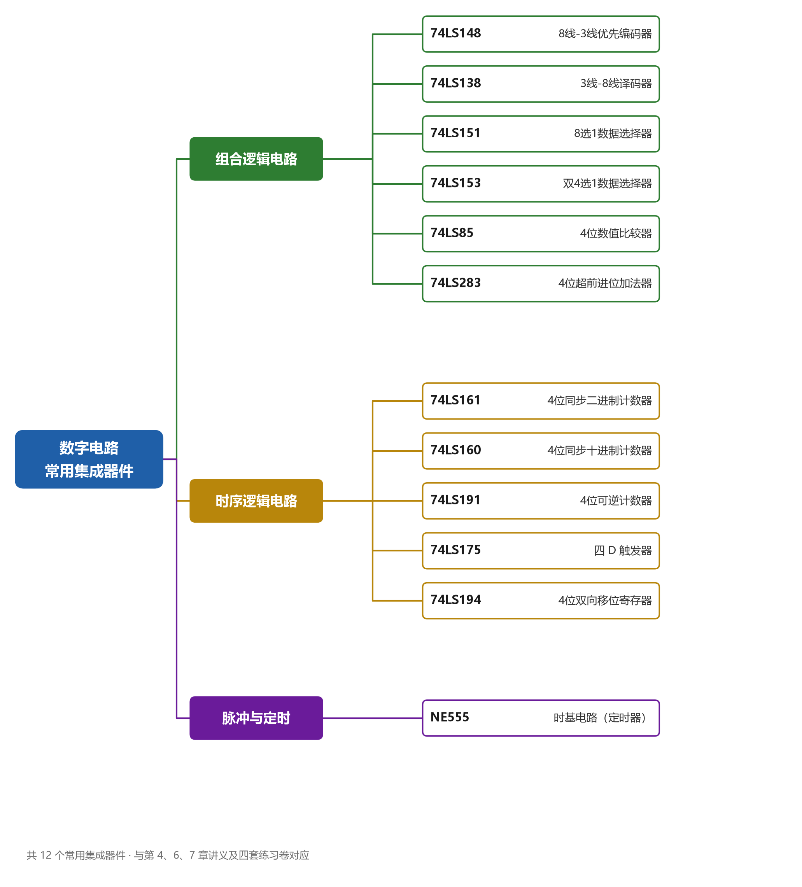
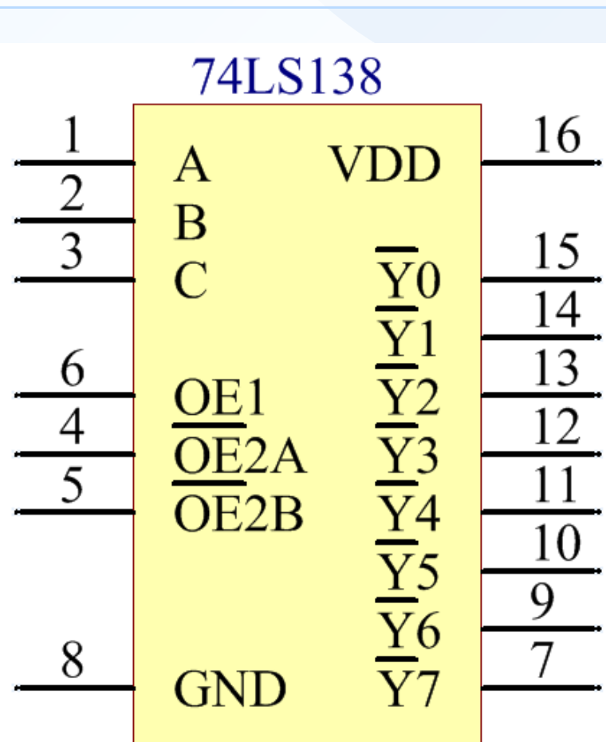
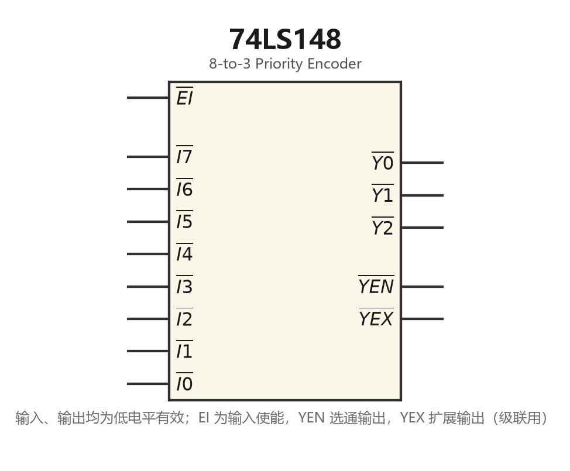
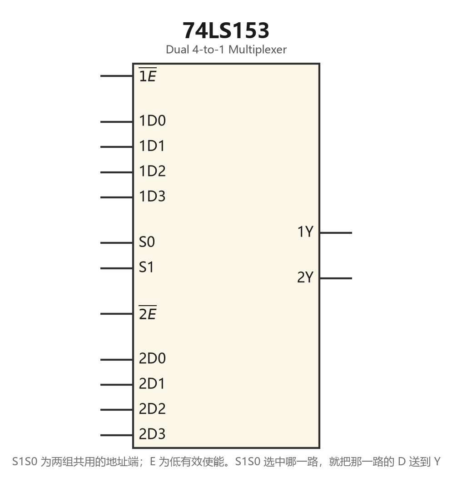
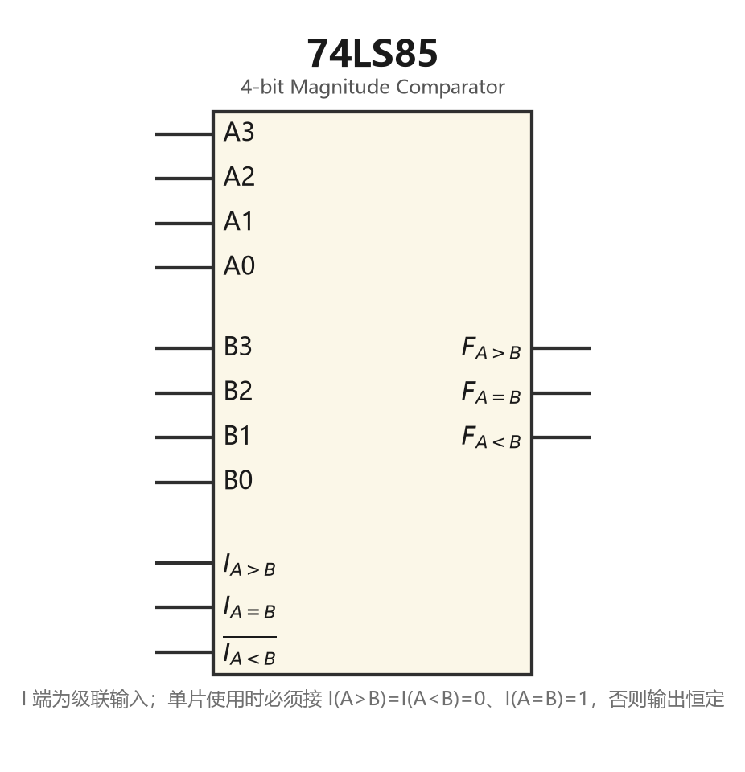
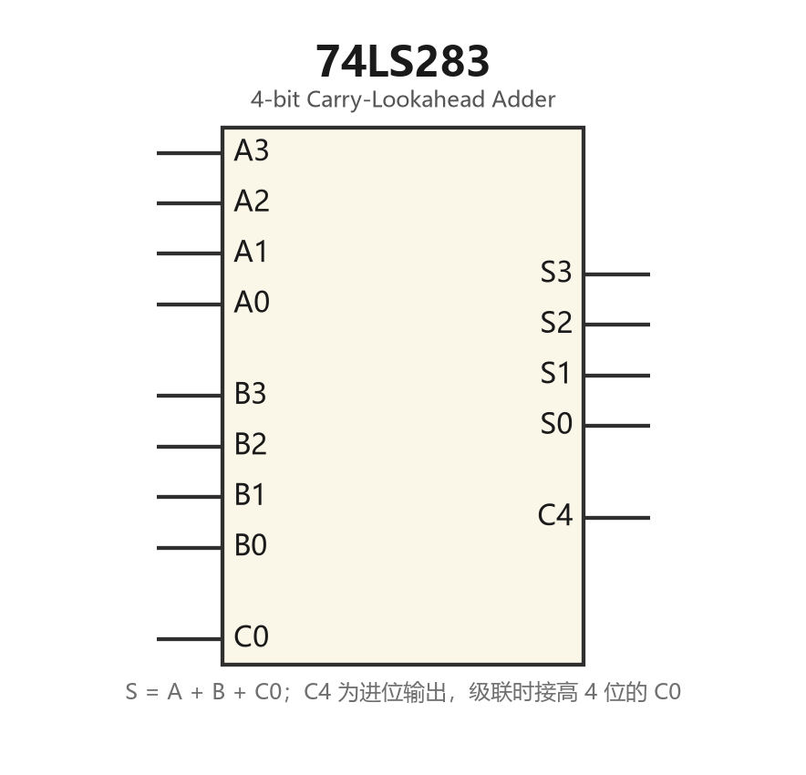
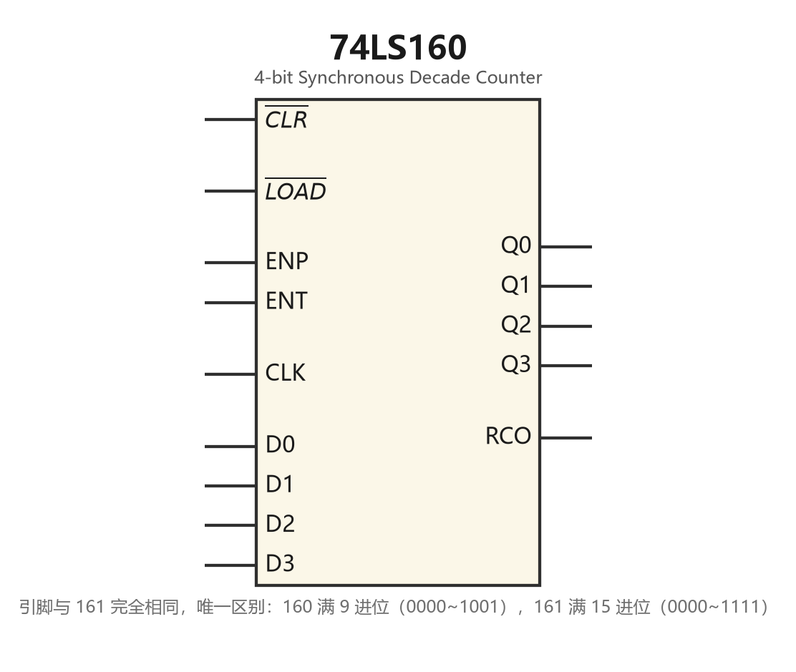
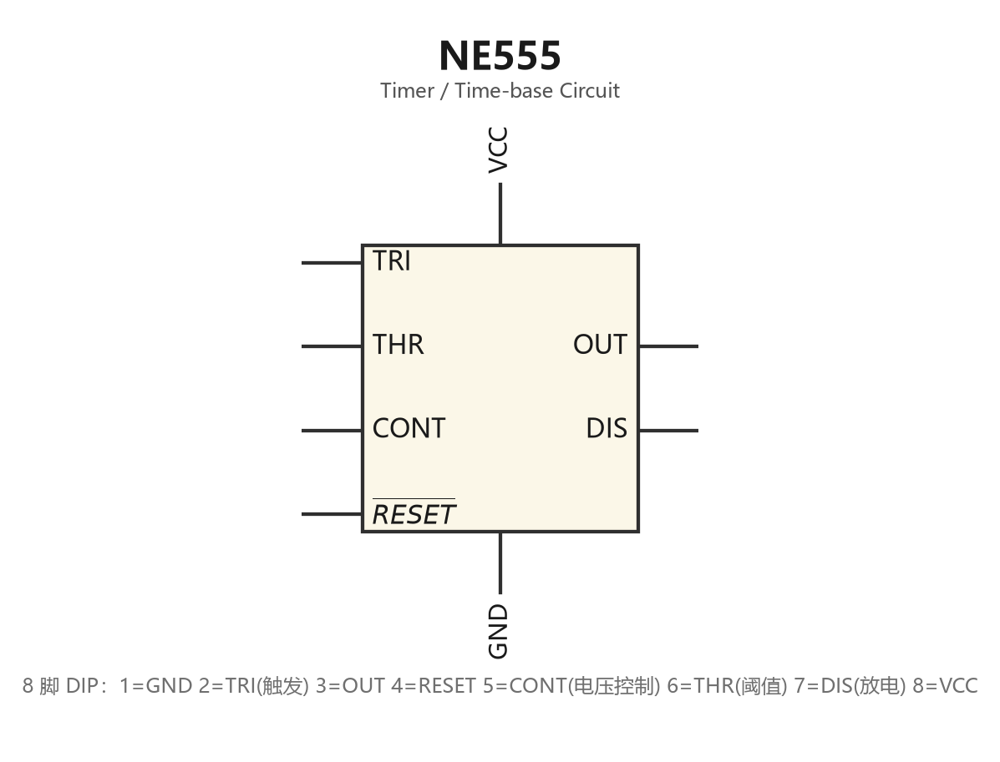

# 集成器件引脚与考法速查

> **定位**：把课上出现的**全部常用集成器件**汇成一册——认得出型号、画得出引脚、接得对电路、答得中考点。
> **配套**：`第4章_组合逻辑电路/`、`第5章_触发器/`、`第6章_时序逻辑电路/`、`第7章_…/` 四章讲义；`试卷/练习题集_逐题精析.md`、`试卷/真题精解/` 六套原卷。
> **题源标注约定**：【练】= 四套练习卷，【真 xx】= 真题精解第 xx 卷，【期末】= 期末习题集。
> **图示说明**：本册器件符号图统一按"**逻辑符号（框图）**"绘制——考场上要画的是这个，不是封装外形；需要实物脚号时查第九节脚号表或课件原图。

---

## 一、先认全：12 个器件与它们的家族

按功能分成三个家族。**同一个家族的器件，考题套路几乎一模一样**，所以先按家族记，再记各自差异。

| 家族 | 器件 | 一句话职能 | 章节 | 出镜率 |
|---|---|---|---|---|
| **组合逻辑** | 74LS148 | 8 个输入压成 3 位代码，**高号优先** | §4.3 编码器 | ★★ |
| | 74LS138 | 3 位地址译出 8 根线，**只有一根低** | §4.4 译码器 | ★★★ |
| | 74LS151 | 8 路里挑 1 路送到输出 | §4.5 数据选择器 | ★★★ |
| | 74LS153 | 双 4 选 1，两组共用地址 | §4.5 数据选择器 | ★★ |
| | 74LS85 | 两个 4 位数比大小 | §4.6 数值比较器 | ★ |
| | 74LS283 | 4 位数相加，带超前进位 | §4.7 加法器 | ★ |
| **时序逻辑** | 74LS161 | 二进制加法计数 0→15 | §6.5 计数器 | ★★★ |
| | 74LS160 | 十进制加法计数 0→9 | §6.5 计数器 | ★★ |
| | 74LS191 | 单时钟可加可减 | §6.5 计数器 | ★ |
| | 74LS175 | 四个 D 触发器打包 | §5.5 集成触发器 | ★ |
| | 74LS194 | 数据能左移、右移、并行装入 | §6.6 移位寄存器 | ★★ |
| **脉冲与定时** | NE555 | 定时、整形、振荡三合一 | §7.3～7.6 | ★★★ |

> **一眼分辨口诀**：**1 开头多半是组合（138/148/151/153），1 后面带 6 的是计数器（160/161/191），带 9 的是移位（194），5 开头是 555。** 型号不是乱编的，记住家族编号段就够应付选择题。

---

## 二、组合逻辑器件

### 2.1 74LS138　3 线-8 线译码器

**引脚画法要点**：左边三根地址线 **C B A**（C 是最高位，别写反），三根使能 **G1（高有效）、G2A、G2B（低有效）**；右边八根输出 **Ȳ0～Ȳ7 全部低有效**。图上每根输出名上那道横线就是"低有效"，**画图时必须画**，漏画扣分。

**课件原版封装图**（左右两列脚号看清楚，考试给实物图时按这个认）：

**功能表（精简版）**：

| G1 | G2A | G2B | 输出 |
|---|---|---|---|
| 0 | × | × | 全为 1（禁止） |
| × | 1 | × | 全为 1（禁止） |
| × | × | 1 | 全为 1（禁止） |
| **1** | **0** | **0** | 按 CBA 译码，**被选中那根为 0**，其余为 1 |

**真值关系**：$\overline{Y_i}=\overline{m_i}$，即 $\overline{Y_i}$ 恰好是第 $i$ 个最小项的**反**。这一条是全部用法的根。

**对应题库**

| 维度 | 内容 |
|---|---|
| **(a) 章节** | 第 4 章 §4.4 译码器 |
| **(b) 题型** | 设计题（实现逻辑函数）、读图题（给电路反写函数）、填空题（最小项个数） |
| **(c) 考法** | ①**用 138 + 与非门实现组合函数**（最高频）；②**读图写函数**；③使能端接法（单片/级联）；④"3-8 译码器把 3 个输入变成几个最小项输出"→ **8 个** |
| **(d) 知识点** | 最小项与 $\overline{Y_i}$ 的对应、与非门"取反再相与"、低有效输出的极性 |
| **(e) 使用过程** | 见下方四步 |

**怎么用（四步，背下来就够）**

1. 把要实现的函数化成**最小项之和**：$F=\sum m(i_1,i_2,\dots)$；
2. 找出这些最小项对应的输出脚 $\overline{Y_{i_1}},\overline{Y_{i_2}},\dots$——**注意取的是同号，不需要反**；
3. 把这些脚接到一个**与非门**的输入端；
4. 单只与非门不够（输入数不足）时，先两两与非再合并；使能端固定接 $G1=1$、$G2A=G2B=0$。

> **为什么是与非门而不是与门？** 因为 $\overline{Y_i}$ 是 $m_i$ 的反，先与非一次正好把极性翻回来：$\overline{\overline{m_{i_1}}\cdot\overline{m_{i_2}}}=m_{i_1}+m_{i_2}=F$。

**题目里怎么出**

- 【练 第一套 四大题】"用 74LS138 和与非门实现 $F$"——给了函数式，要画连线，**8 分里 4 分在连线、4 分在写最小项**。
- 【练 第二套（=第三套）四大题】"读图写 $Y$、$Z$"——给一张已接好的图，要求反推表达式并化简到最简与或式。
- 【真 01 四】【真 02 四】【真 03 七】【真 04 四】【真 05 七】【真 06 三】六套卷里有五套都考它，形式在"实现"和"读图"之间轮换。
- 【期末 填空】"3-8 译码器将 3 个输入变量变换成 ＿＿ 个最小项输出"→ **8**。

**易错**：① 地址线顺序写成 A B C（应为 **C 最高**）；② 输出漏画横线；③ 误用与门（极性反了，答案整体取反）；④ 只接一个与非门却要求实现 4 个最小项（门输入数不够，须两级）。

---

### 2.2 74LS148　8 线-3 线优先编码器

**引脚画法要点**：左边 8 根输入 **Ī7～Ī0 低有效**，且 **I7 优先级最高**（号码大者优先，这和"低位优先"的直觉相反，务必记牢）；右边 3 根输出 **Ȳ2 Ȳ1 Ȳ0 是反码输出**，另有两根扩展用：**ȲEN 选通输出、ȲEX 扩展输出**。使能 **ĒI 低有效**。

**关键功能关系**（教材写法）：

| 条件 | 结果 |
|---|---|
| $\overline{EI}=1$ | 芯片不工作，$\overline{Y_2}\overline{Y_1}\overline{Y_0}=111$，$\overline{Y_{EN}}=1$、$\overline{Y_{EX}}=1$ |
| $\overline{EI}=0$，有输入为 0 | 对**号码最高**的那个输入编码，$\overline{Y_{EN}}=1$、$\overline{Y_{EX}}=0$ |
| $\overline{EI}=0$，无输入为 0 | $\overline{Y_2}\overline{Y_1}\overline{Y_0}=111$，$\overline{Y_{EN}}=0$、$\overline{Y_{EX}}=1$ |

> **记忆钩子**：输出是**反码**——输入 I7 有效时输出是 $\overline{Y_2}\overline{Y_1}\overline{Y_0}=000$（二进制 7 的反码 000），输入 I0 有效时是 111（0 的反码）。**"7 通给 000、0 通给 111"**，一句话记住整张表。

**对应题库**

| 维度 | 内容 |
|---|---|
| **(a) 章节** | 第 4 章 §4.3 编码器 |
| **(b) 题型** | 填空题（编码位数）、简答题（优先的含义）、选择题（147/148 与数码管搭配） |
| **(c) 考法** | ①**"50 个编码对象至少需要几位代码"**（$2^5=32<50\le64=2^6$，答 **6 位**）；②优先级判断（多路同时有效时编哪个）；③反码输出的读法；④与七段译码器 74LS48 / 74LS147 的搭配识别 |
| **(d) 知识点** | 优先编码的定义、反码输出、$2^n\ge N$ 的位数估算 |
| **(e) 使用过程** | 见下 |

**怎么用**

1. 先看**有没有多路同时有效**：有就按"号码最大者"编码，其余忽略；
2. 读输出时**先取反再当二进制数**：$\overline{Y_2}\overline{Y_1}\overline{Y_0}=011$ → 反码 011 → 原码 100 = 4，即 I4 有效；
3. 级联扩位数时，高位片的 $\overline{Y_{EX}}$ 接低位片的 $\overline{EI}$，$\overline{Y_{EN}}$ 汇总做总选通。

**题目里怎么出**

- 【真 06 第 13 题】"若在编码器中有 50 个编码对象，则要求输出二进制代码位数为（　）位"——选择题，答案 6。
- 【真 03 第 3 题】"优先编码器 74LS147、七段字符译码驱动器 74LS48 和七段数码管构成的电路…"——考**器件搭配**，不是单独考 148。
- 判断题常考"优先编码器要求输入互斥"→ **错**，优先编码器的意义恰恰是允许同时有效。

**易错**：① 把"优先"理解成"低位优先"；② 忘记输出是反码，直接把 111 当成 7；③ 算位数时把 $2^n\ge N$ 写成 $2^n>N$。

---

### 2.3 74LS151　8 选 1 数据选择器

**引脚画法要点**：左边 8 根数据 **D0～D7**（**高有效，无横线**，这点和 138/148 相反，最容易画错）；3 根地址 **A2 A1 A0**；使能 **Ē 低有效**；右边两根输出 **Y 与 W**，其中 $W=\overline{Y}$。

**基本关系**：$Y=\sum_{i=0}^{7}D_i m_i$，即"地址选中谁，就把谁送到 Y"。**它本质上就是一台"用地址选最小项"的机器**，所以能用它实现任意三变量函数。

**对应题库**

| 维度 | 内容 |
|---|---|
| **(a) 章节** | 第 4 章 §4.5 数据选择器与数据分配器 |
| **(b) 题型** | 设计题（用 151 实现函数）、读图题（给图求 L）、选择题（153/151 的区分） |
| **(c) 考法** | ①**用 151 实现三变量函数**（地址接 A2A1A0，数据端接 0/1 或单个变量）；②**读图求表达式**；③151 与 153 的引脚/地址端对比 |
| **(d) 知识点** | $Y=\sum D_im_i$、数据端接变量的降维技巧、使能端低有效 |
| **(e) 使用过程** | 见下三步 |

**怎么用（三步）**

1. **地址端接变量**：把函数的 3 个变量接到 A2 A1 A0（顺序按题目给的变量顺序，别自己调）；
2. **数据端对着真值表填**：函数在该最小项为 1 → $D_i=1$；为 0 → $D_i=0$；
3. 使能端接 $\overline{E}=0$。

> 若函数是**四变量**，只接 3 个做地址，剩下那一个变量会出现在数据端：$D_i$ 写成 $x$ 或 $\overline{x}$。这是 151 的进阶考法，也是 138 做不到、151 做得到的差别。

**题目里怎么出**

- 【练 第四套 四大题】"用 74LS151 实现 $F=\sum m(1,3,4,5,7)$"——10 分，要画连线，**四个数据端接 1、三个接 0**。
- 【真 03 第 9 题】"如图所示是由 8 选 1 数据选择器 74LS151 实现的某组合逻辑函数，该函数…"——选择题，考读图反推。
- 【真 05】"（1）求 $L$ 的表达式并化简"——151 读图 + 化简，两步走。

**易错**：① 地址端顺序接反（A0 接到 A2 位置）；② 数据端该接变量却接成 1；③ 把 W 当 Y 用（W 是反相输出）。

---

### 2.4 74LS153　双 4 选 1 数据选择器

**引脚画法要点**：**两组各 4 个数据端（1D0～1D3、2D0～2D3）、各一个输出（1Y、2Y）、各一个低有效使能（1Ē、2Ē）**，而**地址端 S1 S0 是两组共用的**——"共用地址"是 153 的标志性特征，也是最常考的一句话。

**对应题库**

| 维度 | 内容 |
|---|---|
| **(a) 章节** | 第 4 章 §4.5 数据选择器 |
| **(b) 题型** | 选择题（识别器件）、设计题（低配版 151） |
| **(c) 考法** | ①"双 4 选 1"与"8 选 1"的区分；②两组共用地址时的同步选择；③用 153 实现两输出函数 |
| **(d) 知识点** | 共用地址、双输出、使能低有效 |
| **(e) 使用过程** | 与 151 同理，只是数据端只有 4 个、地址只有 2 位 |

**怎么用**：两个函数共享同一组地址 → 一次选中，**两个输出同时给出两位结果**。这正是"用一片 153 同时实现两个二变量函数"的原理。

**题目里怎么出**：多出现在选择题与读图题里（"图中 74LS153 的地址端接法说明什么"），单独出大题较少。

**易错**：① 以为两组地址各自独立；② 忘记每组都要单独使能（1Ē、2Ē 都要接 0）。

---

### 2.5 74LS85　4 位数值比较器

**引脚画法要点**：左侧 **A3～A0、B3～B0** 两组被比较数（**A3、B3 是最高位**）；另有 **3 根级联输入 I(A>B)、I(A=B)、I(A<B)**；右侧 3 根输出 **F(A>B)、F(A=B)、F(A<B)**。

**课件原图给出的脚号**：1=B3、2=I(A<B)、3=I(A=B)、4=I(A>B)、5=F(A>B)、6=F(A=B)、7=F(A<B)、8=GND、9=B0、10=A0、11=B1、12=A1、13=A2、14=B2、15=A3、16=VCC。**注意左右不是简单镜像：左侧第一个脚是 B3 而不是 A3。**

**对应题库**

| 维度 | 内容 |
|---|---|
| **(a) 章节** | 第 4 章 §4.6 数值比较器 |
| **(b) 题型** | 选择题、简答题（级联接法） |
| **(c) 考法** | ①**单片使用时级联输入怎么接**（必考）：$I(A>B)=I(A<B)=0$、$I(A=B)=1$；②多位比较的级联方向（低位输出接高位输入）；③输出唯一定理：三个输出**有且只有一个为 1** |
| **(d) 知识点** | 比较器的级联、高位优先裁决、级联输入的电平规定 |
| **(e) 使用过程** | 见下 |

**怎么用（级联）**

1. 低位片的 $F(A>B)、F(A=B)、F(A<B)$ 分别接到高位片的 $I(A>B)、I(A=B)、I(A<B)$；
2. 最低位的级联输入按上面那条固定接法；
3. 最高片的三个输出就是总结果。

> **为什么最低位要那样接？** 因为"没有更低位可比"时，必须认为低位**相等**，所以 $I(A=B)=1$，比较才从本位开始裁决。

**易错**：① 单片使用时级联输入悬空（结果不定，考试算错）；② 把级联方向接反（高位接低位）。

---

### 2.6 74LS283　4 位超前进位加法器

**引脚画法要点**：左侧 8 根加数 **A3～A0、B3～B0**，加低位进位 **C0**；右侧 4 位和 **S3～S0** 与进位输出 **C4**。

**基本关系**：$\{C_4,S_3S_2S_1S_0\}=A+B+C_0$，**注意 C4 是第 5 位**，别只写 4 位和。

**对应题库**

| 维度 | 内容 |
|---|---|
| **(a) 章节** | 第 4 章 §4.7 加法器 |
| **(b) 题型** | 计算题（补码运算）、设计题（用 283 做减法/码制转换） |
| **(c) 考法** | ①**补码加法求 $A-B$**：$A-B=A+\overline{B}+1$，把 $\overline{B}$ 接 B 端、$C_0$ 接 1；②级联成 8 位；③"超前进位"与串行进位的速度差别 |
| **(d) 知识点** | 补码减法、进位链、超前进位（CLA）为什么快 |
| **(e) 使用过程** | 见下 |

**怎么用（做减法）**：$B$ 的每根线**先经反相器**再接 283 的 B 端，同时把 $C_0$ 接 **1**（加 1 完成取补），输出就是 $A-B$ 的补码形式。

**易错**：① 做减法时忘了 $C_0=1$；② 只取 4 位和而漏掉 C4（溢出判断要用它）。

---

## 三、时序逻辑器件

### 3.1 74LS161　4 位同步二进制计数器

**引脚画法要点**：左侧 **C̄LR 异步清零（低有效）、L̄OAD 同步置数（低有效）、ENP、ENT（都高才计数）、CLK（上升沿）**，再有 4 根并行数据 **D0～D3**；右侧 **Q0～Q3** 与进位输出 **RCO**。

> **"异步清零、同步置数"八个字是本章最贵的一句话**：C̄LR 一拉低**立刻**清零（不等时钟）；L̄OAD 拉低后要**等下一个上升沿**才装入。判断题、改错题、设计题全从这里出。

**对应题库**

| 维度 | 内容 |
|---|---|
| **(a) 章节** | 第 6 章 §6.5 计数器 |
| **(b) 题型** | 设计题（构成任意进制计数器）、读图题、填空/选择题 |
| **(c) 考法** | ①**用 161 构成 $N$ 进制计数器**（清零法 / 置数法）；②**置数值怎么算**：置数法 $D=16-N$；③清零法与置数法的毛刺差别；④级联成 256 进制 |
| **(d) 知识点** | 同步/异步的区别、反馈清零、反馈置数、进位输出 RCO 的作用 |
| **(e) 使用过程** | 见下两种方法 |

**方法一：异步清零法**（用 $\overline{CR}$）

1. 让计数器从 0 开始数；
2. 用**与非门**把"第 $N$ 个状态"的 Q 端译出来，接到 $\overline{CR}$；
3. 数到第 $N$ 个状态时立刻清零，实际稳定状态是 $0\sim N-1$，共 $N$ 个。
   ⚠️ 缺点：第 $N$ 个状态只闪现一下（**毛刺状态**），严格说状态表里多了一行。

**方法二：同步置数法**（用 $\overline{LOAD}$，**工程首选**）

1. 算置数值：$D=16-N$（因为从 $D$ 数到 15 恰好 $N$ 个状态）；
2. 把 $D$ 接到 $D_3D_2D_1D_0$；
3. 反馈信号取 **RCO**（进位输出），反相后接 $\overline{LOAD}$；
4. 数满 $N$ 个状态时 RCO 有效 → 下一拍同步装入 $D$，循环往复，**无毛刺**。

> **为什么是 $16-N$ 而不是 $16-N+1$？** 从 $D$ 开始数：$D, D+1, \dots, 15$ 一共 $16-D$ 个状态，令 $16-D=N$，得 $D=16-N$。这是本题型最常错的数。

**题目里怎么出**

- 【练 第四套 六大题】"74LS161 进位输出置数法构成 $N$ 进制"——10 分，答案 $D=16-N$，并要画出 RCO 反相接 L̄OAD 的连线。
- 【真 01 七】【真 04 六】"74LS161 构成的计数器"——读图判断进制数。
- 【真 05 五】电路设计题，用 161 设计指定进制。

**易错**：① 置数值算成 $16-N+1$；② RCO 不反相就接 L̄OAD（极性反，永远不置数）；③ 把 $\overline{CR}$ 当成同步、$\overline{LOAD}$ 当成异步（正好说反）；④ ENT/ENP 只接一个为 1（不计数）。

---

### 3.2 74LS160　4 位同步十进制计数器

**引脚与 161 完全相同**，唯一区别在计数范围：**160 数到 9 就回 0（0000～1001，10 个状态）**，161 数到 15（16 个状态）。

- 构成 $N$ 进制时：160 用**置数法**算 $D=10-N$；161 算 $D=16-N$。
- 判断"几进制"时：先看型号定模，再看反馈取的是哪个状态。

**对应题库**

| 维度 | 内容 |
|---|---|
| **(a) 章节** | 第 6 章 §6.5 计数器 |
| **(b) 题型** | 选择题（几进制）、读图题 |
| **(c) 考法** | ①**160 级联的进制数计算**（两片 160 级联 = 100 进制）；②与 161 的对比选择；③置数法算 $10-N$ |
| **(d) 知识点** | 十进制计数器的模、级联乘法关系 |
| **(e) 使用过程** | 与 161 同，只把"16"换成"10" |

**题目里怎么出**

- 【真 05 第 9 题】"用 74LS160 及少量与非门组成的电路是（　）进制计数器，两片之间的连接方式…"——两问，考级联方式（**并行进位 / 串行进位**）。
- 【真 06 七】"图 1：74LS160 构成的计数器"——读图判进制。

**易错**：把 160 当 161 算 $16-N$（差 6，直接错）。

---

### 3.3 74LS191　单时钟 4 位可逆计数器

**引脚画法要点**：**只有一个 CLK（单时钟）**，加减由 **U/D̄** 电平决定：**U/D=1 加法、U/D=0 减法**；另有 **C̄TEN 计数使能（低有效）**、**L̄OAD 异步置数**、**R̄CO 进位/借位输出（低有效）**。

> 与"双时钟"的可逆计数器（如 74193，有 CPU、CPD 两个时钟）区分：**191 是单时钟、靠电平换向**，这是选择题的经典陷阱。

**对应题库**

| 维度 | 内容 |
|---|---|
| **(a) 章节** | 第 6 章 §6.5 计数器 |
| **(b) 题型** | 选择题、读图题 |
| **(c) 考法** | ①U/D̄ 电平与加减方向；②单时钟 vs 双时钟；③R̄CO 在加法/减法下的含义（进位/借位） |
| **(d) 知识点** | 可逆计数、单时钟换向、借位输出 |
| **(e) 使用过程** | 定方向（U/D̄）→ 给使能（C̄TEN=0）→ 打时钟 |

**易错**：把 U/D̄ 的高低与加减记反（**1 加 0 减**：可以记"一加零减"）。

---

### 3.4 74LS175　四 D 触发器

**引脚画法要点**：**四个独立的 D 触发器装在一个壳里**，共用一根 **CLK（上升沿触发）** 和一根 **C̄LR（异步清零，低有效）**；每个触发器各有 $D$、$Q$、$\overline{Q}$。

**对应题库**

| 维度 | 内容 |
|---|---|
| **(a) 章节** | 第 5 章 §5.5 集成触发器；第 6 章 §6.6 数码寄存器 |
| **(b) 题型** | 选择题、读图题 |
| **(c) 考法** | ①"四 D 共用时钟"的含义（**同时存入 4 位**）；②作为**数码寄存器**使用；③与 74LS374（三态输出）的区别 |
| **(d) 知识点** | 并行输入并行输出寄存器、公共时钟、异步清零 |
| **(e) 使用过程** | 数据送到 D0～D3 → 打一个上升沿 → 4 位同时锁存到 Q0～Q3 |

**易错**：把 175 当移位寄存器（它不能移位，只能并行进并行出）。

---

### 3.5 74LS194　4 位双向移位寄存器

**引脚画法要点**：**S1 S0 是模式控制**（这是全器件的关键）；**SR 右移串入、SL 左移串入**；**A B C D 并行数据输入**；**QA QB QC QD 输出**；**C̄LR 异步清零、CLK 上升沿**。

**四种模式表（必背）**：

| S1 | S0 | 功能 |
|---|---|---|
| 0 | 0 | **保持** |
| 0 | 1 | **右移**（QA→QB→QC→QD，SR 进 QA） |
| 1 | 0 | **左移**（QD→QC→QB→QA，SL 进 QD） |
| 1 | 1 | **并行置数**（A B C D 同时进） |

> **记忆钩子**：**01 右移、10 左移**——"0 在前就是往低位走"；11 是"全开"所以并行装入。

**对应题库**

| 维度 | 内容 |
|---|---|
| **(a) 章节** | 第 6 章 §6.6 数码寄存器与移位寄存器 |
| **(b) 题型** | 设计题（环形/扭环形计数器）、读图题、选择题（模式判断） |
| **(c) 考法** | ①**给 S1S0 判断功能**（最高频）；②**构成环形/扭环形计数器**并判断模值（$n$ 位环形 = $n$ 进制，扭环形 = $2n$ 进制）；③移位方向与初值推演 |
| **(d) 知识点** | 移位寄存器模式、环形/扭环形、自启动 |
| **(e) 使用过程** | 见下 |

**怎么用（做扭环形计数器）**：取 $\overline{Q_D}$ 接 SR（右移模式 S1S0=01），循环一次经过 $2n$ 个状态；取 $Q_D$ 接 SR 则是环形，只有 $n$ 个状态。

**题目里怎么出**

- 【真 05 七】综合应用题——194 构成指定序列。
- 【期末】"Verilog 8 位霓虹灯控制器"——底层就是 194 的移位思路。
- 【真 06 六】"$J_0=K_0=\overline{A\cdot \overline{Q_1}}$、$J_1=Q_0$、$K_1=1$、$Z=AQ_0Q_1$"这类题虽用 JK，但状态推演方法与 194 完全一致。

**易错**：① S1S0 与左右移记反；② 环形当扭环形（模值差一倍）；③ 忘记 C̄LR 要接高（否则一直清零）。

---

## 四、脉冲与定时：NE555

**引脚画法要点（8 脚，最常考）**：**2 脚 TRI 触发（低有效）、6 脚 THR 阈值（高有效）、5 脚 CONT 电压控制、4 脚 RESET 复位（低有效）、3 脚 OUT 输出、7 脚 DIS 放电、8 脚 VCC、1 脚 GND**。

> **三个 5 kΩ 电阻分压**给出两个阈值：$V_{T+}=\frac{2}{3}V_{CC}$、$V_{T-}=\frac{1}{3}V_{CC}$。555 的一切功能都从这两个阈值长出来。

**三种典型接法与公式（必背）**：

| 电路 | 关键接法 | 输出参数 |
|---|---|---|
| **多谐振荡器**（自激） | 2、6 脚并接电容，7 脚接在两电阻之间 | $T=0.7(R_1+2R_2)C$，$q=\dfrac{R_1+R_2}{R_1+2R_2}>50\%$ |
| **单稳态**（一次触发一个宽脉冲） | 2 脚接触发输入，6、7 脚并接 RC | $t_w=1.1RC$ |
| **施密特触发器**（整形） | 2、6 脚并接输入 | $V_{T+}=\frac{2}{3}V_{CC}$、$V_{T-}=\frac{1}{3}V_{CC}$、$\Delta V_T=\frac{1}{3}V_{CC}$ |

**对应题库**

| 维度 | 内容 |
|---|---|
| **(a) 章节** | 第 7 章 §7.3 集成 555 定时器、§7.4 多谐、§7.5 施密特、§7.6 单稳态 |
| **(b) 题型** | 填空（两个阈值）、简答（组成/工作过程）、选择（回差电压、暂稳态时间）、计算（$f$、占空比、$t_w$） |
| **(c) 考法** | ①**两个阈值与回差电压**；②**给 R、C 算频率/占空比/脉宽**；③**光敏电阻 + 555 的工作过程**（简答常客）；④判断电路属于三种接法中的哪一种 |
| **(d) 知识点** | 比较器+RS 触发器结构、阈值、回差、RC 充放电三要素 |
| **(e) 使用过程** | 见下 |

**怎么用（读一道 555 题的顺序）**

1. **先认接法**：2、6 是否并接？7 脚接在哪？→ 判断是多谐 / 单稳 / 施密特；
2. **再定阈值**：全部阈值只有 $\frac{1}{3}V_{CC}$ 和 $\frac{2}{3}V_{CC}$ 两个；
3. **后算时间**：查上表套公式（多谐用 $0.7$、单稳用 $1.1$）；
4. **最后说过程**：充电到 $\frac{2}{3}$ 翻转、放电到 $\frac{1}{3}$ 再翻转——**两句话讲完就是满分简答**。

**题目里怎么出**

- 【练 第一套 简答 6】"叙述施密特触发器的电压传输特性及工作特点"——回差是关键词。
- 【练 第二套（=第三套）简答 11】"555 + 光敏电阻电路的工作过程"——光弱→6 脚高→复位→继电器动作。
- 【真 01 八】开机延时电路，给 $C=25\,\mu F$、$R=91\,k\Omega$ 算延时——单稳 $t_w=1.1RC$。
- 【真 02 七】【真 03 五】555 应用题。
- 【真 04 第 9 题】"由 555 定时器构成的（　）"——判断接法。
- 【真 05 第 8 题】"555 组成的施密特触发电路中，回差电压等于（　）"→ $\frac{1}{3}V_{CC}$。
- 【真 06 第 18 题】"单稳态触发器的暂稳态持续时间的长短取决于（　）"→ **R 和 C**（与触发脉宽无关）。

**易错**：① 把回差记成 $\frac{2}{3}V_{CC}$（那是阈值本身，回差是**两者之差** $\frac{1}{3}V_{CC}$）；② 多谐占空比算成 50%（普通接法**一定大于 50%**）；③ 单稳的 $t_w$ 误认为与触发信号宽度有关；④ 5 脚悬空（应经 0.01 μF 电容接地抗干扰）。

---

## 五、按题型反查：看到题目先想到哪个器件

| 题面特征 | 首选器件 | 套路 |
|---|---|---|
| "用译码器和与非门实现下列函数" | 74LS138 | 化最小项 → 接 $\overline{Y_i}$ → 与非 |
| "用数据选择器实现下列函数" | 74LS151 / 153 | 地址接变量 → 数据端填 0/1 |
| "读图写出 $Y$ 的表达式" | 138 / 151 | 先写"被选中的最小项"，再或起来 |
| "分析该计数器为几进制" | 160 / 161 / 191 | 定模 → 找反馈状态 → 数状态数 |
| "用 161 构成 $N$ 进制" | 161 | 置数法 $D=16-N$，RCO 反相接 L̄OAD |
| "画出状态图/写状态方程" | 175 / 194 / JK | 先列现态-次态表 |
| "求振荡频率/占空比/脉宽" | 555 | 认接法 → 套 $0.7$ 或 $1.1$ |
| "说明电路工作过程" | 555 / 148 | 按"输入变化→阈值→翻转→输出"四步叙述 |

---

## 六、五个家族级易错点（比单个器件更值钱）

1. **极性两派**：138/148 的输出**带横线（低有效）**，151 的数据端**不带横线（高有效）**。画图时横线漏画或乱画，是最常见的扣分点。
2. **同步/异步**：161/160 的 $\overline{CR}$ 是**异步**清零、$\overline{LOAD}$ 是**同步**置数。说反了整题作废。
3. **置数值**：$N$ 进制用置数法，$D=\text{模}-N$。160 用 10、161 用 16，别混。
4. **优先级方向**：148 是**号码大者优先**；74LS147 是十进制优先编码，两者别混。
5. **555 的三个数**：$\frac{1}{3}$、$\frac{2}{3}$、以及回差 $\frac{1}{3}$——只有这三个数，不会出现别的。

---

## 七、脚号速查（DIP 封装）

> 只收录能从课件原图或标准手册确认的；表里没有的，考试若给图就按图认，不要凭记忆写。

| 器件 | 脚号 → 功能 |
|---|---|
| **74LS138** | 1=A 2=B 3=C 4=G2A 5=G2B 6=G1 7=Y7 8=GND / 9=Y6 10=Y5 11=Y4 12=Y3 13=Y2 14=Y1 15=Y0 16=VCC |
| **74LS85** | 1=B3 2=I(A<B) 3=I(A=B) 4=I(A>B) 5=F(A>B) 6=F(A=B) 7=F(A<B) 8=GND / 9=B0 10=A0 11=B1 12=A1 13=A2 14=B2 15=A3 16=VCC |
| **74LS194** | 1=C̄LR 2=SR 3=A 4=B 5=C 6=D 7=SL 8=GND / 9=S0 10=S1 11=CP 12=QD 13=QC 14=QB 15=QA 16=VCC |
| **74LS160/161** | 1=C̄LR 2=CLK 3=D0 4=D1 5=D2 6=D3 7=ENP 8=GND / 9=ENT 10=L̄OAD 11=Q3 12=Q2 13=Q1 14=Q0 15=RCO 16=VCC |
| **NE555** | 1=GND 2=TRI 3=OUT 4=RESET 5=CONT 6=THR 7=DIS 8=VCC |

---

## 八、复习顺序建议

1. **先吃透 138**：它把"最小项、低有效、与非门"三件事绑在一起，学通了 151 就只是换个壳。
2. **再攻 161**：置数法/清零法两种套路，把 $16-N$ 算到条件反射。
3. **然后 555**：三个公式背熟，简答题就能直接写。
4. **最后扫 148/85/283/194**：这几个多为选择、填空、读图，性价比高但不需要深挖。

---

*本册与以下文件配套使用：*
- `第4章_组合逻辑电路/4.3_编码器.md`、`4.4_译码器.md`、`4.5_数据选择器与数据分配器.md`、`4.6_数值比较器.md`、`4.7_加法器.md`
- `第6章_时序逻辑电路/6.5_计数器.md`、`6.6_数码寄存器与移位寄存器.md`
- `第7章_集成运算放大器和脉冲波形的产生与变换/7.3～7.6`
- `试卷/练习题集_逐题精析.md`（67 题）、`试卷/真题精解/00_全部真题索引与考点对照.md`
